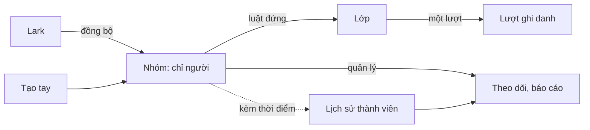

# [HLD] Nhóm học viên (Group)

| | |
|---|---|
| Owner | Bùi Đức Huy (PO) |
| Design lead | theo vai, lead tự điền tên khi ký |
| Tech lead | theo vai, lead tự điền tên khi ký |
| QA lead | theo vai, lead tự điền tên khi ký |
| Họp | Không họp. Lead ghi mục của mình trên repo qua merge request, PO merge; không đặt hạn |

Tài liệu này tối đa ba trang. Mục 1 đọc trong một phút. Mục 8, 9, 10 do lead các team tự viết, trực tiếp trong file này trên repo; mỗi người chỉ sửa mục của mình và dòng của mình ở mục 12. PRD chi tiết đã có bản v0.3 trên Lark; sau khi mục 12 đủ chữ ký, PRD được sửa theo định hướng của lead. Bản trên Lark của brief là bản cuối sau khi ký.

Mục 1 đến 7 và 11 là bản tổng hợp từ tài liệu đã duyệt: muốn đổi nội dung thì sửa ở nguồn qua change request rồi tổng hợp lại, không sửa thẳng ở đây. Mục 8, 9, 10 là của lead; dòng in nghiêng đầu mỗi mục là gợi ý của PO, lead viết bên dưới.

## 1. Tóm tắt
- Vấn đề: không gom được học viên thành tập ổn định để giao bài, theo dõi, cộng dồn; mọi thứ đi qua Lớp.
- Cho ai: L&D giao bài, quản lý theo dõi người của mình, vận hành báo cáo theo phòng ban.
- Đo được: 60% lượt ghi danh mới từ nhóm sau hai tháng; 0 lần gán bổ sung tay; báo cáo quý chạy lại đúng số đã chốt.
- Phạm vi: nhóm nhiều cấp từ Lark và tự tạo; luật đứng dẫn người vào Lớp; quản lý, mentor; lịch sử thành viên; báo cáo theo mốc; rời nhóm. Phần lớn ở Ops.
- Thay đổi lớn nhất: đường giao bài thứ hai chạy nền, và lớp lịch sử thành viên mà mọi báo cáo theo nhóm đọc qua.
- Rủi ro lớn nhất: ma trận quyền chưa ai đọc được; lần đồng bộ đầu chạm 384 người.
- Phụ thuộc lớn nhất: đồng bộ Lark mở rộng được từ người sang cơ cấu.
- Không được phá: nhóm chỉ chứa người; một lượt ghi danh một khoá; thành viên lưu kèm thời điểm; luật đứng theo luật Lớp.
- Cần quyết: bốn câu ở mục 7, đều thuộc Dev.
- Chi tiết: PRD v0.3, 20 user story, 130 business rule, duyệt 12/10/2026.

## 2. Vấn đề và mục tiêu
Giao một khoá cho phòng 55 người là chọn tay hoặc nhập tệp; người mới vào sau bị sót. Quản lý không xem được tiến độ người mình phụ trách vì hệ thống không biết ai quản lý ai. Vận hành không cộng dồn được theo phòng ban. Gamification đã hoãn bộ lọc theo nhóm vì thiếu chức năng này. Cơ cấu đã có trên Lark: 384 nhân sự, 53 phòng ban, 4 cấp.

| Mục tiêu | Đo bằng |
|---|---|
| O1 Giao nội dung cho tập người ổn định | Lượt ghi danh từ nhóm: 60% sau hai tháng |
| O2 Người mới tự nhận nội dung | Lần gán bổ sung tay ở nhóm bật tự ghi danh: 0 |
| O3 Quản lý xem người mình phụ trách | Quản lý mở màn theo dõi mỗi tháng: 50% |
| O4 Cộng dồn theo cơ cấu | Lượt xem báo cáo; ngưỡng đặt sau tháng đầu |
| O5 Dựng lại thành viên tại mốc quá khứ | Chênh lệch chạy lại với bản chốt: 0 |

## 3. Phạm vi
| In | Out | Để sau |
|---|---|---|
| Nhóm tối đa 6 cấp, cấu hình được; nguồn Lark chỉ đọc hoặc tự tạo; một người nhiều nhóm; cha bao trùm con khi đọc | Đồng bộ ngược về Lark: Lark là hệ gốc | Nhóm làm người nhận thông báo Ops |
| Thành viên thêm gỡ tay, theo tệp; lịch sử vào ra kèm thời điểm, giữ vĩnh viễn | Nhóm cho nhân sự vận hành | Phạm vi dữ liệu nhiều mức theo vai |
| Luật đứng giao nội dung; công tắc chảy xuống nhánh con, tự ghi danh người vào sau, mặc định tắt | Nhóm chứa nội dung: chỉ chứa người | |
| Quản lý gán, suy ra theo cây, quản lý chính; mentor theo nhóm vào lớp; theo dõi nhánh ở Ops; học viên xem quản lý ở UpLMS | Sửa cơ chế ghi danh của Lớp | |
| Báo cáo cộng dồn tại mốc; nhật ký; lưu trữ, chỉ xoá nhóm chưa có lịch sử | Xoá nhóm có lịch sử, dọn lịch sử, chia dữ liệu theo nhánh, nhóm động, chuyển lớp | |
| Nghỉ việc đánh dấu lượt kết thúc; rời nhóm chưa học tự gỡ, đang học email quản lý; hai mail mới | | |

## 4. Giải pháp tổng thể

Nhóm là địa chỉ để gán; tiến độ sống ở Lớp; báo cáo theo nhóm đọc qua lịch sử thành viên.

- Nhóm chỉ chứa người; quan hệ người với nội dung chỉ ở Lớp.
- Luật đứng chạy lúc giao, lúc có người vào, lúc bật công tắc; lớp kết thúc thì dừng im lặng.
- Một lượt ghi danh một khoá, có thể nhiều nguồn nhóm; rời một nhóm không mất lượt khi nhóm khác còn giao.
- Đồng bộ thì thuộc nhóm sâu nhất; cha bao trùm ở mức đọc.
- Rời nhóm: nghỉ việc đánh dấu kết thúc; chưa học tự gỡ; đang học email quản lý quyết.
- Phạm vi tách theo màn: theo dõi nhánh đọc theo quan hệ quản lý, giao bài theo vai trò.
- Mỗi vai một tài khoản; tài khoản kiểm thử loại khỏi mọi logic.

## 5. User story theo nhóm bàn giao
| Proto-Unit | US | Tên | Ý chính | Thứ tự |
|---|---|---|---|---|
| U1 Khung | US1 | Tạo, sửa nhóm | Mã duy nhất, tối đa 6 cấp | 1 |
| U1 Khung | US2 | Di chuyển nhánh | Giữ thành viên, nội dung đã giao | 1 |
| U1 Khung | US3 | Thêm gỡ tay | Gỡ xét tình trạng học | 1 |
| U1 Khung | US4 | Thêm gỡ theo tệp | Dòng lỗi không chặn | 1 |
| U1 Khung | US6 | Danh sách nhóm | Cây tải dần, đếm cả nhánh | 1 |
| U3 Giao | US7 | Giao nội dung | Chọn lớp, không hồi tố | 2 |
| U3 Giao | US8 | Tự ghi danh | Công tắc theo cặp nhóm lớp | 2 |
| U7 Nền | US14 | Lưu trữ nhóm | Luật đứng ngừng, lượt giữ | 3 |
| U7 Nền | US15 | Nhật ký thành viên | Chỉ đọc, giữ toàn bộ | 3 |
| U7 Nền | US18 | Báo cáo cộng dồn | Theo thành viên tại mốc | 3 |
| U2 Đồng bộ | US5 | Nhóm từ Lark | Theo lô, chỉ đọc, nhóm sâu nhất | 4 |
| U4 Quan hệ | US9 | Gán quản lý | Nhiều quản lý, email báo | 5 |
| U4 Quan hệ | US10 | Suy ra theo cây | Kế thừa, tính lúc đọc | 5 |
| U4 Quan hệ | US11 | Quản lý chính | Một người một chính | 5 |
| U4 Quan hệ | US12 | Gán mentor | Mentor nhóm thành mentor lớp | 5 |
| U4 Quan hệ | US13 | Nhóm trống quản lý | Cảnh báo, chuyển phụ trách | 5 |
| U5 Hiển thị | US16 | Theo dõi nhánh | Ở Ops, theo quan hệ quản lý | 6 |
| U5 Hiển thị | US17 | Xem quản lý | Tên, ảnh, email | 6 |
| U6 Vòng đời | US19 | Rời khi chưa học | Tự gỡ, trừ nhóm khác còn giao | 7 |
| U6 Vòng đời | US20 | Báo quản lý | Một email gộp, cảnh báo mất tiến độ | 7 |

Thứ tự: U1, U3 cho giá trị thấy ngay; U7 trước U2, U4 vì lịch sử phải có trước khi tích luỹ. Dev chốt thứ tự thật. Chi tiết từng US ở PRD `inception/prd/prd.md`; lead đọc trước khi ghi mục 8, 9, 10.

## 6. Ảnh hưởng tới hệ thống hiện có và rủi ro
| Vùng | Thay đổi | Mức |
|---|---|---|
| Lớp, ghi danh | Đường giao bài thứ hai; không lượt trùng; Foundation kéo theo | High |
| Dữ liệu người dùng | users chưa có quan hệ cơ cấu, khoá ngoại của 15 bảng; class_user_instances của 6 bảng | High |
| Phân quyền | Phạm vi theo nhánh là chiều mới; ma trận quyền chưa đọc được | High |
| Báo cáo | Report LMS, Sis Dashboard lấy lớp làm khoá; đọc qua lịch sử thành viên; bộ lọc động | High |
| Mail, đồng bộ Lark | Mail chào mừng theo từng người; hai mail mới; đồng bộ từ người sang cơ cấu, lần đầu 53 nhóm 384 người | High |
| Rule, nhóm cũ, vùng chưa tra | 8 rule bị chạm; Group Management bỏ, bảng cũ chờ Dev xem; lịch dạy, phòng học chưa tra | Medium |

Cutover hai lần: đồng bộ cây trước, chưa giao; rồi mở giao, nếu không bắn mail hàng loạt. Lịch sử chỉ từ ngày bật. Lượt đã sinh không thu hồi tự động.

| # | Loại | Nội dung | Ai chấp nhận, ngày | Điều kiện kèm theo |
|---|---|---|---|---|
| 1 | Giả định | Đồng bộ Lark mở rộng được sang cơ cấu | PO, 05/10/2026 | Dev xác nhận ở mục 9 |
| 2 | Giả định | Cây Lark đủ tin cậy | PO, 05/10/2026 | Có nhật ký đồng bộ |
| 3 | Rủi ro | Báo cáo lùi tối đa tới ngày bật | PO, 06/10/2026 | Nói rõ với người dùng |
| 4 | Rủi ro | Hai nhánh thì hai quản lý cùng thấy hết | PO, 05/10/2026 | Không muốn thì không xếp hai nhánh |
| 5 | Rủi ro | Gỡ khỏi lớp mất tiến độ, chưa có chuyển lớp | PO, 06/10/2026 | Email có câu cảnh báo |
| 6 | Finding mở | US13 gộp cảnh báo và chuyển | PO, 12/10/2026 | Giữ chung |
| 7 | Giả định | Chưa có số liệu vận hành thật | PO, 06/10/2026 | Ngưỡng O4 đặt sau tháng đầu |

## 7. Quyết định cần chốt
| # | Câu hỏi | Lựa chọn | Ai quyết | Hạn |
|---|---|---|---|---|
| 1 | Bảng groups cũ có dữ liệu thật không | Bỏ, giữ, hay chuyển đổi | Dev | Trước U1 |
| 2 | Export ma trận quyền để nối phạm vi quản lý với vai trò ở màn theo dõi nhánh | Ghi cách nối ở mục 9 | Dev | Trước U5 |
| 3 | Cột roles.is_group là gì | Dùng lại, tách bạch, hay không liên quan | Dev | Trước U4 |
| 4 | Hộp xác nhận gỡ khỏi lớp đã cảnh báo mất tiến độ chưa | Chưa thì thêm một câu | Dev | Trước U6 |

PO đã chốt 12/10/2026: loại quan hệ cố định, gồm quản lý và mentor; tài khoản kiểm thử và trả lời bình luận tạo trong Ops, không qua Lark.

## 8. Design Direction
*Điểm cần lưu ý cho Design, gợi từ tài liệu đã duyệt:*
*1. Toàn bộ màn mới ở UpLMS Ops: cây nhóm hành xử như Drive, tải dần theo nhánh, số thành viên đếm cả nhánh con, tìm thấy nhóm con thì hiện đường dẫn từ gốc; nhóm lưu trữ ẩn mặc định ở mọi ô chọn nhóm.*
*2. Nhóm đồng bộ chỉ đọc: nút Sửa, Di chuyển, Thêm gỡ thành viên ẩn, thay bằng một dòng giải thích; nút Xoá chỉ hiện với nhóm chưa có lịch sử.*
*3. Hai công tắc khi giao nội dung, chảy xuống nhánh con và tự ghi danh người vào sau, mặc định tắt, mỗi cái một tooltip; cảnh báo vượt sức chứa là một dòng ở màn danh sách học viên trong lớp, không chặn.*
*4. Chữ Nhóm dễ nhầm với support group đang có ở Ops; nhãn màn và ô chọn phải tách bạch.*
*5. UpLMS chỉ thêm một khối Quản lý của tôi trên hồ sơ: ảnh, tên, email, không số điện thoại, quản lý chính lên đầu. Màn theo dõi nhánh ở Ops sắp theo số khoá quá hạn, cố ý không hiện phần trăm tiến độ.*

Design lead viết theo khung dưới. Ý không áp dụng ghi "không áp dụng", không bỏ trống.
- Luồng màn chính:
- Pattern tái dùng:
- Ràng buộc hiển thị:
- Cần nghiên cứu hoặc thử với người dùng:
- Cần PO quyết:

## 9. Technical Direction
*Điểm cần lưu ý cho Tech, gợi từ PRD và phân tích ảnh hưởng; mỗi dòng là một cụm, chi tiết đầy đủ ở mục 6 và PRD mục TDD, Dữ liệu phải lưu, Vấn đề tồn đọng:*
*1. Bốn ràng buộc không được phá: nhóm chỉ chứa người; một người một lượt ghi danh cho một khoá, lượt có thể nhiều nguồn nhóm; mọi thay đổi thành viên lưu kèm thời điểm và không xoá kể cả khi nghỉ việc hay lưu trữ; luật đứng theo luật của Lớp. Năm thứ phải lưu: thời điểm vào ra nhóm, lý do rời, nguồn nhóm, nguồn lượt ghi danh, trạng thái lượt ghi danh.*
*2. Thực thể dùng chung: users là khoá ngoại của 15 bảng, class_user_instances của 6 bảng dữ liệu học, groups cũ chưa rõ dữ liệu, support-groups trùng chữ và không có tenant_id. Quan hệ quản lý kế thừa tính lúc đọc, không lưu cứng.*
*3. Luật đứng chạy nền ở ba thời điểm, dừng im lặng và ghi nhật ký khi lớp kết thúc, kéo theo Foundation như thêm tay, mail chào mừng bắn bình thường; đồng bộ theo lô; cutover hai lần để lần đồng bộ đầu không kích hoạt luật đứng; rollback không thu hồi lượt đã sinh.*
*4. Phạm vi tách theo màn: màn theo dõi nhánh đọc theo quan hệ quản lý, màn giao bài theo vai trò hệ thống, không cộng không giao; ma trận quyền Casbin chưa đọc được. Tài khoản tách theo vai, tài khoản kiểm thử nhận diện bằng cờ is_operator và loại khỏi mọi logic.*
*5. Tenant: số cấp tối đa cấu hình theo tổ chức, mặc định 6; bảng mới phải có tenant_id; loại quan hệ cố định; đồng bộ Lark nên là một bộ chuyển đổi đổ vào hình dạng dữ liệu cơ cấu chuẩn để tenant khác thay HRIS. Hai thứ chưa tra được: lịch dạy và phòng học.*

Đây là định hướng kỹ thuật, đầu vào cho phần chi tiết của PRD. Tech lead viết theo khung dưới; ý không áp dụng ghi "không áp dụng", không bỏ trống.
- Hướng tiếp cận:
- Thành phần hiện có bị chạm:
- Dữ liệu phải giữ lại:
- Điểm tích hợp và phụ thuộc kỹ thuật:
- Ràng buộc và NFR mục tiêu:
- Độ lớn và thứ tự từng Proto-Unit:
- Dev tự quyết ở detailed design:
- Cần PO quyết:

## 10. Test Strategy
*Điểm cần lưu ý cho QA, gợi từ business rule và các góc đã quét:*
*1. Góc đã thành rule, phải có ca kiểm: lớp đã kết thúc thì luật đứng dừng im lặng; vượt sức chứa vẫn thêm, chỉ cảnh báo; tài khoản kiểm thử không xuất hiện ở đâu; người nghỉ việc đánh dấu kết thúc, báo cáo quá khứ vẫn tính; người thuộc hai nhóm cùng giao một lớp rời một nhóm thì giữ lượt; giao nội dung không hồi tố.*
*2. Góc còn là giả định, cần PO hoặc Dev chốt trước khi viết ca: đồng bộ lỗi nửa chừng; quyền quản lý bị thu hồi khi đang xem báo cáo; cây Lark đổi lớn giữa hai lần đồng bộ.*
*3. Vùng hồi quy: thêm gỡ học viên khỏi lớp, lớp Foundation, mail số 11, 12, 23 đến 26, mọi dashboard, phân quyền, đồng bộ Lark, Comment Replier.*
*4. Dữ liệu test cần dựng sẵn: cây giả bốn cấp có người thuộc hai nhánh, lớp có Foundation, lớp đã kết thúc, lớp gần đầy sức chứa, tài khoản kiểm thử, một nhánh chưa gán quản lý để kiểm kế thừa.*
*5. Báo cáo theo mốc quá khứ: chốt một con số, rồi thêm người mới và cho người khác nghỉ việc, chạy lại cùng mốc phải ra đúng con số cũ.*

QA lead viết theo khung dưới. Ý không áp dụng ghi "không áp dụng", không bỏ trống.
- Phạm vi test:
- Vùng hồi quy:
- Dữ liệu và môi trường test:
- Tiêu chí vào và ra:
- Góc cần PO chốt:

## 11. Release và phụ thuộc
| Việc | Phụ thuộc | Mốc |
|---|---|---|
| U1 rồi U3 | Không | Chưa có target release, Jira |
| U7 | U1; trước khi dữ liệu tích luỹ | Trước lần bật đồng bộ đầu |
| U2 | U1; quyết định 1 | Lần bật một, chưa giao |
| U4, U5 | U1; quyết định 2, 3 | Sau lần bật một |
| U6 | U2, U3; quyết định 4 | Lần bật hai |
| Gamification, Report Phase 1 | Chức năng này | Theo lịch hai dự án đó |
| Figma | Chưa có | Design ghi ở mục 8 |

## 12. Sign-off
Trạng thái: **Đồng ý** là duyệt · **Có ý kiến** là duyệt kèm ghi chú đã viết ở mục của mình · **Yêu cầu sửa** là chưa duyệt, ghi rõ sửa gì ở cột Ghi chú · **Chưa xem**.

| Vai trò | Tên | Trạng thái | Ngày | Ghi chú |
|---|---|---|---|---|
| Product | Bùi Đức Huy | Đồng ý | 12/10/2026 | |
| Design | | Chưa xem | | |
| Dev | | Chưa xem | | |
| QA | | Chưa xem | | |
