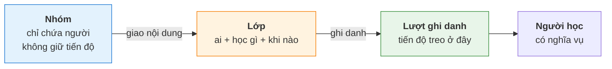
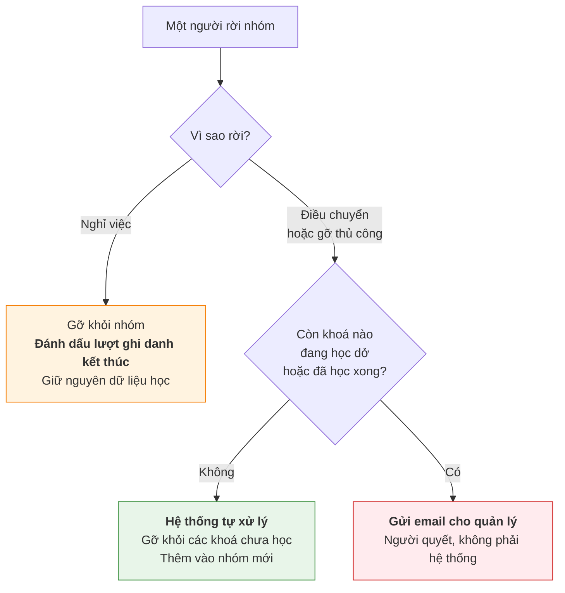
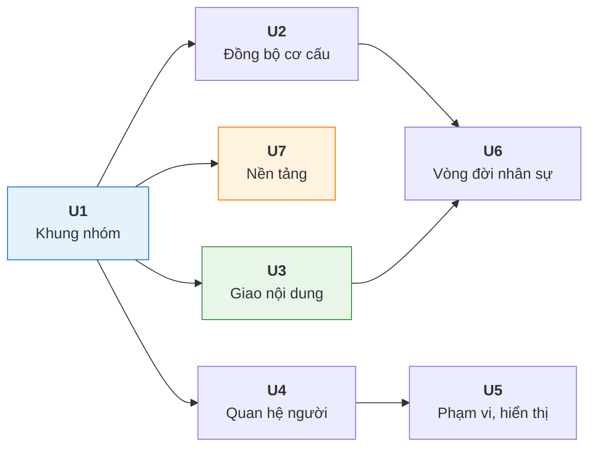
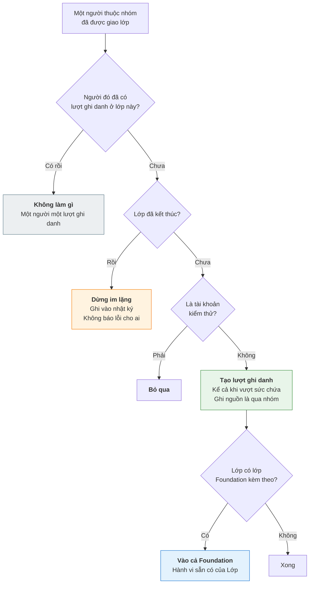

# [PRD] Nhóm học viên

| | |
| --- | --- |
| **Target release** | |
| **Epic** | |
| **Story** | |
| **Related** | `[BRD] Group — Nhóm học viên` · Dự án Gamification *(`US16` bộ lọc bảng xếp hạng theo nhóm đang chờ chức năng này)* |
| **Document status** | `PUBLISH` |
| **Document owner** | Bùi Đức Huy |
| **Người duyệt** | Bùi Đức Huy — v0.1 ngày 06/10/2026 · v0.2 ngày 09/10/2026 |
| **Designer** | |
| **Tech lead** | |
| **QA** | |
| **Reviewer** | |

---

# Document version

| Version | Người cập nhật | Nội dung | Impact | Ngày cập nhật |
| --- | --- | --- | --- | --- |
| v0.1 | Bùi Đức Huy | Bản đầu — 20 user story, 122 business rule, 7 nhóm bàn giao | — | 06/10/2026 |
| v0.2 | Bùi Đức Huy | Sau khi đối chiếu với TalentLMS: `US16` ghi rõ màn theo dõi nhánh ở UpLMS Ops · thêm mail event `MAIL-GRP-02` báo người được gán quản lý hoặc nhận chuyển phụ trách · thêm câu cảnh báo mất tiến độ vào `MAIL-GRP-01`. Sau review: chỉ định quản lý chính (`US11`) cũng gửi `MAIL-GRP-02`, email gộp khi chuyển phụ trách chỉ liệt nhóm mới, phần mentor không báo. 128 business rule | `US9` · `US11` · `US13` · `US16` · `US20` | 09/10/2026 |

---

# Problem

Hệ thống không có cách gom học viên thành một tập hợp ổn định để giao nội dung và theo dõi. Mọi thứ hiện phải làm qua **Lớp**, mà Lớp gắn với đúng một khoá học và có thời hạn, nên nó không thay thế được.

Ba nhóm người gặp vấn đề, theo ba cách khác nhau.

**L&D khi giao bài học.** Muốn giao một khoá cho toàn bộ phòng Fulfillment HCM thì phải chọn tay 55 người, hoặc nhập một file danh sách. Làm xong, tuần sau có người mới vào phòng thì không ai nhớ phải gán bổ sung, trừ khi có người rà lại bằng tay.

**Quản lý trực tiếp khi theo dõi.** Không có cách nào xem tiến độ học của riêng những người mình phụ trách. Hệ thống không biết ai quản lý ai, nên cũng không lọc được.

**Vận hành khi làm báo cáo.** Không cộng dồn được số liệu theo phòng ban hay theo khối, vì không có cấu trúc nào để cộng theo.

Hệ quả đã thấy ở tính năng khác: dự án Gamification phải hoãn bộ lọc bảng xếp hạng theo nhóm, và ghi nhận rằng quản lý trực tiếp chưa có công cụ riêng. Cả hai đều chờ đúng chức năng này.

---

# Analytics

## Cơ cấu tổ chức hiện có

Xuất từ Lark ngày 05/10/2026:

| | Số |
|---|---|
| Nhân sự trong cây tổ chức | **384** |
| Phòng ban riêng biệt | **53** |
| Khối ở cấp 1 | 5 — `ECOM` · `VẬN HÀNH` · `Tech` · `CHUYỂN ĐỔI SỐ` · `BOD` |
| Độ sâu cây | **4 cấp** |

Phân bố nhân sự theo độ sâu phòng ban:

| Cấp | Phòng ban | Người |
|---|---|---|
| 1 | 2 | 6 |
| 2 | 22 | 203 |
| 3 | 27 | 166 |
| 4 | 2 | 9 |

Phòng ban đông nhất có **55 người** *(`ECOM / Fulfillment HCM`)*. Hơn một nửa nhân sự nằm ở cấp 2. Chỉ 9 người trong 384 nằm ở cấp sâu nhất.

**Cơ cấu này đã tồn tại đầy đủ trên Lark, nhưng UpLnD không có nó.** Hệ thống hiện đồng bộ được danh sách người, không đồng bộ cơ cấu.

## Cách vận hành đang xoay xở

❓`BA` — **chưa khảo sát trực tiếp.** Phần dưới suy luận từ những gì hệ thống hiện có. Cần người viết xác nhận hoặc bổ sung số liệu thật.

| Hướng | Hiện trạng suy ra |
|---|---|
| Cách làm hiện tại | Tạo Lớp rồi thêm học viên, chọn tay hoặc nhập file danh sách |
| Tiêu chí quyết định | Dựa vào danh sách phòng ban giữ ngoài hệ thống — file Excel hoặc tra trên Lark |
| Chi phí | Mỗi lần giao một khoá cho một phòng ban là một lần lập danh sách |
| Chỗ sai | Người mới vào phòng sau khi đã giao bài thì bị bỏ sót. Người chuyển phòng vẫn còn trong lớp cũ |

> Con số đáng bổ sung nếu có: một tháng vận hành giao bài bao nhiêu lần, mỗi lần mất bao lâu, đã từng sót người chưa và hậu quả thế nào.

---

# Objective

| # | Kết quả muốn đạt |
|---|---|
| `O1` | Giao nội dung cho một tập người ổn định, không phải lập danh sách lại mỗi lần |
| `O2` | Người mới vào tập đó **tự nhận** nội dung đã giao, không cần ai nhớ gán bổ sung |
| `O3` | Quản lý xem được tiến độ học của riêng những người mình phụ trách |
| `O4` | Số liệu cộng dồn được theo cơ cấu tổ chức, từ một phòng ban lên tới cả khối |
| `O5` | Biết được tại một thời điểm trong quá khứ ai thuộc nhóm nào, để báo cáo cũ vẫn đọc được |

---

# Out of scope

Ở cấp tính năng. Trả lời câu hỏi *"chức năng này có bao gồm X không"* mà không phải đọc hết 20 user story.

| Không làm | Vì sao |
|---|---|
| **Đồng bộ ngược từ UpLnD về hệ thống nhân sự** | Lark là hệ gốc, UpLnD chỉ đọc |
| **Nhóm cho nhân sự vận hành** | Dự án này nhắm học viên. Chức năng cây phòng ban cho nhân sự vận hành từng tồn tại nhưng hiện không chạy |
| **Nhóm chứa nội dung** | Vỡ nguyên tắc mô hình hoá: quan hệ người với nội dung chỉ sống trong Lớp và Automation. Nhóm chỉ chứa người |
| **Sửa cơ chế ghi danh của Lớp** | Giao nội dung qua nhóm vẫn đi qua Lớp và vẫn sinh một lượt ghi danh |
| **Xoá nhóm đã có lịch sử** | Phá mục tiêu `O5`. Chỉ cho lưu trữ |
| **Dọn lịch sử thành viên theo thời gian** | Giữ toàn bộ, không giới hạn |
| **Chia dữ liệu học theo nhánh cho từng quản lý** | Tiến độ treo vào lượt ghi danh của Lớp, không chia theo nhánh được |
| **Nhóm động theo điều kiện** | Đúng hai cách vào nhóm: đồng bộ từ hệ thống nhân sự theo cây tổ chức, và tự tạo thủ công. Không có cách thứ ba |
| **Chức năng chuyển lớp** | Hệ thống chưa có. Muốn chuyển thì xoá khỏi lớp cũ, thêm vào lớp mới, học lại từ đầu |
| **Cơ chế phạm vi dữ liệu nhiều mức** | Đơn giản hoá ở đợt này: quản lý chỉ xem được nhóm mình quản lý. Không phụ thuộc vào một module chưa làm |

---

# Stakeholder

| Stakeholder | Action |
|---|---|
| **Nhân sự vận hành** | Dựng nhóm, quản lý thành viên, giao nội dung cho nhóm, gán người quản lý |
| **L&D** | Giao bài học theo nhóm thay vì theo danh sách người |
| **Quản lý trực tiếp** | Xem tiến độ học của người trong nhánh mình phụ trách, trên UpLMS Ops. Nhận email khi được gán làm quản lý và khi có người rời nhóm còn nghĩa vụ học |
| **Học viên** | Nhận nội dung qua nhóm. Xem ai là quản lý của mình |
| **Mentor** | Đi theo nhóm vào lớp, phụ trách đúng nhóm đó |
| Hệ thống nhân sự *(Lark)* | Nguồn cơ cấu tổ chức. Hệ gốc, UpLnD chỉ đọc |

---

# Preferences

| | |
|---|---|
| **Figma** | |
| **Tài khoản staging** | |
| **BRD** | `[BRD] Group — Nhóm học viên` v0.2 |
| **Dữ liệu cơ cấu tham chiếu** | File xuất từ Lark ngày 05/10/2026 — 384 nhân sự, 53 phòng ban, 4 cấp |

---

# Metrics success

Đề xuất. Mỗi mục tiêu có ít nhất một cách đo, tất cả đều lấy được từ dữ liệu hệ thống sẽ có — không cần khảo sát riêng.

| Factor | Goal | Signal | Metrics |
| --- | --- | --- | --- |
| **Adoption** | Vận hành chuyển sang giao bài qua nhóm thay vì lập danh sách tay — `O1` | Tỉ lệ lượt ghi danh sinh ra từ đường nhóm | **≥ 60%** lượt ghi danh mới đến từ nhóm, sau 2 tháng kể từ ngày bật |
| **Task Success** | Người mới vào nhóm tự nhận nội dung, không ai phải nhớ gán bổ sung — `O2` | Số người nhận nội dung tự động sau khi gia nhập | **0** trường hợp phải gán bổ sung thủ công cho người mới, với nhóm đã bật công tắc tự ghi danh |
| **Engagement** | Quản lý thật sự dùng công cụ theo dõi — `O3` | Số quản lý mở màn theo dõi nhánh mình | **≥ 50%** người được gán quản lý mở màn đó ít nhất một lần mỗi tháng |
| **Task Success** | Báo cáo theo cơ cấu dùng được thay cho việc ghép tay — `O4` | Số lượt xem báo cáo cộng dồn theo nhóm | Có số liệu nền sau tháng đầu; đặt ngưỡng ở lần rà tiếp theo |
| **Task Success** | Báo cáo quá khứ ra đúng con số đã chốt — `O5` | Chênh lệch giữa báo cáo chạy lại và bản chốt cùng kỳ | **0** chênh lệch |

**Hai chỉ số đáng theo dõi vì chúng bắt lỗi, không đo thành công:**

| Đo gì | Vì sao |
|---|---|
| Số lần luật đứng **dừng im lặng** vì lớp đã kết thúc hoặc không nhận thêm | Luật đứng chạy nền. Dừng nhiều mà không ai biết nghĩa là người học đang bị sót |
| Số email `MAIL-GRP-01` gửi đi mà **không ai xử lý** sau 7 ngày | `US20` đẩy quyết định sang người. Không ai quyết thì tính năng chỉ chuyển vấn đề chứ không giải |

> Chỉ số `O4` chưa đặt được ngưỡng vì chưa biết vận hành xem báo cáo bao nhiêu lần một tháng — đây cũng là số liệu `Analytics` còn thiếu.

---

# Solution

Nhóm là một **tập hợp người**. Nó không chứa nội dung, không có thời hạn, và không sinh nghĩa vụ học.

Cây tổ chức đồng bộ từ hệ thống nhân sự là **một nguồn** tạo nhóm, không phải bản chất của chức năng. Nhóm còn có thể do người dùng tự tạo, và có thể cắt ngang cơ cấu.

## Nhóm nối với việc học qua Lớp

Giao nội dung cho nhóm là một **luật đứng**: ai thuộc nhóm này thì vào lớp này. Người gia nhập sau khi đã giao vẫn tự nhận, nếu công tắc tự ghi danh đang bật. Sao chép thành viên một lần thì không khác gì nhập file, và `O2` không đạt.

## TDD — ràng buộc nghiệp vụ cho thiết kế kỹ thuật

Bốn thứ phải đúng, bất kể làm theo cách nào:

| # | Ràng buộc |
|---|---|
| `C1` | Nhóm **chỉ chứa người**. Không chứa khoá học, không chứa lộ trình |
| `C2` | Người vừa ở Lớp vừa ở Nhóm, cùng được giao một khoá, vẫn chỉ sinh **một lượt ghi danh** |
| `C3` | Mọi thay đổi thành viên phải **lưu kèm thời điểm**, đủ để dựng lại trạng thái tại một mốc quá khứ. Đây là **nền của báo cáo**, không phải một màn tra cứu |
| `C4` | Luật đứng **theo luật của Lớp**. Lớp không cho thêm người thì nhóm cũng không thêm được — không có ngoại lệ riêng cho đường đi qua nhóm |

## Dữ liệu phải lưu

| Thông tin | Vì sao phải lưu | Ràng buộc |
|---|---|---|
| **Thời điểm một người vào và ra khỏi mỗi nhóm** | Báo cáo theo mốc quá khứ đọc từ đây. `O4` và `O5` phụ thuộc hoàn toàn | Không xoá, kể cả khi người đó nghỉ việc hoặc nhóm bị lưu trữ |
| **Lý do rời nhóm** | Ba trường hợp rời nhóm có ba luật khác nhau — xem mục dưới | Phân biệt được: nghỉ việc · điều chuyển · gỡ thủ công |
| **Nguồn của mỗi nhóm** | Quyết định ai sửa được gì. Nhóm đồng bộ không cho sửa tay | Hai giá trị: đồng bộ từ hệ thống nhân sự · tự tạo |
| **Nguồn của mỗi lượt ghi danh** | Phân biệt người vào lớp qua nhóm với người được thêm tay. Cần cho `C2` | — |
| **Trạng thái lượt ghi danh** | Người nghỉ việc đánh dấu kết thúc chứ không xoá | Báo cáo hiện tại loại ra, báo cáo quá khứ vẫn tính |

> 🚫 **PRD này không khai bảng, không khai endpoint.** Thiết kế dữ liệu và giao diện lập trình là việc của Dev. PO ghi *cái gì phải đúng*, Dev quyết *làm thế nào*.

## Ba trường hợp rời nhóm, ba luật khác nhau

Áp một luật cho cả ba sẽ hoặc mất dữ liệu học, hoặc chặn việc hợp lệ.

**Vì sao nghỉ việc không xoá lượt ghi danh.** Báo cáo trong hệ này được tính ra từ dữ liệu, không lưu sẵn ở đâu. Xoá lượt ghi danh là xoá chính thứ mà báo cáo đọc.

> Quý 3 chốt: *"Fulfillment HCM — 48/55 hoàn thành khoá An toàn lao động"*.
> Tháng 10, bảy người nghỉ việc. Mở lại báo cáo quý 3.

Nếu xoá thì hệ thống tính lại từ dữ liệu còn lại và ra **41/48**, không phải 48/55. Đánh dấu thì con số cũ giữ nguyên. Cách này cũng nhất quán với cách hệ thống đối xử với tài khoản: nhân sự nghỉ việc thì tài khoản tự chuyển trạng thái khoá, không bị xoá.

## Người thuộc nhóm nào khi đồng bộ

Chỉ thuộc **nhóm sâu nhất** trên nhánh của họ.

> Người ở `ECOM / Trung tâm vận hành 1 / Growth 1 / Sub-Growth 1` là thành viên của **`Sub-Growth 1`**, không phải của cả bốn nhóm trên đường đi.

Nhóm cha vẫn bao trùm toàn bộ nhánh con **ở mức đọc** — báo cáo cộng dồn và phạm vi quản lý tính theo cả nhánh. Chỉ quan hệ thành viên là không nhân bản theo độ sâu.

Người thuộc nhiều nhánh *(cơ cấu ma trận)* thì có nhiều nhóm sâu nhất, mỗi nhánh một cái.

## Số cấp tối đa

**6 cấp**, cấu hình được theo tổ chức, đếm từ nhóm gốc là cấp 1. Cây thật hiện sâu 4 cấp, dư 2 để mở rộng mà không phải đổi cấu hình.

Giới hạn này là **van an toàn chống nhập sai**, không phải để bảo vệ hiệu năng.

## Mentor đi theo nhóm vào lớp

Mentor gắn vào **nhóm**. Khi thêm nhóm vào lớp, mentor của nhóm được gán luôn làm mentor trong lớp và **phụ trách đúng nhóm đó**.

Mentor đầu tiên được thêm vào lớp là người chịu trách nhiệm chính, đổi lại được sau.

## Phạm vi dữ liệu tách theo màn

Một người có thể vừa mang vai trò hệ thống, vừa là quản lý một nhóm. Hai thứ cho hai phạm vi khác nhau.

> Chị Lan là trưởng phòng Fulfillment HCM *(quản lý 55 người)*, đồng thời có vai trò giao bài cho toàn công ty.

Mỗi màn **khai rõ nó đọc theo phạm vi nào** — màn quản lý nhóm đọc theo quan hệ quản lý, màn giao bài đọc theo vai trò hệ thống. Không cộng hai phạm vi lại, cũng không lấy phần giao.

## Tài khoản tách theo vai trò

Một người trong tổ chức có thể đồng thời là học viên thật, tài khoản kiểm thử, và nhân sự trả lời bình luận. **Mỗi vai một tài khoản riêng.**

Hệ quả: tài khoản kiểm thử bị loại khỏi **mọi** báo cáo và **mọi** logic của chức năng nhóm.

---

# Unit — nhóm bàn giao

| Unit | Gồm US | Phụ thuộc | Release độc lập được? |
| --- | --- | --- | --- |
| **U1 — Khung nhóm** | `US1` · `US2` · `US3` · `US4` · `US6` | — | ✅ Dựng và quản lý nhóm thủ công, chưa cần nguồn ngoài |
| **U2 — Đồng bộ cơ cấu** | `US5` | U1 | ✅ Thêm một nguồn tạo nhóm |
| **U3 — Giao nội dung** | `US7` · `US8` | U1 | ✅ Đây là Unit mang lại `O1` và `O2` |
| **U4 — Quan hệ người** | `US9` · `US10` · `US11` · `US12` · `US13` | U1 | ✅ Quản lý và mentor |
| **U5 — Phạm vi và hiển thị** | `US16` · `US17` | U4 | ✅ Mang lại `O3` |
| **U6 — Vòng đời nhân sự** | `US19` · `US20` | U2 · U3 | ❌ Cần cả đồng bộ lẫn luật đứng mới có tình huống để xử lý |
| **U7 — Nền tảng** | `US14` · `US15` · `US18` | U1 | ❌ Chạm mọi Unit khác. `US18` mang lại `O4`, `US15` mang lại `O5` |

**Thứ tự đề xuất:** U1 → U3 → U7 → U2 → U4 → U5 → U6

Lý do xếp U3 ngay sau U1: đó là Unit duy nhất mang lại giá trị thấy được ngay — giao bài cho cả phòng bằng một thao tác. U7 đứng thứ ba vì ràng buộc `C3` *(thành viên lưu kèm thời điểm)* phải có **trước** khi dữ liệu bắt đầu tích luỹ, nếu không thì lịch sử của giai đoạn đầu mất vĩnh viễn.

Phụ thuộc đi một chiều, không có vòng.

> Chỉ đề xuất. Thứ tự thật do Dev chốt theo năng lực đội và ràng buộc kỹ thuật.

---

# Specific Requirement

> **Quy ước đánh số:**
> - User Story: `US1` … `US20` — liên tục trong tài liệu
> - Business rule: `BR-<số US>.<số thứ tự>` → `BR-1.1`, `BR-1.2`, `BR-2.1`… duy nhất trong tài liệu

## Danh sách user story

### Phía vận hành

| ID | User story | Unit | Nguồn |
|---|---|---|---|
| `US1` | Tạo và sửa nhóm nhiều cấp, để dựng được cơ cấu tổ chức đang dùng | U1 | Yêu cầu 1, 4 |
| `US2` | Di chuyển một nhánh sang nhóm cha khác, để cơ cấu đổi thì hệ thống theo kịp | U1 | Yêu cầu 4 |
| `US3` | Thêm và gỡ thành viên thủ công, để xử lý trường hợp lẻ | U1 | Yêu cầu 5 |
| `US4` | Thêm và gỡ thành viên theo lô bằng tệp, để không phải thao tác từng người với nhóm hàng chục người | U1 | Yêu cầu 6 |
| `US5` | Nhóm đồng bộ từ hệ thống nhân sự được đánh dấu riêng và không cho sửa, để biết nhóm nào là bản sao của nguồn ngoài | U2 | Yêu cầu 3 |
| `US6` | Xem danh sách nhóm dạng cây hoặc bảng kèm bộ lọc, để tìm được nhóm trong số hàng chục nhóm | U1 | Yêu cầu 10 |
| `US7` | Giao nội dung cho một nhóm, tuỳ chọn chảy xuống nhánh con, để giao bài cho cả phòng bằng một thao tác | U3 | Yêu cầu 8 · giải quyết `O1` |
| `US8` | Bật tắt việc người mới vào nhóm tự nhận nội dung đã giao, để kiểm soát ai phải học gì | U3 | Yêu cầu 9 · giải quyết `O2` |
| `US9` | Gán một hoặc nhiều người quản lý cho nhóm, để hệ thống biết ai phụ trách ai | U4 | Yêu cầu 13 |
| `US10` | Hệ thống tự suy ra quản lý theo cây khi nhóm con chưa gán, để không phải gán lại cho từng nhánh | U4 | Yêu cầu 14 |
| `US11` | Chỉ định quản lý đích danh trên hồ sơ một người, để xử lý trường hợp báo cáo chéo nhánh | U4 | Yêu cầu 15 |
| `US12` | Gán mentor cho nhóm, để mentor đi theo nhóm vào lớp và phụ trách đúng nhóm đó | U4 | Yêu cầu 19 |
| `US13` | Được cảnh báo khi một nhóm trống quản lý, và chuyển được toàn bộ quan hệ sang người khác | U4 | Yêu cầu 18 |
| `US14` | Lưu trữ một nhóm để nó ngừng nhận nội dung mới mà vẫn giữ lịch sử | U7 | Yêu cầu 12 |
| `US15` | Tra được nhật ký thay đổi thành viên khi có vấn đề cần làm rõ, không giới hạn thời gian | U7 | Yêu cầu 11 · giải quyết `O5` |

### Phía quản lý và học viên

| ID | User story | Unit | Nguồn |
|---|---|---|---|
| `US16` | Là quản lý, xem toàn bộ dữ liệu học của người trong nhánh mình phụ trách, và chỉ những người đó | U5 | Yêu cầu 16 · giải quyết `O3` |
| `US17` | Là học viên, thấy ai là quản lý của mình và cách liên hệ | U5 | Yêu cầu 17 |

### Báo cáo

| ID | User story | Unit | Nguồn |
|---|---|---|---|
| `US18` | Xem số liệu học cộng dồn theo nhóm và theo cả nhánh, ở hiện tại hoặc tại một mốc quá khứ | U7 | Giải quyết `O4` |

### Vòng đời nhân sự

| ID | User story | Unit | Nguồn |
|---|---|---|---|
| `US19` | Hệ thống tự gỡ người khỏi các khoá chưa học rồi thêm vào nhóm mới, để không phải can thiệp vào việc đơn giản | U6 | Vòng đời nhân sự |
| `US20` | Là quản lý, nhận email khi một người tôi phụ trách rời nhóm mà đang học dở hoặc đã học xong, để tự quyết xử lý | U6 | Vòng đời nhân sự |

---

## US1: Tạo và sửa nhóm

### 1/ User story

Là nhân sự vận hành, tôi cần tạo và sửa nhóm nhiều cấp, để dựng được cơ cấu mà tổ chức đang dùng.

### 2/ Pre - Condition

- Có quyền quản lý nhóm trên UpLMS Ops
- Nhóm cha *(nếu chọn)* đang ở trạng thái `Đang dùng` và cùng nguồn với nhóm sắp tạo

### 3/ Scenario

`Quản lý tổ chức → Nhóm → Danh sách nhóm → Tạo nhóm`

Người vận hành điền tên và mã, chọn nhóm cha nếu nhóm này nằm trong một nhánh sẵn có, rồi lưu. Để trống nhóm cha thì nhóm thành một gốc mới.

Sửa nhóm: mở chi tiết nhóm, bấm sửa. Nhóm đồng bộ từ hệ thống nhân sự thì nút sửa không hiện.

### 4/ Acceptance criteria

#### UI / UX / Rule UX / Rule UI

| Màn hình | Giao diện | Field | Yêu cầu |
|---|---|---|---|
| Tạo nhóm | Form | **Tên nhóm** | Bắt buộc. Tối đa 255 ký tự. Placeholder: *Nhập tên nhóm*. Bỏ trống hoặc chỉ có dấu cách → báo *Tên nhóm không được để trống* |
| Tạo nhóm | Form | **Mã nhóm** | Bắt buộc. Duy nhất trong tổ chức. Trùng → báo *Mã nhóm đã tồn tại*, không cho lưu |
| Tạo nhóm | Form | **Mô tả** | Không bắt buộc. Tối đa 1000 ký tự. Ô nhập nhiều dòng |
| Tạo nhóm | Form | **Nhóm cha** | Không bắt buộc. Chọn một, có tìm kiếm. Danh sách **chỉ hiện nhóm tự tạo** đang `Đang dùng`. Để trống → nhóm gốc. Tooltip: *Để trống nếu đây là nhóm cấp cao nhất* |
| Tạo nhóm | Nút | **Lưu** | Mờ đi khi chưa đủ field bắt buộc |
| Sửa nhóm | Form | Tất cả field trên | Mã nhóm **không sửa được** sau khi tạo. Ô mờ, tooltip: *Mã nhóm không thay đổi được* |
| Sửa nhóm | Nút | **Sửa** | **Không hiện** với nhóm có nguồn `Đồng bộ`. Thay bằng dòng chữ: *Nhóm này đồng bộ từ hệ thống nhân sự, không chỉnh sửa trên UpLMS* |

#### Business requirement — Business rule

- `BR-1.1` Mã nhóm **duy nhất** trong phạm vi một tổ chức. Không sửa được sau khi tạo
- `BR-1.2` Nhóm cha phải **cùng nguồn** với nhóm con. Nhóm tự tạo không nhận nhóm cha là nhóm đồng bộ, và ngược lại
- `BR-1.3` Một nhánh sâu **tối đa 6 cấp**, đếm từ nhóm gốc là cấp 1. Tạo nhóm làm nhánh vượt 6 cấp → chặn, báo *Nhánh này đã đạt số cấp tối đa*
- `BR-1.4` Số cấp tối đa **cấu hình được theo tổ chức**, không đóng cứng trong mã
- `BR-1.5` Nhóm nguồn `Đồng bộ` **không sửa được** mọi field trên UpLMS Ops
- `BR-1.6` Nhóm mới tạo luôn có nguồn `Tự tạo` và trạng thái `Đang dùng`. Người dùng không chọn hai giá trị này

#### Data Field

| Thông tin | Mới / Có sẵn | Ghi chú |
|---|---|---|
| Tên nhóm · Mã nhóm · Mô tả · Nhóm cha | Mới | |
| Nguồn nhóm | Mới | Hai giá trị: `Đồng bộ` · `Tự tạo` |
| Trạng thái nhóm | Mới | Hai giá trị: `Đang dùng` · `Lưu trữ` |

### 5/ Out of scope

- Sao chép một nhóm thành nhóm mới
- Gộp hai nhóm làm một

### 6/ Conner case

---

## US2: Di chuyển một nhánh

### 1/ User story

Là nhân sự vận hành, tôi cần di chuyển một nhánh sang nhóm cha khác, để cơ cấu tổ chức đổi thì hệ thống theo kịp.

### 2/ Pre - Condition

- Nhóm được di chuyển có nguồn `Tự tạo`
- Nhóm đích đang `Đang dùng` và cùng nguồn

### 3/ Scenario

Ở màn danh sách dạng cây, người vận hành kéo một nhóm thả vào nhóm khác. Hoặc mở chi tiết nhóm, sửa field nhóm cha.

Hệ thống kiểm tra trước khi áp: không tạo vòng, không vượt số cấp. Hỏi xác nhận rồi mới di chuyển.

### 4/ Acceptance criteria

#### UI / UX / Rule UX / Rule UI

| Màn hình | Giao diện | Field | Yêu cầu |
|---|---|---|---|
| Danh sách nhóm — dạng cây | Kéo thả | — | Kéo một nhóm thả vào nhóm khác. Vị trí thả hợp lệ hiện viền xanh, không hợp lệ hiện viền đỏ kèm lý do |
| Danh sách nhóm — dạng cây | Hộp xác nhận | — | Hiện: tên nhánh, **số nhóm con**, **số người bị ảnh hưởng**, nhóm cha cũ và mới. Nút *Di chuyển* và *Huỷ* |
| Chi tiết nhóm | Form | **Nhóm cha** | Đổi giá trị rồi lưu. Cùng bộ kiểm tra như kéo thả |

#### Business requirement — Business rule

- `BR-2.1` Không cho di chuyển một nhóm vào **chính nó** hoặc vào **nhánh con của nó**. Chặn và báo *Không thể di chuyển một nhóm vào nhánh con của chính nó*
- `BR-2.2` Di chuyển làm nhánh vượt **6 cấp** → chặn, báo rõ nhánh sẽ sâu bao nhiêu cấp
- `BR-2.3` Nhóm nguồn `Đồng bộ` **không di chuyển được** bằng tay. Cơ cấu đổi thì đổi ở hệ thống nhân sự
- `BR-2.4` Di chuyển nhánh **giữ nguyên toàn bộ thành viên** của mọi nhóm trong nhánh
- `BR-2.5` Di chuyển nhánh **không đổi nội dung đã giao**. Nội dung giao cho nhóm cũ ở cấp trên không tự áp cho nhánh vừa chuyển sang
- `BR-2.6` Mỗi lần di chuyển ghi vào nhật ký: nhánh nào, từ đâu sang đâu, ai làm, lúc nào

### 5/ Out of scope

- Di chuyển nhiều nhánh cùng lúc
- Hoàn tác một lần di chuyển

### 6/ Conner case

---

## US3: Thêm và gỡ thành viên thủ công

### 1/ User story

Là nhân sự vận hành, tôi cần thêm và gỡ thành viên thủ công, để xử lý những trường hợp lẻ mà đồng bộ không phủ.

### 2/ Pre - Condition

- Nhóm có nguồn `Tự tạo` và trạng thái `Đang dùng`
- Người được thêm là học viên đang có tài khoản

### 3/ Scenario

`Chi tiết nhóm → tab Thành viên → Thêm thành viên`

Người vận hành tìm theo tên, mã nhân viên hoặc email, chọn một hoặc nhiều người, xác nhận. Gỡ thì chọn người trong danh sách rồi bấm gỡ.

### 4/ Acceptance criteria

#### UI / UX / Rule UX / Rule UI

| Màn hình | Giao diện | Field | Yêu cầu |
|---|---|---|---|
| tab Thành viên | Bảng | Cột | Họ tên · Mã nhân viên · Email · Phòng ban · Ngày vào nhóm · Trạng thái tài khoản |
| tab Thành viên | Bộ lọc | — | Trạng thái tài khoản · Vào trực tiếp hay thuộc nhánh con |
| tab Thành viên | Mặc định | — | **Ẩn người đã nghỉ việc.** Có công tắc *Hiện cả người đã nghỉ* |
| Thêm thành viên | Hộp tìm kiếm | — | Tìm theo họ tên, mã nhân viên, email. Hiện tối đa 20 kết quả, cuộn để tải thêm |
| Thêm thành viên | Danh sách kết quả | — | Người **đã ở trong nhóm** hiện mờ kèm nhãn *Đã trong nhóm*, không chọn lại được |
| Gỡ thành viên | Hộp xác nhận | — | Hiện số người sẽ gỡ. Nếu có người đang học nội dung giao qua nhóm này thì cảnh báo trước, xem `BR-3.4` |
| tab Thành viên | Nút | **Thêm / Gỡ** | **Không hiện** với nhóm nguồn `Đồng bộ`. Thay bằng: *Thành viên nhóm này do hệ thống nhân sự quyết định* |

#### Business requirement — Business rule

- `BR-3.1` Một người **thuộc nhiều nhóm** cùng lúc, ở nhiều nhánh khác nhau
- `BR-3.2` **Tài khoản kiểm thử không bao giờ xuất hiện** ở màn này, kể cả khi bật mọi bộ lọc, kể cả trong ô tìm kiếm khi thêm
- `BR-3.3` Nhóm nguồn `Đồng bộ` **không thêm gỡ thủ công được**
- `BR-3.4` Gỡ một người khỏi nhóm thì xét theo tình trạng học của họ ở các nội dung giao qua nhóm đó:
  - Chưa học khoá nào → gỡ luôn, hệ thống tự gỡ khỏi các lớp chưa học
  - Có khoá đang học dở hoặc đã học xong → vẫn gỡ khỏi nhóm, nhưng **gửi email cho quản lý** để họ quyết. Xem `US20`
- `BR-3.5` Mọi lần thêm gỡ ghi vào nhật ký kèm **thời điểm** và **lý do** `Thêm tay`
- `BR-3.6` Người đã nghỉ việc vẫn gỡ được khỏi nhóm, nhưng lượt ghi danh của họ **giữ nguyên trạng thái đã kết thúc**, không xoá

#### Data Field

| Thông tin | Mới / Có sẵn | Ghi chú |
|---|---|---|
| Quan hệ người với nhóm, kèm thời điểm vào ra | Mới | Nền của báo cáo quá khứ |
| Lý do vào hoặc rời nhóm | Mới | `Thêm tay` · `Nhập tệp` · `Đồng bộ` · `Nghỉ việc` · `Điều chuyển` |

### 5/ Out of scope

- Mời người ngoài tổ chức vào nhóm
- Người dùng tự xin vào nhóm

### 6/ Conner case

---

## US4: Thêm và gỡ thành viên theo lô

### 1/ User story

Là nhân sự vận hành, tôi cần thêm và gỡ thành viên bằng tệp, để không phải thao tác từng người với nhóm hàng chục người.

### 2/ Pre - Condition

- Nhóm có nguồn `Tự tạo` và trạng thái `Đang dùng`

### 3/ Scenario

`Chi tiết nhóm → tab Thành viên → Nhập tệp`

Người vận hành tải tệp mẫu, điền danh sách, tải lên. Hệ thống đọc từng dòng: dòng hợp lệ thì thêm, dòng lỗi thì bỏ qua và ghi vào log. Xong hiện kết quả kèm nút xem log.

### 4/ Acceptance criteria

#### UI / UX / Rule UX / Rule UI

| Màn hình | Giao diện | Field | Yêu cầu |
|---|---|---|---|
| Nhập tệp | Nút | **Tải tệp mẫu** | Tệp `.xlsx` có sẵn tiêu đề cột và một dòng ví dụ |
| Nhập tệp | Vùng tải lên | — | Chấp nhận `.csv` và `.xlsx`. **Mỗi lần một tệp**. Sai định dạng → báo ngay, không tải lên |
| Nhập tệp | Chọn hành động | — | Hai lựa chọn: *Thêm vào nhóm* hoặc *Gỡ khỏi nhóm*. Bắt buộc chọn trước khi tải tệp |
| Kết quả | Thông báo | — | *Đã xử lý N dòng: thành công X, lỗi Y*. Có nút **Xem log** |
| Xem log | Bảng | — | Mỗi dòng lỗi hiện: số dòng trong tệp, giá trị đã nhập, **lý do lỗi** ở cột riêng. Trường lỗi bôi đỏ |

#### Business requirement — Business rule

- `BR-4.1` Mỗi lần nhập **một tệp**, định dạng `.csv` hoặc `.xlsx`
- `BR-4.2` Dòng hợp lệ xử lý thành công, dòng lỗi **không chặn các dòng còn lại**
- `BR-4.3` Ba loại lỗi phải nhận ra và báo riêng: không tìm thấy người · người đã ở trong nhóm · tài khoản kiểm thử
- `BR-4.4` Nhập tệp gỡ thành viên tuân theo đúng `BR-3.4` — người đang học dở thì vẫn gỡ, và gửi email cho quản lý
- `BR-4.5` Mọi dòng xử lý thành công ghi nhật ký với lý do `Nhập tệp`

### 5/ Out of scope

- Nhập tệp để **tạo nhóm** hàng loạt
- Hoàn tác một lần nhập

### 6/ Conner case

---

## US5: Nhóm đồng bộ từ hệ thống nhân sự

### 1/ User story

Là nhân sự vận hành, tôi cần nhóm đồng bộ từ hệ thống nhân sự được đánh dấu riêng và không cho sửa, để biết nhóm nào là bản sao của nguồn ngoài và nhóm nào mình tự quản.

### 2/ Pre - Condition

- Hệ thống nhân sự đã có cây tổ chức
- Cơ chế đồng bộ học viên đang chạy

### 3/ Scenario

Đồng bộ chạy theo lô. Mỗi lần chạy, hệ thống đọc cây tổ chức từ nguồn, dựng hoặc cập nhật các nhóm tương ứng, rồi gắn người vào nhóm sâu nhất trên nhánh của họ.

Người vận hành không khởi động cũng không can thiệp. Họ chỉ xem kết quả và biết nhóm nào đến từ đâu.

### 4/ Acceptance criteria

#### UI / UX / Rule UX / Rule UI

| Màn hình | Giao diện | Field | Yêu cầu |
|---|---|---|---|
| Danh sách nhóm | Nhãn | **Nguồn** | Nhóm đồng bộ có nhãn riêng ở mỗi dòng. Nhóm tự tạo không có nhãn |
| Chi tiết nhóm | Khối thông tin | — | Hiện: nguồn · **lần đồng bộ gần nhất** · số thành viên lần gần nhất |
| Chi tiết nhóm | Mọi nút sửa | — | **Ẩn hết** với nhóm đồng bộ: sửa thông tin · thêm gỡ thành viên · di chuyển nhánh · xoá. Thay bằng một dòng giải thích |
| Chi tiết nhóm | Vẫn cho làm | — | **Giao nội dung** · **gán quản lý** · **gán mentor** vẫn làm được bình thường trên nhóm đồng bộ |

> Phân biệt quan trọng: nhóm đồng bộ khoá **cơ cấu và thành viên**, không khoá **những gì UpLnD gắn thêm vào nhóm đó**.

#### Business requirement — Business rule

- `BR-5.1` Hệ thống nhân sự là **hệ gốc**. UpLnD chỉ đọc, không ghi ngược
- `BR-5.2` Người được gắn vào **nhóm sâu nhất** trên nhánh của họ, không gắn vào các nhóm cha trên đường đi
- `BR-5.3` Nhóm cha vẫn **bao trùm toàn bộ nhánh con** ở mọi màn đọc dữ liệu — báo cáo, phạm vi quản lý, số thành viên
- `BR-5.4` Người thuộc nhiều nhánh thì có **nhiều nhóm sâu nhất**, mỗi nhánh một cái
- `BR-5.5` Nhóm đồng bộ **không sửa được** cơ cấu và thành viên trên UpLMS Ops
- `BR-5.6` Nhóm đồng bộ **vẫn nhận được** nội dung giao, quản lý và mentor. Đây là dữ liệu của UpLnD, không phải của hệ nhân sự
- `BR-5.7` 🔴 **Người biến mất khỏi nguồn** *(nghỉ việc)* thì ghi là **rời nhóm kèm thời điểm**, không xoá dòng quan hệ. Lịch sử phải còn để báo cáo quá khứ đọc được
- `BR-5.8` Phòng ban biến mất khỏi nguồn thì nhóm tương ứng chuyển sang **`Lưu trữ`**, không xoá
- `BR-5.9` Đồng bộ chạy **theo lô**, không cần tức thời. Cơ cấu tổ chức đổi vài lần một năm
- `BR-5.10` Mỗi lần đồng bộ ghi nhật ký cho mọi thay đổi thành viên, với lý do `Đồng bộ`

#### Data Field

| Thông tin | Mới / Có sẵn | Ghi chú |
|---|---|---|
| Mối nối giữa nhóm và đơn vị tương ứng ở nguồn | Mới | Để lần đồng bộ sau biết nhóm nào ứng với đơn vị nào |
| Thời điểm đồng bộ gần nhất | Mới | |
| Mối nối giữa tài khoản và danh tính ở hệ nhân sự | **Có sẵn** | Cơ chế đồng bộ học viên đang dùng |

#### NFR

- Đồng bộ lần đầu chạm **53 nhóm và 384 người** cùng lúc. Phải chạy nền, không chặn giao diện
- Đồng bộ lỗi giữa chừng thì lần chạy sau phải **tự sửa được chênh lệch**, không cần ai dọn tay

### 5/ Out of scope

- Đồng bộ ngược từ UpLnD về hệ nhân sự
- Người vận hành bấm nút chạy đồng bộ thủ công
- Xem trước thay đổi rồi mới áp

### 6/ Conner case

---

## US6: Xem danh sách nhóm

### 1/ User story

Là nhân sự vận hành, tôi cần xem danh sách nhóm dạng cây hoặc bảng kèm bộ lọc, để tìm được nhóm mình cần trong số hàng chục nhóm.

### 2/ Pre - Condition

- Có quyền xem nhóm trên UpLMS Ops

### 3/ Scenario

`Quản lý tổ chức → Nhóm → Danh sách nhóm`

Mặc định mở ở dạng cây, hiện các nhóm gốc đã gấp lại. Bấm vào một nhóm để mở nhánh con. Chuyển sang dạng bảng khi cần lọc và sắp xếp.

### 4/ Acceptance criteria

#### UI / UX / Rule UX / Rule UI

| Màn hình | Giao diện | Field | Yêu cầu |
|---|---|---|---|
| Danh sách nhóm | Công tắc | **Dạng xem** | Hai lựa chọn: *Cây* và *Bảng*. **Mặc định Cây**. Nhớ lựa chọn gần nhất của người dùng |
| Dạng cây | Cây gấp mở | — | Mở đầu hiện các nhóm gốc, **đã gấp**. Bấm mũi tên để mở một nhánh — **chỉ tải nhánh đó**, không tải cả cây |
| Dạng cây | Mỗi dòng | — | Tên nhóm · số thành viên · nhãn nguồn nếu là nhóm đồng bộ |
| Dạng bảng | Cột | — | Tên nhóm · Mã · Nguồn · **Số thành viên** · Người quản lý · Trạng thái · Cập nhật lần cuối |
| Cả hai | **Số thành viên** | — | Đếm **gồm cả người ở nhánh con**, giống cách thư mục đếm cả nội dung bên trong. Tooltip: *Gồm thành viên của các nhóm con* |
| Cả hai | Ô tìm kiếm | — | Tìm theo tên và mã. Kết quả hiện **đường dẫn đầy đủ từ gốc**, ví dụ `ECOM / Trung tâm vận hành 1 / Growth 1` |
| Dạng bảng | Bộ lọc | — | Nguồn · Cấp · Trạng thái · Người quản lý. Kết hợp được nhiều điều kiện |
| Dạng bảng | Sắp xếp | — | Theo tên, số thành viên, ngày cập nhật |
| Dạng bảng | Phân trang | — | Mặc định 20 dòng mỗi trang |
| Cả hai | Nhóm lưu trữ | — | **Ẩn mặc định.** Có công tắc *Hiện nhóm đã lưu trữ*. Khi hiện thì chữ xám và có nhãn *Lưu trữ* |

#### Business requirement — Business rule

- `BR-6.1` Dạng cây **tải dần theo nhánh**. Mở nhánh nào mới tải nhánh đó
- `BR-6.2` Số thành viên đếm **gồm toàn bộ nhánh con**, không chỉ người gán trực tiếp vào nhóm đó
- `BR-6.3` Số thành viên **không tính tài khoản kiểm thử** và **không tính người đã nghỉ việc**
- `BR-6.4` Tìm kiếm trả về nhóm con thì hiện **cả đường dẫn từ gốc**, để người dùng biết nhóm đó nằm ở đâu
- `BR-6.5` Nhóm `Lưu trữ` ẩn mặc định ở mọi màn chọn nhóm, không riêng màn danh sách

### 5/ Out of scope

- Xuất danh sách nhóm ra tệp
- Đánh dấu nhóm yêu thích để truy cập nhanh

### 6/ Conner case

---

## US7: Giao nội dung cho nhóm

### 1/ User story

Là nhân sự vận hành, tôi cần giao nội dung cho một nhóm, tuỳ chọn chảy xuống nhánh con, để giao bài cho cả phòng bằng một thao tác thay vì chọn tay từng người.

### 2/ Pre - Condition

- Nhóm đang ở trạng thái `Đang dùng`
- Lớp định giao đang nhận thêm học viên

### 3/ Scenario

`Chi tiết nhóm → tab Nội dung được giao → Giao nội dung`

Người vận hành chọn một hoặc nhiều lớp, bật tắt hai công tắc, xem trước số người sẽ vào lớp, rồi xác nhận. Từ lúc đó, ai thuộc nhóm thì vào lớp.

### 4/ Acceptance criteria

#### UI / UX / Rule UX / Rule UI

| Màn hình | Giao diện | Field | Yêu cầu |
|---|---|---|---|
| Giao nội dung | Chọn nhiều | **Lớp** | Bắt buộc. Có tìm kiếm theo tên lớp và tên khoá. Danh sách **chỉ hiện lớp đang nhận thêm học viên** — lớp đã kết thúc không xuất hiện |
| Giao nội dung | Công tắc | **Chảy xuống nhánh con** | **Mặc định tắt.** Tooltip: *Bật thì người ở các nhóm con cũng vào lớp này* |
| Giao nội dung | Công tắc | **Tự ghi danh người vào sau** | **Mặc định tắt.** Chuỗi hiển thị: `New group members will be automatically enrolled to this group's existing course`. Tooltip: *Tắt thì chỉ người đang có trong nhóm vào lớp. Người gia nhập sau phải thêm tay* |
| Giao nội dung | Khối xem trước | — | Trước khi xác nhận, hiện: **số người sẽ vào lớp** · số người **đã có trong lớp rồi** · số người bị bỏ qua và lý do |
| tab Nội dung được giao | Bảng | Cột | Tên lớp · Khoá học · Thời hạn lớp · Số người đã vào qua nhóm này · Ngày giao · Trạng thái hai công tắc |
| tab Nội dung được giao | Nút | **Gỡ lớp** | **Ẩn khi đã có người trong nhóm học lớp đó.** Thay bằng: *Đã có học viên trong lớp này, không gỡ được* |
| **Chi tiết lớp — tab Học viên** | Dòng cảnh báo | — | Lớp vượt sức chứa thì hiện **một dòng** ở đầu danh sách: *Lớp này giới hạn N học viên, hiện có M người.* Chỉ thông báo, **không chặn thao tác nào** |

#### Giải pháp nghiệp vụ — luật đứng chạy thế nào

Luật đứng chạy ở ba thời điểm: lúc giao nội dung, lúc có người vào nhóm, và lúc người dùng bật công tắc tự ghi danh.

Chỉ có **một cửa chặn thật**: lớp đã kết thúc. Sức chứa không chặn.

#### Business requirement — Business rule

- `BR-7.1` Giao nội dung cho nhóm là một **luật đứng**, không phải sao chép danh sách một lần. Ai thuộc nhóm thì vào lớp
- `BR-7.2` Giao cho **lớp**, không giao cho khoá. Người vận hành chọn lớp cụ thể, hệ thống không tự tìm lớp theo khoá
- `BR-7.3` Người vừa được thêm tay vào lớp, vừa thuộc nhóm được giao lớp đó, vẫn chỉ có **một lượt ghi danh**
- `BR-7.4` Luật đứng **theo luật của Lớp**. Lớp đã kết thúc thì không thêm người được, **không có ngoại lệ** cho đường đi qua nhóm
- `BR-7.5` Luật đứng gặp lớp đã kết thúc thì **dừng im lặng** và ghi vào nhật ký. Không báo lỗi, vì không ai đang ngồi trước màn hình lúc đó
- `BR-7.6` 🔴 **Vượt sức chứa lớp KHÔNG chặn.** Vẫn thêm người bình thường. Hệ thống chỉ hiện **một dòng ở màn danh sách học viên trong lớp** báo số học viên đã vượt giới hạn. Không phải thông báo tức thời, không phải hộp xác nhận
- `BR-7.7` Lớp có lớp Foundation gắn kèm thì người vào lớp chính **cũng vào Foundation**. Đây là hành vi sẵn có của Lớp, không phải luật mới
- `BR-7.8` **Tài khoản kiểm thử bị bỏ qua** ở mọi bước của luật đứng
- `BR-7.9` Lượt ghi danh sinh ra qua nhóm phải **ghi lại nguồn**, để phân biệt với người được thêm tay
- `BR-7.10` **Không gỡ được một lớp khỏi nhóm khi đã có người trong nhóm học lớp đó.** Cùng logic với việc gỡ học viên khỏi lớp
- `BR-7.11` Giao nội dung cho nhóm **không hồi tố**: người đã rời nhóm trước thời điểm giao thì không vào lớp

#### Data Field

| Thông tin | Mới / Có sẵn | Ghi chú |
|---|---|---|
| Quan hệ nhóm với lớp, kèm hai công tắc | Mới | |
| Nguồn của lượt ghi danh | **Có sẵn** | Hệ thống đã ghi nguồn lượt ghi danh. Cần thêm một giá trị cho đường đi qua nhóm |

#### NFR

- Giao nội dung cho nhóm lớn **không được chặn giao diện**. Nhóm 55 người sinh 110 lượt ghi danh nếu lớp có Foundation

### 5/ Out of scope

- Giao nội dung theo lịch, ví dụ *đầu tháng sau mới vào lớp*
- Giao lộ trình thay vì giao lớp
- Gỡ hàng loạt nội dung khỏi nhiều nhóm cùng lúc

### 6/ Conner case

---

## US8: Bật tắt tự ghi danh người vào sau

### 1/ User story

Là nhân sự vận hành, tôi cần bật tắt việc người mới vào nhóm tự nhận nội dung đã giao, để kiểm soát ai phải học gì.

### 2/ Pre - Condition

- Nhóm đã được giao ít nhất một lớp

### 3/ Scenario

Công tắc nằm ngay ở dòng của từng lớp trong tab Nội dung được giao. Bật tắt từng lớp riêng, không phải cho cả nhóm.

Bật công tắc với một lớp đang có người chưa vào thì hệ thống hỏi có muốn ghi danh những người đó luôn không.

### 4/ Acceptance criteria

#### UI / UX / Rule UX / Rule UI

| Màn hình | Giao diện | Field | Yêu cầu |
|---|---|---|---|
| tab Nội dung được giao | Công tắc trên từng dòng | **Tự ghi danh** | Bật tắt ngay tại dòng, không phải mở màn khác. Lưu ngay khi đổi |
| tab Nội dung được giao | Hộp xác nhận khi **bật** | — | Nếu có người trong nhóm chưa vào lớp: *Nhóm này có N người chưa vào lớp. Ghi danh luôn cho họ?* Hai nút: *Ghi danh luôn* và *Chỉ áp dụng cho người vào sau* |
| tab Nội dung được giao | Hộp xác nhận khi **tắt** | — | *Người gia nhập nhóm từ giờ sẽ không tự vào lớp này. Người đã vào vẫn học bình thường.* |

#### Business requirement — Business rule

- `BR-8.1` Công tắc đặt ở **từng cặp nhóm với lớp**, không phải một công tắc chung cho cả nhóm
- `BR-8.2` Tắt công tắc **không gỡ ai khỏi lớp**. Người đã vào vẫn học tiếp
- `BR-8.3` Bật công tắc cho người dùng chọn: ghi danh luôn cho người đang thiếu, hay chỉ áp dụng từ giờ trở đi
- `BR-8.4` Công tắc bật thì luật đứng chạy **mỗi lần có người vào nhóm**, gồm cả người vào qua đồng bộ và qua nhập tệp
- `BR-8.5` Đổi trạng thái công tắc ghi vào nhật ký kèm người thao tác và thời điểm

### 5/ Out of scope

- Hẹn giờ bật tắt công tắc
- Điều kiện tự ghi danh phức tạp hơn, ví dụ *chỉ người có chức danh X*

### 6/ Conner case

---

## US9: Gán người quản lý cho nhóm

### 1/ User story

Là nhân sự vận hành, tôi cần gán một hoặc nhiều người quản lý cho nhóm, để hệ thống biết ai phụ trách ai.

### 2/ Pre - Condition

- Nhóm ở trạng thái `Đang dùng`
- Người được gán có tài khoản nhân sự vận hành

### 3/ Scenario

`Chi tiết nhóm → tab Người phụ trách → Gán quản lý`

Chọn một hoặc nhiều người, lưu. Từ đó họ xem được dữ liệu học của mọi người trong nhóm và nhánh con.

### 4/ Acceptance criteria

#### UI / UX / Rule UX / Rule UI

| Màn hình | Giao diện | Field | Yêu cầu |
|---|---|---|---|
| tab Người phụ trách | Chọn nhiều | **Người quản lý** | Tìm theo tên và email. Chỉ hiện tài khoản nhân sự vận hành đang hoạt động |
| tab Người phụ trách | Danh sách | — | Mỗi dòng: tên · email · **nguồn quan hệ** *(gán trực tiếp hay kế thừa từ nhóm cha)* |
| tab Người phụ trách | Khối kế thừa | — | Nhóm chưa gán ai thì hiện quản lý kế thừa, kèm chữ: *Kế thừa từ nhóm `<tên nhóm cha>`* |
| tab Người phụ trách | Cảnh báo | — | Nhóm không có quản lý nào, kể cả kế thừa, thì hiện dòng cảnh báo. Xem `US13` |

#### Business requirement — Business rule

- `BR-9.1` Một nhóm có **nhiều người quản lý** cùng lúc
- `BR-9.2` Một người quản lý **nhiều nhóm** ở nhiều nhánh khác nhau
- `BR-9.3` Quản lý của một nhóm xem được dữ liệu học của **toàn bộ nhánh**, gồm cả nhóm con
- `BR-9.4` Gán quản lý được cho **cả nhóm đồng bộ**, vì đây là dữ liệu của UpLnD
- `BR-9.5` Người quản lý **không tự động** trở thành mentor, và ngược lại. Hai quan hệ riêng
- `BR-9.6` Gán **trực tiếp** thì gửi email `MAIL-GRP-02` cho người được gán. Quan hệ **kế thừa** từ nhóm cha không gửi, vì không có thao tác gán nào xảy ra
- `BR-9.7` `MAIL-GRP-02` là **mail event mới**, dùng chung hạ tầng với `MAIL-GRP-01`. Một thao tác gán nhiều người thì mỗi người nhận một email của riêng mình. Luật này tính theo số **người nhận** trong một lần gán; `BR-13.6` tính theo số **nhóm** trong một lần chuyển phụ trách, hai trục độc lập, không mâu thuẫn

#### Nội dung email — `MAIL-GRP-02`

| | |
|---|---|
| **Khi nào bắn** | Một người được gán trực tiếp làm quản lý của một nhóm *(`US9`)* · nhận chuyển toàn bộ phụ trách từ người khác *(`US13`)* · được chỉ định làm quản lý chính trên hồ sơ một người *(`US11`)* |
| **Gửi cho** | Người được gán, ở dòng người nhận. Không đồng gửi ai |
| **Nội dung** | Nhóm nào hoặc người nào, ai gán, lúc nào · với nhóm: số người trong nhánh tính cả nhóm con · đường dẫn tới màn theo dõi nhánh *(`US16`)* |
| **Không bắn khi** | Quan hệ kế thừa từ nhóm cha · người đó đã là quản lý của chính nhóm đó · chỉ định lại chính người đang là quản lý chính của hồ sơ đó · gỡ chỉ định *(`US11`)* · gán hoặc chuyển mentor *(`US12`, `BR-13.7`, quan hệ khác)* |

### 5/ Out of scope

- Phân quyền chi tiết giữa các quản lý trong cùng một nhóm
- Quản lý tự nhận nhóm

### 6/ Conner case

---

## US10: Suy ra quản lý theo cây

### 1/ User story

Là nhân sự vận hành, tôi cần hệ thống tự suy ra quản lý theo cây khi nhóm con chưa gán ai, để không phải gán lại cho từng nhánh nhỏ.

### 2/ Pre - Condition

- Nhóm cha ở đâu đó trên nhánh đã có ít nhất một quản lý

### 3/ Scenario

Không có thao tác. Khi mở một nhóm chưa gán quản lý, hệ thống đi ngược lên cây tìm nhóm cha gần nhất có quản lý, rồi hiện người đó kèm ghi chú kế thừa từ đâu.

### 4/ Acceptance criteria

#### UI / UX / Rule UX / Rule UI

| Màn hình | Giao diện | Field | Yêu cầu |
|---|---|---|---|
| tab Người phụ trách | Khối kế thừa | — | Hiện tên quản lý kế thừa, kèm **tên nhóm cha** mà quan hệ đó đến từ đó |
| tab Người phụ trách | Nút | **Gán riêng cho nhóm này** | Gán xong thì **ngừng kế thừa**, khối kế thừa biến mất |
| Hồ sơ học viên | Khối Quản lý | — | Phân biệt rõ ba loại: *chính* · *theo nhóm* · *kế thừa* |

#### Business requirement — Business rule

- `BR-10.1` Nhóm chưa gán quản lý thì **kế thừa từ nhóm cha gần nhất** có quản lý
- `BR-10.2` Kế thừa đi ngược lên **tối đa tới nhóm gốc**. Không có ai trên cả nhánh thì nhóm đó không có quản lý
- `BR-10.3` Gán quản lý riêng cho một nhóm thì nhóm đó **ngừng kế thừa**, kể cả khi danh sách gán riêng ngắn hơn
- `BR-10.4` Kế thừa áp cho **từng nhóm**, không áp cho từng người. Một nhóm hoặc kế thừa toàn bộ, hoặc không
- `BR-10.5` Quan hệ kế thừa **không lưu thành dữ liệu riêng**, mà tính ra khi cần. Đổi quản lý nhóm cha thì mọi nhánh con kế thừa đổi theo ngay

### 5/ Out of scope

- Chặn kế thừa ở một nhóm cụ thể mà không gán ai thay
- Kế thừa một phần, ví dụ chỉ lấy một trong ba quản lý của nhóm cha

### 6/ Conner case

---

## US11: Chỉ định quản lý chính trên hồ sơ

### 1/ User story

Là nhân sự vận hành, tôi cần chỉ định quản lý đích danh trên hồ sơ một người, để xử lý trường hợp họ báo cáo cho người ở nhánh khác.

### 2/ Pre - Condition

- Học viên đã có tài khoản
- Người được chỉ định có tài khoản nhân sự vận hành

### 3/ Scenario

`Quản lý học viên → Hồ sơ học viên → Overview → khối Quản lý → Chỉ định quản lý chính`

Dùng khi cơ cấu thật không khớp cây tổ chức: người làm ở phòng A nhưng báo cáo cho trưởng phòng B.

### 4/ Acceptance criteria

#### UI / UX / Rule UX / Rule UI

| Thay đổi | Section | Field | Validate |
|---|---|---|---|
| **Thêm** | Overview | Khối **Nhóm đang thuộc** | Danh sách nhóm kèm đường dẫn đầy đủ từ gốc. Không có nhóm nào → *Chưa thuộc nhóm nào* |
| **Thêm** | Overview | Khối **Quản lý** | Xếp theo thứ tự: **quản lý chính** lên đầu có nhãn riêng, rồi quản lý theo nhóm, rồi kế thừa |
| **Thêm** | Overview | Nút **Chỉ định quản lý chính** | Chọn một người. Đã có rồi thì nút đổi thành *Thay quản lý chính* |
| **Thêm** | Overview | Nút **Gỡ chỉ định** | Gỡ xong thì người đó quay về chỉ có quản lý theo nhóm |

#### Business requirement — Business rule

- `BR-11.1` Mỗi học viên có **tối đa một quản lý chính**
- `BR-11.2` **Quản lý chính đứng cao nhất** trong các loại quản lý. Đây là người chịu trách nhiệm chính về người đó
- `BR-11.3` Thứ bậc này **không đổi phạm vi dữ liệu**. Xem được một người thì xem **toàn bộ** dữ liệu học của họ, bất kể là loại quản lý nào
- `BR-11.4` Thứ bậc đổi hai thứ: **thứ tự hiển thị** trên hồ sơ, và **người nhận email** khi có việc cần quyết. Xem `US20`
- `BR-11.5` Quan hệ quản lý chính là **dữ liệu của UpLnD**, không đến từ hệ nhân sự. Nó **không vướng** ràng buộc *thông tin học viên không sửa được trên Ops*
- `BR-11.6` Gán và gỡ quản lý chính ghi vào nhật ký
- `BR-11.7` Chỉ định quản lý chính gửi email `MAIL-GRP-02` cho người được chỉ định, mỗi hồ sơ một email, để họ biết có người phải theo dõi ở màn `US16`. Thay quản lý chính thì chỉ người mới nhận. Gỡ chỉ định không gửi. Nội dung email xem `US9`

#### Data Field

| Thông tin | Mới / Có sẵn | Ghi chú |
|---|---|---|
| Quan hệ quản lý chính giữa hai người | Mới | Khác với quan hệ quản lý qua nhóm |

### 5/ Out of scope

- Chỉ định nhiều quản lý chính cho một người
- Chỉ định hàng loạt bằng tệp

### 6/ Conner case

---

## US12: Gán mentor cho nhóm

### 1/ User story

Là nhân sự vận hành, tôi cần gán mentor cho nhóm, để mentor đi theo nhóm vào lớp và phụ trách đúng nhóm đó.

### 2/ Pre - Condition

- Nhóm ở trạng thái `Đang dùng`
- Người được gán có tài khoản nhân sự vận hành

### 3/ Scenario

`Chi tiết nhóm → tab Người phụ trách → Gán mentor`

Khi nhóm được giao một lớp, mentor của nhóm tự thành mentor trong lớp đó và phụ trách những người đến từ nhóm này.

### 4/ Acceptance criteria

#### UI / UX / Rule UX / Rule UI

| Màn hình | Giao diện | Field | Yêu cầu |
|---|---|---|---|
| tab Người phụ trách | Chọn nhiều | **Mentor** | Tìm theo tên và email. Chỉ hiện tài khoản nhân sự vận hành |
| Chi tiết lớp — tab Mentor | Cột thêm | **Phụ trách nhóm** | Mentor đến từ nhóm thì hiện tên nhóm. Mentor thêm tay thì để trống |
| Chi tiết lớp — tab Mentor | Nhãn | — | Người chịu trách nhiệm chính có nhãn riêng |

#### Business requirement — Business rule

- `BR-12.1` Mentor gắn vào **nhóm**. Khi nhóm được giao một lớp, mentor của nhóm **tự thành mentor trong lớp đó**
- `BR-12.2` Mentor đến từ nhóm **chỉ phụ trách những người đến từ nhóm đó**, không phụ trách cả lớp
- `BR-12.3` Một lớp nhận nhiều nhóm thì có nhiều mentor, mỗi người phụ trách phần của mình
- `BR-12.4` **Mentor đầu tiên được thêm vào lớp là người chịu trách nhiệm chính.** Đổi lại được sau
- `BR-12.5` Gỡ mentor khỏi nhóm thì **cũng gỡ khỏi các lớp** mà quan hệ đó sinh ra, trừ khi họ được thêm tay vào lớp từ trước
- `BR-12.6` Mentor thêm tay vào lớp **không bị ảnh hưởng** bởi thay đổi ở nhóm

#### Data Field

| Thông tin | Mới / Có sẵn | Ghi chú |
|---|---|---|
| Quan hệ mentor với nhóm | Mới | |
| Mentor trong lớp phụ trách nhóm nào | Mới | Chiều mới thêm vào quan hệ mentor với lớp đã có |
| Người chịu trách nhiệm chính · loại mentor | **Có sẵn** | Hệ thống đã phân biệt hai thứ này ở cấp lớp |

### 5/ Out of scope

- Mentor là học viên khác thay vì nhân sự vận hành
- Phân công mentor theo từng người trong nhóm

### 6/ Conner case

---

## US13: Cảnh báo nhóm trống quản lý

### 1/ User story

Là nhân sự vận hành, tôi cần được cảnh báo khi một nhóm không còn ai quản lý, và chuyển được toàn bộ quan hệ sang người khác.

### 2/ Pre - Condition

- Có ít nhất một nhóm đang ở trạng thái `Đang dùng`

### 3/ Scenario

Khi một người rời vị trí, người vận hành mở màn danh sách nhóm và thấy ngay những nhóm đang trống quản lý. Từ hồ sơ người sắp rời, chuyển toàn bộ quan hệ quản lý và mentor sang người thay thế bằng một thao tác.

### 4/ Acceptance criteria

#### UI / UX / Rule UX / Rule UI

| Màn hình | Giao diện | Field | Yêu cầu |
|---|---|---|---|
| Danh sách nhóm | Nhãn cảnh báo | — | Nhóm không có quản lý nào, kể cả kế thừa, hiện nhãn *Chưa có quản lý* |
| Danh sách nhóm | Bộ lọc | — | Thêm lựa chọn *Chỉ nhóm chưa có quản lý* |
| Hồ sơ nhân sự vận hành | Khối | **Đang phụ trách** | Liệt kê nhóm họ quản lý và nhóm họ làm mentor |
| Hồ sơ nhân sự vận hành | Nút | **Chuyển toàn bộ phụ trách** | Chọn người thay thế, xem trước danh sách sẽ chuyển, xác nhận |
| Chuyển phụ trách | Hộp xác nhận | — | Hiện: số nhóm · số người bị ảnh hưởng · người nhận. Nút *Chuyển* và *Huỷ* |

#### Business requirement — Business rule

- `BR-13.1` Nhóm **trống quản lý** là nhóm không có ai gán trực tiếp **và** không kế thừa được từ nhánh trên
- `BR-13.2` Cảnh báo chỉ hiển thị, **không chặn** thao tác nào
- `BR-13.3` Chuyển phụ trách chuyển **cả quan hệ quản lý lẫn mentor** sang người mới
- `BR-13.4` Chuyển phụ trách **không đụng tới quản lý chính gắn trên hồ sơ** từng người. Đó là quan hệ riêng, phải đổi riêng
- `BR-13.5` Mỗi lần chuyển ghi nhật ký: từ ai sang ai, bao nhiêu nhóm, lúc nào
- `BR-13.6` Người nhận chuyển phụ trách nhận **một** email `MAIL-GRP-02` gộp các nhóm được chuyển, không gửi mỗi nhóm một email. Email chỉ liệt nhóm người nhận **chưa** quản lý trực tiếp trước đó; nhóm họ đã quản lý sẵn không liệt. Không còn nhóm mới nào thì **không gửi**. Nội dung email xem `US9`
- `BR-13.7` Phần quan hệ mentor được chuyển theo `BR-13.3` **không** báo qua `MAIL-GRP-02`, nhất quán với `US12`: gán mentor không gửi email

### 5/ Out of scope

- Tự chọn người thay thế
- Chuyển một phần danh sách phụ trách

### 6/ Conner case

---

## US14: Lưu trữ nhóm

### 1/ User story

Là nhân sự vận hành, tôi cần lưu trữ một nhóm để nó ngừng nhận nội dung mới mà vẫn giữ nguyên lịch sử.

### 2/ Pre - Condition

- Nhóm ở trạng thái `Đang dùng`

### 3/ Scenario

Phòng ban giải thể hoặc nhóm tạm không dùng tới. Người vận hành lưu trữ nhóm đó. Nhóm biến khỏi mọi danh sách chọn, nhưng báo cáo quá khứ vẫn đọc được.

### 4/ Acceptance criteria

#### UI / UX / Rule UX / Rule UI

| Màn hình | Giao diện | Field | Yêu cầu |
|---|---|---|---|
| Chi tiết nhóm | Nút | **Lưu trữ** | Hộp xác nhận hiện: số thành viên · số lớp đang giao · hệ quả |
| Chi tiết nhóm | Nút | **Xoá** | **Chỉ hiện với nhóm chưa từng có thành viên và chưa từng giao nội dung.** Còn lại ẩn, thay bằng: *Nhóm đã có lịch sử, chỉ lưu trữ được* |
| Chi tiết nhóm | Nút | **Khôi phục** | Hiện với nhóm đang `Lưu trữ`. Đưa về `Đang dùng` |
| Danh sách nhóm | Hiển thị | — | Nhóm lưu trữ **ẩn mặc định**, chữ xám khi bật hiện, có nhãn *Lưu trữ* |
| Mọi ô chọn nhóm | Danh sách | — | Nhóm lưu trữ **không xuất hiện** ở bất kỳ ô chọn nhóm nào |

#### Business requirement — Business rule

- `BR-14.1` **Chỉ xoá được nhóm chưa từng có thành viên và chưa từng giao nội dung.** Đây là nhóm tạo nhầm, không có gì để mất
- `BR-14.2` Nhóm đã có lịch sử **chỉ lưu trữ được, không xoá**. Xoá là phá chính khả năng đọc lại báo cáo quá khứ
- `BR-14.3` Lưu trữ nhóm thì **luật đứng ngừng chạy**: không ai mới vào lớp qua nhóm này nữa
- `BR-14.4` Lưu trữ nhóm **không đụng tới lượt ghi danh đã sinh**. Người đang học dở vẫn học tiếp bình thường
- `BR-14.5` Lưu trữ nhóm **giữ nguyên toàn bộ thành viên và lịch sử**
- `BR-14.6` Nhóm có nhánh con thì lưu trữ nhóm cha **cũng lưu trữ cả nhánh**. Hộp xác nhận phải nói rõ số nhóm bị ảnh hưởng
- `BR-14.7` Nhóm lưu trữ vẫn xuất hiện trong **báo cáo theo mốc quá khứ** và trong **nhật ký**

### 5/ Out of scope

- Lưu trữ hàng loạt nhiều nhóm
- Tự lưu trữ nhóm không dùng quá N tháng

### 6/ Conner case

---

## US15: Tra nhật ký thay đổi thành viên

### 1/ User story

Là nhân sự vận hành, tôi cần tra được nhật ký thay đổi thành viên khi có vấn đề cần làm rõ, không giới hạn thời gian.

### 2/ Pre - Condition

- Có quyền xem nhật ký nhóm

### 3/ Scenario

Có người thắc mắc vì sao họ bị gán một khoá, hoặc vì sao số liệu báo cáo lệch. Người vận hành mở nhật ký, lọc theo người hoặc theo nhóm, tìm ra thời điểm và lý do.

### 4/ Acceptance criteria

#### UI / UX / Rule UX / Rule UI

| Màn hình | Giao diện | Field | Yêu cầu |
|---|---|---|---|
| Nhật ký | Bảng | Cột | Thời điểm · Người bị thay đổi · Nhóm · Hành động · Lý do · Người thao tác |
| Nhật ký | Cột **Hành động** | — | Hai giá trị: `Vào nhóm` · `Rời nhóm` |
| Nhật ký | Cột **Lý do** | — | Năm giá trị: `Thêm tay` · `Nhập tệp` · `Đồng bộ` · `Nghỉ việc` · `Điều chuyển` |
| Nhật ký | Cột **Người thao tác** | — | Để trống khi do đồng bộ tự làm. Hiện chữ *Hệ thống* |
| Nhật ký | Bộ lọc | — | Khoảng thời gian · nhóm · người · lý do |
| Nhật ký | Sắp xếp | — | Mặc định mới nhất lên đầu |
| Nhật ký | Lối vào | — | Vào từ chi tiết nhóm *(lọc sẵn theo nhóm đó)* và từ hồ sơ học viên *(lọc sẵn theo người đó)* |

#### Business requirement — Business rule

- `BR-15.1` Nhật ký **giữ toàn bộ, không giới hạn thời gian, không dọn**
- `BR-15.2` Mọi thay đổi thành viên đều ghi nhật ký, kể cả thay đổi do đồng bộ tự làm
- `BR-15.3` Nhật ký **chỉ đọc**. Không sửa, không xoá được dòng nào
- `BR-15.4` Nhật ký **ghi nhận thay đổi thành viên**, không ghi thay đổi thông tin nhóm. Đổi tên nhóm không vào đây

#### Data Field

| Thông tin | Mới / Có sẵn | Ghi chú |
|---|---|---|
| Nhật ký thay đổi thành viên | Mới | Hệ thống có sẵn một cơ chế ghi vết, nhưng **không ghi giá trị cũ mới và không ghi thời điểm** nên không dùng được cho việc này |

### 5/ Out of scope

- Xuất nhật ký ra tệp
- Hoàn tác một thay đổi từ nhật ký

### 6/ Conner case

---

## US16: Quản lý theo dõi nhánh mình phụ trách

### 1/ User story

Là quản lý, tôi cần xem toàn bộ dữ liệu học của người trong nhánh mình phụ trách, và chỉ những người đó.

### 2/ Pre - Condition

- Người dùng được gán là quản lý của ít nhất một nhóm, hoặc là quản lý chính của ít nhất một người

### 3/ Scenario

Trên **UpLMS Ops**, quản lý mở màn theo dõi, thấy danh sách người mình phụ trách, sắp xếp sẵn theo ai đang chậm nhất. Bấm vào một người để xem chi tiết.

### 4/ Acceptance criteria

#### UI / UX / Rule UX / Rule UI

| Màn hình | Giao diện | Field | Yêu cầu |
|---|---|---|---|
| Theo dõi nhánh | Bảng | Cột | Họ tên · Nhóm · **Số khoá quá hạn** · Số khoá đang học · Số khoá hoàn thành · Lần học gần nhất |
| Theo dõi nhánh | Sắp xếp mặc định | — | Theo **số khoá quá hạn** giảm dần. Người cần chú ý nhất lên đầu |
| Theo dõi nhánh | Bộ lọc | — | Nhóm · có khoá quá hạn hay không |
| Theo dõi nhánh | Chọn nhóm | — | Quản lý nhiều nhóm thì có ô chọn nhóm. Mặc định hiện tất cả |
| Theo dõi nhánh | Bấm vào một người | — | Mở hồ sơ học viên, xem chi tiết từng khoá |

> Cố ý **không đưa tiến độ phần trăm từng khoá** vào bảng này. Quản lý nhìn danh sách để biết *ai cần nhắc*, không để đọc chi tiết.

#### Business requirement — Business rule

- `BR-16.1` Quản lý xem được người trong **toàn bộ nhánh** mình phụ trách, gồm cả nhóm con
- `BR-16.2` Xem được một người thì xem **toàn bộ** dữ liệu học của họ, kể cả khoá họ nhận qua nhánh khác
- `BR-16.3` Người thuộc hai nhánh thì **cả hai quản lý cùng thấy toàn bộ** dữ liệu học của họ. Đây là hệ quả của cơ cấu ma trận, không phải lỗi phân quyền
- `BR-16.4` Màn này đọc theo **quan hệ quản lý**, không đọc theo vai trò hệ thống. Người vừa là quản lý nhóm vừa có vai trò xem toàn công ty thì ở màn này **chỉ thấy nhánh mình**
- `BR-16.5` **Không hiện tài khoản kiểm thử**
- `BR-16.6` **Không hiện người đã nghỉ việc** ở chế độ xem hiện tại
- `BR-16.7` Màn theo dõi nhánh nằm ở **UpLMS Ops**. Quản lý đăng nhập bằng tài khoản nhân sự vận hành, chính tài khoản đã được gán ở `US9`. Không có bản ở portal học viên; học viên chỉ xem được quản lý của mình qua `US17`

#### NFR

- Quản lý một khối lớn có thể phụ trách hàng trăm người. Danh sách phải phân trang

### 5/ Out of scope

- Quản lý tự giao bài cho người mình phụ trách
- Quản lý sửa thời hạn học của người mình phụ trách
- Xuất danh sách ra tệp

### 6/ Conner case

---

## US17: Học viên xem quản lý của mình

### 1/ User story

Là học viên, tôi cần thấy ai là quản lý của mình và cách liên hệ.

### 2/ Pre - Condition

- Học viên đăng nhập được vào UpLMS
- Học viên thuộc ít nhất một nhóm có quản lý, hoặc có quản lý chính

### 3/ Scenario

`UpLMS → Hồ sơ → khối Quản lý của tôi`

### 4/ Acceptance criteria

#### UI / UX / Rule UX / Rule UI

| Thay đổi | Section | Field | Validate |
|---|---|---|---|
| **Thêm** | Hồ sơ | Khối **Quản lý của tôi** | Hiện **nhiều** quản lý, không phải một |
| **Thêm** | Hồ sơ | Mỗi dòng | Ảnh đại diện · họ tên · email. **Không hiện số điện thoại** |
| **Thêm** | Hồ sơ | Thứ tự | **Quản lý chính lên đầu**, có nhãn phân biệt. Rồi tới quản lý theo nhóm |
| **Thêm** | Hồ sơ | Trạng thái rỗng | Không có ai → *Chưa có thông tin quản lý. Liên hệ bộ phận vận hành nếu cần.* |

#### Business requirement — Business rule

- `BR-17.1` Học viên **chỉ xem**, không sửa được quan hệ quản lý
- `BR-17.2` Hiện **tên, ảnh và email**. Không hiện số điện thoại
- `BR-17.3` Quản lý chính hiện đầu tiên, có nhãn phân biệt với quản lý theo nhóm
- `BR-17.4` Học viên **không thấy** mình thuộc nhóm nào. Màn này chỉ nói về người, không nói về cơ cấu

### 5/ Out of scope

- Nhắn tin cho quản lý từ trong hệ thống
- Học viên xem người cùng nhóm với mình

### 6/ Conner case

---

## US18: Báo cáo cộng dồn theo nhóm

### 1/ User story

Là nhân sự vận hành, tôi cần xem số liệu học cộng dồn theo nhóm và theo cả nhánh, ở thời điểm hiện tại hoặc tại một mốc quá khứ, để báo cáo theo cơ cấu tổ chức.

### 2/ Pre - Condition

- Nhóm đã có thành viên và đã được giao ít nhất một nội dung

### 3/ Scenario

Người vận hành mở dashboard, chọn nhóm thay vì chọn lớp, xem số liệu của cả phòng. Muốn biết quý trước thế nào thì chọn mốc thời gian lùi về.

### 4/ Acceptance criteria

#### UI / UX / Rule UX / Rule UI

| Thay đổi | Section | Field | Validate |
|---|---|---|---|
| **Sửa** | Dashboard | Bộ lọc | **Làm động.** Bỏ ràng buộc bắt buộc phải chọn khoá và lớp. Lọc theo gì cũng được |
| **Thêm** | Dashboard | Bộ lọc **Nhóm** | Chọn một nhóm, có tìm kiếm. Nhóm lưu trữ không hiện |
| **Thêm** | Dashboard | Công tắc **Gồm nhánh con** | Mặc định **bật** |
| **Thêm** | Dashboard | Chọn **Mốc thời gian** | Hai lựa chọn: *Hiện tại* hoặc *Một ngày trong quá khứ*. Mặc định hiện tại |
| **Thêm** | Dashboard | Khối số liệu | Số người có nghĩa vụ · số hoàn thành · tỉ lệ hoàn thành · **số quá hạn** · **số chưa bắt đầu** · tiến độ trung bình |
| **Thêm** | Dashboard | Bảng so sánh | So các **nhóm cùng cấp, cùng nhóm cha**. Mỗi dòng một nhóm con, cùng bộ chỉ số |

> Tách **chưa bắt đầu** khỏi **quá hạn** vì hai thứ đòi hai cách xử lý: chưa bắt đầu thì nhắc, quá hạn thì phải quyết gia hạn hay cho trượt.

#### Business requirement — Business rule

- `BR-18.1` Báo cáo tính theo **thành viên tại mốc thời gian đã chọn**, không theo danh sách hôm nay
- `BR-18.2` Chọn mốc quá khứ thì mọi chỉ số tính theo trạng thái **tại mốc đó**, gồm cả người sau này đã nghỉ việc
- `BR-18.3` Nhóm cha gồm **toàn bộ người ở nhánh con** khi bật công tắc
- `BR-18.4` **Không tính tài khoản kiểm thử** ở mọi chỉ số
- `BR-18.5` Chế độ xem hiện tại **loại người đã nghỉ việc**. Chế độ xem quá khứ **vẫn tính họ**, nếu lúc đó họ còn làm
- `BR-18.6` Bảng so sánh chỉ hiện **nhóm cùng cấp cùng cha**. So một phòng với cả khối là so sai đơn vị
- `BR-18.7` Mốc quá khứ lùi được **tối đa tới ngày bật tính năng**. Trước đó không có dữ liệu thành viên theo thời gian

#### NFR

- Báo cáo một khối lớn cộng dồn qua nhiều cấp. Không chặn giao diện khi tính

### 5/ Out of scope

- Hẹn giờ gửi báo cáo định kỳ qua email
- Xuất báo cáo ra tệp
- So sánh hai mốc thời gian cạnh nhau

### 6/ Conner case

---

## US19: Rời nhóm khi chưa học khoá nào

### 1/ User story

Là nhân sự vận hành, tôi cần hệ thống tự gỡ người khỏi các khoá chưa học rồi thêm vào nhóm mới, để không phải can thiệp vào việc đơn giản.

### 2/ Pre - Condition

- Một người rời nhóm vì bị gỡ thủ công hoặc vì đồng bộ phát hiện họ chuyển phòng ban

### 3/ Scenario

Không có thao tác. Hệ thống xét từng khoá người đó nhận qua nhóm cũ. Khoá nào chưa học thì gỡ luôn. Rồi thêm họ vào nhóm mới và áp luật đứng của nhóm đó.

### 4/ Acceptance criteria

#### Business requirement — Business rule

- `BR-19.1` **Chưa học** nghĩa là chưa có hoạt động học nào được ghi nhận ở khoá đó
- `BR-19.2` Khoá chưa học thì hệ thống **tự gỡ**, không hỏi ai
- `BR-19.3` Chỉ gỡ khỏi khoá **nhận qua nhóm cũ**. Khoá được thêm tay giữ nguyên
- `BR-19.4` Sau khi gỡ, nếu người đó vào nhóm mới thì **luật đứng của nhóm mới chạy bình thường**
- `BR-19.5` Người đó có **ít nhất một khoá đang học dở hoặc đã học xong** thì không áp `US19` cho khoá đó, mà chuyển sang `US20`. Hai luật áp **cho từng khoá**, không áp cho cả người
- `BR-19.6` Mọi lần gỡ tự động ghi nhật ký với lý do `Điều chuyển`

### 5/ Out of scope

- Người vận hành xem trước rồi mới cho gỡ
- Hoàn tác một lần gỡ tự động

### 6/ Conner case

---

## US20: Báo quản lý khi người rời nhóm còn nghĩa vụ học

### 1/ User story

Là quản lý, tôi cần nhận email khi một người tôi phụ trách rời nhóm mà đang học dở hoặc đã học xong, để tự quyết xử lý thay vì để hệ thống tự làm.

### 2/ Pre - Condition

- Một người rời nhóm và còn ít nhất một khoá đang học dở hoặc đã học xong, nhận qua nhóm đó

### 3/ Scenario

Hệ thống phát hiện tình huống, gửi email. Quản lý đọc, vào hệ thống xử lý bằng tay: giữ nguyên lớp, hoặc gỡ họ khỏi lớp.

### 4/ Acceptance criteria

#### Nội dung email — `MAIL-GRP-01`

| | |
|---|---|
| **Khi nào bắn** | Một người rời nhóm mà còn ít nhất một khoá đang học dở hoặc đã học xong |
| **Gửi cho** | **Quản lý chính** ở dòng người nhận. Các quản lý khác ở dòng đồng gửi |
| **Nội dung** | Ai rời nhóm nào, sang nhóm nào · danh sách khoá còn lại kèm tình trạng từng khoá · đường dẫn tới hồ sơ người đó · một câu cảnh báo cố định: *"Gỡ khỏi lớp sẽ xoá tiến độ đã học và không khôi phục được. Giữ nguyên lớp nếu muốn người này học tiếp."* |
| **Không bắn khi** | Người đó chưa học khoá nào *(`US19` tự xử lý)* · người đó nghỉ việc *(lượt ghi danh chỉ đánh dấu kết thúc)* |

#### Business requirement — Business rule

- `BR-20.1` Hệ thống **không tự quyết** khi người rời nhóm còn dữ liệu học. Nó báo cho người quyết
- `BR-20.2` Email gửi **quản lý chính** ở dòng người nhận. Có quản lý chính thì rõ ai chịu trách nhiệm
- `BR-20.3` Không có quản lý chính thì gửi **mọi quản lý theo nhóm**, cùng ở dòng người nhận
- `BR-20.4` Không có quản lý nào thì gửi **quản trị viên hệ thống**. Không bao giờ để một trường hợp trôi đi mà không ai nhận
- `BR-20.5` Một lần rời nhóm chỉ gửi **một email**, gộp mọi khoá còn lại. Không gửi mỗi khoá một email
- `BR-20.6` Lượt ghi danh **giữ nguyên** cho tới khi có người xử lý. Không treo, không khoá
- `BR-20.7` Đây là **mail event mới**, chưa có trong các mail tự động hiện có

### 5/ Out of scope

- Nút xử lý ngay trong email
- Nhắc lại nếu quản lý không xử lý sau N ngày
- Gửi cho L&D

### 6/ Conner case

---

# Vấn đề tồn đọng

| # | Nội dung | Người trả lời | Chặn gì |
|---|---|---|---|
| 1 | **Số liệu vận hành thật** — một tháng giao bài bao nhiêu lần, mỗi lần mất bao lâu, đã từng sót người chưa | Người viết | Mục `Analytics` còn `❓BA` |
| 2 | **Ma trận phân quyền hiện có** — chưa ai đọc được, nó nằm trong dữ liệu chứ không nằm trong cấu trúc | Dev | `US16` — phạm vi dữ liệu dựng trên nền chưa nhìn thấy |
| 3 | **Loại quan hệ** *(quản lý, mentor)* do hệ thống định nghĩa cố định hay tổ chức tự thêm được | Người viết | `US12` — ảnh hưởng chiều đa tổ chức |
| 4 | **Tài khoản kiểm thử và tài khoản trả lời bình luận tạo bằng cách nào**, khi chúng không phải nhân sự nên không có trong cây tổ chức | Người viết · Dev | Không chặn |
| 5 | **Mốc lùi tối đa của báo cáo quá khứ** là ngày bật tính năng *(`BR-18.7`)*. Cần nói rõ với người dùng, đừng để họ tưởng có dữ liệu cũ hơn | Người viết | Không chặn, nhưng phải truyền đạt |
| 6 | **Hộp xác nhận gỡ học viên khỏi lớp** bên chức năng Lớp đã có cảnh báo mất tiến độ chưa | Dev | Không chặn. Thuộc chức năng Lớp, ngoài phạm vi dự án này; `MAIL-GRP-01` đã có câu cảnh báo riêng |

---

# Comments
