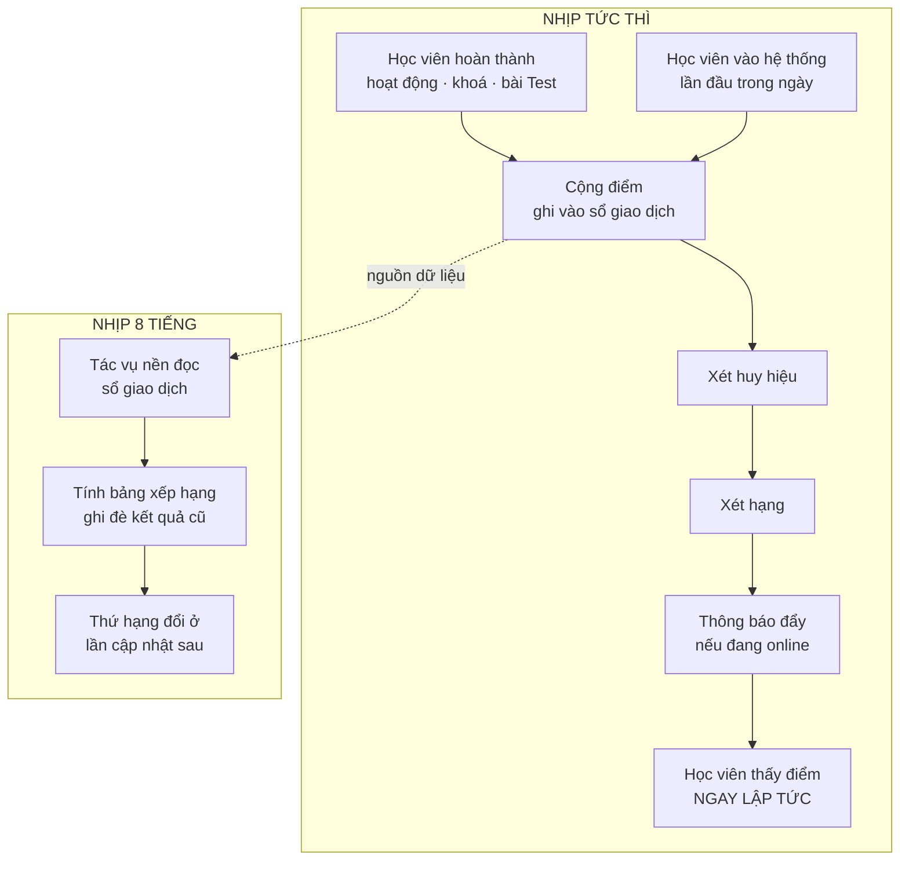
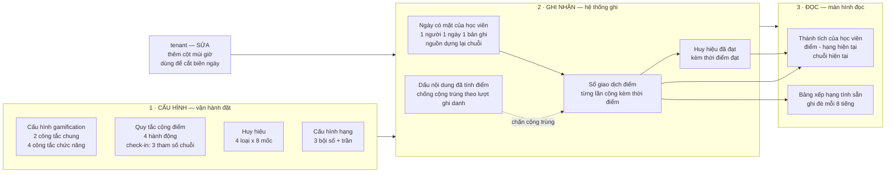
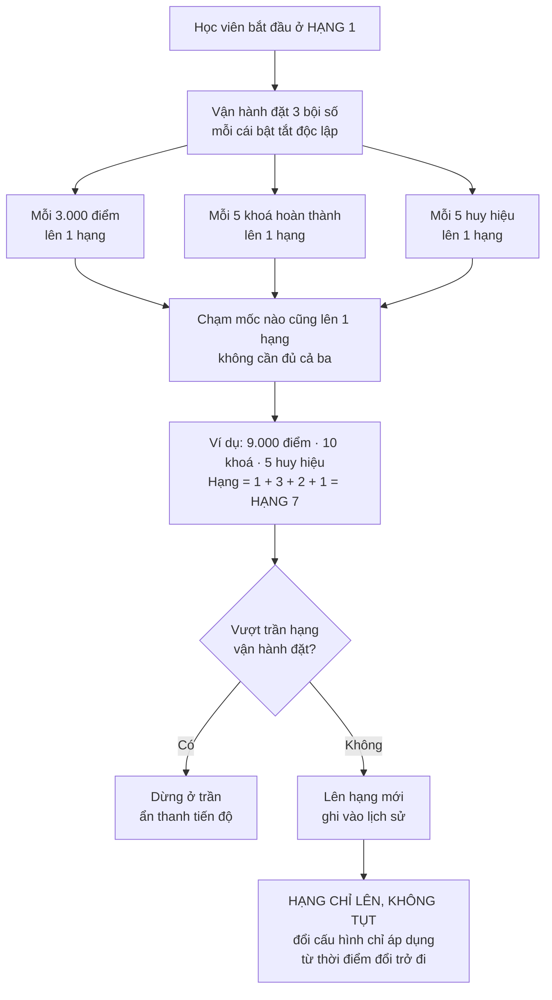
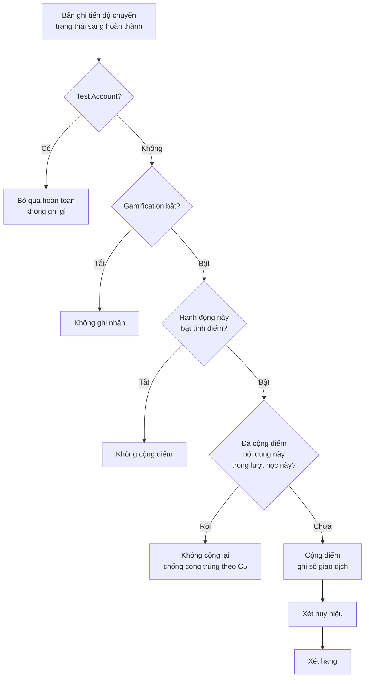
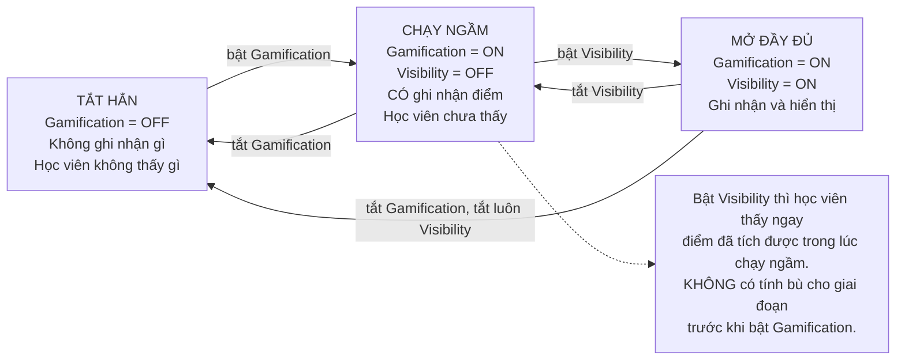

# [PRD] Gamification — Điểm, huy hiệu, hạng và bảng xếp hạng

| | |
| --- | --- |
| **Target release** | ❓ *cần điền* |
| **Epic** | ❓ *link Jira* |
| **Story** | ❓ *link Jira* |
| **Related** | `brd-v0.6-20260923.md` · `impact-matrix-v0.2-20260923.md` · `solution-comparison-v0.1-20260923.md` |
| **Document status** | 🔄 **v0.6 chờ PO review lại** — mang `CR-009`, `CR-010` và design đã chốt. Bản v0.2 đã được PO duyệt 23/09/2026 |
| **Document owner** | Bùi Đức Huy (PO) |
| **Designer** | ❓ *cần điền* |
| **Tech lead** | ❓ *cần điền* |
| **QA** | ❓ *cần điền* |
| **Reviewer** | ❓ *cần điền* |

---

# Document version

| Version | Người cập nhật | Nội dung | Impact | Ngày cập nhật |
| --- | --- | --- | --- | --- |
| v0.1 | Bùi Đức Huy | Bản khung: bối cảnh, giải pháp tổng thể và danh sách US | — | 23/09/2026 |
| v0.2 | Bùi Đức Huy | Viết chi tiết `US1` đến `US15`. Bỏ chiến dịch và kỳ lịch, thay bằng bộ chọn khoảng ngày (`CR-007`). Tách cấu hình thành bốn màn, khoá mốc huy hiệu, hạng thành số tịnh tiến, bảng xếp hạng tách theo chỉ số (`CR-008`) | `CR-007` `CR-008` | 23/09/2026 |
| v0.3 | Bùi Đức Huy | Điểm check-in tăng dần theo chuỗi ngày đăng nhập liên tiếp, thêm khối chuỗi trên trang Thành tích (`CR-009`). Đổi thuật ngữ "khử trùng" thành "chống cộng trùng". Làm rõ `C5` bằng định nghĩa lượt ghi danh | `CR-009` | 01/10/2026 |
| v0.4 | Bùi Đức Huy | Bỏ trần điểm mỗi ngày, kéo theo bỏ sự kiện `No points`. Làm rõ logic lên hạng: mỗi mốc chạm được đều cho một hạng. Màn lịch sử thành panel `Achievement history` kèm bộ chuỗi tiếng Anh đầy đủ (`CR-010`) | `CR-010` | 01/10/2026 |
| v0.5 | Bùi Đức Huy | Áp design đã chốt: bước tăng chuỗi cố định `5`, trần `40` chạm đúng ngày thứ 7, bỏ chuỗi dài nhất. Danh sách huy hiệu chuyển sang `My Profile` → tab `Badges`. Thêm hành vi trỏ và bấm trên dải tóm tắt. Viết lại cột `Nguồn` thành nội dung đọc được | Design chốt 01/10 | 01/10/2026 |
| v0.6 | Bùi Đức Huy | Gộp bốn màn cấu hình Ops thành một trang bốn khối. Thêm mục **Design** kèm sáu ảnh màn đã chốt. Tooltip cho ô chuỗi | Design chốt 01/10 | 01/10/2026 |

> ✅ **`Approved with Notes` — PO duyệt ngày 23/09/2026.** Còn **8 câu hỏi mở** ở mục `Vấn đề tồn đọng`, không câu nào chặn bàn giao.

---

# Problem

**Học viên đã được ghi danh vào khoá nhưng không chủ động quay lại học.**

| | |
|---|---|
| **Ai gặp** | Học viên trên UpLMS — đã có tài khoản, đã được thêm vào lớp, đã có nội dung để học |
| **Gặp khi nào** | Trong suốt thời gian học, đặc biệt ở giai đoạn giữa khoá khi không còn động lực ban đầu và chưa thấy đích |
| **Hậu quả** | Học viên học dở dang hoặc học dồn sát hạn. Vận hành phải thúc thủ công. Đội truyền thông nội bộ muốn tổ chức phong trào học tập nhưng không có số liệu nào để biết ai đang cố gắng |

Hệ thống hiện tại **chỉ ghi nhận việc học, không phản hồi lại việc học**. Học viên hoàn thành một hoạt động thì thanh tiến độ nhích lên — ngoài ra không có gì. Không có sự ghi nhận, không có mốc để nhắm tới, không có lý do để quay lại vào ngày hôm sau khi chưa tới hạn.

---

# Analytics

## Số liệu thật — General Launch, 8/9–21/9/2026

| Chỉ số | Tiêu chí đặt ra | Thực tế | |
|---|---|---|---|
| **Activation** | 80% nhân viên được gán khoá **đăng nhập lần đầu** trong 7 ngày kể từ General Launch | **40.2%** (53/132) | ❌ hụt một nửa |
| **Course start** | 80% người được gán đã **bắt đầu** khoá học trong 7 ngày | **22%** (29/132) | ❌ hụt gần 4 lần |
| **Completion** | 80% **hoàn thành** khoá bắt buộc đầu tiên trong 14 ngày | **64.1%** (93/145) | ❌ |

> ⚠️ Mẫu số khác nhau: Activation và Course start tính trên **132**, Completion tính trên **145** — hai nhóm người khác nhau. `OQ-01`

## Con số quan trọng nhất không nằm trong bảng

**53 người đăng nhập, chỉ 29 người bắt đầu học** — tức **24 người đã vào hệ thống rồi không bắt đầu gì cả**, bằng **45% số người đã chịu mở ứng dụng**.

Vấn đề tách thành **ba tầng riêng biệt**, mỗi tầng một nguyên nhân khác nhau:

| Tầng | Số đo | Nghĩa là gì |
|---|---|---|
| **1. Không mở ứng dụng** | Activation **40.2%** | 6/10 người được gán khoá không vào lấy một lần trong tuần đầu |
| **2. Mở rồi không học** | **45%** người đăng nhập không bắt đầu | Không phải vấn đề tiếp cận — vào tới nơi rồi vẫn không bắt đầu |
| **3. Bắt đầu rồi bỏ dở** | Completion **64.1%** | Đã bắt đầu nhưng không tới đích trong thời hạn |

## Vận hành đang xoay xở thế nào

| Hướng | Hiện trạng |
|---|---|
| **Cách làm hiện tại** | Theo dõi tiến độ qua dashboard SIS, thấy ai chậm thì thúc thủ công. 30 mail tự động đều là **mail sự kiện** — không có mail nào nhằm tạo động lực |
| **Công cụ bị hạn chế** | Giao diện soạn và gửi thông báo thủ công trên Ops **đang ẩn** (3/4 page module Notification & Email) |
| **Tiêu chí quyết định** | Vận hành nhìn phần trăm tiến độ và thời hạn còn lại — hai con số **cho biết ai đang chậm, không cho biết ai đang cố gắng** |
| **Chỗ sai** | Phụ thuộc vận hành nhớ và làm thủ công, không mở rộng được, và **không tạo được thói quen**. Số liệu cho thấy cách này **không đạt mục tiêu ở cả ba chỉ số** |

---

# Objective

| # | Kết quả muốn đạt |
|---|---|
| O1 | **Học viên quay lại học đều đặn hơn** mà không cần vận hành nhắc thủ công |
| O2 | **Nỗ lực học được ghi nhận ngay lúc nó xảy ra** |
| O3 | **Học viên có mốc ngắn hạn để nhắm tới** |
| O4 | **Đội truyền thông nội bộ chọn được khoảng ngày bất kỳ để lấy số liệu công bố** — việc đánh giá hiệu quả và trao thưởng do họ tự làm bên ngoài |
| O5 | **Điểm số đáng tin** — mỗi con số truy được nguồn, không bị thổi lên bằng thao tác đối phó |

---

# Stakeholder

| Stakeholder | Action |
| --- | --- |
| **Học viên (UpLMS)** | Nhận điểm · nhận huy hiệu · lên hạng · xem trang thành tích · tra lịch sử điểm · xem bảng xếp hạng và vị trí của mình |
| **Nhân sự vận hành (UpLMS Ops)** | Khai bảng điểm · tạo huy hiệu · đặt hạng và ngưỡng · bật/tắt cơ chế |
| **Đội truyền thông nội bộ** | Chọn khoảng ngày để lấy số liệu · công bố và **trao thưởng ngoài hệ thống** |
| **L&D** | Dùng dữ liệu điểm, hạng, huy hiệu để đánh giá mức độ tham gia học tập ở quy mô tổ chức |
| **Quản lý trực tiếp** | Theo dõi tình hình học của nhân viên mình phụ trách |
| **QA** | Điền mục `Conner case` của từng US |

> ⚠️ **Quản lý trực tiếp chưa có công cụ riêng trong phạm vi này.** Cần bộ lọc bảng xếp hạng theo nhóm (`US16 — chưa làm`), chờ đồng bộ sơ đồ tổ chức từ HRM.

---

# Preferences

❓ **Cần bổ sung trước khi bàn giao** — đây là nơi Dev và QA tìm mọi thứ để bắt đầu.

- **UX:** ❓ *link Figma — chưa có*. Ảnh design chốt ngày 01/10 nằm ở mục **Design** ngay dưới
- **Luồng giải pháp:** `working/solution-options/solution-comparison-v0.1-20260923.md` §9
- **Phân tích ảnh hưởng:** `working/impact-analysis/impact-matrix-v0.2-20260923.md`
- **Tài liệu nền:** `docs/brd/brd-v0.6-20260923.md` · `project-decisions.md`
- **API tham chiếu:** `lms-be.staging.upbase.asia/api/v1/docs` · `ops-be.staging.upbase.asia/api/v1/docs`
- **Tham chiếu ngoài:** `TNT.CFG.02` — Hồ sơ tổ chức và tham số *(module Tenant, chưa làm)*
- **KB liên quan:** `03-assessment.md` (`BR-TEST`) · `06-user-account.md` §8b (`Test Account`) · `07-learning-experience.md` (điều kiện hoàn thành) · `12-data-model.md` · `15-product-direction.md` §6
- **Tài khoản staging:** ❓ *chưa có*

---

# Metrics success

> Ba chỉ số dưới là **chỉ số thật đang đo của chính sản phẩm**, lấy từ General Launch 8/9–21/9/2026. Mốc nền là số đo trước khi có gamification.

| Factor (HEART) | Goal | Signal | Metrics |
| --- | --- | --- | --- |
| **Adoption** | Học viên được gán khoá chịu mở ứng dụng | Đăng nhập lần đầu trong 7 ngày | **Activation** — mốc nền **40.2%**, tiêu chí **80%** |
| **Engagement** | Vào rồi thì bắt đầu học, không bỏ đó | Bắt đầu khoá trong 7 ngày | **Course start** — mốc nền **22%**, tiêu chí **80%** |
| **Task Success** | Học tới đích trong thời hạn | Hoàn thành khoá bắt buộc đầu tiên trong 14 ngày | **Completion** — mốc nền **64.1%**, tiêu chí **80%** |
| **Retention** | Quay lại đều đặn, không học dồn | Số ngày có mặt trong tháng | ❓ *chưa có mốc nền — gamification tạo ra số này lần đầu* |

Hai factor còn lại (**Happiness**) **xoá vì chưa có cách đo** — không có khảo sát hài lòng trong phạm vi này.

---

# Design

Sáu màn đã chốt ngày 01/10/2026. Ảnh gốc nằm trong repo ở `.claude/projects/Gamification/design/`.

| Màn | Thuộc US | Chốt gì ở đây |
|---|---|---|
| **Gamification** | `US1` `US6` `US7` | Dải tóm tắt bốn ô · bảng xếp hạng bốn tab · khối vị trí của tôi với đường kẻ `Show All` |
| **How to collect points** | `US1` | Panel trượt từ phải, bốn dòng theo bốn hành động tính điểm |
| **How to level up** | `US1` `US10` | Panel trượt từ phải, ba tiêu chí lên hạng |
| **Achievement history** | `US3` | Panel trượt từ phải, nội dung dạng câu văn |
| **User Profile — Badges** | `US4` | Tab trong `My Profile`, bộ đếm `({đã đạt}/{tổng mốc})`, huy hiệu chưa đạt hiện xám |
| **Ops — Enable Setting** | `US8` `US9` `US10` `US11` `US14` | Một trang bốn khối, mốc huy hiệu chỉ đọc |
| **Ops — Disable** | `US14` | `Gamification` tắt thì mọi khối khác biến mất |

# Solution

## TDD

### Nguyên tắc nền

**Gamification chỉ đọc dữ liệu học tập, không sửa.** Nó ghi ra bản ghi của riêng nó. Đây là điều kiện để giữ nguyên logic hoàn thành Activity hiện tại và để bật/tắt gamification không ảnh hưởng gì tới việc học.

### Cách bắt sự kiện: **tính trong luồng**

Điểm được cộng **ngay trong cùng thao tác** với việc hoàn thành hoạt động, không qua tác vụ nền, không qua hàng đợi. Học viên thấy điểm **tức thì**.

> **`NFR-GAM-01` — bắt buộc.** Lỗi ở gamification **không được làm hỏng thao tác học**. Học viên bấm Hoàn thành thì thao tác đó **phải thành công**, kể cả khi phần cộng điểm gặp lỗi. Phần cộng điểm cũng **không được làm chậm cảm nhận** của thao tác.
>
> Hệ quả phải xử lý: lỗi bị chặn lại thì **điểm lần đó mất mà không ai biết** → `OQ-02`.

### Bốn luồng

*Hai nhịp chạy song song: mọi thứ học viên tự làm thì ghi nhận tức thì, riêng bảng xếp hạng tính nền 8 tiếng một lần.*

| # | Luồng | Cách chạy | Nhịp |
|---|---|---|---|
| 1 | **Cộng điểm khi hoàn thành hoạt động / khoá / bài Test** | Trong luồng | Tức thì |
| 2 | **Ghi nhận ngày có mặt (check-in)** | Trong luồng, **lần đầu trong ngày** học viên vào hệ thống | Tức thì |
| 3 | **Xét huy hiệu và xét hạng** | Sau khi cộng điểm, cùng luồng | Tức thì |
| 4 | **Tính bảng xếp hạng** | Tác vụ nền, **tính sẵn theo chu kỳ**, hiển thị nhãn *"cập nhật lúc HH:mm"* | Theo chu kỳ |

> ℹ️ **Điểm hiện ngay nhưng thứ hạng đổi ở lần cập nhật tiếp theo.** Hai nhịp khác nhau — cần nói rõ trên giao diện để học viên không thắc mắc.

### Mười ràng buộc bắt buộc

| # | Ràng buộc |
|---|---|
| `C1` | Cấu hình gắn với **tổ chức**, không đóng cứng |
| `C2` | Mọi danh mục **mở rộng được bằng cấu hình** |
| `C3` | Lưu **từng lần cộng điểm kèm thời điểm**, không chỉ lưu tổng |
| `C4` | Đổi cấu hình điểm → **áp dụng từ thời điểm đổi**, không tính lại quá khứ |
| `C5` | Chống cộng trùng trong phạm vi **một lượt ghi danh**. Chỉ cộng điểm khi bản ghi tiến độ **chuyển trạng thái** sang hoàn thành, tính từ lúc bật |
| `C6` | **Biên kỳ cắt theo múi giờ tổ chức**, không theo giờ máy chủ |
| `C7` | Một lần cộng điểm thuộc **mọi khoảng ngày bao trùm nó**, nên bảng xếp hạng luôn tính từ sổ giao dịch theo khoảng ngày |
| `C8` | **Mọi mốc dùng để xếp hạng phải lưu thời điểm đạt** |
| `C9` | **"Ngày"** trong check-in cắt theo **múi giờ tổ chức** |
| `C10` | **`Test Account` bị loại khỏi TOÀN BỘ logic gamification** — lọc ngay từ tầng ghi nhận, không ghi rồi lọc sau |

#### `C5` nói gì

**Lượt ghi danh** là một lần học viên được thêm vào một lớp chứa khoá học. Mỗi lần thêm vào sinh ra một bản ghi mới. Trong UpLnD, **toàn bộ tiến độ học treo vào bản ghi ghi danh chứ không treo vào con người** — hệ thống lưu *"lượt ghi danh số 1 đã xong bài 3"*, không lưu *"anh A đã học bài 3"*.

`C5` gồm hai lớp chặn độc lập:

| Lớp | Nội dung | Chặn được gì |
|---|---|---|
| **Chống cộng trùng** | Mỗi nội dung chỉ trả điểm **một lần trong một lượt ghi danh**. Trả rồi thì đóng dấu, lần sau thấy dấu là bỏ qua | Học viên mở lại bài đã xong để lấy thêm điểm |
| **Chỉ bắt lúc chuyển trạng thái** | Chỉ cộng khi bản ghi tiến độ **vừa chuyển** từ chưa hoàn thành sang hoàn thành. Không nhìn trạng thái hiện tại | Nội dung đã hoàn thành **trước khi bật** tính năng tự nó không sinh điểm, nên không phải nạp sẵn dấu cho toàn bộ lịch sử học của mọi người |

Dấu sống cùng lượt ghi danh, nên **xoá học viên khỏi lớp rồi thêm lại là lượt mới**: tiến độ về `0`, học lại từ đầu, và điểm được tính lại từ đầu. Chứng chỉ thì không, vì chứng chỉ cấp theo khoá chứ không theo lượt (`BR-13.12`).

> Hệ quả cho Dev: **"số khoá hoàn thành"** dùng để xét huy hiệu và lên hạng phải đếm từ **sổ giao dịch điểm**, không đếm từ endpoint chứng chỉ. Học hai lượt thì có hai lần điểm nhưng chỉ một chứng chỉ.

### Ba rule nền

| Mã | Nội dung |
|---|---|
| `BR-TEST` | Test `Graded Assignment = Yes` → tính khi **đạt Pass Point**. `= No` → tính khi **hoàn thành**. **Quiz · Case Study · Storyline → không tính** |
| `BR-REGRADE` | Chấm lại chỉ đi một chiều không-đạt → đạt. **Điểm chốt tại lần chấm đầu tiên**, chấm lại không cộng thêm. Không cần cơ chế thu hồi |
| `BR-SKIP` | **Khoá được đánh dấu bỏ qua thì không tính là hoàn thành** *(viết tổng quát thay vì gọi tên Foundation — tránh đóng cứng logic UpBase)* |

### Định nghĩa chỉ số — viết một lần, ba chỗ dùng lại

Mỗi chỗ **tự tính** — huy hiệu và hạng đếm trọn đời, bảng xếp hạng đếm trong khoảng ngày — nhưng **cái gì được đếm thì phải thống nhất**:

| Chỉ số | Đếm cái gì |
|---|---|
| **Điểm tích luỹ** | Tổng mọi lần cộng điểm, không hết hạn |
| **Số ngày có mặt** | Số ngày riêng biệt học viên vào hệ thống, cắt theo múi giờ tổ chức |
| **Số hoạt động hoàn thành** | Bản ghi tiến độ chuyển sang hoàn thành, trong phạm vi lượt ghi danh |
| **Số bài Test** | Theo `BR-TEST` |
| **Số khoá hoàn thành** | **Số lượt hoàn thành khoá** ghi trong sổ giao dịch điểm, không phải số chứng chỉ. Học lại một khoá thì tính thêm một lượt (`BR-13.10`), trong khi chứng chỉ không cấp lại — hai con số này khác nhau, xem `BR-13.12`. **Không tính khoá bỏ qua** (`BR-SKIP`) |
| **Số huy hiệu** | Huy hiệu đã đạt, giữ vĩnh viễn |

## Database

*Mười thực thể mới chia ba tầng. Sổ giao dịch điểm là gốc — mọi con số hiển thị đều truy được về đây.*

**10 thực thể mới. Bảng hiện hữu duy nhất bị sửa là `tenant`, thêm một cột.**

| Bảng | Mới / Sửa | Mục đích | `tenant_id` |
| --- | --- | --- | --- |
| `tenant` | **Sửa** | ➕ Thêm **tham số múi giờ** (`C6`, `C9`). Bảng hiện có 7 cột, không có trường này. Thuộc `TNT.CFG.02`, module Tenant chưa làm — đợt này khai tạm ở đây | *(là bảng gốc)* |
| Cấu hình gamification | Mới | Hai công tắc chung (`Gamification` · `Visibility in UpLMS`) · **bốn công tắc chức năng** (`Points` · `Badges` · `Levels` · `Leaderboard`) · bốn công tắc cột bảng xếp hạng | ✅ Bắt buộc |
| Quy tắc cộng điểm | Mới | Bốn hành động, mỗi hành động một công tắc và một số điểm. Riêng check-in khai bằng **ba tham số** điểm chuỗi thay vì một số (`BR-8.5a`) | ✅ Bắt buộc |
| **Sổ giao dịch điểm** | Mới | **Từng lần cộng điểm kèm nguồn và thời điểm** (`C3`). Nền của lịch sử ghi nhận, bảng xếp hạng theo khoảng ngày, tiêu chí phụ khi đồng hạng, và chỉ số *số khoá hoàn thành* | ✅ **Bắt buộc — rò rỉ ở đây hậu quả nặng nhất** |
| Dấu nội dung đã tính điểm | Mới | Chống cộng trùng trong phạm vi lượt ghi danh (`C5`) | ✅ Bắt buộc |
| Ngày có mặt của học viên | Mới | Nguồn cho điểm check-in và huy hiệu loại Check-in. Một học viên một ngày một bản ghi | ✅ Bắt buộc |
| Huy hiệu | Mới | Bốn loại, mỗi loại tám mốc. **Giá trị mốc chỉ đọc sau khi khởi tạo** (`BR-9.2`). Tên, hình, mô tả sửa được. Công tắc bật tắt từng loại | ✅ Bắt buộc |
| Huy hiệu đã đạt | Mới | Học viên nào đạt mốc nào, **kèm thời điểm đạt** (`C8`) | ✅ Bắt buộc |
| Cấu hình hạng | Mới | Ba bội số lên hạng (điểm · số khoá · số huy hiệu), mỗi cái một công tắc, cộng trần hạng. **Không có tên hạng và hình hạng** — hạng là số thứ tự tịnh tiến | ✅ Bắt buộc |
| **Thành tích của học viên** | Mới | Điểm tích luỹ · hạng hiện tại · thời điểm lên hạng gần nhất · **chuỗi hiện tại, ngày có mặt gần nhất**. Đây là bảng `US1` và `US12` đọc | ✅ Bắt buộc |
| **Bảng xếp hạng tính sẵn** | Mới | Thứ hạng cho năm khoảng ngày của nút bấm nhanh, nhân bốn chỉ số. **Bị ghi đè mỗi chu kỳ 8 tiếng.** Khoảng ngày tự chọn không lưu ở đây, tính lúc chọn (`BR-6.12`) | ✅ Bắt buộc |

> **Ảnh huy hiệu** dùng hạ tầng `resources` sẵn có. Tài nguyên bị xoá thì rơi về **ảnh mặc định** (`BR-1.7`). Hạng không có hình nên không dùng `resources`.

## API

Đã đối chiếu Swagger — hệ thống có **692 operation** (LMS 144 / Ops 548), **không có nhóm nào liên quan gamification**. Tiền tố `/api/v1/gamification/` không trùng với đường dẫn nào đang tồn tại.

### UpLMS — phía học viên

| Method | Endpoint | Mới / Sửa | Mục đích |
| --- | --- | --- | --- |
| GET | `/api/v1/gamification/me` | Mới | Điểm tích luỹ · hạng hiện tại · huy hiệu đã đạt — `US1` |
| GET | `/api/v1/gamification/me/point-history` | Mới | Lịch sử từng lần cộng điểm — `US3` |
| GET | `/api/v1/gamification/me/badges` | Mới | Huy hiệu đã đạt + **sắp đạt kèm phần còn thiếu** — `US4` |
| GET | `/api/v1/gamification/leaderboard` | Mới | Bảng xếp hạng theo **khoảng ngày** và **chỉ số** được chọn — `US6` |
| GET | `/api/v1/gamification/leaderboard/me` | Mới | Vị trí của tôi kèm vài người liền kề — `US7` |
| GET | `/api/v1/gamification/rules` | Mới | Bảng điểm và tiêu chí lên hạng đang áp dụng, để hiện phần *cách tính điểm* và *cách lên hạng* ở `US1` |
| PUT | `/api/v1/courses/**.../progress` | **Sửa** | Endpoint hiện có. Thêm phần cộng điểm **trong luồng**, chịu `NFR-GAM-01` |
| GET | `/api/v1/courses/my-learnings` | **Sửa** | Endpoint hiện có. **Thêm field** điểm tích luỹ và hạng — chỉ thêm, không phá contract cũ |

> **Điểm check-in (`US5`) không có endpoint riêng.** Hệ thống ghi nhận ngày có mặt ở lần đầu học viên vào hệ thống trong ngày, không có thao tác nào của học viên.

### UpLMS Ops — phía vận hành

| Method | Endpoint | Mới / Sửa | Mục đích |
| --- | --- | --- | --- |
| GET, PUT | `/api/v1/gamification/settings` | Mới | Hai công tắc chung · múi giờ tổ chức — `US14` |
| GET, PUT | `/api/v1/gamification/point-rules` | Mới | Công tắc `Points` · bốn hành động · ba tham số điểm chuỗi — `US8` |
| GET, PUT | `/api/v1/gamification/badges` | Mới | Công tắc `Badges` · bật tắt bốn loại · sửa tên, hình, mô tả từng mốc — `US9`. **Không có `POST` và `DELETE`**: không tạo, không xoá huy hiệu (`BR-9.7`). **Giá trị mốc không nhận sửa** (`BR-9.2`) |
| GET, PUT | `/api/v1/gamification/levels` | Mới | Công tắc `Levels` · ba bội số lên hạng · trần hạng — `US10`. **Không có `POST` và `DELETE`**: hạng là số tịnh tiến, không phải danh sách bậc để tạo |
| GET, PUT | `/api/v1/gamification/leaderboard-settings` | Mới | Công tắc `Leaderboard` · bật tắt bốn bảng — `US11` |
| GET | `/api/v1/gamification/learners` | Mới | Danh sách học viên kèm hạng, theo khoảng ngày — `US12` |
| GET | `/api/v1/gamification/learners/export` | Mới | Xuất danh sách ra **Excel** theo khoảng ngày đang chọn — `US12` |

---

# Specific Requirement

> **Quy ước đánh số:**
> - User Story: `US1`, `US2`… liên tục
> - Business rule: `BR-<số US>.<số thứ tự>` → `BR-1.1`, `BR-2.1`… unique toàn PRD
> - US chưa làm → ghi rõ trong tiêu đề

## Danh sách US

### Phía học viên (UpLMS) — 7 US

| ID | User Story | Nguồn |
| --- | --- | --- |
| **US1** | Là học viên, tôi cần xem điểm, hạng và huy hiệu đã đạt để biết nỗ lực học của mình được ghi nhận tới đâu | Giải `O2` — nỗ lực học được ghi nhận ngay lúc nó xảy ra |
| **US2** | Là học viên, tôi cần được báo ngay khi nhận điểm, đạt huy hiệu hoặc lên hạng, trong lúc đang dùng hệ thống | Giải `O2` — nỗ lực học được ghi nhận ngay lúc nó xảy ra |
| **US3** | Là học viên, tôi cần tra được từng lần cộng điểm đến từ đâu để tin vào con số của mình | Giải `O5` — điểm số đáng tin, mỗi con số truy được nguồn. Dựa trên `C3` — lưu từng lần cộng điểm kèm thời điểm |
| **US4** | Là học viên, tôi cần biết huy hiệu nào sắp đạt và còn thiếu gì để có mục tiêu ngắn hạn | Giải `O3` — học viên có mốc ngắn hạn để nhắm tới |
| **US5** | Là học viên, tôi cần việc vào hệ thống mỗi ngày được ghi nhận thành điểm để có lý do mở ứng dụng hằng ngày | Giải `O1` — học viên quay lại học đều đặn mà không cần nhắc thủ công. **Nhắm thẳng vào Activation 40.2%**, chỉ số yếu nhất trong `Analytics` |
| **US6** | Là học viên, tôi cần xem bảng xếp hạng của kỳ tôi chọn để biết mình đứng ở đâu so với người khác | Yêu cầu bổ sung ở `CR-001` — đưa bảng xếp hạng vào phạm vi đợt này |
| **US7** | Là học viên, tôi cần luôn thấy vị trí của chính mình kèm vài người liền kề, kể cả khi không ở nhóm đầu | Yêu cầu bổ sung ở `CR-001`. Là cơ chế giảm nhẹ chính cho bảng xếp hạng toàn tổ chức: người hạng thấp vẫn thấy được mình |

### Phía vận hành (UpLMS Ops) — 8 US

> Cấu hình nằm trên **một trang duy nhất trong Ops, chia bốn khối, mỗi khối một chức năng có công tắc riêng**: Points · Badges · Levels · Leaderboard. `US8` đến `US11` mô tả bốn khối đó.
>
> `CR-008` ban đầu chốt tách bốn màn. Design chốt ngày 01/10 gộp lại một trang vì lượng cấu hình ít, bắt vận hành nhảy bốn màn thì bất tiện hơn.

| ID | User Story | Nguồn |
| --- | --- | --- |
| **US8** | Là nhân sự vận hành, tôi cần bật/tắt cơ chế điểm và khai mỗi hành động được bao nhiêu điểm, để điều chỉnh theo mục tiêu từng giai đoạn | Nền của mọi cơ chế còn lại. Không khai được điểm thì không có gì để xếp hạng |
| **US9** | Là nhân sự vận hành, tôi cần bật/tắt từng loại huy hiệu và **đặt tên cùng hình cho từng mốc**, để bộ huy hiệu mang ngôn ngữ của tổ chức mình | Chốt ở `CR-008` — mốc do hệ thống định sẵn, vận hành chỉ đặt tên và hình |
| **US10** | Là nhân sự vận hành, tôi cần đặt mỗi bao nhiêu điểm, bao nhiêu khoá, bao nhiêu huy hiệu thì học viên lên một hạng, và đặt trần hạng | Chốt ở `CR-008` — hạng là số thứ tự tịnh tiến, không có tên và hình |
| **US11** | Là nhân sự vận hành, tôi cần chọn bảng xếp hạng hiện những cột nào, để kiểm soát học viên nhìn thấy gì về nhau | Chốt ở `CR-008` — mỗi chỉ số một bảng riêng, bật tắt độc lập |
| **US12** | Là nhân sự vận hành, tôi cần xem danh sách học viên kèm hạng của họ, để nắm tình hình chung | Chốt ở `CR-008` — vận hành cần tra cứu hạng của từng người |
| **US13** | Là nhân sự vận hành, tôi cần điểm phản ánh việc học thật, không bị đẩy lên bằng thao tác đối phó | Giải `O5` — điểm không bị thổi lên bằng thao tác đối phó |
| **US14** | Là nhân sự vận hành, tôi cần bật/tắt gamification và bật/tắt hiển thị phía học viên riêng biệt, để chạy thử cơ chế trước khi mở | Cần giai đoạn chạy ngầm để thử cơ chế trước khi mở cho học viên |
| **US15** | Là quản trị, tôi cần phân quyền để chỉ vai trò vận hành phù hợp mới sửa được cấu hình gamification | `[suy ra]` — không có trong yêu cầu gốc, nhưng mọi cấu hình đều cần kiểm soát ai sửa được |

### Chưa làm trong phạm vi này — 3 US

| ID | User Story | Chờ gì |
| --- | --- | --- |
| **US16** | *Bộ lọc bảng xếp hạng theo nhóm* — **chưa làm** | Chức năng nhóm đồng bộ từ HRM. **Là công cụ duy nhất phục vụ Quản lý trực tiếp** |
| **US17** | *Tính điểm và huy hiệu từ Quiz, Case Study, Storyline* — **chưa làm** | PO chốt không tính ở đợt này |
| **US18** | *Điểm cho lộ trình · huy hiệu theo kỹ năng* — **chưa làm** | Tính năng Lộ trình và Khung năng lực |

> **Danh sách gồm 18 US, trong đó 15 US làm ở đợt này.**
>
> **Không có chiến dịch và không có kỳ lịch.** Bảng xếp hạng dùng **bộ chọn khoảng ngày tự do**, nên không cần thực thể chiến dịch, không cần thao tác chốt kỳ, và không có màn xem lại kỳ đã kết thúc. Muốn xem khoảng nào thì chọn khoảng đó.

---

## US1: Trang Thành tích của tôi

### 1/ User story

Là học viên, tôi cần xem điểm, hạng và huy hiệu đã đạt của mình để biết nỗ lực học được ghi nhận tới đâu.

### 2/ Pre - Condition

| Điều kiện | Nguồn |
|---|---|
| `Gamification` đang bật và `Visibility in UpLMS` đang bật ở cấp tổ chức | `S12` |
| Học viên đăng nhập được vào UpLMS | KB `06` |
| Tài khoản không phải `Test Account` | `C10` · `KB-USER-TA-01` |
| Vận hành đã tạo ít nhất một hạng. Chưa có hạng nào thì khối hạng không hiện | `US11` |

### 3/ Scenario

Học viên vào UpLMS, mở trang Thành tích của tôi từ menu chính hoặc từ màn My Learning. Trang hiện ba khối theo thứ tự: điểm tích luỹ, hạng hiện tại kèm tiến độ tới hạng kế tiếp, và danh sách huy hiệu đã đạt.

Học viên chưa có điểm nào vẫn vào được trang. Lúc đó điểm hiện 0, hạng là hạng thấp nhất, phần huy hiệu hiện trạng thái rỗng.

### 4/ Acceptance criteria

**UI / UX / Rule UX / Rule UI**

| Màn hình | Giao diện | Field | Yêu cầu |
|---|---|---|---|
| Thành tích của tôi | Điểm vào trang | Mục menu | Hiện ở menu chính của UpLMS. `Visibility in UpLMS` tắt thì mục menu biến mất, và mở thẳng đường dẫn trả về không tìm thấy |
| Thành tích của tôi | Điểm vào trang | Lối tắt ở My Learning | Từ khối điểm và hạng trên My Learning, bấm vào mở sang trang này. Xem `US5` cho chi tiết khối đó |
| Thành tích của tôi | Khối tổng quan | Điểm tích luỹ | Số nguyên, phân cách hàng nghìn bằng dấu chấm. Giá trị nhỏ nhất 0, không có số âm. Không kèm đơn vị sau số. Chưa có điểm thì hiện `0`, không hiện trạng thái rỗng |
| Thành tích của tôi | Khối tổng quan | Hạng hiện tại | **Một con số thứ tự tịnh tiến**, bắt đầu từ `1`. **Không có tên hạng, không có hình hạng.** Học viên mới vào hệ thống ở hạng `1` |
| Thành tích của tôi | Khối tổng quan | Tiến độ tới hạng kế tiếp | Thanh tiến độ kèm dòng nêu phần còn thiếu của **tiêu chí sắp chạm mốc nhất**. Chạm **trần hạng** rồi thì ẩn cả khối, không hiện thanh đầy |
| Gamification | Dải tóm tắt | `{n} Streaks` | **Chuỗi hiện tại** — số ngày vào hệ thống liên tiếp đang giữ. Chưa vào ngày nào thì hiện `0`. Cách tính ở `US5` |
| Gamification | Dải tóm tắt | Chuỗi dài nhất | **Không hiện.** Chỉ số quá khứ không giúp học viên quyết định gì hôm nay |
| Gamification | Dải tóm tắt | Khi `Points` tắt | Ẩn ô chuỗi. Không còn điểm thì chuỗi mất ý nghĩa |
| Thành tích của tôi | Cách lên hạng | Rule chung | Ngoài tiêu chí gần nhất, hiện **đầy đủ ba tiêu chí lên hạng đang bật** kèm bội số của từng cái. Ví dụ: `Every 3,000 points` · `Every 5 completed courses` · `Every 5 badges`. Tiêu chí đang tắt thì không hiện |
| Thành tích của tôi | Cách tính điểm | Rule chung | Hiện **bảng điểm đang áp dụng**: mỗi hành động đang bật được bao nhiêu điểm. Ví dụ: `Activity completion: 25` · `Course completion: 150` · `Successful test: 50`. Hành động đang tắt thì không hiện |
| Gamification | Panel `How to collect points?` | Dòng check-in | Nhãn `10–40 points`, mô tả `for each daily sign-in, +5 per day in a row up to day 7`. Hiện khoảng thay vì một số vì điểm thay đổi theo chuỗi |
| Gamification | Dải tóm tắt | `{n} Badges` | **Chỉ hiện số lượng huy hiệu đã đạt.** Danh sách đầy đủ nằm ở màn khác, xem `US4` |

**Bốn ô tóm tắt — trỏ vào và bấm**

| Ô | Hiện gì | Trỏ chuột vào | Bấm vào |
|---|---|---|---|
| **Chuỗi** | `5 Streaks` | Tooltip `Days you've signed in without a break.` | Không có hành động. Ô này chỉ để xem |
| **Điểm** | `475 Points` | Gợi ý `How to collect points?` | Mở panel `How to collect points?` trượt từ phải |
| **Huy hiệu** | `3 Badges` | Gợi ý `Go to badge gallery` | **Chuyển màn** sang `My Profile` → tab `Badges` (`US4`) |
| **Hạng** | `Level 1` | Gợi ý `How to level up?` | Mở panel `How to level up?` trượt từ phải |

**Hai panel mở ra từ dải tóm tắt**

| Màn hình | Giao diện | Field | Yêu cầu |
|---|---|---|---|
| Gamification | Panel `How to collect points?` | Bố cục | Trượt từ cạnh phải. Mỗi dòng gồm nhãn điểm bên trái và mô tả hành động bên phải |
| Gamification | Panel `How to collect points?` | Ba dòng còn lại | `for each activity completion` · `for each course completion` · `for each successful test completion`. Số điểm lấy từ cấu hình đang áp dụng |
| Gamification | Panel `How to collect points?` | Hành động đang tắt | Không hiện dòng tương ứng |
| Gamification | Panel `How to level up?` | Nội dung | Ba tiêu chí đang bật, **mỗi dòng mở đầu bằng `Every`**: `Every 3,000 points` · `Every 5 completed courses` · `Every 5 badges`. Thiếu chữ `Every` thì học viên hiểu thành đạt mốc đó một lần là lên hạng, trong khi mỗi lần chạm thêm một mốc đều cho một hạng (`BR-10.2`) |
| Gamification | Panel `How to level up?` | Tiêu chí đang tắt | Không hiện dòng tương ứng |
| Gamification | Cả hai panel | Đóng | Nút `✕` ở góc phải tiêu đề |

**Business requirement — Business rule**

- `BR-1.1` Trang chỉ tồn tại khi `Gamification` bật **và** `Visibility in UpLMS` bật. Tắt một trong hai thì trang không truy cập được bằng bất kỳ đường nào.
- `BR-1.2` Điểm hiển thị là **điểm tích luỹ** của cá nhân tính từ lúc vào hệ thống, không phải điểm theo kỳ.
- `BR-1.3` **Hạng chỉ lên, không tụt.** Vận hành đổi ngưỡng hạng thì cấu hình mới **chỉ áp từ thời điểm đổi trở đi**. Học viên đang ở một hạng **giữ nguyên hạng đó**, kể cả khi không còn đủ ngưỡng mới. Theo `C4`.
  > Riêng điểm tích luỹ không bao giờ giảm, nên hạng chỉ xét theo điểm thì thực tế không tụt trừ khi vận hành đổi ngưỡng.
- `BR-1.4` **Huy hiệu đã nhận không bị lấy lại bởi việc đổi cấu hình.** Mốc của một huy hiệu **khoá ngay sau khi tạo**, và **không có thao tác xoá huy hiệu**. Nên không có cách nào để vận hành làm học viên mất một huy hiệu đã đạt.
- `BR-1.4a` Huy hiệu **không còn hiện** trong đúng hai trường hợp:
  | Trường hợp | Dữ liệu |
  |---|---|
  | Vận hành **tắt chức năng huy hiệu**, hoặc **tắt rule của riêng huy hiệu đó** | Giữ nguyên. Bật lại thì hiện lại đầy đủ |
  | Học viên **rời tổ chức** | Theo vòng đời tài khoản, không phải cơ chế của gamification |
- `BR-1.5` Tài khoản có `Test Account = Yes` không phát sinh dữ liệu gamification nên không vào được trang này. Theo `KB-USER-TA-01`.
- `BR-1.6` Điểm là số nguyên.
- `BR-1.7` Ảnh huy hiệu lấy từ kho tài nguyên dùng chung. Tài nguyên bị xoá thì rơi về ảnh mặc định, huy hiệu của học viên không mất.

**Data Field**

| Field | Kiểu | Bắt buộc | Giá trị hợp lệ | Ghi chú |
|---|---|---|---|---|
| Điểm tích luỹ | Số nguyên | Có | `>= 0` | Mới. Đọc từ bảng điểm của học viên |
| Hạng hiện tại | Khoá ngoại tới bảng Hạng | Không | Rỗng khi chưa có hạng nào được tạo | Mới |
| Thời điểm lên hạng | Thời gian | Không | | Mới. Cần cho `C8` |
| Huy hiệu đã đạt | Danh sách | Không | | Mới. Mỗi dòng gồm mã huy hiệu và **thời điểm đạt** (`C8`) |

> Trang này **chỉ đọc**. Không có field nào học viên sửa được.

**NFR**

Trang đọc giá trị đã lưu sẵn. Không tính lại điểm hay xét lại hạng khi mở trang.

### 5/ Out of scope

| Không làm ở US này | Thuộc về |
|---|---|
| Hiển thị điểm theo khoảng ngày | `US6` |
| Hiển thị huy hiệu **chưa đạt** và phần còn thiếu | `US4` |
| Hiển thị lịch sử từng lần cộng điểm | `US3` |
| So sánh thứ hạng với học viên khác | `US6`, `US7` |
| Cho học viên đổi ảnh huy hiệu, tên hạng, hay bất kỳ cấu hình nào | `US10`, `US11` |

### 6/ Conner case

*(QA điền)*

---

## US2: Thông báo thành tích

### 1/ User story

Là học viên, tôi cần được báo ngay khi nhận điểm, đạt huy hiệu hoặc lên hạng, trong lúc đang dùng hệ thống, để cảm nhận được sự ghi nhận đúng lúc nó xảy ra.

### 2/ Pre - Condition

| Điều kiện | Nguồn |
|---|---|
| `Gamification` bật và `Visibility in UpLMS` bật | `S12` · `A19` |
| Học viên **đang mở UpLMS** tại thời điểm thành tích phát sinh | `S10` |
| Tài khoản không phải `Test Account` | `C10` |
| Vận hành đã khai ít nhất một hành động tính điểm | `US9` |

### 3/ Scenario

Học viên hoàn thành một hoạt động học. Điểm được cộng ngay trong chính thao tác đó, và thông báo hiện lên trong lúc học viên vẫn đang ở trong hệ thống.

Nếu lần cộng điểm này đủ ngưỡng một huy hiệu, huy hiệu được trao và báo kèm. Nếu đủ ngưỡng hạng kế tiếp, học viên lên hạng và nhận thông báo nổi bật hơn.

Học viên không ở trong hệ thống thì không nhận thông báo nào. Thành tích vẫn được ghi, tra lại được ở lịch sử điểm (`US3`) và trang thành tích (`US1`).

> Trường hợp offline hay gặp nhất là **bài kiểm tra chấm tay**. Mentor chấm xong sau vài ngày, điểm được cộng lúc đó, học viên thường không đang online.

### 4/ Acceptance criteria

**UI / UX / Rule UX / Rule UI**

| Màn hình | Giao diện | Field | Yêu cầu |
|---|---|---|---|
| Mọi màn UpLMS | Thông báo nhận điểm | Nội dung | Một dòng, tiếng Anh, theo mẫu `+ {điểm} for {mô tả hành động}`. Ví dụ: `+ 25 for completing the unit` · `+ 150 for completing the course` |
| Mọi màn UpLMS | Thông báo đạt huy hiệu | Nội dung | Hai dòng, tiếng Anh. Dòng đầu `Congratulations!` in đậm. Dòng sau theo mẫu `You unlocked the {tên huy hiệu} badge by {mô tả điều kiện}`. Ví dụ: `You unlocked the Learning Newbie badge by completing 1 course` |
| Mọi màn UpLMS | Thông báo lên hạng | Nội dung | Cùng dạng hai dòng như huy hiệu, thay tên huy hiệu bằng tên hạng. Câu chữ chính xác: `❓BA` |
| Mọi màn UpLMS | Biểu tượng | Thông báo điểm | Một biểu tượng chung cho mọi thông báo điểm |
| Mọi màn UpLMS | Biểu tượng | Thông báo huy hiệu | Hình của chính huy hiệu vừa đạt |
| Mọi màn UpLMS | Nhiều thông báo cùng lúc | Cách hiển thị | **Không gộp.** Mỗi thành tích là một thẻ riêng, xếp chồng theo đúng thứ tự phát sinh. Một thao tác sinh ra bốn thành tích thì hiện bốn thẻ |
| Mọi màn UpLMS | Danh từ trong câu | Số ít và số nhiều | Câu phải đúng ngữ pháp theo số lượng: `1 course` chứ không phải `1 courses`. Áp cho mọi mẫu câu có số đếm |
| Mọi màn UpLMS | Vị trí và hướng xếp chồng | | `❓BA` — chờ Figma |
| Mọi màn UpLMS | Thời gian tự tắt | | `❓BA` — chờ Figma. Cần tính tới trường hợp bốn năm thẻ xuất hiện cùng lúc |
| Mọi màn UpLMS | Khi `Visibility in UpLMS` tắt | | Không đẩy thông báo nào, kể cả khi điểm vẫn đang được ghi ngầm |

**Business requirement — Business rule**

- `BR-2.1` Thông báo chỉ đẩy khi học viên **đang mở UpLMS**. Học viên không online thì **không gửi và không xếp hàng chờ gửi sau**.
- `BR-2.2` Không gửi email cho bất kỳ thông báo thành tích nào. Gamification không chạm vào 30 mail event hiện có.
- `BR-2.3` Không dùng cơ chế Notification hiện có của Ops. Cơ chế đó là soạn tay gửi theo nhóm, gửi theo job nửa tiếng (`KB-NOTI-05`), không phù hợp với thông báo theo từng người.
- `BR-2.4` `Visibility in UpLMS` tắt thì không đẩy thông báo nào, dù `Gamification` vẫn đang bật và điểm vẫn được ghi.
- `BR-2.5` Khi chuyển từ **chạy ngầm** sang **bật đầy đủ**, **không bắn thông báo hồi tố** cho dữ liệu đã tích trong giai đoạn chạy ngầm. Học viên thấy điểm và hạng đã có sẵn ở trang thành tích, kèm lịch sử để tra nguồn.
- `BR-2.6` Lỗi ở phần hiển thị thông báo **không được làm hỏng thao tác học**. Học viên bấm Hoàn thành thì thao tác đó phải thành công dù thông báo không hiện được. Theo `NFR-GAM-01`.
- `BR-2.7` Tài khoản có `Test Account = Yes` không nhận thông báo, vì không phát sinh dữ liệu gamification.
- `BR-2.8` Không có thông báo tụt hạng, vì hạng chỉ lên không tụt (`BR-1.3`).
- `BR-2.9` **Không gộp thông báo.** Mỗi thành tích phát sinh một thẻ riêng, kể cả khi nhiều thành tích đến từ cùng một thao tác.

**NFR**

Việc đẩy thông báo nằm trong cùng thao tác với việc hoàn thành hoạt động. Phần này không được làm chậm cảm nhận của thao tác đó, và lỗi ở đây phải được chặn lại tại chỗ.

### 5/ Out of scope

| Không làm ở US này | Lý do |
|---|---|
| Gửi email thông báo thành tích | PO chốt chỉ đẩy trong hệ thống |
| Lưu thông báo vào hộp thư để đọc lại sau | Thành tích tra được ở `US1` và `US3`. Hộp thư thông báo hiện có không dùng |
| Gửi bản tóm tắt *"bạn đã nhận X điểm khi vắng mặt"* khi học viên quay lại | PO chốt: không online thì thôi, thành tích vào lịch sử |
| Thông báo cho người khác, ví dụ quản lý trực tiếp hay mentor | Ngoài phạm vi. Xem `US16 — chưa làm` |
| Cho học viên tắt hoặc chỉnh thông báo thành tích | Chưa yêu cầu. Xem `OQ-12` |

### 6/ Conner case

*(QA điền)*

---

## US3: Lịch sử ghi nhận

### 1/ User story

Là học viên, tôi cần tra được từng lần cộng điểm đến từ đâu, và mọi thay đổi về huy hiệu hay hạng của mình, để tin vào con số của mình.

> Lịch sử gồm cả điểm, mốc đạt huy hiệu và lên hạng — một dòng thời gian duy nhất về mọi thứ học viên đã đạt được.

> Đây là US giữ cho `O5` đứng vững. Yêu cầu gốc nói thẳng: *"Điểm không giải thích được thì không ai tin bảng xếp hạng."*

### 2/ Pre - Condition

| Điều kiện | Nguồn |
|---|---|
| `Gamification` bật và `Visibility in UpLMS` bật | `S12` |
| Tài khoản không phải `Test Account` | `C10` |

### 3/ Scenario

Học viên ở màn Gamification, mở `Achievement history`. Một panel trượt ra từ cạnh phải, liệt kê từng lần ghi nhận theo thứ tự **mới nhất lên trước**.

Mỗi mục gồm hai dòng: dòng trên là thời điểm, dòng dưới là một câu kể rõ học viên nhận được gì và vì sao.

Học viên cuộn xuống để xem các lần trước đó. Chưa có lần nào thì hiện trạng thái rỗng.

### 4/ Acceptance criteria

**UI / UX / Rule UX / Rule UI**

| Màn hình | Giao diện | Field | Yêu cầu |
|---|---|---|---|
| Achievement history | Điểm vào | Vị trí | **Panel trượt từ cạnh phải**, mở từ màn Gamification. Không phải trang riêng, không phải tab |
| Achievement history | Panel | Tiêu đề | `Achievement history`, kèm nút `✕` đóng ở góc phải |
| Achievement history | Mục | Dòng thời gian | `HH:mm • dd/mm/yyyy`, chữ nhỏ màu nhạt, cắt theo múi giờ tổ chức |
| Achievement history | Mục | Dòng nội dung | Một câu hoàn chỉnh. Số điểm, tên huy hiệu và số hạng **in đậm**, phần còn lại chữ thường. Bộ chuỗi đầy đủ ở bảng dưới |
| Achievement history | Mục | Thứ tự | **Mới nhất lên trước** |
| Achievement history | Mục | Tên dài | Tên hoạt động và tên khoá cắt ở `60` ký tự rồi thêm `…`. Trỏ chuột vào hiện đầy đủ |
| Achievement history | Panel | Số mục một lần tải | Tải thêm khi cuộn tới cuối. Số mục mỗi lần: `❓BA` |
| Achievement history | Panel | Trạng thái rỗng | `Nothing here yet. Start learning to earn your first points.` |
| Lịch sử ghi nhận | Bảng | Thao tác | Chỉ đọc. Không sửa, không xoá, không có nút thao tác nào trên dòng |

**Bộ chuỗi đầy đủ**

Mẫu chung: `You earned **{điểm}** for {hành động}.` Phần trong `{…}` là giá trị hệ thống điền.

*Nhận điểm*

| Nguồn | Chuỗi |
|---|---|
| Check-in, ngày đầu của chuỗi | `You earned **{n} points** for checking in today.` |
| Check-in, đang giữ chuỗi | `You earned **{n} points** for checking in today. Day {d} of your streak.` |
| Hoàn thành hoạt động | `You earned **{n} points** for completing **{tên hoạt động}** in {tên khoá}.` |
| Hoàn thành khoá | `You earned **{n} points** for completing the course **{tên khoá}**.` |
| Qua bài Test | `You earned **{n} points** for passing **{tên bài Test}** in {tên khoá}.` |

*Huy hiệu và hạng*

| Sự kiện | Chuỗi |
|---|---|
| Đạt huy hiệu | `You unlocked the **{tên huy hiệu}** badge for reaching {mốc} {đơn vị}.` |
| Lên hạng | `You reached **Level {n}**.` |

`{đơn vị}` thay theo loại huy hiệu: `sign-ins` · `activities` · `passed tests` · `completed courses`.

> **Ba loại sự kiện, không hơn.** Nhận điểm · đạt huy hiệu · lên hạng.
>
> Không có sự kiện **không được điểm** vì `CR-010` bỏ trần điểm ngày, mà chạm trần vốn là lý do duy nhất sinh ra nó.
>
> Không có sự kiện **tụt hạng** và **gỡ huy hiệu**. Hạng chỉ lên (`BR-1.3`), huy hiệu đã nhận giữ vĩnh viễn (`BR-1.4`).

**Business requirement — Business rule**

- `BR-3.1` Lịch sử hiện **mọi lần hệ thống cộng điểm**. Không còn trần điểm ngày nên không còn trường hợp xét mà không được điểm.
- `BR-3.3` Mỗi dòng nêu **nguồn cụ thể**, không chỉ loại hành động. Học viên phải đối chiếu được với việc mình đã làm.
- `BR-3.4` Sắp xếp theo thời điểm, mới nhất trước.
- `BR-3.5` Lịch sử **không sửa và không xoá được**, kể cả bởi vận hành.
- `BR-3.6` Vận hành đổi bảng điểm thì **các dòng lịch sử cũ giữ nguyên số điểm đã ghi**. Theo `C4`, cấu hình mới chỉ áp cho lần cộng sau đó.
- `BR-3.7` Điểm ghi trong giai đoạn **chạy ngầm** hiện đầy đủ trong lịch sử ngay khi bật `Visibility in UpLMS`.
- `BR-3.8` Tài khoản có `Test Account = Yes` không có lịch sử, vì không phát sinh dữ liệu gamification.
- `BR-3.9` **Lịch sử giữ toàn bộ, không giới hạn thời gian, không dọn.** Học viên tra được mọi lần ghi nhận từ ngày đầu tiên. Đây là điều kiện để `O5` đứng vững: một con số chỉ đáng tin khi truy được tới tận nguồn.

**Data Field**

| Field | Kiểu | Bắt buộc | Giá trị hợp lệ | Ghi chú |
|---|---|---|---|---|
| Thời điểm ghi nhận | Thời gian | Có | | Mới. Nền của `C3`, `C7`, `C8` |
| Học viên | Khoá ngoại tới `users` | Có | | Mới |
| Loại hành động | Danh mục | Có | Một trong các hành động khai ở `US9` | Mới |
| Nội dung nguồn | Khoá ngoại | Không | Hoạt động, khoá, hoặc bài Test. Rỗng với hành động check-in | Mới |
| Số điểm | Số nguyên | Có | `>= 0` | Mới. `0` khi chạm trần ngày |
| Lý do không được điểm | Danh mục | Không | Chỉ điền khi số điểm `= 0` | Mới |
| `tenant_id` | Khoá ngoại | Có | | `C1`. Bảng này là nơi rò rỉ gây hậu quả nặng nhất |

> Đây là **sổ giao dịch điểm**, bảng nền của gần như mọi thứ trong tính năng: lịch sử ở US này, xếp hạng theo kỳ (`C7`), tiêu chí phụ khi đồng hạng (`S22`), và kiểm tra luật chống cày.

**NFR**

Danh sách tải theo trang, không tải toàn bộ lịch sử của học viên trong một lần.

### 5/ Out of scope

| Không làm ở US này | Lý do |
|---|---|
| Lọc hoặc tìm kiếm trong lịch sử | Chưa yêu cầu. Xem `OQ-18` |
| Xuất lịch sử ra file | Chưa yêu cầu |
| Hiện huy hiệu đã đạt và lần lên hạng trong cùng dòng thời gian | Huy hiệu và hạng nằm ở `US1` |
| Xem lịch sử điểm của học viên khác | Không ai có quyền này, kể cả vận hành |
| Vận hành sửa hoặc cộng bù điểm thủ công | `A12`. Nếu sau này cần thì là một US riêng |

### 6/ Conner case

*(QA điền)*

---

## US4: Huy hiệu sắp đạt

### 1/ User story

Là học viên, tôi cần biết huy hiệu nào mình sắp đạt và còn thiếu bao nhiêu, để có mục tiêu ngắn hạn để nhắm tới.

### 2/ Pre - Condition

| Điều kiện | Nguồn |
|---|---|
| `Gamification` bật và `Visibility in UpLMS` bật | `S12` |
| Vận hành đã tạo ít nhất một huy hiệu | `US10` |
| Tài khoản không phải `Test Account` | `C10` |

### 3/ Scenario

Học viên bấm ô `{n} Badges` trên màn Gamification, hệ thống chuyển sang **`My Profile` → tab `Badges`**.

Tab này hiện **toàn bộ huy hiệu của từng loại đang bật**, cả đã đạt lẫn chưa đạt. Huy hiệu đã đạt hiện màu, chưa đạt hiện xám. Tiêu đề mỗi loại kèm bộ đếm dạng `Check-in Badges (2/8)`.

Trỏ chuột vào một huy hiệu bất kỳ thì hiện **mốc của nó**, ví dụ `8 check-in`. Đó là cách học viên biết còn thiếu bao nhiêu.

### 4/ Acceptance criteria

**UI / UX / Rule UX / Rule UI**

| Màn hình | Giao diện | Field | Yêu cầu |
|---|---|---|---|
| My Profile → Badges | Điểm vào | Vị trí | **Một tab trong màn `My Profile`**, cạnh `My profile` và `Security`. Vào từ ô `{n} Badges` trên màn Gamification |
| My Profile → Badges | Tiêu đề loại | Bộ đếm | `{Tên loại} Badges ({đã đạt}/{tổng mốc})`, ví dụ `Check-in Badges (2/8)` |
| My Profile → Badges | Huy hiệu | Hình | Đã đạt hiện màu, **chưa đạt hiện xám**. Ảnh vận hành tải lên ở `US9`. Ảnh gốc bị xoá thì rơi về ảnh mặc định |
| My Profile → Badges | Huy hiệu | Tên | Hiện dưới hình |
| My Profile → Badges | Huy hiệu | Mốc | Hiện khi **trỏ chuột vào huy hiệu**, dạng `{mốc} {đơn vị}` — ví dụ `8 check-in`. Đây là cách học viên biết còn thiếu bao nhiêu |
| My Profile → Badges | Huy hiệu | Ngày đạt | **Không hiện ở đây.** Học viên tra trong `Achievement history` (`US3`), nơi có đủ thời điểm của mọi mốc |
| My Profile → Badges | Huy hiệu | Thứ tự | Nhóm theo loại, trong mỗi loại sắp theo **mốc tăng dần**. Mọi học viên thấy cùng một thứ tự |
| My Profile → Badges | Loại đang tắt | Hiển thị | Không hiện cả nhóm. Vận hành tắt loại nào ở `US9` thì loại đó biến mất khỏi tab |
| Thành tích của tôi | Danh sách huy hiệu | Phạm vi hiển thị | **Hiện toàn bộ huy hiệu vận hành đã tạo**, cả đã đạt lẫn chưa đạt, kèm mốc của từng cái. Học viên thấy hết bản đồ để biết phấn đấu tới đâu |
| Thành tích của tôi | Danh sách huy hiệu | Nhóm và thứ tự | Nhóm theo loại. Trong mỗi loại sắp theo mốc tăng dần, mốc thấp trước |
| Thành tích của tôi | Danh sách huy hiệu | Huy hiệu đã đạt | Hình đầy đủ màu, kèm ngày đạt |
| Thành tích của tôi | Danh sách huy hiệu | Huy hiệu chưa đạt | Hình hiển thị khác để phân biệt với đã đạt. Cách phân biệt: `❓BA`, chờ Figma |
| Thành tích của tôi | Danh sách huy hiệu | Tên huy hiệu | Hiện đầy đủ với cả huy hiệu chưa đạt. Không giấu tên |
| Thành tích của tôi | Danh sách huy hiệu | Tiến độ | Chỉ hiện với huy hiệu **chưa đạt**. Thanh tiến độ kèm số dạng `{hiện tại}/{ngưỡng}`, ví dụ `12/20` |
| Thành tích của tôi | Danh sách huy hiệu | Phần còn thiếu | Chỉ hiện với huy hiệu chưa đạt. Một dòng tiếng Anh theo mẫu `{N} more {đơn vị} to unlock`. Ví dụ: `8 more activities to unlock`. Chuỗi cho từng loại: `❓BA` |
| Thành tích của tôi | Danh sách huy hiệu | Trạng thái rỗng | Vận hành chưa tạo huy hiệu nào thì ẩn cả phần này |

**Business requirement — Business rule**

- `BR-4.1` Hiện **toàn bộ huy hiệu vận hành đã tạo**, cả đã đạt lẫn chưa đạt, kèm mốc của từng cái.
- `BR-4.2` Huy hiệu chưa đạt hiện thêm tiến độ và phần còn thiếu. Huy hiệu đã đạt hiện ngày đạt.
- `BR-4.3` 🔑 **Số đếm hiển thị ở đây phải dùng đúng định nghĩa chỉ số đã khai trong `Solution`, giống hệt lúc hệ thống xét trao huy hiệu.** Sai lệch giữa hai chỗ tạo ra tình huống học viên thấy *"còn 1 nữa"*, làm xong, rồi không được huy hiệu.
- `BR-4.4` Vận hành chưa tạo huy hiệu nào cho một loại thì loại đó **không hiện**.
- `BR-4.5` Tài khoản có `Test Account = Yes` không có phần này.

**Đổi ngưỡng huy hiệu — quét lại toàn bộ**

- `BR-4.6` **Mốc của một huy hiệu khoá ngay sau khi tạo**, vận hành không sửa được. **Cũng không có thao tác xoá huy hiệu.** Nên không có tình huống nào khiến học viên mất huy hiệu đã có, và không có tình huống phải quét lại cấp bù.
- `BR-4.7` Vận hành tạo thêm huy hiệu mới với mốc khác thì huy hiệu đó được xét **từ thời điểm tạo trở đi**, theo `C4`. Học viên đã vượt mốc từ trước được trao ở lần xét tiếp theo.
- `BR-4.8` Huy hiệu bị **tắt** thì biến khỏi danh sách với mọi học viên, kể cả người đã đạt. Dữ liệu giữ nguyên, bật lại thì hiện lại đầy đủ. Xem `BR-1.4a`.
- `BR-4.9` **Tắt cả chức năng huy hiệu** thì toàn bộ phần huy hiệu biến khỏi trang Thành tích của tôi, và chỉ số `Badges` biến khỏi bộ chọn chỉ số của bảng xếp hạng (`US6`).

> **Ba cơ chế cùng một luật.** Điểm, huy hiệu và hạng đều chỉ áp thay đổi **từ thời điểm đổi trở đi**, và **không có gì bị lấy lại** khỏi học viên. Hạng không tụt, huy hiệu không mất, điểm đã ghi không đổi.

**Data Field**

Không có field mới. Phần này tính từ dữ liệu đã có:

| Cần gì | Lấy ở đâu |
|---|---|
| Ngưỡng và loại của từng huy hiệu | Bảng Huy hiệu (`US10`) |
| Huy hiệu học viên đã đạt | Bảng Huy hiệu đã đạt (`US1`) |
| Số ngày có mặt | Bảng Ngày có mặt (`US5`) |
| Số hoạt động hoàn thành | Sổ giao dịch điểm (`US3`) |
| Số bài Test | Sổ giao dịch điểm, lọc theo `BR-TEST` |
| Số khoá hoàn thành | Đếm **số lượt hoàn thành khoá** trong sổ giao dịch điểm (`US3`). ⚠️ **Không dùng** `GET /api/v1/users/course-certificate/count`, vì endpoint đó đếm chứng chỉ mà chứng chỉ không cấp lại khi học lại — xem `BR-13.12` |

**NFR**

Số đếm của mỗi loại chỉ tính **một lần** cho mỗi lần mở trang, rồi so với mọi mốc của loại đó. Không tính lại cho từng huy hiệu.

Việc quét lại khi đổi ngưỡng (`BR-4.6`, `BR-4.7`) chạy nền, không chặn thao tác lưu cấu hình của vận hành.

### 5/ Out of scope

| Không làm ở US này | Lý do |
|---|---|
| Gợi ý nội dung cụ thể để đạt huy hiệu, ví dụ *"học khoá X"* | Chưa yêu cầu. Cần logic đề xuất nội dung, là bài toán khác |
| Hiện tiến độ tới **hạng** kế tiếp | Đã có ở `US1` |
| Thông báo khi sắp đạt một huy hiệu, ví dụ *"còn 1 nữa"* | Chưa yêu cầu. `US2` chỉ báo khi đã đạt |

### 6/ Conner case

*(QA điền)*

---

## US5: Điểm khi vào hệ thống hằng ngày

### 1/ User story

Là học viên, tôi cần việc vào hệ thống mỗi ngày được ghi nhận thành điểm, để có lý do mở ứng dụng hằng ngày.

> Đây là hành động nhắm thẳng vào chỉ số yếu nhất trong `Analytics`: **Activation 40.2%** so với tiêu chí 80%. Sáu trên mười người được gán khoá không vào lấy một lần trong tuần đầu.

### 2/ Pre - Condition

| Điều kiện | Nguồn |
|---|---|
| `Gamification` bật ở cấp tổ chức | `S12` |
| Vận hành đã bật hành động **vào hệ thống hằng ngày** và khai ba tham số điểm chuỗi | `US8` |
| Tài khoản không phải `Test Account` | `C10` |
| Tổ chức đã khai tham số **múi giờ** | `C9` · `S21` |

> `Visibility in UpLMS` tắt thì **vẫn ghi nhận và vẫn cộng điểm**, chỉ không hiện gì cho học viên. Đây là giai đoạn chạy ngầm.

### 3/ Scenario

Học viên mở UpLMS. Ở lần đầu tiên trong ngày, hệ thống ghi nhận ngày có mặt, tăng chuỗi thêm một, rồi cộng điểm theo độ dài chuỗi mới. Thông báo hiện lên theo `US2`.

Học viên vào lại lần thứ hai, thứ ba trong cùng ngày thì không cộng thêm, không tăng chuỗi, không có thông báo.

Sang ngày mới, tính theo múi giờ tổ chức, lần vào đầu tiên lại được cộng với mức điểm cao hơn hôm trước, cho tới khi chạm trần.

Học viên bỏ trọn một ngày không vào thì chuỗi về `0`. Lần vào kế tiếp bắt đầu chuỗi mới, điểm quay về mức nền. Điểm đã nhận trong chuỗi cũ vẫn giữ nguyên.

### 4/ Acceptance criteria

**UI / UX / Rule UX / Rule UI**

| Màn hình | Giao diện | Field | Yêu cầu |
|---|---|---|---|
| Mọi màn UpLMS | Thông báo nhận điểm | Nội dung | Theo mẫu của `US2`, kèm độ dài chuỗi sau khi tăng. Chuỗi tiếng Anh: `❓BA`. Gợi ý: `+ {điểm} · {n}-day streak` |
| Gamification | Dải tóm tắt | `{n} Streaks` | Chuỗi hiện tại. Đứt thì về `0` |
| Gamification | Dải tóm tắt | Số ngày có mặt | **Không hiện riêng.** Nó là chỉ số nền cho huy hiệu loại Check-in, học viên thấy qua tiến độ huy hiệu ở `US4`. Khác với chuỗi: con số này **không về `0`** khi nghỉ |
| Toàn hệ thống | Thao tác của học viên | | **Không có thao tác nào.** Học viên không bấm nút check-in. Hệ thống tự ghi khi thấy học viên vào |

**Business requirement — Business rule**

- `BR-5.1` Mỗi ngày ghi nhận **một lần duy nhất**, ở lần đầu tiên học viên vào hệ thống trong ngày đó. Vào nhiều lần trong ngày không cộng thêm điểm và không tăng chuỗi.
- `BR-5.2` **Không có thao tác check-in thủ công.** Học viên không bấm gì. Hệ thống ghi nhận khi thấy học viên có mặt.
- `BR-5.3` **"Ngày" cắt theo múi giờ tổ chức** (`C9`). Không dùng giờ máy chủ và không dùng múi giờ của thiết bị học viên.
- `BR-5.4` **Điểm tăng dần theo độ dài chuỗi.** Gọi `n` là ngày thứ mấy của chuỗi đang giữ: `điểm = min( điểm nền + (n − 1) × 5 , trần điểm chuỗi )` **Bước tăng cố định `5`, không cấu hình được.** Vận hành chỉ khai hai tham số ở `US8`: điểm nền và trần. Với `10 / 40`: `10 · 15 · 20 · 25 · 30 · 35 · 40`, chạm trần đúng **ngày thứ 7**. Trọn một tuần được `175` điểm.
- `BR-5.5` **Chuỗi tăng thêm một mỗi ngày có mặt.** Ngày mở đầu một chuỗi có `n = 1` và nhận đúng mức điểm nền.
- `BR-5.6` **Bỏ trọn một ngày thì chuỗi về `0`.** Lần vào kế tiếp mở chuỗi mới từ `n = 1`. Hệ thống đếm **mọi ngày dương lịch**, nên thứ bảy, chủ nhật, ngày lễ và ngày nghỉ phép đều làm đứt chuỗi nếu học viên không vào.
- `BR-5.7` **Đứt chuỗi không thu hồi điểm đã nhận.** Điểm nằm lại trong sổ giao dịch, chuỗi về `0` chỉ ảnh hưởng mức điểm của những ngày sau.
- `BR-5.9` Đổi ba tham số ở `US8` **chỉ áp dụng từ thời điểm đổi** (`C4`). Chuỗi đang giữ không bị cắt và không bị tính lại; ngày kế tiếp dùng tham số mới với đúng `n` hiện có.
- `BR-5.10` **Trần điểm chuỗi** ở `BR-5.4` chỉ chặn mức điểm của riêng một ngày check-in. Nó không phải trần cho tổng điểm trong ngày — hệ thống không có trần đó.
- `BR-5.11` Ghi nhận ngày có mặt nằm trong cùng thao tác với việc học viên vào hệ thống. Lỗi ở đây **không được chặn học viên vào hệ thống**, theo `NFR-GAM-01`.
- `BR-5.12` `Gamification` tắt thì **không ghi nhận gì**. Bật lại chỉ tính từ thời điểm bật: chuỗi mở lại từ `n = 1`, không dựng lại những ngày đã qua.
- `BR-5.13` `Visibility in UpLMS` tắt thì **vẫn ghi nhận, vẫn cộng điểm, vẫn tăng chuỗi**, chỉ không hiện và không thông báo.
- `BR-5.14` Tài khoản có `Test Account = Yes` không được ghi nhận ngày có mặt và không có chuỗi.

**Data Field**

| Field | Kiểu | Bắt buộc | Giá trị hợp lệ | Ghi chú |
|---|---|---|---|---|
| Học viên | Khoá ngoại tới `users` | Có | | Mới |
| Ngày có mặt | Ngày | Có | Cắt theo múi giờ tổ chức | Mới. Không lưu giờ phút, chỉ lưu ngày |
| `tenant_id` | Khoá ngoại | Có | | `C1` |

Một học viên một ngày chỉ có **một bản ghi**. Đây cũng là cách chặn cộng điểm hai lần khi học viên mở hai thiết bị cùng lúc, xử lý luôn `CG-7`.

Số ngày có mặt dùng ở hai nơi: hành động tính điểm này, và **huy hiệu loại Tích cực** (`US4`, `US9`).

Trạng thái chuỗi **không lưu ở bảng này** mà lưu ở `Thành tích của học viên`, vì nó là trạng thái của một người chứ không phải của một ngày:

| Field | Kiểu | Bắt buộc | Giá trị hợp lệ | Ghi chú |
|---|---|---|---|---|
| Chuỗi hiện tại | Số nguyên | Có | `>= 0` | Mới. `0` nghĩa là chưa có chuỗi hoặc vừa đứt |
| Ngày có mặt gần nhất | Ngày | Không | Cắt theo múi giờ tổ chức | Mới. Dùng để biết chuỗi đã đứt chưa |

Bảng `Ngày có mặt của học viên` giữ nguyên cấu trúc. Nó vẫn là nguồn để dựng lại chuỗi khi cần đối chiếu.

**NFR**

Việc ghi nhận chạy ở lần vào đầu tiên trong ngày. Những lần vào sau trong cùng ngày không được tạo thêm thao tác ghi.

Việc xác định chuỗi đã đứt hay chưa đọc từ `Ngày có mặt gần nhất`, không quét lại bảng `Ngày có mặt của học viên`.

### 5/ Out of scope

| Không làm ở US này | Lý do |
|---|---|
| Miễn trừ thứ bảy, chủ nhật, ngày lễ và nghỉ phép khỏi việc đứt chuỗi | `BR-5.6` đếm mọi ngày dương lịch. PO chốt ở `CR-009` sau khi cân nhắc phương án theo lịch làm việc |
| Quỹ bảo vệ chuỗi, cho phép vắng vài ngày mỗi tháng mà không đứt | Đã nêu ở `CR-009`, PO không chọn |
| Thông báo đẩy cảnh báo sắp đứt chuỗi | `BR-2.1` chỉ đẩy thông báo khi học viên **đang mở UpLMS**. Người sắp đứt chuỗi theo định nghĩa là người không vào, nên sẽ không bao giờ nhận được. Thay bằng dòng nhắc tĩnh trên trang Thành tích |
| Huy hiệu trao theo độ dài chuỗi | Chưa yêu cầu. Huy hiệu loại Tích cực vẫn đo tổng số ngày có mặt |
| Nút check-in cho học viên tự bấm | `BR-5.2`. Vào hệ thống là đủ |
| Lấy dữ liệu từ sự kiện đăng nhập của Keycloak | Học viên dùng SSO Lark, phiên sống nhiều ngày nên có thể không sinh sự kiện đăng nhập mới. Người chăm nhất lại là người ít sinh sự kiện nhất |
| Dựng lại số ngày có mặt trước khi bật tính năng | `BR-5.12`. Không tính bù, và chuỗi cũng mở lại từ đầu |
| Phân biệt vào hệ thống bằng máy tính hay điện thoại | Chưa yêu cầu |

### 6/ Conner case

*(QA điền)*

---

## US6: Bảng xếp hạng

### 1/ User story

Là học viên, tôi cần xem bảng xếp hạng của kỳ tôi chọn, để biết mình đứng ở đâu so với người khác.

### 2/ Pre - Condition

| Điều kiện | Nguồn |
|---|---|
| `Gamification` bật và `Visibility in UpLMS` bật | `S12` |
| Tổ chức đã khai tham số **múi giờ** | `C6` · `S21` |
| Tài khoản không phải `Test Account` | `C10` |

### 3/ Scenario

Học viên mở trang Bảng xếp hạng. Mặc định hiện kỳ tháng hiện tại.

Học viên đổi khoảng ngày bằng bộ chọn, hoặc bấm một trong các nút nhanh: toàn thời gian, tuần này, tháng này, quý này, năm này.

Bảng hiện thứ hạng, tên và chỉ số của từng học viên, kèm nhãn thời điểm cập nhật gần nhất.

### 4/ Acceptance criteria

**UI / UX / Rule UX / Rule UI**

| Màn hình | Giao diện | Field | Yêu cầu |
|---|---|---|---|
| Bảng xếp hạng | Điểm vào | Vị trí | Mục riêng ở menu chính UpLMS. `Visibility in UpLMS` tắt thì mục biến mất |
| Bảng xếp hạng | Chọn khoảng ngày | Cách chọn | **Bộ chọn khoảng ngày tự do**: ngày bắt đầu và ngày kết thúc, học viên tự chọn |
| Bảng xếp hạng | Chọn khoảng ngày | Lối tắt | Nút bấm nhanh điền sẵn khoảng ngày: `All time` · `This week` · `This month` · `This quarter` · `This year`. Chỉ là lối tắt, không phải cơ chế riêng |
| Bảng xếp hạng | Chọn khoảng ngày | Mặc định | `All time` — từ ngày bật tính năng tới hôm nay |
| Bảng xếp hạng | Chọn khoảng ngày | Hiển thị | Luôn hiện khoảng ngày đang áp dụng, ví dụ `1–30 Sep 2026`, kể cả khi chọn bằng nút bấm nhanh |
| Bảng xếp hạng | Chọn khoảng ngày | Ràng buộc | Ngày kết thúc không nhỏ hơn ngày bắt đầu. Không chọn được ngày trong tương lai. Không chọn được ngày trước lúc bật tính năng |
| Bảng xếp hạng | Chọn bảng | Các lựa chọn | Bốn bảng riêng: `Points` · `Badges` · `Courses` · `Level`. Chỉ hiện những bảng vận hành đã bật ở `US11`. Bảng `Level` biến mất khi chọn một khoảng ngày cụ thể |
| Bảng xếp hạng | Chọn bảng | Mặc định | `Points`. `[đề xuất]` |
| Bảng xếp hạng | Bảng | Top 3 | Ba vị trí đầu hiển thị nổi bật, tách khỏi danh sách bên dưới |
| Bảng xếp hạng | Bảng | Danh sách đầy đủ | Bên dưới top 3, cuộn được, gồm **toàn bộ học viên** kể cả người chưa có chỉ số nào. Người chưa có chỉ số nằm cuối |
| Bảng xếp hạng | Bảng | Cột `#` | Thứ hạng, số nguyên bắt đầu từ 1. Không có hai người cùng thứ hạng, xem `BR-6.4`. **Học viên chưa có chỉ số nào để trống ô này** |
| Bảng xếp hạng | Bảng | Cột học viên | Ảnh đại diện và tên học viên |
| Bảng xếp hạng | Bảng | Cột giá trị | Một cột duy nhất, đúng chỉ số của bảng đang xem |
| Bảng xếp hạng | Bảng | Dòng của chính người đang xem | Làm nổi bật trong danh sách. Chi tiết ở `US7` |
| Bảng xếp hạng | Nhãn cập nhật | Nội dung | `Last updated {HH:mm}` theo múi giờ tổ chức. Luôn hiện, kể cả khi bảng vừa mới tính xong |
| Bảng xếp hạng | Trạng thái rỗng | Kỳ chưa có ai được ghi nhận | `No one has earned points in this period yet.` |

**Business requirement — Business rule**

- `BR-6.1` Phạm vi xếp hạng là **toàn tổ chức**. Không có bộ lọc theo lớp, phòng ban hay nhóm ở phạm vi này.
- `BR-6.2` **Mỗi chỉ số là một bảng xếp hạng riêng**, không phải một bảng nhiều cột. Bốn bảng: theo điểm · theo số huy hiệu · theo số khoá hoàn thành · theo hạng. Học viên chuyển giữa các bảng.
- `BR-6.2a` **Bảng nào hiện ra do vận hành cấu hình** ở `US11`. Tắt bảng nào thì học viên không chuyển sang được.
- `BR-6.2b` **Bảng theo hạng chỉ có ở `All time`**, biến mất khi chọn một khoảng ngày cụ thể. Theo `BR-11.2`.
- `BR-6.3` Nút bấm nhanh điền **khoảng ngày theo lịch**, không phải cửa sổ trượt. `This week` là tuần theo lịch, không phải bảy ngày gần nhất. Biên ngày cắt theo **múi giờ tổ chức**.
- `BR-6.4` **Cùng chỉ số thì ai đạt mức đó sớm hơn xếp trên.** Không hiển thị hai người cùng thứ hạng. Quy tắc này bắt buộc vì hai trong bốn chỉ số có khoảng giá trị rất hẹp: số huy hiệu thường từ 0 đến 10, số khoá hoàn thành từ 0 đến 5.
- `BR-6.5` Bảng **tính sẵn theo chu kỳ**, không tính lại mỗi lần học viên mở trang. Nhãn `Last updated` cho biết số liệu tính tới lúc nào.
- `BR-6.6` Học viên **chưa có chỉ số nào trong kỳ vẫn xuất hiện** trong bảng, nhưng **cột thứ hạng để trống**. Nhiều người cùng ở trạng thái này thì vẫn nằm trên dưới nhau trong danh sách, chỉ là không ai có số thứ hạng.
- `BR-6.12` **Hai cách tính, tuỳ khoảng ngày:**

  | Khoảng ngày | Cách tính | Học viên thấy gì |
  |---|---|---|
  | `All time` và năm khoảng của nút bấm nhanh | **Tính sẵn, 8 tiếng một lần** | Mở là thấy ngay, kèm nhãn `Last updated {HH:mm}` |
  | Khoảng ngày tự chọn | **Tính lúc chọn** | Có trạng thái đang tải trong lúc tính |
- `BR-6.13` **Gốc của bảng là toàn thời gian**, tính từ ngày bật tính năng tới hôm nay. Khoảng ngày là **bộ lọc** đặt lên trên, không phải một bảng riêng biệt.
- `BR-6.14` Ý nghĩa của chỉ số **`Rank`** đổi theo khoảng ngày đang chọn:
  - `All time` → xếp theo **hạng hiện tại** của học viên
  - Một khoảng ngày cụ thể → xếp theo **hạng học viên đạt được trong khoảng đó**. Ai không lên hạng nào trong khoảng thì để trống ô thứ hạng, theo `BR-6.6`
  > `[đề xuất]` — ba chỉ số kia đếm được trong khoảng ngày nên không mơ hồ. Riêng hạng là trạng thái tích luỹ nên phải quy ước. Xem `OQ-29`.
- `BR-6.7` Tài khoản có `Test Account = Yes` **không xuất hiện**, vì không phát sinh dữ liệu gamification.
- `BR-6.8` Học viên bị `Block` hoặc đã rời tổ chức **không xuất hiện trong bảng đang chạy**. Kết quả kỳ đã chốt giữ nguyên, xem `US8`.
- `BR-6.9` Bảng **công khai tên và ảnh** của học viên với mọi học viên khác trong tổ chức.
- `BR-6.10` ⚠️ **Kết quả là số liệu sống, không đóng băng.** Hỏi cùng một khoảng ngày vào hai thời điểm khác nhau **có thể ra kết quả khác nhau**, vì bài chấm tay có thể được chấm muộn, và học viên bị `Block` hay rời tổ chức sẽ biến mất khỏi bảng. PO chấp nhận điều này khi bỏ cơ chế chốt kỳ.
  > Việc công bố và trao thưởng làm ngoài hệ thống, nên bên công bố cần **ghi lại số liệu tại đúng thời điểm công bố**.
- `BR-6.11` Một lần cộng điểm thuộc **mọi khoảng ngày bao trùm nó**. Điểm nhận ngày 15/09 xuất hiện khi xem tuần đó, tháng 9, quý III, năm 2026, hay bất kỳ khoảng tự chọn nào chứa ngày 15/09.

**Data Field**

| Field | Kiểu | Bắt buộc | Ghi chú |
|---|---|---|---|
| Khoảng ngày | Ngày bắt đầu và ngày kết thúc | Có | Chỉ lưu với các khoảng của nút bấm nhanh |
| Chỉ số | Danh mục | Có | Một trong bốn |
| Học viên | Khoá ngoại tới `users` | Có | |
| Giá trị chỉ số | Số nguyên | Có | |
| Thời điểm đạt mức hiện tại | Thời gian | Có | Nền của `BR-6.4`. Theo `C8` |
| Thứ hạng | Số nguyên | Không | Để trống với học viên chưa có chỉ số, theo `BR-6.6` |
| Thời điểm tính | Thời gian | Có | Nguồn của nhãn `Last updated` |
| `tenant_id` | Khoá ngoại | Có | `C1` |

Bảng này bị **ghi đè mỗi chu kỳ tính**. Không có bảng kết quả đóng băng nào.

**NFR**

⚠️ **Đây là chỗ nặng nhất của cả tính năng, và nó nặng hơn sau khi bỏ cơ chế chốt kỳ.**

| Loại khoảng ngày | Cách tính |
|---|---|
| Năm khoảng của nút bấm nhanh, nhân bốn chỉ số | **Tính sẵn** theo chu kỳ 8 tiếng (`BR-6.12`) |
| Khoảng ngày học viên tự chọn | **Tính lúc chọn**, có trạng thái đang tải. Không tính sẵn được vì số khoảng khả dĩ là vô hạn |

`All time` là khoảng nặng nhất và **càng ngày càng nặng**, vì nó gom toàn bộ sổ giao dịch từ ngày bật tính năng.

> PO chốt: khoảng ngày tự chọn thì **tính lúc chọn và hiện trạng thái đang tải**. Chấp nhận học viên chờ, đổi lại không phải tính sẵn vô số khoảng.

### 5/ Out of scope

| Không làm ở US này | Lý do |
|---|---|
| Lọc bảng xếp hạng theo lớp, phòng ban hay nhóm | Chờ chức năng nhóm đồng bộ từ HRM. Xem `US16 — chưa làm` |
| Hiện vị trí của người đang xem kèm người liền kề | `US7` |
| **Đóng băng hoặc lưu lại kết quả của một khoảng ngày** | Kết quả là số liệu sống, xem `BR-6.10`. Bên công bố tự ghi lại số liệu tại thời điểm công bố |
| **Chiến dịch có tên, có phạm vi người tham gia, có vòng đời** | Bộ chọn khoảng ngày đã bao trùm nhu cầu này |
| Xuất bảng xếp hạng ra file | Chưa yêu cầu. Việc công bố kết quả do đội truyền thông làm ngoài hệ thống |
| Chọn khoảng ngày trong tương lai, hoặc trước ngày bật tính năng | Không có dữ liệu |

### 6/ Conner case

*(QA điền)*

---

## US7: Vị trí của tôi

### 1/ User story

Là học viên, tôi cần luôn thấy vị trí của chính mình kèm vài người liền kề, kể cả khi mình không nằm trong nhóm đầu, để biết cần hơn ai một chút là lên hạng.

> Đây là cơ chế giảm nhẹ chính cho việc bảng xếp hạng chỉ có phạm vi toàn tổ chức. Với hàng nghìn học viên, phần lớn không bao giờ ở gần top 3, nên nếu không có khối này thì bảng xếp hạng gần như vô nghĩa với họ.

### 2/ Pre - Condition

| Điều kiện | Nguồn |
|---|---|
| Học viên đang mở trang Bảng xếp hạng (`US6`) | |
| `Gamification` bật và `Visibility in UpLMS` bật | `S12` |
| Tài khoản không phải `Test Account` | `C10` |

### 3/ Scenario

Học viên mở trang Bảng xếp hạng. Ngoài top 3 ở trên và danh sách đầy đủ ở giữa, có một khối riêng luôn hiện vị trí của chính học viên kèm vài người ngay trên và ngay dưới.

Học viên cuộn danh sách đi đâu thì khối này vẫn ở đó. Đổi kỳ hoặc đổi chỉ số thì khối này tính lại theo.

Học viên chưa có chỉ số nào trong kỳ thì khối vẫn hiện, nhưng không có số thứ hạng.

### 4/ Acceptance criteria

**UI / UX / Rule UX / Rule UI**

| Màn hình | Giao diện | Field | Yêu cầu |
|---|---|---|---|
| Bảng xếp hạng | Khối Vị trí của tôi | Vị trí trên màn | Luôn nhìn thấy được, không phụ thuộc vị trí cuộn của danh sách. Cách thể hiện: `❓BA`, chờ Figma |
| Bảng xếp hạng | Khối Vị trí của tôi | Dòng của chính học viên | Thứ hạng, ảnh, tên, giá trị chỉ số. Làm nổi bật khác với các dòng liền kề |
| Bảng xếp hạng | Khối Vị trí của tôi | Người liền kề | Vài người ngay trên và ngay dưới. Số lượng mỗi bên: `❓BA` |
| Bảng xếp hạng | Khối Vị trí của tôi | Khoảng cách tới người trên | Một dòng nêu còn thiếu bao nhiêu để vượt người ngay trên, theo mẫu `{N} {đơn vị} behind {tên}`. `[đề xuất]` |
| Bảng xếp hạng | Khối Vị trí của tôi | Học viên đang trong top 3 | Khối vẫn hiện, không ẩn đi. `[đề xuất]` |
| Bảng xếp hạng | Khối Vị trí của tôi | Học viên chưa có chỉ số | Khối vẫn hiện, ô thứ hạng để trống, kèm một dòng gợi ý bắt đầu học. Chuỗi tiếng Anh: `❓BA` |
| Bảng xếp hạng | Khối Vị trí của tôi | Khi đổi kỳ hoặc đổi chỉ số | Tính lại theo kỳ và chỉ số đang chọn ở `US6` |

**Business requirement — Business rule**

- `BR-7.1` Khối này **luôn hiện**, kể cả khi học viên nằm ngoài top 3 và ngoài vùng danh sách đang cuộn tới.
- `BR-7.2` Hiện kèm **vài người ngay trên và ngay dưới**, để học viên thấy khoảng cách gần nhất chứ không chỉ thấy con số thứ hạng.
- `BR-7.3` Học viên **chưa có chỉ số nào trong kỳ** thì khối vẫn hiện với ô thứ hạng để trống, theo `BR-6.6`. Không ẩn khối, vì ẩn đi thì đúng nhóm học viên cần được kéo vào lại là nhóm không thấy gì.
- `BR-7.4` Khối cập nhật **cùng nhịp với bảng**, 8 tiếng một lần theo `BR-6.12`. Không tính riêng theo thời gian thực.
- `BR-7.5` Đổi kỳ hoặc đổi chỉ số ở `US6` thì khối tính lại theo. Kỳ và chỉ số của khối luôn khớp với bảng đang xem.
- `BR-7.6` Người liền kề hiển thị **tên và ảnh công khai**, giống bảng chính, theo `BR-6.9`.
- `BR-7.7` Tài khoản có `Test Account = Yes` không có khối này, và cũng không xuất hiện trong danh sách người liền kề của ai.

**Data Field**

Không có field mới. Khối này đọc từ **bảng xếp hạng đã tính sẵn** của `US6`, lấy dòng của học viên và các dòng liền kề.

**NFR**

Việc tìm dòng của học viên và các dòng liền kề dựa trên thứ hạng đã tính sẵn, không xếp hạng lại toàn bộ khi mở trang.

> Đây là lý do `US6` phải lưu **thứ hạng** thành một giá trị, không chỉ lưu giá trị chỉ số. Muốn biết vị trí của một người thì phải so với tất cả, nên nếu không tính sẵn thì mỗi lần mở trang lại phải xếp hạng lại cả tổ chức.

### 5/ Out of scope

| Không làm ở US này | Lý do |
|---|---|
| Xem vị trí của học viên khác trong danh sách người liền kề của họ | Chỉ có vị trí của chính mình |
| Thông báo khi thứ hạng thay đổi | Chưa yêu cầu. `US2` chỉ báo điểm, huy hiệu, lên hạng |
| Hiện lịch sử thứ hạng theo thời gian, ví dụ biểu đồ lên xuống | Chưa yêu cầu |
| So sánh với một người cụ thể do học viên chọn | Chưa yêu cầu |

### 6/ Conner case

*(QA điền)*

---

## US8: Cấu hình điểm

### 1/ User story

Là nhân sự vận hành, tôi cần bật tắt cơ chế điểm và khai mỗi hành động được bao nhiêu điểm, để điều chỉnh theo mục tiêu từng giai đoạn.

### 2/ Pre - Condition

| Điều kiện | Nguồn |
|---|---|
| `Gamification` đang bật ở cấp tổ chức | `US14` |
| Người dùng có quyền cấu hình gamification | `US15` |

### 3/ Scenario

Nhân sự vận hành mở màn cấu hình `Points` trong khu vực Gamification trên Ops.

Đầu khối là công tắc bật tắt cả cơ chế điểm. Bên dưới là bốn hành động, mỗi hành động có công tắc riêng và một ô nhập số điểm. Riêng check-in có ba ô của bảng điểm chuỗi.

Sửa xong thì lưu. Cấu hình mới áp dụng cho các lần cộng điểm **từ thời điểm lưu trở đi**, không tính lại quá khứ.

### 4/ Acceptance criteria

**UI / UX / Rule UX / Rule UI**

| Màn hình | Giao diện | Field | Yêu cầu |
|---|---|---|---|
| Cấu hình điểm | Đầu màn | Công tắc `Points` | Bật tắt cả cơ chế điểm. Tắt thì mọi hành động bên dưới **chuyển sang trạng thái không thao tác được**, nhưng giữ nguyên giá trị đã khai |
| Cấu hình điểm | Đầu màn | Mô tả chức năng | `Award users with points for different learning activities and encourage healthy competition.` |
| Cấu hình điểm | Danh sách hành động | `On each daily check-in` | Công tắc riêng + **một ô nhập điểm nền**. Mô tả dưới tiêu đề: `Award points for signing in each day. Each day in a row adds 5 more, up to 40 on day 7.` Ứng với `US5` |
| Cấu hình điểm | Điểm chuỗi check-in | Ô nhập | **Điểm nền** — số điểm của ngày đầu tiên trong một chuỗi. Số nguyên dương, nhỏ nhất `1`. Mặc định `10` |
| Cấu hình điểm | Điểm chuỗi check-in | Bước tăng | **Cố định `5`, không hiện ô nhập.** Nêu trong câu mô tả |
| Cấu hình điểm | Điểm chuỗi check-in | Trần điểm chuỗi | **Mặc định `40`**, chạm đúng ngày thứ 7. Chưa cho vận hành sửa ở đợt này, nêu trong câu mô tả |
| Cấu hình điểm | Danh sách hành động | `On each activity completion` | Công tắc riêng + ô nhập số điểm |
| Cấu hình điểm | Danh sách hành động | `On each course completion` | Công tắc riêng + ô nhập số điểm |
| Cấu hình điểm | Danh sách hành động | `On each successful test completion` | Công tắc riêng + ô nhập số điểm. **Chỉ tính bài Test đạt**, theo `BR-TEST` |
| Cấu hình điểm | Ô nhập số điểm | Định dạng | Số nguyên dương. Nhỏ nhất `1`, lớn nhất `❓BA`. Không nhận số âm, không nhận số thập phân, không nhận `0` |
| Cấu hình điểm | Ô nhập số điểm | Khi hành động đang tắt | Không nhập được, giữ nguyên giá trị cũ |
| Cấu hình điểm | Ô nhập số điểm | Bỏ trống | Không lưu được. Báo lỗi ngay tại ô |
| Cấu hình điểm | Nút lưu | Trạng thái | Chỉ bật khi có thay đổi so với giá trị đang lưu |
| Cấu hình điểm | Sau khi lưu | Xác nhận | Hiện nhắc rằng cấu hình mới **chỉ áp dụng từ bây giờ trở đi**, không tính lại điểm đã cộng. Chuỗi tiếng Anh: `❓BA` |

**Business requirement — Business rule**

- `BR-8.1` Bốn hành động tính điểm là **danh sách cố định** trong phạm vi này: check-in hằng ngày · hoàn thành hoạt động · hoàn thành khoá · hoàn thành bài Test đạt. Vận hành **không tự thêm hành động mới**.
  > Nhưng danh sách này phải **mở rộng được bằng cấu hình** ở tầng dữ liệu, theo ràng buộc `C2`. Sau này thêm hành động cho lộ trình học thì chỉ thêm bản ghi, không sửa cấu trúc.
- `BR-8.2` Tắt công tắc `Points` thì **ngừng cộng điểm mới**, nhưng điểm đã có **giữ nguyên** và học viên vẫn xem được ở trang thành tích.
- `BR-8.3` Tắt một hành động riêng lẻ thì chỉ hành động đó ngừng sinh điểm. Ba hành động còn lại chạy bình thường.
- `BR-8.4` Đổi số điểm của một hành động thì **áp dụng từ thời điểm lưu trở đi**. Các lần cộng điểm trước đó **giữ nguyên số điểm đã ghi** trong lịch sử, theo `C4`.
- `BR-8.5` Số điểm là **số nguyên dương**, nhỏ nhất `1`. Muốn một hành động không sinh điểm thì **tắt công tắc**, không đặt giá trị `0`.
- `BR-8.5a` Check-in khai bằng **một ô điểm nền**. Bước tăng `5` và trần `40` là **hằng số của đợt này**, không hiện ô nhập.
  > Hai hằng số này vẫn phải **lưu ở tầng dữ liệu chứ không đóng cứng trong mã**, theo `C2`. Đợt sau mở ô cho vận hành sửa thì chỉ cần hiện ô, không phải đổi cấu trúc.
- `BR-8.5b` **Trần `40` chạm đúng ngày thứ 7** của chuỗi. Con số chọn theo chủ đích: người giữ chuỗi trọn một tuần, kể cả thứ bảy và chủ nhật, thì từ đó về sau luôn nhận mức cao nhất.
- `BR-8.5c` Đổi điểm nền **không cắt chuỗi của học viên nào**. Chuỗi đang giữ chạy tiếp, ngày kế tiếp tính theo giá trị mới (`BR-5.9`).
- `BR-8.8` Mọi giá trị trên màn này **gắn với tổ chức** (`C1`), không đóng cứng trong mã.

**Data Field**

| Field | Kiểu | Bắt buộc | Giá trị hợp lệ | Ghi chú |
|---|---|---|---|---|
| Cơ chế điểm bật hay tắt | Đúng/sai | Có | Mặc định **tắt** khi khởi tạo tổ chức | Mới |
| Mã hành động | Danh mục | Có | Bốn giá trị cố định ở phạm vi này | Mới. Chịu `C2` |
| Hành động bật hay tắt | Đúng/sai | Có | Mặc định **tắt** | Mới |
| Số điểm | Số nguyên | Có | `>= 1` | Mới |
| `tenant_id` | Khoá ngoại | Có | | `C1` |

**NFR**

Cấu hình đọc rất nhiều lần, vì mỗi lần cộng điểm đều phải tra. Cần tính tới việc giữ sẵn trong bộ nhớ thay vì đọc lại mỗi lần.

### 5/ Out of scope

| Không làm ở US này | Lý do |
|---|---|
| Thêm hành động tính điểm mới ngoài bốn hành động đã khai | `BR-8.1`. Thêm hành động cần có nguồn sự kiện tương ứng, là việc phát triển |
| Đặt số điểm khác nhau theo loại hoạt động, theo khoá, hay theo lớp | Chưa yêu cầu. Một hành động một số điểm, áp cho cả tổ chức |
| Lên lịch đổi cấu hình vào một thời điểm trong tương lai | Chưa yêu cầu |
| Xem lịch sử ai đã đổi cấu hình và đổi gì | Chưa yêu cầu. Xem `OQ-34` |
| Tính lại điểm đã cộng theo cấu hình mới | `BR-8.4`. Không bao giờ tính lại quá khứ |

### 6/ Conner case

*(QA điền)*

---

## US9: Cấu hình huy hiệu

### 1/ User story

Là nhân sự vận hành, tôi cần bật tắt từng loại huy hiệu và đặt tên cùng hình cho từng mốc, để bộ huy hiệu mang ngôn ngữ của tổ chức mình.

### 2/ Pre - Condition

| Điều kiện | Nguồn |
|---|---|
| `Gamification` đang bật ở cấp tổ chức | `US14` |
| Người dùng có quyền cấu hình gamification | `US15` |

### 3/ Scenario

Nhân sự vận hành mở màn cấu hình `Badges`. Đầu màn là công tắc bật tắt cả chức năng huy hiệu.

Bên dưới là bốn loại huy hiệu, mỗi loại có công tắc riêng và một danh sách mốc. Mốc là con số hệ thống định sẵn, không sửa được. Với mỗi mốc, vận hành đặt tên và chọn hình.

Ví dụ loại Course có mốc `1, 2, 4, 8, 16, 32, 64, 128`. Vận hành đặt mốc đầu tên `Newbie`, mốc thứ tư tên `Pro`, mốc cuối tên `Legend`, mỗi cái một hình riêng.

### 4/ Acceptance criteria

**UI / UX / Rule UX / Rule UI**

| Màn hình | Giao diện | Field | Yêu cầu |
|---|---|---|---|
| Cấu hình huy hiệu | Đầu màn | Công tắc `Badges` | Bật tắt cả chức năng huy hiệu |
| Cấu hình huy hiệu | Đầu màn | Mô tả chức năng | `Award users with badges to highlight the milestones in their learning journey.` |
| Cấu hình huy hiệu | Bốn loại | Danh sách | `Check-in badges` (số ngày có mặt) · `Activity badges` (số hoạt động hoàn thành) · `Test badges` (số bài Test đạt) · `Course badges` (số khoá hoàn thành). Tên tiếng Anh chính xác: `❓BA` |
| Cấu hình huy hiệu | Mỗi loại | Công tắc riêng | Bật tắt riêng từng loại, không phụ thuộc ba loại còn lại |
| Cấu hình huy hiệu | Mỗi loại | Dòng tóm tắt mốc | Nêu dãy mốc của loại đó, ví dụ `Awarded at 1, 2, 4, 8, 16, 32, 64, 128 completed courses` |
| Cấu hình huy hiệu | Từng mốc | Giá trị mốc | **Chỉ đọc.** Không sửa được, không có ô nhập. Xem `BR-9.2` |
| Cấu hình huy hiệu | Từng mốc | Tên huy hiệu | Nhập được. Có sẵn giá trị mặc định do hệ thống đặt, vận hành đổi nếu muốn. Bỏ trống thì quay về tên mặc định, không lưu trống |
| Cấu hình huy hiệu | Từng mốc | Hình huy hiệu | Chọn từ kho tài nguyên hoặc tải lên. Có sẵn hình mặc định. Định dạng, kích thước, dung lượng: `❓BA` |
| Cấu hình huy hiệu | Từng mốc | Mô tả | Nhập được, không bắt buộc. Hiện trong tooltip ở `US1` |
| Cấu hình huy hiệu | Khi loại đang tắt | Các mốc bên dưới | Không thao tác được, giữ nguyên nội dung đã đặt |
| Cấu hình huy hiệu | Thao tác không có | Tạo, xoá, thêm mốc | **Không có nút tạo huy hiệu, không có nút xoá, không thêm bớt được số mốc trong một loại** |
| Cấu hình huy hiệu | Nút lưu | Trạng thái | Chỉ bật khi có thay đổi |

**Business requirement — Business rule**

- `BR-9.1` **Bốn loại huy hiệu là danh sách cố định** ở phạm vi này. Vận hành không tạo loại mới.
- `BR-9.2` 🔑 **Giá trị mốc do hệ thống định sẵn và không sửa được.** Lý do: mốc là căn cứ đã dùng để trao huy hiệu trong quá khứ. Sửa mốc nghĩa là đổi logic của những lần trao đã xảy ra, và khi đó hoặc phải gỡ huy hiệu của người không còn đủ, hoặc để hai chuẩn cùng tồn tại. Cả hai đều hỏng.
  > ⚠️ **Hệ quả: dãy mốc chọn lúc ra mắt là vĩnh viễn.** Không sửa được về sau, nên cần cân nhắc kỹ trước khi chốt. Xem `OQ-35`.
- `BR-9.3` Vận hành đặt được **tên, hình và mô tả** cho từng mốc. Đây là phần nội dung, không phải phần logic.
- `BR-9.4` Đổi tên hoặc hình của một mốc thì **áp ngay cho cả huy hiệu học viên đã đạt**. Vẫn là cùng một huy hiệu, chỉ đổi cách hiển thị. Không phải trao lại, không sinh thông báo.
- `BR-9.5` Tắt một loại huy hiệu thì huy hiệu loại đó **biến khỏi giao diện học viên**, kể cả với người đã đạt. **Dữ liệu giữ nguyên**, bật lại thì hiện lại đầy đủ. Theo `BR-1.4a`.
- `BR-9.6` Tắt công tắc `Badges` thì **toàn bộ phần huy hiệu biến khỏi giao diện học viên**, và hệ thống **ngừng xét trao huy hiệu mới**.
- `BR-9.7` **Không có thao tác tạo mới hoặc xoá huy hiệu.** Bộ huy hiệu là cố định, chỉ bật tắt và đổi nội dung.
- `BR-9.8` Tên và hình **luôn có giá trị**. Hệ thống đặt sẵn mặc định cho cả bốn loại và mọi mốc, nên tổ chức bật chức năng lên là dùng được ngay, không phải điền trước.

**Data Field**

| Field | Kiểu | Bắt buộc | Giá trị hợp lệ | Ghi chú |
|---|---|---|---|---|
| Chức năng huy hiệu bật hay tắt | Đúng/sai | Có | Mặc định **tắt** khi khởi tạo tổ chức | Mới |
| Mã loại huy hiệu | Danh mục | Có | Bốn giá trị cố định | Mới. Chịu `C2` |
| Loại bật hay tắt | Đúng/sai | Có | Mặc định **tắt** | Mới |
| Giá trị mốc | Số nguyên | Có | **Chỉ đọc sau khi khởi tạo** | Mới |
| Tên mốc | Chuỗi | Có | Có mặc định | Mới |
| Hình mốc | Khoá ngoại tới `resources` | Có | Có mặc định | Mới. Tài nguyên bị xoá thì rơi về hình mặc định, theo `BR-1.7` |
| Mô tả mốc | Chuỗi | Không | | Mới |
| `tenant_id` | Khoá ngoại | Có | | `C1` |

**NFR**

Mỗi lần cộng điểm đều kéo theo một lần xét huy hiệu cho bốn loại. Cấu hình này đọc nhiều, cần giữ sẵn trong bộ nhớ.

### 5/ Out of scope

| Không làm ở US này | Lý do |
|---|---|
| Tạo loại huy hiệu mới ngoài bốn loại | `BR-9.1`. Loại mới cần chỉ số đếm tương ứng, là việc phát triển |
| Sửa giá trị mốc | `BR-9.2`. Đổi mốc là đổi logic quá khứ |
| Thêm hoặc bớt số mốc trong một loại | Cùng lý do với `BR-9.2` |
| Xoá huy hiệu | `BR-9.7`. Muốn ẩn thì tắt loại đó |
| Huy hiệu gắn với một nội dung cụ thể, ví dụ *"hoàn thành khoá An toàn thông tin"* | Chưa yêu cầu. Bốn loại hiện tại đều đếm số lượng, không xét nội dung nào |
| Trao huy hiệu thủ công cho một học viên | Chưa yêu cầu |

### 6/ Conner case

*(QA điền)*

---

## US10: Cấu hình hạng

*Mỗi mốc chạm được ở bất kỳ tiêu chí nào đều cho một hạng. Không phải chỉ lấy tiêu chí cao nhất.*

### 1/ User story

Là nhân sự vận hành, tôi cần đặt mỗi bao nhiêu điểm, bao nhiêu khoá, bao nhiêu huy hiệu thì học viên lên một hạng, và đặt trần hạng, để phân tầng mức độ tham gia.

### 2/ Pre - Condition

| Điều kiện | Nguồn |
|---|---|
| `Gamification` đang bật ở cấp tổ chức | `US14` |
| Người dùng có quyền cấu hình gamification | `US15` |

### 3/ Scenario

Nhân sự vận hành mở màn cấu hình `Levels`. Đầu màn là công tắc bật tắt chức năng hạng.

Bên dưới là ba tiêu chí lên hạng, mỗi tiêu chí có công tắc riêng và một ô nhập bội số: cứ mỗi bấy nhiêu điểm thì lên một hạng, cứ mỗi bấy nhiêu khoá hoàn thành thì lên một hạng, cứ mỗi bấy nhiêu huy hiệu thì lên một hạng.

Cuối màn là trần hạng, con số cao nhất học viên có thể đạt tới.

### 4/ Acceptance criteria

**UI / UX / Rule UX / Rule UI**

| Màn hình | Giao diện | Field | Yêu cầu |
|---|---|---|---|
| Cấu hình hạng | Đầu màn | Công tắc `Levels` | Bật tắt chức năng hạng |
| Cấu hình hạng | Đầu màn | Mô tả chức năng | `Levels represent the stages in a user's learning journey.` |
| Cấu hình hạng | Tiêu đề nhóm | | `Increase the user's level every` |
| Cấu hình hạng | Ba tiêu chí | `Points` | Công tắc riêng + ô nhập bội số. Cứ mỗi bấy nhiêu điểm tích luỹ thì lên một hạng |
| Cấu hình hạng | Ba tiêu chí | `Completed courses` | Công tắc riêng + ô nhập bội số |
| Cấu hình hạng | Ba tiêu chí | `Badges` | Công tắc riêng + ô nhập bội số. **Không thao tác được khi chức năng huy hiệu đang tắt**, xem `BR-10.7` |
| Cấu hình hạng | Ô nhập bội số | Định dạng | Số nguyên dương, nhỏ nhất `1`. Bỏ trống thì không lưu được |
| Cấu hình hạng | Trần hạng | Ô nhập | Số nguyên dương, nhỏ nhất `2`. Bỏ trống nghĩa là **không có trần** |
| Cấu hình hạng | Cảnh báo | Bật `Levels` mà tắt cả ba tiêu chí | Chặn lưu. Không có tiêu chí nào thì không ai lên hạng được |
| Cấu hình hạng | Nút lưu | Trạng thái | Chỉ bật khi có thay đổi |
| Cấu hình hạng | Sau khi lưu | Xác nhận | Nhắc rằng cấu hình mới chỉ áp từ bây giờ, hạng đã đạt giữ nguyên |

**Business requirement — Business rule**

- `BR-10.1` **Hạng bắt đầu từ `1`.** Học viên mới vào hệ thống ở hạng `1`, kể cả khi chưa có điểm nào.
- `BR-10.2` 🔑 **Mỗi lần bất kỳ tiêu chí nào chạm thêm một mốc, học viên lên một hạng ngay lúc đó.** Không cần đạt cả ba tiêu chí. Tiêu chí nào chạm mốc trước thì lên hạng trước, chạm tiếp mốc nào nữa thì lại lên tiếp.

  > **Ví dụ theo dòng thời gian.** Cấu hình: mỗi `3.000` điểm, mỗi `5` khoá, mỗi `5` huy hiệu. Lan bắt đầu ở hạng `1`.
  >
  > | Khi nào | Lan đang có | Vừa chạm mốc gì | Hạng |
  > |---|---|---|---|
  > | Tháng 1 | `1.500` điểm · **`5` khoá** · `4` huy hiệu | mốc 5 khoá | `2` |
  > | Tháng 2 | `2.000` điểm · `5` khoá · **`5` huy hiệu** | mốc 5 huy hiệu | `3` |
  > | Tháng 3 | **`3.000` điểm** · `5` khoá · `5` huy hiệu | mốc 3.000 điểm | `4` |
  > | Tháng 4 | `5.000` điểm · **`10` khoá** · `5` huy hiệu | mốc 10 khoá | `5` |
  > | Tháng 6 | **`9.000` điểm** · `10` khoá · `5` huy hiệu | mốc 6.000 rồi 9.000 điểm | `7` |
  >
  > Tính nhanh ở một thời điểm bất kỳ: **hạng = `1` + tổng số mốc đã chạm của cả ba tiêu chí.** Ở tháng 6 là `1 + 3 + 2 + 1 = 7`.
  >
  > **Không phải lấy tiêu chí cao nhất.** Nếu chỉ lấy cái cao nhất thì tháng 2 và tháng 3 Lan chạm mốc mà hạng vẫn đứng im ở `2`, vì tiêu chí khoá đang dẫn với 1 mốc. PO chốt phương án A ngày 01/10 để mọi mốc chạm được đều có tác dụng.

- `BR-10.3` **Hạng chỉ lên, không tụt.** Theo `BR-1.3`.
- `BR-10.4` Đổi bội số của một tiêu chí thì **áp dụng từ thời điểm lưu trở đi**, theo `C4`. Hạng học viên đang có **giữ nguyên**, kể cả khi theo cấu hình mới họ chưa đủ điều kiện cho hạng đó.
- `BR-10.5` **Trần hạng** là số cao nhất học viên đạt tới. Chạm trần rồi thì vượt thêm bội số nào cũng không lên nữa. Bỏ trống trần nghĩa là không giới hạn.
- `BR-10.6` Hạ trần xuống dưới hạng hiện tại của một số học viên thì những người đó **giữ nguyên hạng đang có**, theo `BR-10.3`. Chỉ người chưa chạm trần mới bị chặn ở trần mới.
- `BR-10.7` 🔗 **Tắt chức năng huy hiệu thì tiêu chí lên hạng theo huy hiệu tắt theo.** Khi vận hành tắt `Badges` ở `US9`, hệ thống **cảnh báo rõ rằng tiêu chí lên hạng theo huy hiệu cũng sẽ ngừng hoạt động**, rồi mới cho tắt. Hạng học viên đã đạt nhờ huy hiệu **giữ nguyên**.
- `BR-10.8` Bật `Levels` mà tắt cả ba tiêu chí là **cấu hình không hợp lệ**, chặn lưu. Không có tiêu chí nào thì mọi học viên kẹt ở hạng `1` vĩnh viễn.
- `BR-10.9` Tắt công tắc `Levels` thì **ngừng xét lên hạng** và **hạng biến khỏi giao diện học viên**. Dữ liệu giữ nguyên, bật lại thì hiện lại. Cột `Level` cũng biến khỏi bảng xếp hạng (`US11`).

**Data Field**

| Field | Kiểu | Bắt buộc | Giá trị hợp lệ | Ghi chú |
|---|---|---|---|---|
| Chức năng hạng bật hay tắt | Đúng/sai | Có | Mặc định **tắt** khi khởi tạo tổ chức | Mới |
| Mã tiêu chí | Danh mục | Có | Ba giá trị: điểm · số khoá hoàn thành · số huy hiệu | Mới. Chịu `C2` |
| Tiêu chí bật hay tắt | Đúng/sai | Có | | Mới |
| Bội số | Số nguyên | Có | `>= 1` | Mới |
| Trần hạng | Số nguyên | Không | `>= 2`. Rỗng nghĩa là không giới hạn | Mới |
| Hạng hiện tại của học viên | Số nguyên | Có | `>= 1` | Mới. Nằm ở bảng thành tích của học viên |
| Thời điểm lên hạng gần nhất | Thời gian | Có | | Mới. Cần cho `C8` và cho sự kiện `Rank up` ở `US3` |
| `tenant_id` | Khoá ngoại | Có | | `C1` |

**NFR**

Xét hạng chạy sau mỗi lần cộng điểm và sau mỗi lần trao huy hiệu. Phép tính là ba phép chia lấy phần nguyên rồi cộng lại, không cần duyệt dữ liệu.

### 5/ Out of scope

| Không làm ở US này | Lý do |
|---|---|
| **Đặt tên và hình cho từng hạng** | Hạng là một con số theo mô hình đã chốt. Yêu cầu gốc có nhắc tên và hình — xem `OQ-38` |
| Đặt ngưỡng riêng cho từng hạng, ví dụ hạng 2 cần 1000 còn hạng 3 cần 3000 | Mô hình là **bội số đều**, không phải bậc thang tuỳ ý |
| Thêm tiêu chí lên hạng ngoài ba tiêu chí | Cần chỉ số đếm tương ứng, là việc phát triển |
| Hạ hạng, hoặc đặt lại hạng thủ công cho một học viên | `BR-10.3`. Hạng chỉ lên |
| Thưởng thêm khi lên hạng, ví dụ tặng điểm | Chưa yêu cầu |

### 6/ Conner case

*(QA điền)*

---

## US11: Cấu hình bảng xếp hạng

### 1/ User story

Là nhân sự vận hành, tôi cần chọn bảng xếp hạng hiện những cột nào, để kiểm soát học viên nhìn thấy gì về nhau.

### 2/ Pre - Condition

| Điều kiện | Nguồn |
|---|---|
| `Gamification` đang bật ở cấp tổ chức | `US14` |
| Người dùng có quyền cấu hình gamification | `US15` |

### 3/ Scenario

Nhân sự vận hành mở màn cấu hình `Leaderboard`. Đầu màn là công tắc bật tắt cả bảng xếp hạng.

Bên dưới là bốn công tắc chọn cột hiện ra: hạng, điểm, huy hiệu, số khoá hoàn thành. Tắt cột nào thì học viên không thấy cột đó, và cũng không xếp bảng theo cột đó được.

### 4/ Acceptance criteria

**UI / UX / Rule UX / Rule UI**

| Màn hình | Giao diện | Field | Yêu cầu |
|---|---|---|---|
| Cấu hình bảng xếp hạng | Đầu màn | Công tắc `Leaderboard` | Bật tắt cả bảng xếp hạng |
| Cấu hình bảng xếp hạng | Đầu màn | Mô tả chức năng | `Leaderboards offer users an overview of their learning progress compared to everyone else's.` |
| Cấu hình bảng xếp hạng | Bốn bảng | `Show levels` | Bật tắt **bảng xếp hạng theo hạng** |
| Cấu hình bảng xếp hạng | Bốn bảng | `Show points` | Bật tắt **bảng xếp hạng theo điểm** |
| Cấu hình bảng xếp hạng | Bốn bảng | `Show badges` | Bật tắt **bảng xếp hạng theo số huy hiệu** |
| Cấu hình bảng xếp hạng | Bốn bảng | `Show courses` | Bật tắt **bảng xếp hạng theo số khoá hoàn thành** |
| Cấu hình bảng xếp hạng | Bảng bị khoá | Khi chức năng nguồn đang tắt | Công tắc **không thao tác được** và có dòng giải thích vì sao. Ví dụ: tắt `Levels` ở `US10` thì `Show levels` khoá lại |
| Cấu hình bảng xếp hạng | Cảnh báo | Tắt hết bốn bảng | Chặn lưu. Không còn bảng nào để học viên xem |
| Cấu hình bảng xếp hạng | Nút lưu | Trạng thái | Chỉ bật khi có thay đổi |

**Business requirement — Business rule**

- `BR-11.1` **Mỗi chỉ số là một bảng xếp hạng riêng**, bật tắt độc lập: theo hạng · theo điểm · theo số huy hiệu · theo số khoá hoàn thành. Không phải một bảng nhiều cột.
- `BR-11.2` 🔑 **Bảng theo hạng tự ẩn khi học viên chọn một khoảng ngày cụ thể**, kể cả khi vận hành đang bật nó. Chỉ có ở `All time`.
  > Lý do: ba chỉ số kia đếm được trong một khoảng ngày. Hạng là trạng thái tích luỹ từ ngày đầu, đặt vào một khoảng thì không có nghĩa.
- `BR-11.3` Học viên **chuyển giữa các bảng đang bật**. Bảng nào tắt thì không xuất hiện trong danh sách chọn. Bảng mặc định khi mở trang là bảng theo điểm.
- `BR-11.4` **Bảng phụ thuộc vào chức năng sinh ra nó.** Tắt chức năng ở màn khác thì bảng tương ứng khoá lại và không hiện:

  | Tắt gì ở đâu | Bảng nào khoá |
  |---|---|
  | `Points` ở `US8` | Bảng theo điểm |
  | `Badges` ở `US9` | Bảng theo huy hiệu |
  | `Levels` ở `US10` | Bảng theo hạng |

  Bảng theo số khoá hoàn thành không phụ thuộc chức năng nào, vì dữ liệu khoá học luôn có.
- `BR-11.5` Tắt hết bốn bảng là **cấu hình không hợp lệ**, chặn lưu.
- `BR-11.6` Tắt công tắc `Leaderboard` thì **toàn bộ trang bảng xếp hạng biến khỏi UpLMS**, gồm cả khối vị trí của tôi ở `US7`. Dữ liệu điểm vẫn ghi bình thường.
- `BR-11.7` Đổi cấu hình cột **áp dụng ngay ở lần học viên mở trang tiếp theo**. Không phải chờ chu kỳ tính lại 8 tiếng, vì đây là thay đổi hiển thị chứ không phải thay đổi số liệu.

**Data Field**

| Field | Kiểu | Bắt buộc | Giá trị hợp lệ | Ghi chú |
|---|---|---|---|---|
| Bảng xếp hạng bật hay tắt | Đúng/sai | Có | Mặc định **tắt** khi khởi tạo tổ chức | Mới |
| Hiện cột hạng | Đúng/sai | Có | | Mới |
| Hiện cột điểm | Đúng/sai | Có | | Mới |
| Hiện cột huy hiệu | Đúng/sai | Có | | Mới |
| Hiện cột số khoá | Đúng/sai | Có | | Mới |
| `tenant_id` | Khoá ngoại | Có | | `C1` |

**NFR**

Cấu hình này chỉ ảnh hưởng hiển thị, không ảnh hưởng việc tính toán. Bảng vẫn tính đủ bốn chỉ số theo chu kỳ 8 tiếng, chỉ là hiện ra hay không.

> Cách này tốn thêm chút tính toán cho cột đang tắt, đổi lại bật cột lên là có số liệu ngay, không phải chờ chu kỳ sau.

### 5/ Out of scope

| Không làm ở US này | Lý do |
|---|---|
| Đổi thứ tự các bảng trong danh sách chọn | Chưa yêu cầu |
| Cấu hình riêng cho từng nhóm học viên | Chờ chức năng nhóm. Xem `US16 — chưa làm` |
| Đặt số người hiện ở phần nổi bật, hiện đang cố định là top 3 | Chưa yêu cầu |
| Đổi chu kỳ tính lại bảng, đang cố định 8 tiếng | Chưa yêu cầu. Xem `BR-6.12` |
| Ẩn tên hoặc ảnh học viên trên bảng | PO chốt bảng công khai danh tính, theo `BR-6.9` |

### 6/ Conner case

*(QA điền)*

---

## US12: Danh sách học viên và hạng

### 1/ User story

Là nhân sự vận hành, tôi cần xem danh sách học viên kèm hạng của họ, để nắm tình hình chung.

### 2/ Pre - Condition

| Điều kiện | Nguồn |
|---|---|
| `Gamification` đang bật ở cấp tổ chức | `US14` |
| Người dùng có quyền xem dữ liệu gamification | `US15` |

### 3/ Scenario

Nhân sự vận hành mở danh sách học viên trong khu vực Gamification trên Ops. Danh sách hiện mọi học viên của tổ chức kèm hạng, điểm tích luỹ, số huy hiệu và số khoá hoàn thành.

Vận hành tìm theo tên, sắp xếp theo cột bất kỳ, và xem theo trang.

### 4/ Acceptance criteria

**UI / UX / Rule UX / Rule UI**

| Màn hình | Giao diện | Field | Yêu cầu |
|---|---|---|---|
| Danh sách học viên | Bảng | Cột `Learner` | Ảnh đại diện và tên học viên |
| Danh sách học viên | Bảng | Cột `Level` | Số hạng hiện tại. Ẩn cột nếu chức năng hạng đang tắt |
| Danh sách học viên | Bảng | Cột `Points` | Điểm tích luỹ toàn thời gian. Ẩn cột nếu chức năng điểm đang tắt |
| Danh sách học viên | Bảng | Cột `Badges` | Số huy hiệu đã đạt. Ẩn cột nếu chức năng huy hiệu đang tắt |
| Danh sách học viên | Bảng | Cột `Courses` | Số khoá hoàn thành. Luôn hiện |
| Danh sách học viên | Bảng | Cột `Last activity` | Ngày gần nhất học viên có mặt trong hệ thống. Chưa vào lần nào thì để trống |
| Danh sách học viên | Chọn khoảng ngày | Cách chọn | Bộ chọn khoảng ngày tự do, kèm nút nhanh `All time` · `This week` · `This month` · `This quarter` · `This year`. Mặc định `All time` |
| Danh sách học viên | Chọn khoảng ngày | Ảnh hưởng tới cột | Chọn một khoảng cụ thể thì `Points`, `Badges`, `Courses` tính **trong khoảng đó**, và cột `Level` **ẩn đi** vì hạng là trạng thái tích luỹ |
| Danh sách học viên | Xuất file | Nút `Export` | Xuất đúng danh sách đang hiện, theo khoảng ngày và thứ tự sắp xếp hiện tại. **Định dạng Excel** |
| Danh sách học viên | Xuất file | Nội dung | Gồm mọi dòng của kết quả lọc hiện tại, không chỉ trang đang xem |
| Danh sách học viên | Tìm kiếm | Theo tên | Một ô tìm theo tên học viên |
| Danh sách học viên | Sắp xếp | Theo cột | Bấm tiêu đề cột để sắp xếp. Mặc định sắp theo hạng giảm dần |
| Danh sách học viên | Phân trang | Số dòng mỗi trang | Theo chuẩn các màn danh sách khác của Ops |
| Danh sách học viên | Thao tác | | **Chỉ đọc.** Không có nút sửa, không có nút xoá, không mở được chi tiết để chỉnh |
| Danh sách học viên | Trạng thái rỗng | Chưa có học viên nào | Theo chuẩn màn danh sách của Ops |

**Business requirement — Business rule**

- `BR-12.1` Màn này **chỉ đọc**. Vận hành không sửa hạng, không cộng trừ điểm, không trao hay gỡ huy hiệu thủ công. Theo `A12`.
- `BR-12.2` Hiện **mọi học viên của tổ chức**, kể cả người chưa có điểm nào. Người chưa có gì thì các cột số hiện `0`.
- `BR-12.3` Tài khoản có `Test Account = Yes` **không xuất hiện**, theo `C10`.
- `BR-12.4` **Có bộ lọc khoảng ngày**, mặc định toàn thời gian. Chọn một khoảng cụ thể thì điểm, huy hiệu và số khoá tính trong khoảng đó, còn **cột hạng ẩn đi** vì hạng là trạng thái tích luỹ, cùng lý do với `BR-11.2`.
- `BR-12.8` 🆕 **Xuất file theo khoảng ngày đang chọn.** Đây là cách đội truyền thông lấy số liệu để công bố và trao thưởng ngoài hệ thống.
  > File xuất ra là **bản ghi lại tại thời điểm xuất**. Vì số liệu là sống (`BR-6.10`), xuất lại cùng khoảng ngày vào lúc khác có thể ra kết quả khác. Bên công bố cần giữ file đã xuất làm căn cứ.
- `BR-12.5` Số liệu đọc **thẳng từ bản ghi thành tích của học viên**, nên **cập nhật tức thì**, không chờ chu kỳ 8 tiếng như bảng xếp hạng.
  > Hai màn hiển thị hai con số có thể lệch nhau trong vòng 8 tiếng. Đây là chủ đích: bảng xếp hạng cần ổn định để học viên không thấy thứ hạng nhảy liên tục, còn vận hành cần số đúng tại thời điểm tra.
- `BR-12.6` Cột ẩn theo chức năng đang tắt, cùng nguyên tắc với `BR-11.4`. Chức năng tắt thì con số không còn được cập nhật, hiện ra sẽ gây hiểu nhầm.
- `BR-12.7` Học viên bị `Block` hoặc đã rời tổ chức **không xuất hiện**, cùng quy tắc với bảng xếp hạng ở `BR-6.8`.

**Data Field**

Không có field mới. Màn này đọc từ bản ghi thành tích của học viên đã có ở `US1`, `US3`, `US10`, cộng thêm ngày có mặt gần nhất từ bảng ở `US5`.

**NFR**

Danh sách đọc theo trang. Không tính lại hạng hay đếm lại huy hiệu khi mở màn, chỉ đọc giá trị đã lưu.

### 5/ Out of scope

| Không làm ở US này | Lý do |
|---|---|
| Sửa hạng, cộng trừ điểm, trao huy hiệu thủ công | `BR-12.1`. Nếu sau này cần thì là một US riêng, và phải xử lý cả việc ghi vào lịch sử |
| Xem lịch sử ghi nhận của một học viên cụ thể | Chưa yêu cầu. Học viên tự xem ở `US3` |
| Lọc theo lớp, khoá, phòng ban | Chờ chức năng nhóm. Xem `US16 — chưa làm` |

### 6/ Conner case

*(QA điền)*

---

## US13: Điểm phản ánh việc học thật

*Năm cửa kiểm trước khi cộng một điểm. Trượt ở cửa nào thì dừng ở đó.*

### 1/ User story

Là nhân sự vận hành, tôi cần điểm phản ánh việc học thật, không bị đẩy lên bằng thao tác đối phó, để cơ chế còn đáng tin.

> US này **không có màn hình riêng và không có tham số cấu hình nào**. Nó gom các quy tắc chạy ngầm bảo vệ tính đúng đắn của điểm, trải suốt cả tính năng.
>
> Đây là US giữ cho `O5` đứng vững: *điểm số đáng tin, mỗi con số truy được nguồn và không bị thổi lên bằng thao tác đối phó*.

### 2/ Pre - Condition

| Điều kiện | Nguồn |
|---|---|
| `Gamification` đang bật và cơ chế điểm đang bật | `US8` · `US14` |

### 3/ Scenario

Học viên hoàn thành một hoạt động. Trước khi cộng điểm, hệ thống kiểm ba điều: nội dung này đã trả điểm cho học viên trong lượt ghi danh hiện tại chưa, bản ghi tiến độ có thật sự vừa chuyển sang hoàn thành không, và tài khoản có phải tài khoản kiểm thử không.

Qua hết ba cửa thì cộng điểm. Vướng cửa nào thì không cộng và không ghi gì vào lịch sử.

### 4/ Acceptance criteria

**UI / UX / Rule UX / Rule UI**

**US này không lộ ra ở màn nào.** Toàn bộ là quy tắc chạy ngầm, và sau khi bỏ trần điểm ngày thì cũng không còn tham số nào để vận hành cấu hình.

**Business requirement — Business rule**

**Ba cửa kiểm trước khi cộng điểm**

- `BR-13.1` **Chống cộng trùng nội dung.** Mỗi nội dung chỉ trả điểm **một lần trong một lượt ghi danh**. Học viên mở lại hoạt động đã hoàn thành thì không cộng thêm.
- `BR-13.2` **Chỉ cộng khi chuyển trạng thái.** Điểm chỉ sinh ra khi bản ghi tiến độ **chuyển từ chưa hoàn thành sang hoàn thành**, và chỉ tính các lần chuyển xảy ra **từ thời điểm bật tính năng trở đi**.
  > Đây là rule thay cho việc phải nạp sẵn dữ liệu chống cộng trùng khi ra mắt. Nội dung học viên đã hoàn thành từ trước không chuyển trạng thái nữa nên không phát sinh điểm, kể cả khi họ mở lại vào ngày đầu tiên.
- `BR-13.4` **Loại trừ tài khoản kiểm thử.** Tài khoản có `Test Account = Yes` không phát sinh điểm, và **lọc ngay từ tầng ghi nhận**, không ghi rồi lọc sau. Theo `C10`.

**Chống cộng trùng khi thao tác song song**

- `BR-13.5` Học viên mở hai thiết bị hoặc hai tab và hoàn thành cùng một hoạt động gần như đồng thời thì **chỉ cộng điểm một lần**. Việc kiểm và ghi phải là một thao tác không tách rời.
  > Điểm cộng ngay trong luồng (`Option C`) nên hai thao tác song song đều có thể chạy tới bước cộng điểm cùng lúc. Nếu chỉ dựa vào chống cộng trùng ở `BR-13.1` thì cả hai đều thấy "chưa trả điểm" và cùng cộng.
- `BR-13.6` Với **điểm khi vào hệ thống hằng ngày**, ràng buộc một học viên một ngày một bản ghi ở `US5` đã tự chặn trùng. Không cần cơ chế thêm.

**Khi cộng điểm gặp lỗi**

- `BR-13.7` Lỗi ở phần cộng điểm **không được làm hỏng thao tác học**, theo `NFR-GAM-01`. Học viên bấm Hoàn thành thì thao tác đó phải thành công.
- `BR-13.8` ✅ Lỗi bị chặn lại thì **ghi lại chỗ lỗi để vận hành thấy và xử lý**, không để mất âm thầm. Học viên học thật mà không có điểm và không ai giải thích được là đúng thứ `O5` muốn tránh. PO chốt 23/09.

**Những gì KHÔNG chặn, có chủ đích**

- `BR-13.9` Hoạt động chỉ có **Text hoặc Ảnh** được tính hoàn thành ngay khi mở hiển thị, theo `KB-LX-03b`. Học viên bấm lướt vẫn nhận điểm. **Không làm cơ chế chống cày riêng cho loại này.**
  > Rủi ro chấp nhận có chủ đích. Thiệt hại bị chặn bởi hai lớp: chống cộng trùng khiến mỗi nội dung chỉ trả điểm một lần, và trần ngày chặn việc dồn toàn bộ trong một buổi. Hoạt động chứa Video đã chặt sẵn vì phải xem đủ 80% thời lượng (`KB-LX-03a`).
- `BR-13.10` **Học viên bị xoá khỏi lớp rồi thêm lại thì lượt học mới được tính điểm mới**, cho cả hoàn thành hoạt động lẫn hoàn thành khoá. Coi như một khoá mới.

  Vận hành thêm lại học viên vào lớp thì chọn **ghi nhận đã xong khoá** hoặc **học lại từ đầu**. Chọn ghi nhận đã xong thì không có tiến độ nào chuyển trạng thái, nên **không phát sinh điểm nào**.

  Việc này cần thao tác của vận hành nên không phải đường cày điểm tự phục vụ.
- `BR-13.12` 🔑 **Chứng chỉ cấp theo KHOÁ, không theo lượt ghi danh.** Một học viên chỉ nhận **một chứng chỉ cho một khoá**, dù học lại bao nhiêu lần. Xoá khỏi lớp thì chứng chỉ vẫn còn.

  > ⚠️ **Hệ quả quan trọng cho Dev: chỉ số "số khoá hoàn thành" KHÔNG đếm bằng số chứng chỉ.**
  >
  > Học viên hoàn thành khoá A hai lần thì được điểm hai lần (`BR-13.10`) nhưng chỉ có một chứng chỉ. Nếu đếm bằng chứng chỉ thì con số sẽ thấp hơn thực tế và lệch với điểm đã cộng.
  >
  > Chỉ số này đếm **số lượt hoàn thành khoá** trong sổ giao dịch điểm, không đếm chứng chỉ.
- `BR-13.11` Học viên **không tự huỷ ghi danh được** sau khi đã học ít nhất một hoạt động, theo `KB-LX-08`. Đường cày điểm ghi danh rồi huỷ rồi ghi danh lại **đã bị hệ thống chặn sẵn**, không cần làm gì thêm.

**Data Field**

Không có field mới. US này dùng ba thứ đã khai ở nơi khác:

| Cần gì | Ở đâu |
|---|---|
| Dấu nội dung đã tính điểm | Bảng chống cộng trùng, `US3` |
| Tổng điểm đã nhận trong ngày | Tính từ sổ giao dịch điểm theo ngày, `US3` |

**NFR**

Bốn cửa kiểm chạy trong cùng thao tác với việc hoàn thành hoạt động, nên phải nhẹ. Việc tính tổng điểm đã nhận trong ngày cần tránh quét lại toàn bộ sổ giao dịch mỗi lần.

### 5/ Out of scope

| Không làm ở US này | Lý do |
|---|---|
| Đo thời gian học viên ở lại một hoạt động | `BR-13.9`. Đo thời gian là sửa logic hoàn thành, điều PO chốt không làm |
| Phát hiện hành vi bất thường và cảnh báo vận hành | Chưa yêu cầu |
| Thu hồi điểm đã cộng khi phát hiện gian lận | Chưa yêu cầu. Cũng mâu thuẫn với `BR-3.5` — lịch sử không sửa được |
| Trần điểm mỗi ngày, mỗi tuần hoặc mỗi tháng | Bỏ theo `CR-010`. Chống cộng trùng (`BR-13.1`) đã chặn việc lặp lại cùng một nội dung |

### 6/ Conner case

*(QA điền)*

---

## US14: Bật tắt gamification và hiển thị

*Ba trạng thái và đường đi giữa chúng. Chạy ngầm là trạng thái để chạy thử trước khi mở cho học viên.*

### 1/ User story

Là nhân sự vận hành, tôi cần bật tắt gamification và bật tắt hiển thị phía học viên riêng biệt, để chạy thử cơ chế trước khi mở cho học viên.

### 2/ Pre - Condition

| Điều kiện | Nguồn |
|---|---|
| Người dùng có quyền cấu hình gamification | `US15` |

### 3/ Scenario

Nhân sự vận hành mở màn cấu hình chung của Gamification. Có hai công tắc xếp theo tầng.

Công tắc thứ nhất bật tắt cả cơ chế. Bật lên thì hệ thống bắt đầu ghi nhận và tính điểm, nhưng học viên chưa thấy gì. Công tắc thứ hai xuất hiện, quyết định học viên có nhìn thấy hay không.

Cách dùng thông thường: bật công tắc thứ nhất, chạy ngầm hai tới bốn tuần, xem phân bố điểm thật, chỉnh cấu hình, rồi mới bật công tắc thứ hai.

### 4/ Acceptance criteria

**UI / UX / Rule UX / Rule UI**

| Màn hình | Giao diện | Field | Yêu cầu |
|---|---|---|---|
| Cấu hình chung | Công tắc 1 | `Gamification` | Bật tắt cả cơ chế. Tắt thì ngừng ghi nhận và ngừng hiển thị |
| Cấu hình chung | Công tắc 2 | `Visibility in UpLMS` | **Chỉ xuất hiện khi công tắc 1 đang bật.** Quyết định học viên có nhìn thấy gamification hay không |
| Cấu hình chung | Công tắc 2 | Dòng giải thích | Nêu rõ tắt công tắc này thì hệ thống **vẫn ghi nhận bình thường**, chỉ là học viên không thấy. Chuỗi tiếng Anh: `❓BA` |
| Cấu hình chung | Trạng thái hiện tại | Nhãn | Hiện rõ đang ở trạng thái nào trong ba: tắt hẳn, chạy ngầm, bật đầy đủ. Chuỗi tiếng Anh: `❓BA` |
| Cấu hình chung | Múi giờ tổ chức | Ô chọn | Múi giờ dùng để cắt biên ngày và biên khoảng. Xem `BR-14.9` |
| Cấu hình chung | Cảnh báo khi tắt công tắc 1 | Nội dung | Nêu rõ: ngừng ghi nhận mọi thứ, bốn chức năng con khoá lại, dữ liệu đã có giữ nguyên, và **bật lại sẽ tính từ thời điểm bật chứ không tính bù** |
| Cấu hình chung | Cảnh báo khi bật công tắc 2 lần đầu | Nội dung | Nêu rõ học viên sẽ **thấy ngay toàn bộ điểm, hạng và huy hiệu đã tích trong giai đoạn chạy ngầm**, và hệ thống **không gửi thông báo hồi tố** |

**Business requirement — Business rule**

- `BR-14.1` **Hai công tắc cho ba trạng thái:**

  | Trạng thái | `Gamification` | `Visibility in UpLMS` | Hệ thống làm gì |
  |---|---|---|---|
  | **Tắt hẳn** | Tắt | *(không hiện)* | Không ghi nhận, không hiển thị |
  | **Chạy ngầm** | Bật | Tắt | **Ghi nhận đầy đủ**, học viên không thấy gì |
  | **Bật đầy đủ** | Bật | Bật | Ghi nhận và hiển thị |

- `BR-14.2` Công tắc `Visibility in UpLMS` **chỉ tồn tại khi `Gamification` đang bật**. Tắt công tắc 1 thì công tắc 2 biến mất khỏi giao diện, giá trị của nó giữ nguyên để lần sau bật lại vẫn như cũ.
- `BR-14.3` Ở trạng thái **chạy ngầm**, hệ thống ghi nhận đầy đủ: cộng điểm, trao huy hiệu, xét hạng, tính bảng xếp hạng. Chỉ có ba thứ không xảy ra: học viên không thấy trang thành tích, không thấy bảng xếp hạng, và **không nhận thông báo** (`A19`).
- `BR-14.4` 🔑 Chuyển từ **chạy ngầm** sang **bật đầy đủ** thì **không bắn thông báo hồi tố**. Học viên thấy ngay điểm, hạng và huy hiệu đã tích, kèm lịch sử để tra nguồn. Không có thông báo nào cho những gì đã xảy ra trong giai đoạn chạy ngầm.
  > Không có rule này thì mỗi học viên nhận hàng trăm thông báo cùng lúc vào đúng ngày ra mắt.
- `BR-14.5` Bật lại sau khi **tắt hẳn** thì **tính từ thời điểm bật trở đi**. Giai đoạn tắt không ghi gì nên không có gì để bù. Dữ liệu trước khi tắt giữ nguyên và hiện lại đầy đủ.
- `BR-14.6` **Mặc định khi khởi tạo một tổ chức mới là tắt hẳn.** Tổ chức chủ động bật khi sẵn sàng.
- `BR-14.7` Tắt `Gamification` thì **bốn công tắc chức năng ở `US8` đến `US11` khoá lại**, giữ nguyên mọi giá trị đã cấu hình. Bật lại thì trở về đúng cấu hình cũ.
- `BR-14.8` Hai công tắc này **gắn với tổ chức** (`C1`). Đợt này chỉ có một tổ chức nên không cần màn quản lý nhiều tổ chức, nhưng dữ liệu phải thiết kế theo tổ chức ngay từ đầu.
- `BR-14.9` **Múi giờ tổ chức** quyết định biên ngày cho điểm check-in và chuỗi (`US5`), và biên khoảng cho bảng xếp hạng (`US6`). Không dùng giờ máy chủ và không dùng múi giờ thiết bị của học viên.
  > Tham số này thuộc về **hồ sơ tổ chức** trong module Tenant (`TNT.CFG.02`), nhưng module đó chưa làm. Đợt này khai tạm ở đây, thiết kế để module Tenant sau này tiếp quản mà không phải chuyển dữ liệu.

**Data Field**

| Field | Kiểu | Bắt buộc | Giá trị hợp lệ | Ghi chú |
|---|---|---|---|---|
| `Gamification` bật hay tắt | Đúng/sai | Có | Mặc định **tắt** | Mới |
| `Visibility in UpLMS` bật hay tắt | Đúng/sai | Có | Mặc định **tắt** | Mới |
| Múi giờ tổ chức | Múi giờ | Có | Chuẩn múi giờ quốc tế | **Thêm cột vào bảng `tenant`** — bảng hiện hữu duy nhất bị sửa trong cả tính năng |
| `tenant_id` | Khoá ngoại | Có | | `C1` |

**NFR**

Hai công tắc này đọc ở gần như mọi thao tác của gamification. Cần giữ sẵn trong bộ nhớ thay vì đọc lại mỗi lần.

### 5/ Out of scope

| Không làm ở US này | Lý do |
|---|---|
| Màn quản lý nhiều tổ chức | Chưa có multi-tenant. Dữ liệu vẫn thiết kế theo tổ chức |
| Lên lịch bật tắt vào một thời điểm định trước | Chưa yêu cầu |
| Bật gamification cho một nhóm học viên thử nghiệm trước | Chờ chức năng nhóm. Xem `US16 — chưa làm` |
| Xoá toàn bộ dữ liệu gamification khi tắt | Tắt là ngừng ghi, không xoá |
| Khai đầy đủ hồ sơ tổ chức theo `TNT.CFG.02` | Thuộc module Tenant. Đợt này chỉ khai múi giờ |

### 6/ Conner case

*(QA điền)*

---

## US15: Phân quyền cấu hình gamification

### 1/ User story

Là quản trị, tôi cần phân quyền để chỉ vai trò vận hành phù hợp mới sửa được cấu hình gamification.

### 2/ Pre - Condition

| Điều kiện | Nguồn |
|---|---|
| Hệ phân quyền hiện có của Ops đang hoạt động | KB `06` · bảng `casbin_rule` |
| Người dùng có quyền quản trị phân quyền | Cơ chế hiện có |

### 3/ Scenario

Quản trị mở màn phân quyền hiện có của Ops. Trong danh sách quyền xuất hiện nhóm quyền mới cho Gamification.

Quản trị gán quyền cho vai trò phù hợp. Vai trò không có quyền thì không thấy khu vực Gamification trong menu Ops.

### 4/ Acceptance criteria

**UI / UX / Rule UX / Rule UI**

| Màn hình | Giao diện | Field | Yêu cầu |
|---|---|---|---|
| Phân quyền (màn hiện có) | Danh sách quyền | Nhóm `Gamification` | Xuất hiện như một nhóm quyền mới. **Không làm màn phân quyền riêng** |
| Phân quyền (màn hiện có) | Quyền | `Xem cấu hình gamification` | Mở được trang cấu hình và danh sách học viên, nhưng không sửa được |
| Phân quyền (màn hiện có) | Quyền | `Sửa cấu hình gamification` | Sửa được cả bốn khối cấu hình ở `US8` đến `US11` và công tắc chung ở `US14` |
| Phân quyền (màn hiện có) | Quyền | `Xem danh sách học viên và hạng` | Mở được màn ở `US12` và xuất file |
| Menu Ops | Khu vực Gamification | Hiển thị | Không có quyền xem thì **không thấy khu vực này trong menu**, và mở thẳng đường dẫn cũng không vào được |

**Business requirement — Business rule**

- `BR-15.1` Thêm nhóm quyền mới vào **hệ phân quyền hiện có**, không dựng cơ chế riêng và không làm màn riêng.
- `BR-15.2` **Tách quyền xem và quyền sửa.** Cấu hình gamification ảnh hưởng tới điểm của toàn bộ học viên, nên cần có vai trò xem được để đối chiếu mà không sửa được.
- `BR-15.3` Không có quyền xem thì khu vực Gamification **không xuất hiện trong menu Ops**, và mở thẳng đường dẫn cũng không vào được.
- `BR-15.4` Phân quyền này **chỉ áp cho Ops**. Học viên trên UpLMS không chịu ảnh hưởng: khi `Visibility in UpLMS` bật thì mọi học viên đều thấy phần của mình và thấy bảng xếp hạng.
- `BR-15.5` **L&D, Mentor, Giáo viên là vai trò trong Ops như mọi vai trò khác.** Họ thấy được gì hoàn toàn do quản trị gán quyền, không có xử lý riêng cho từng vai trò.
- `BR-15.6` Đổi quyền có hiệu lực theo đúng cơ chế của hệ phân quyền hiện có. Gamification không tự làm khác.

**Data Field**

Không có field mới. Dùng cấu trúc phân quyền hiện có, chỉ thêm bản ghi cho ba quyền mới.

**NFR**

Không có yêu cầu riêng. Theo chuẩn của hệ phân quyền hiện có.

### 5/ Out of scope

| Không làm ở US này | Lý do |
|---|---|
| Làm màn phân quyền riêng cho gamification | `BR-15.1`. Dùng màn hiện có |
| Phân quyền tới từng khối cấu hình, ví dụ chỉ sửa được huy hiệu mà không sửa được điểm | Chưa yêu cầu. Cả bốn khối dùng chung một quyền sửa |
| Quy trình duyệt trước khi cấu hình có hiệu lực | Chưa yêu cầu |
| Ghi lại ai đã đổi cấu hình gì | PO chốt không cần, xem `OQ-34` |

### 6/ Conner case

*(QA điền)*

---

# Vấn đề tồn đọng

| # | Nội dung | Người trả lời | Chặn việc gì |
| --- | --- | --- | --- |
| **OQ-01** | Mẫu số **132** và **145** ở Analytics là hai nhóm người khác nhau, hay 145 gồm cả giai đoạn trước? | PO | Độ chính xác mục `Analytics` |
| ~~OQ-02~~ | ✅ **Đã chốt 23/09: cộng điểm lỗi thì ghi lại**, không để mất âm thầm. Xem `BR-13.8` | PO | — |
| ~~OQ-03~~ | ✅ **Tạm chốt 23/09** bộ Activation · Course start · Completion, kèm `Retention` chưa có mốc nền | PO | — |
| ~~OQ-07~~ | ✅ **Đã chốt 23/09: sổ giao dịch điểm giữ toàn bộ, không dọn.** Xem `BR-3.9` | PO | — |
| ~~OQ-08~~ | ✅ **Đã chốt: thêm cột vào bảng `tenant`**, thiết kế để module Tenant sau này tiếp quản. Xem `BR-14.9` | — | — |
| ~~OQ-09~~ | ✅ **Đã rõ:** mọi học viên bắt đầu ở `0` điểm và **hạng `1`**, theo `BR-10.1` | — | — |
| **OQ-10** | Metadata đầu tài liệu: `Target release` · `Epic` · `Story` · `Tech lead` · `QA` · `Reviewer` | PO | Bàn giao |
| **OQ-11** | Link Figma và tài khoản staging để đối chiếu giao diện | PO | `US1`–`US12` |
| **OQ-12** | Học viên có tắt hoặc chỉnh được thông báo thành tích không? | PO | `US2` |
| **OQ-16** | Câu chữ tiếng Anh cho thông báo **lên hạng** | PO | `US2` |
| **OQ-17** | Câu chữ tiếng Anh mô tả từng loại hành động trong cột `Source` của lịch sử điểm | PO | `US3` |
| **OQ-18** | Lịch sử điểm có cần **lọc theo khoảng ngày hoặc theo loại hành động** không? Hiện tôi để ngoài phạm vi | PO | `US3` |
| **OQ-19** | Số dòng mỗi trang của lịch sử điểm | PO | `US3` |
| ~~OQ-20~~ | ✅ **Đã chốt 23/09: hạ ngưỡng thì quét lại cấp bù, nâng ngưỡng thì gỡ huy hiệu.** Xem `BR-4.6`, `BR-4.7` | PO | — |
| ~~OQ-22~~ | ✅ **Đã chốt 23/09: không báo khi gỡ huy hiệu.** Sau `CR-008` thì tình huống này không còn phát sinh — mốc huy hiệu khoá sau khi tạo nên không có thao tác gỡ, và lịch sử cũng không có sự kiện `Badge removed`. Xem `BR-1.4` | PO | — |
| ~~OQ-23~~ | ✅ **Đã chốt 23/09: hạng KHÔNG tụt.** Đổi ngưỡng hạng chỉ áp từ thời điểm đổi trở đi. Khác với huy hiệu, cố ý. Xem `BR-1.3` | PO | — |
| ~~OQ-21~~ | ✅ **Đã làm rõ 23/09: chứng chỉ cấp theo KHOÁ, không theo lượt ghi danh.** Một học viên một chứng chỉ cho một khoá, học lại không cấp thêm. Xem `BR-13.12`. *(Còn lại một chi tiết cho Dev: endpoint đếm chứng chỉ đã loại khoá bỏ qua theo `BR-SKIP` chưa — kiểm lúc làm.)* | PO | — |
| ~~OQ-25~~ | ✅ **Đã chốt 23/09: vẫn hiện, nhưng cột thứ hạng để trống.** Xem `BR-6.6` | PO | — |
| ~~OQ-26~~ | ✅ **Đã chốt 23/09: nổi bật top 3.** Danh sách đầy đủ bên dưới — xem `OQ-28` | PO | — |
| ~~OQ-27~~ | ✅ **Đã chốt 23/09: tính lại 8 tiếng một lần, ba lần một ngày.** Xem `BR-6.12` | PO | — |
| ~~OQ-28~~ | ✅ **Đã chốt 23/09: nổi bật top 3, danh sách đầy đủ cuộn được bên dưới**, người chưa có chỉ số nằm cuối với ô thứ hạng để trống | PO | — |
| ~~OQ-29~~ | ✅ **Đã chốt 23/09: chọn khoảng ngày thì không có bảng theo hạng.** Bảng `Level` chỉ tồn tại ở `All time`. Xem `BR-11.2` | PO | — |
| ~~OQ-30~~ | ✅ **Đã chốt 23/09: khoảng ngày tự chọn thì tính lúc chọn, có trạng thái đang tải.** Các khoảng của nút bấm nhanh vẫn tính sẵn 8 tiếng một lần. Xem `BR-6.12` | PO | — |
| ~~OQ-31~~ | ✅ **Đã chốt 23/09: không có thao tác xoá huy hiệu.** Huy hiệu chỉ không còn hiện khi tắt chức năng huy hiệu, tắt rule của huy hiệu đó, hoặc học viên rời tổ chức. Xem `BR-1.4a` | PO | — |
| ~~OQ-32~~ | ✅ **Đã chốt 23/09: hai cấp** — một công tắc `Badges` cho cả chức năng, và một công tắc cho từng loại huy hiệu | PO | — |
| ~~OQ-33~~ | ✅ **Đã chốt 23/09: có, cả bốn chức năng đều có công tắc riêng** — `Points` · `Badges` · `Levels` · `Leaderboard` | PO | — |
| ~~OQ-34~~ | ✅ **Đã chốt 23/09: không cần lịch sử ai đổi cấu hình gamification** | PO | — |
| ~~OQ-35~~ | ✅ **Đã chốt 23/09.** Dãy mốc: Check-in `4, 8, 16, 32, 64, 128, 256, 512` · Activity `10, 25, 50, 100, 200, 400, 800, 1600` · Test `2, 4, 8, 16, 32, 64, 128, 256` · Course `1, 2, 4, 8, 16, 32, 64, 128` | PO | — |
| ~~OQ-36~~ | ✅ **Đã chốt 23/09: tắt huy hiệu thì tắt luôn tiêu chí lên hạng theo huy hiệu, có cảnh báo khi tắt.** Xem `BR-10.7` | PO | — |
| ~~OQ-37~~ | ✅ **Đã chốt 23/09: `Check-in badges` · `Activity badges` · `Test badges` · `Course badges`** | PO | — |
| ~~OQ-38~~ | ✅ **Đã chốt 23/09: hạng chỉ là số thứ tự tịnh tiến, không có tên và hình** | PO | — |
| ~~OQ-39~~ | ✅ **Đã chốt 23/09: tách thành các bảng riêng**, mỗi chỉ số một bảng, không phải một bảng nhiều cột | PO | — |
| ~~OQ-40~~ | ✅ **Đã chốt 23/09: có xuất file.** Chọn khoảng ngày rồi export, ở màn danh sách học viên `US12`. Xem `BR-12.8` | PO | — |
| ~~OQ-41~~ | ✅ **Đã chốt 23/09: xuất Excel** | PO | — |

> ✅ `OQ-13` đã đóng: **giao diện UpLMS dùng tiếng Anh.** Mọi chuỗi hiển thị trong PRD viết bằng tiếng Anh.
> ✅ `OQ-14` không còn cần: PO chốt **không gộp thông báo**.
> ✅ `OQ-15` đã đóng: **hoàn thành khoá và được cấp chứng chỉ là MỘT hành động**, cộng điểm một lần. Ảnh PO gửi chỉ là ví dụ về cách hiển thị.

---

# Comments

*Trao đổi trong quá trình review.*
