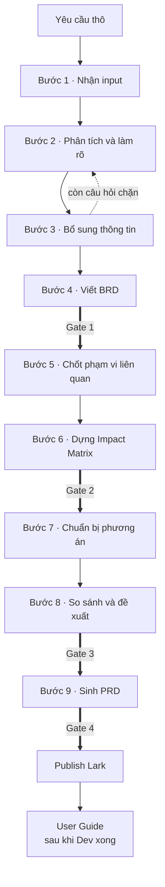
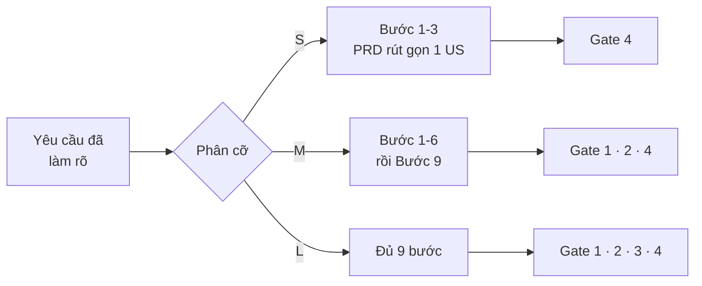
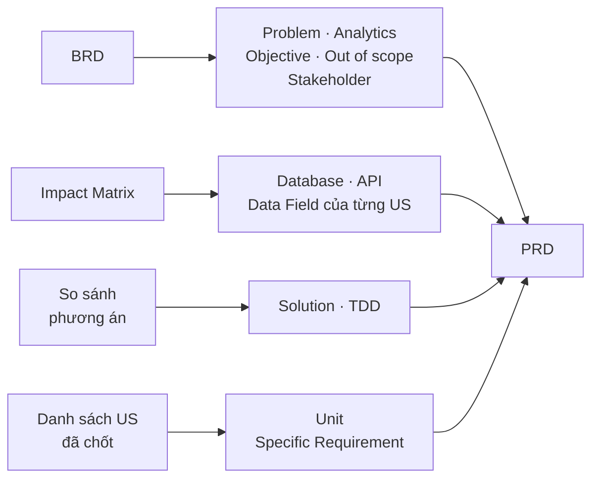

# PO Workflow with AI

Quy trình làm việc giữa PO và AI để biến một yêu cầu thô thành PRD đủ chi tiết cho Dev, QA và Design. Là đầu vào cho các AI Workflow tiếp theo

Tài liệu này mô tả **tổng quan quy trình và phương pháp**. Hướng dẫn vận hành chi tiết tại [HUONG-DAN-SU-DUNG.md](HUONG-DAN-SU-DUNG.md).

---

## Nguyên tắc nền

**AI đề xuất, người quyết.** AI đọc knowledge base, tra Swagger, dựng bản nháp, chỉ ra chỗ mâu thuẫn. PO chốt mọi quyết định về phạm vi, nghiệp vụ và ưu tiên. Không có quyết định nào AI tự chốt thay.

Ba nguyên tắc đi kèm:

**Không bịa.** Thiếu thông tin nhẹ thì ghi `Assumption`. Thiếu tới mức ảnh hưởng phạm vi, business rule, dữ liệu hay luồng thì ghi `Open Question` và dừng hỏi. Ô không suy được đánh dấu `❓BA`, không điền bừa cho đủ chỗ.

**Dừng ở mức phân tích.** Cần biết một cơ chế kỹ thuật có tồn tại không thì hỏi PO, không tự đào Swagger rồi kết luận. Có endpoint không có nghĩa là có tính năng.

**Knowledge base là bản chụp, không phải chân lý.** Schema DB, Swagger và User Guide là nguồn sống. Yêu cầu chạm tới vùng nào thì đọc lại nguồn vùng đó, quá một tháng kể từ lần đối chiếu cuối cũng phải đọc lại.

---

## Chín bước, năm giai đoạn



*Mũi tên đậm là Gate. Nét đứt giữa Bước 3 và Bước 2 là vòng lặp: còn câu hỏi chặn thì quay lại phân tích, chưa viết BRD.*

| Bước | Làm gì | Kết quả |
|---|---|---|
| **1** | PO đưa yêu cầu thô vào: mô tả vấn đề, yêu cầu từ stakeholder, biên bản họp, tài liệu tham khảo | File trong `working/raw-inputs/` |
| **2** | AI đọc yêu cầu, tra knowledge base, tách ra ba thứ: danh sách requirement ứng viên kèm mức tin cậy, phạm vi sơ bộ chia In/Out/Potential, và danh sách câu hỏi mở có đánh dấu câu nào chặn bước sau | Bản làm rõ + bảng câu hỏi mở |
| **3** | PO trả lời câu hỏi. AI cập nhật bản làm rõ. **Còn câu hỏi chặn thì quay lại Bước 2**, không đi tiếp | Bản làm rõ đã đủ để viết BRD |
| **4** | Viết BRD: vấn đề, số liệu chứng minh, mục tiêu, stakeholder, phạm vi, danh sách US ở mức tên | `docs/brd/brd-v0.1.md` → **Gate 1** |
| **5** | Quét knowledge base, schema và Swagger, trình bảng **Related Features & Docs Map**: module nào, màn nào, bảng nào, endpoint nào, rule nào có liên quan. PO xác nhận đủ hay sót | Bản đồ phạm vi liên quan đã được PO chốt |
| **6** | Dựng Impact Matrix từ bản đồ đó: cái gì bị chạm, chạm tới mức nào, rule nào xung đột với rule hiện có | `working/impact-analysis/impact-matrix-v0.1.md` → **Gate 2** |
| **7** | Hỏi PO đã có định hướng giải pháp chưa. Có thì nhận xét điểm mạnh và lỗ hổng, gợi ý thêm một hai phương án thay thế. Chưa có thì AI dựng các phương án từ đầu | Danh sách phương án để so sánh |
| **8** | So sánh các phương án theo: phù hợp nghiệp vụ, tác động tới người dùng, tác động hệ thống và dữ liệu, công sức, rủi ro, phụ thuộc. Kèm khuyến nghị có điều kiện, không phải quyết định cuối | `working/solution-options/solution-comparison-v0.1.md` → **Gate 3** |
| **9** | Sinh PRD qua bốn chặng, xem bên dưới | `docs/prd/prd-<tính năng>-v0.1.md` → **Gate 4** |

Bước 9 chia bốn chặng vì nó là bước nặng nhất:

```
9A   Khung PRD + danh sách US        → dừng, PO confirm danh sách
9A+  Chia Unit, nhóm bàn giao
9B   Field Intake                     → dừng, PO trả lời bảng field
9C   Viết chi tiết từng US
```

Năm giai đoạn gộp chín bước lại: làm rõ yêu cầu (1-3), BRD (4), phân tích ảnh hưởng (5-6), solution (7-8), PRD (9).

### Vì sao tách nhỏ thay vì gộp

Mỗi ranh giới bước là **một chỗ người phải trả lời**. Gộp hai bước lại nghĩa là bỏ một chỗ dừng.

Bước 2 và 3 tách ra vì chúng là **vòng lặp**, không phải hai việc nối tiếp. AI phân tích rồi hỏi, người trả lời, AI phân tích lại. Vòng này chạy tới khi hết câu hỏi chặn. Gộp thành một bước thì không diễn đạt được chỗ lặp.

Bước 5 và 6 tách ra vì **Impact Matrix chỉ đúng khi phạm vi đúng**. Bước 5 trình bản đồ phạm vi để PO xác nhận trước; nếu phạm vi sót một module thì ma trận ở Bước 6 phân tích nhầm chỗ, và sai này không lộ ra cho tới lúc Dev làm.

Bước 7 và 8 tách ra vì Bước 7 **rẽ nhánh theo câu trả lời của PO**. PO đã có định hướng thì AI nhận xét và bổ sung phương án thay thế. PO chưa có thì AI dựng từ đầu. Hai đường khác nhau, dẫn tới cùng một việc ở Bước 8.

Bước 1 tách riêng vì nó không có việc của AI. Nó là chỗ để đặt input đúng chỗ, và cũng là chỗ phát hiện sớm rằng yêu cầu chưa đủ để bắt đầu.


---

## Khái niệm riêng

| Khái niệm | Nghĩa |
|---|---|
| **Gate** | Điểm PO duyệt một artifact. Ba trạng thái: `Approved` · `Approved with Notes` · `Need Revision`. Trượt thì quay về **đúng bước cụ thể**, không làm lại từ đầu |
| **Điểm dừng** | Chỗ AI phải hỏi trước khi đi tiếp, nhưng không phải duyệt artifact. Có ba điểm dừng: chốt phạm vi liên quan, confirm danh sách US, trả lời bảng field |
| **Cỡ yêu cầu** | `S` · `M` · `L`. Quyết định đi mấy bước và qua mấy Gate |
| **Unit** | Nhóm US làm độc lập được. Trả lời câu hỏi Dev hỏi đầu tiên: làm cái nào trước |
| **Change request** | Yêu cầu đổi giữa chừng. Mỗi CR ghi rõ điểm re-entry: quay về bước nào, artifact nào phải sửa, Gate nào duyệt lại |
| `❓BA` | Ô chưa rõ, có người chịu trách nhiệm điền. Không dùng làm dữ kiện |
| `[suy ra]` | AI suy luận, không phải câu chữ trực tiếp từ nguồn |

---

## Phân cỡ để không bắt yêu cầu nhỏ chạy đủ chín bước

Một yêu cầu sửa nhãn trên một màn mà phải qua BRD, Impact Matrix, Solution Comparison rồi mới tới PRD là cách chắc chắn khiến người dùng bỏ quy trình và viết tay cho nhanh.

Sau Bước 2, AI quét nhanh knowledge base, DB và Swagger rồi phân cỡ:

| Cỡ | Dấu hiệu, phải đúng tất cả | Đường đi | Gate |
|---|---|---|---|
| **S** | Chạm 1 màn · không đổi data model · không đổi business rule hiện có · không chạm module khác | Bước 1–3 → PRD rút gọn 1 US | Gate 4 |
| **M** | Chạm tối đa 2 module · thêm field nhưng không đổi quan hệ bảng · không có conflict · đã rõ hướng giải | Bước 1–6 → Bước 9 | Gate 1, 2, 4 |
| **L** | Chạm từ 3 module trở lên, hoặc đổi data model, hoặc có conflict, hoặc có nhiều hướng giải | Đủ 9 bước | Đủ 4 Gate |



*Cỡ quyết định bỏ giai đoạn nào. Cỡ `S` bỏ cả phân tích ảnh hưởng lẫn so sánh phương án, cỡ `M` chỉ bỏ so sánh phương án.*

Ba quy tắc bắt buộc:

1. Nghi ngờ thì lên cỡ. Không chắc `S` hay `M` thì chọn `M`
2. Phát hiện giữa chừng thì nâng cỡ ngay, không đi tiếp đường cũ
3. Echo phân cỡ kèm lý do trước khi chạy. PO có quyền đổi cỡ

---

## Artifact sinh ra

```
.claude/projects/<tên project>/
├── project-context.md          bối cảnh, phạm vi, ràng buộc, mapping Lark
├── project-decisions.md        nhật ký mọi quyết định đã chốt
├── docs/
│   ├── brd/                    BRD theo version
│   ├── prd/                    PRD theo version
│   └── user-guide/             viết sau khi Dev xong
├── design/                     ảnh màn đã chốt + order.txt
└── working/
    ├── raw-inputs/             yêu cầu gốc, change-requests.md
    ├── ai-drafts/              bản làm rõ yêu cầu
    ├── open-questions/         câu hỏi mở theo nhóm
    ├── impact-analysis/        related map, impact matrix
    └── solution-options/       so sánh phương án
```

`project-decisions.md` là bộ nhớ của dự án. AI tra file này để không hỏi lại câu đã có đáp án.

Artifact của giai đoạn trước là đầu vào của giai đoạn sau, và cuối cùng dồn hết vào PRD:



*Không mục nào của PRD viết từ con số không. Mỗi mục truy được về một artifact đã qua Gate.*

---

## Cơ chế giữ chất lượng

**Bốn Gate cộng ba điểm dừng.** Ở cỡ `L` là bảy chỗ PO phải trả lời trước khi AI đi tiếp.

**Trạng thái Gate có ba mức, không phải hai.** `Approved with Notes` cho phép đi tiếp kèm danh sách việc còn treo, thay vì bắt chọn giữa duyệt sạch và làm lại.

**Điểm re-entry khi có change request.** Yêu cầu đổi ở Bước 9 không có nghĩa là làm lại từ Bước 1. CR ghi rõ artifact nào hết hiệu lực, Gate nào duyệt lại.

**Đối chiếu sau khi publish.** API trả `200` không có nghĩa nội dung vào đúng chỗ. Sau mỗi lần đẩy lên Lark, đếm lại số heading, số bảng, số sơ đồ, số ảnh và so với file nguồn.

**Dọn dấu vết quy trình trước khi bàn giao.** Ký hiệu nội bộ như `9A`, `Gate 3`, nhãn chờ, ghi chú thay đổi giữa chừng đều là giàn giáo. Dev và QA không tra được chúng. Trạng thái duyệt ghi ai duyệt, không ghi Gate mấy.

---

## Phương pháp luận đứng sau

Quy trình này không phải phát minh mới. Nó ghép bảy cơ chế đã có sẵn trong lý thuyết phân tích nghiệp vụ và kỹ thuật phần mềm, rồi chỉnh lại cho phù hợp với việc một người làm cùng AI.

| Cơ chế trong luồng | Lấy từ | Ý gốc |
|---|---|---|
| Năm giai đoạn | BABOK (IIBA) | Khơi gợi yêu cầu, phân tích, đặc tả, kiểm chứng. Bốn hoạt động tách bạch, không trộn |
| Gate giữa các giai đoạn | Stage-Gate, Robert G. Cooper, 1986 | Mỗi giai đoạn kết thúc bằng một cổng quyết định: đi tiếp, dừng, hay làm lại |
| Phân cỡ `S` `M` `L` | Rolling wave planning, PMBOK | Mức chi tiết của kế hoạch tỉ lệ với mức bất định. Chỗ đã rõ thì không cần lập kế hoạch dày |
| Chặng 9A, 9B, 9C | Progressive elaboration, PMBOK | Làm rõ dần. Không cố định mọi chi tiết khi chưa đủ thông tin |
| Impact Matrix | Software Change Impact Analysis, Bohner và Arnold, 1996 | Trước khi sửa, xác định cái gì bị ảnh hưởng và ảnh hưởng tới đâu |
| Unit | Modular decomposition, David Parnas, 1972 | Chia hệ thống thành mô-đun ghép lỏng, mỗi cái thay đổi được mà không kéo theo cái khác |
| `project-decisions.md` | Architecture Decision Record, Michael Nygard, 2011 | Ghi quyết định kèm bối cảnh, để người đọc sau sáu tháng hiểu được vì sao |

### Vì sao đặt Gate chứ không chạy một mạch

Chi phí sửa một lỗi yêu cầu tăng theo giai đoạn phát hiện. Barry Boehm chỉ ra điều này trong *Software Engineering Economics* (1981): một hiểu nhầm về nghiệp vụ nếu bắt được lúc viết tài liệu thì sửa bằng cách gõ lại vài dòng, còn nếu bắt được sau khi code xong thì phải sửa code, sửa test, sửa cả dữ liệu đã sinh ra.

Gate là chỗ ép dừng để kiểm. Bốn Gate không phải để tạo thủ tục, mà vì bốn artifact đó đều là nền cho artifact sau: BRD sai thì Impact Matrix phân tích nhầm phạm vi, Impact Matrix sót thì PRD thiếu rule.

Ba trạng thái Gate cũng từ Stage-Gate. Cooper mô tả bốn kết quả có thể của một cổng: `Go`, `Kill`, `Hold`, `Recycle`. Luồng này giữ ba cái dùng được: `Approved` ứng với Go, `Need Revision` ứng với Recycle, và `Approved with Notes` là Go kèm điều kiện, cho phép đi tiếp mà không mất dấu việc còn treo.

### Vì sao phân cỡ yêu cầu

Rolling wave planning nói mức chi tiết nên tỉ lệ với mức bất định. Một yêu cầu chạm một màn, không đổi dữ liệu, không đụng rule cũ thì bất định thấp, nên không cần phân tích ảnh hưởng và so sánh phương án.

Quy trình nào cũng bị bỏ khi chi phí tuân thủ vượt giá trị nó mang lại. Phân cỡ giữ cho chi phí đó tương xứng với rủi ro.

### Vì sao AI đề xuất mà người quyết

Việc phân công giữa người và máy có một nguyên tắc cũ, Paul Fitts đặt ra năm 1951: giao cho mỗi bên phần nó làm tốt hơn.

Máy đọc nhanh và nhớ đủ. Nó quét được toàn bộ data model, API surface và knowledge base trong vài giây, rồi chỉ ra chỗ mâu thuẫn mà người đọc tay sẽ bỏ sót.

Người biết bối cảnh mà tài liệu không ghi. Vì sao đợt này ưu tiên tính năng A, tổ chức chịu được rủi ro nào, cái gì đã chốt miệng trong cuộc họp tuần trước. Những thứ đó không nằm trong bất kỳ nguồn nào AI đọc được.

Nên AI dựng bản nháp và chỉ ra vấn đề, người chốt phạm vi và nghiệp vụ. Phân vai này cũng là nguyên tắc nền của AI-DLC, phương pháp do AWS định nghĩa, phát biểu dưới dạng *AI proposes, human validates*.

### Phần không lấy từ đâu cả

Bốn quy tắc dưới đây không có trong tài liệu học thuật nào. Chúng sinh ra từ lỗi gặp phải khi chạy quy trình trên dự án thật, rồi được viết thành quy tắc để không lặp lại:

| Quy tắc | Lỗi nó chặn |
|---|---|
| Đánh dấu `❓BA` thay vì suy đoán | AI điền một giá trị nghe hợp lý vào ô trống, Dev code theo, tới lúc test mới phát hiện giá trị đó không có thật |
| Knowledge base là bản chụp, chạm vùng nào đọc lại nguồn vùng đó | Rule trong knowledge base cũ hơn hệ thống. Bốn rule được phát hiện sai trong một dự án |
| Có endpoint không có nghĩa là có tính năng | Ba lần kết luận nhầm vì thấy endpoint trong Swagger, trong khi tính năng đã bị gỡ khỏi giao diện |
| Dọn dấu vết quy trình trước khi bàn giao | Ký hiệu nội bộ như `9A` hay `Gate 3` lọt vào tài liệu gửi Dev, người đọc không tra được chúng là gì |

Một quy trình chỉ dựng từ lý thuyết sẽ thiếu bốn chỗ này. Chúng chỉ lộ ra khi chạy thật.

---

## Quy trình này hợp với ai

Hợp khi:

- Bạn là PO hoặc BA, viết tài liệu cho một hệ thống đã chạy, có người dùng thật và dữ liệu cũ
- Yêu cầu chạm nhiều module và cần biết trước nó phá cái gì
- Tài liệu phải theo template có sẵn của công ty
- Cần truy được vì sao một quyết định được chốt, sau vài tháng vẫn tra lại được

Chưa hợp khi:

- Dựng sản phẩm mới hoàn toàn, chưa có hệ thống để phân tích ảnh hưởng
- Chỉ cần bản nháp nhanh để thảo luận, không cần bàn giao
- Quy trình công ty không có bước duyệt tài liệu

---

## So với các phương pháp khác

| | PO Workflow | AI-DLC | Spec generation |
|---|---|---|---|
| Phủ tới đâu | Yêu cầu → PRD → User Guide | Inception → Construction → Operations | Yêu cầu → spec |
| Người dùng | PO hoặc BA | Cả team, có dev | Bất kỳ ai |
| Phân tích ảnh hưởng tới module khác | Có, là một giai đoạn riêng | Không có | Không có |
| So sánh phương án trước khi chốt | Có, là một giai đoạn riêng | Không có | Không có |
| Checkpoint | 4 Gate, co giãn theo cỡ yêu cầu | Cố định cho mọi đơn vị công việc | 3 phase gate |
| Xử lý khi thiếu thông tin | `❓BA` · `Assumption` · `Open Question` | Không có cơ chế riêng | Không có cơ chế riêng |
| Template đầu ra | Template PRD của công ty | Chuẩn riêng | Chuẩn riêng |

Điểm mạnh của quy trình này nằm ở hai giai đoạn mà các phương pháp kia không có: phân tích ảnh hưởng và so sánh phương án. Cả hai chỉ có nghĩa khi hệ thống đã chạy và việc thêm một tính năng có thể phá thứ đang hoạt động.

Đổi lại, nó không nói gì về việc viết code, chạy test hay triển khai. Phần đó thuộc về Dev.

