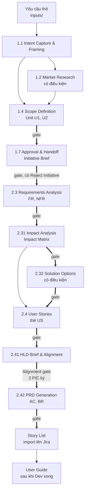
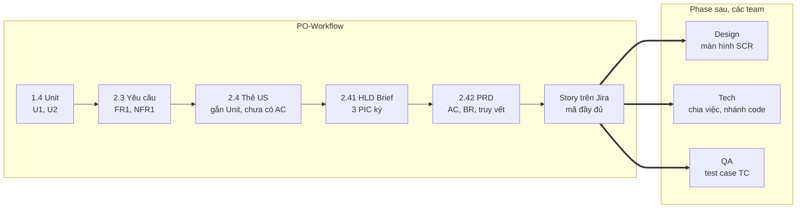

# PO-Workflow

PO-Workflow là quy trình để PO hoặc BA phân tích yêu cầu cùng AI, đi từ một yêu cầu thô tới PRD theo template của công ty, sau đó bàn giao cho Design, Tech và QA theo một chuẩn chung. AI đọc tài liệu, đặt câu hỏi, soạn bản nháp và tự kiểm; PO trả lời, quyết định và duyệt ở cuối mỗi bước.

Khung phase, stage, gate và thuật ngữ tham khảo [AWS AI-DLC Workflows](https://github.com/awslabs/aidlc-workflows) bản 2.11, giới hạn trong hai phase thuộc phạm vi PO là Ideation và Inception. Quy trình viết bằng Markdown và một script Python, không cài engine của AWS. Engine không phụ thuộc sản phẩm và không phụ thuộc công cụ AI; dữ kiện của sản phẩm nằm trong domain pack.

| Tài liệu | Dành cho | Nội dung |
|---|---|---|
| README.md, file này | Mọi người | Phương pháp, từng stage, chuẩn bàn giao, mức độ trưởng thành |
| [USER-GUIDE.md](USER-GUIDE.md) | PO, các PIC | Thao tác hằng ngày |
| [GLOSSARY.md](GLOSSARY.md) | Mọi người | Thuật ngữ và họ mã |
| [DOMAIN-SETUP.md](DOMAIN-SETUP.md) | Người phụ trách quy trình | Đưa một sản phẩm mới vào quy trình |
| [engine/standards/](engine/standards/) | Design, Tech, QA | Nguyên tắc chia story, quy ước mã, quy tắc bàn giao, quyết định giao việc trên Jira |
| [AGENTS.md](AGENTS.md) | Công cụ AI | Luật làm việc cho AI; `CLAUDE.md` chỉ nhập lại file này |
| [CHANGELOG.md](CHANGELOG.md) | Người phụ trách quy trình | Phiên bản engine và cách nâng cấp |

## Mục lục

1. [Phạm vi và đầu ra](#1-phạm-vi-và-đầu-ra)
2. [Nguyên lý nền](#2-nguyên-lý-nền)
3. [Quy trình](#3-quy-trình)
4. [Từng stage](#4-từng-stage)
5. [Kiểm tra chất lượng](#5-kiểm-tra-chất-lượng)
6. [Đầu ra chuẩn cho các phase sau](#6-đầu-ra-chuẩn-cho-các-phase-sau)
7. [Sau PRD](#7-sau-prd)
8. [Cấu trúc repo và nâng cấp](#8-cấu-trúc-repo-và-nâng-cấp)
9. [Mức độ trưởng thành](#9-mức-độ-trưởng-thành)
10. [Đối chiếu với AWS AI-DLC](#10-đối-chiếu-với-aws-ai-dlc)
11. [Phương pháp luận và quy tắc rút từ sự cố](#11-phương-pháp-luận-và-quy-tắc-rút-từ-sự-cố)
12. [Lịch sử và nguồn](#12-lịch-sử-và-nguồn)

## 1. Phạm vi và đầu ra

Một yêu cầu là một intent, lưu tại `intents/<YYMMDD-slug>/`. Intent đi qua 10 stage chia làm 2 phase. Ideation xác định vấn đề và phạm vi; Inception chuyển phạm vi thành yêu cầu, phân tích ảnh hưởng lên hệ thống đang chạy, chia user story, thống nhất định hướng với các team, sau đó viết PRD. Mỗi stage sinh một artifact và kết thúc bằng một gate do PO duyệt.

Phần lớn sản phẩm dùng quy trình này đã có người dùng và dữ liệu. Vì vậy quy trình dành nhiều công sức cho việc xác định tính năng mới chạm tới những gì đang chạy, trước khi viết chi tiết.

Đầu ra bàn giao gồm 5 loại. Mọi artifact khác là bản phân tích nội bộ của PO.

| Đầu ra | Người nhận | Khi nào |
|---|---|---|
| Initiative Brief | Người quyết đầu tư | Cuối Ideation, profile L |
| HLD Brief | Design PIC, Tech PIC, QA PIC | Trước khi viết PRD, profile M và L |
| PRD | Design, Dev, QA | Cuối Inception |
| Story List để import lên Jira, mỗi user story một dòng | Design, Tech, QA | Sau khi PRD được duyệt |
| User Guide | Người dùng cuối | Sau khi Dev làm xong |

Ngoài phạm vi: thiết kế kỹ thuật chi tiết, cách Dev chia việc và triển khai trong phase Construction, vận hành sau phát hành.

## 2. Nguyên lý nền

Mọi quy tắc trong quy trình xuất phát từ 7 nguyên lý. Gặp một quy tắc chưa rõ lý do, tìm nguyên lý tương ứng ở bảng dưới.

| Nguyên lý | Ý chính | Áp vào quy trình | Nguồn |
|---|---|---|---|
| Human-in-the-loop | AI đề xuất, PO quyết định | Gate cuối mỗi stage; lời duyệt ghi nguyên văn vào `decisions.md` | AWS AI-DLC; Paul Fitts, 1951 |
| Requirements Engineering | Khơi gợi, phân tích, đặc tả, kiểm chứng là bốn việc tách biệt | Questions file, phân tích yêu cầu và ảnh hưởng, PRD, kiểm tra | BABOK v3, IIBA |
| Context Engineering | AI làm tốt khi được nạp đúng và đủ thông tin | Bước Load đầu mỗi stage đọc domain pack, nhật ký quyết định, bài học | Anthropic, 2025 |
| Quality Gate | Mỗi đầu ra là nền cho đầu ra sau, nên phải được kiểm trước khi đi tiếp | Script kiểm, checklist có mục chặn, AI Reviewer, năm lựa chọn tại gate | Stage-Gate, Robert G. Cooper, 1986 |
| Iterative Refinement | Chi tiết tăng theo mức chắc chắn | Profile S, M, L; thẻ user story trước, acceptance criteria sau HLD Brief | PMBOK, progressive elaboration |
| Requirement Traceability | Yêu cầu, user story, rule, tiêu chí chấp nhận truy được về nhau và về nguồn | Mã ổn định, thẻ nguồn, bảng truy vết, mã đầy đủ khi bàn giao | Gotel và Finkelstein, 1994; ISO/IEC/IEEE 29148 |
| Responsible AI | AI không tự điền khi thiếu thông tin; người chịu trách nhiệm cuối | Ký hiệu `❓PO`, đọc lại nguồn sống, chỉ đăng bản đã duyệt | NIST AI RMF 1.0, 2023 |

4 quy tắc làm việc rút từ các nguyên lý trên áp cho mọi stage:

- AI không tự điền dữ kiện. Thiếu thông tin nhỏ thì ghi giả định; thiếu thông tin làm đổi phạm vi, rule, dữ liệu hoặc luồng thì ghi câu hỏi mở và dừng; ô không suy ra được thì đánh dấu `❓PO`.
- AI dừng ở mức phân tích. Cần biết một cơ chế kỹ thuật có tồn tại hay không thì hỏi PO. Có endpoint trong API spec không có nghĩa là tính năng còn hoạt động.
- Knowledge base là bản chụp. Schema dữ liệu, API spec, tài liệu người dùng là nguồn sống; yêu cầu chạm tới vùng nào thì đọc lại nguồn vùng đó, và quá 30 ngày kể từ lần đối chiếu cuối cũng phải đọc lại.
- Câu trả lời và quyết định của PO được ghi nguyên văn. AI tra nhật ký quyết định trước khi hỏi để không hỏi lại.

## 3. Quy trình

### 3.1 Sơ đồ



### 3.2 10 stage

Số stage 1.1, 1.2, 1.4, 1.7, 2.3, 2.4 giữ theo AWS. 4 stage PO-Workflow thêm mang số thập phân để chen vào giữa: 2.31 và 2.32 sau 2.3, 2.41 và 2.42 sau 2.4. Định danh của stage là slug, ví dụ `impact-analysis`; số chỉ để hiển thị thứ tự. Các stage AWS giao cho kiến trúc sư, delivery, design hoặc developer, như 1.3, 1.5, 1.6, 2.1, 2.2 và 2.5 tới 2.9, không có trong repo này.

| Stage | Mục đích | Artifact chính | Profile | Nguồn |
|---|---|---|---|---|
| 0 Khởi tạo | Dựng thư mục intent, cấp mã tính năng, chọn profile | `intent.md`, `state.md`, `decisions.md` | mọi profile | AWS Initialization |
| 1.1 Intent Capture & Framing | Xác định vấn đề, mục tiêu đo được, stakeholder; tách giải pháp người yêu cầu đề xuất khỏi vấn đề | `intent-statement.md` | M, L | AWS |
| 1.2 Market Research | So sánh với sản phẩm khác theo khía cạnh đã chọn | `competitive-analysis.md` | L, có điều kiện | AWS |
| 1.4 Scope Definition | Chốt In, Out, Potential; chia nhu cầu thành Unit có ưu tiên | `scope-document.md` | M, L | AWS |
| 1.7 Approval & Handoff | Tóm tắt Ideation thành một trang để quyết đi tiếp hay dừng | `initiative-brief.md` | L | AWS |
| 2.3 Requirements Analysis | Chuyển phạm vi thành yêu cầu có mã; tra KB tìm trùng lặp và rule chi phối | `requirements.md` | S, M, L | AWS |
| 2.31 Impact Analysis | Xác định phần nào của hệ thống đang chạy bị ảnh hưởng; tìm conflict | `impact-matrix.md` | M, L | PO-Workflow |
| 2.32 Solution Options | So sánh các hướng giải theo bảy tiêu chí | `solution-options.md` | L, có điều kiện | PO-Workflow |
| 2.4 User Stories | Chia yêu cầu thành user story; mỗi US một thẻ chín mục đủ cho các PIC viết định hướng | `stories.md` | M, L | AWS |
| 2.41 HLD Brief & Alignment | Tài liệu tối đa ba trang để các PIC ghi định hướng và ký | `hld-brief.md` | M, L | PO-Workflow |
| 2.42 PRD Generation | PRD theo template công ty, chi tiết từng US theo HLD Brief, có tiêu chí chấp nhận và truy vết | `prd.md` | S, M, L | PO-Workflow |

Mỗi file stage trong `engine/stages/` có bảng metadata với hàng "Lệch so với AWS", ghi điểm khác với stage cùng số của AWS. 2 stage gốc có chỉnh: 1.4 gộp intent backlog vào scope-document, và 2.4 không viết acceptance criteria, không chạy nhiều agent cùng góp ý.

### 3.3 Profile và depth

Khi tạo intent, AI quét nhanh và đề xuất profile kèm lý do; PO có quyền đổi. Phân vân giữa hai profile thì chọn profile lớn hơn.

| Profile | Độ lớn và độ phức tạp | Stage chạy | AI Reviewer | Số gate |
|---|---|---|---|---|
| S | Một màn, không đổi data model, không đổi rule có sẵn, không chạm module khác, không chạm tính năng ẩn, không tích hợp ngoài, không migration | 2.3 và 2.42, PRD rút gọn | 2.42 | 2 |
| M | Tối đa hai module, thêm field nhưng không đổi quan hệ bảng, không conflict, hướng giải đã rõ | 1.1 và 1.4 duyệt chung, 2.3, 2.31, 2.4, 2.41, 2.42 | 2.3, 2.4, 2.42 | 6 |
| L | Có ít nhất một yếu tố: từ ba module, đổi data model, conflict với rule hiện có, chạm tính năng ẩn, nhiều hướng giải, tích hợp ngoài, migration, thao tác không hoàn tác được | Đủ 10 stage; 1.2 và 2.32 khi cần | 1.1, 2.3, 2.4, 2.42 | 8 đến 10 |

Depth quyết định mức chi tiết của artifact. Template đánh dấu mục tuỳ chọn bằng `<!-- tuỳ chọn -->`; mục không có dấu là bắt buộc.

| Depth | Mục bắt buộc | Mục tuỳ chọn |
|---|---|---|
| Minimal | Viết ngắn, chỉ điều đã chốt | Bỏ |
| Standard | Viết đủ | Viết khi có nội dung |
| Comprehensive | Viết đủ | Viết hết, mục không áp dụng ghi lý do |

### 3.4 Chuỗi đầu ra

Các artifact sinh ra theo thứ tự: Unit ở 1.4, FR ở 2.3, user story ở 2.4, HLD Brief ở 2.41, cuối cùng là acceptance criteria và business rule trong PRD ở 2.42. Acceptance criteria chỉ viết sau khi các PIC đã ký định hướng, vì viết trước sẽ phải sửa lại khi hướng làm đổi.



Unit trong PO-Workflow là nhóm user story theo giá trị và ưu tiên; AWS gọi khái niệm này là proto-Unit. Dev chia việc của mình trong phase Construction theo kiến trúc, có thể khác cách nhóm của PO.

### 3.5 Bảy bước của một stage

Mọi stage chạy cùng 7 bước, định nghĩa một lần trong `engine/protocol/stage-protocol.md`.

| Bước | AI làm | PO làm |
|---|---|---|
| 1. Load | Đọc trạng thái, quyết định cũ, artifact đầu vào, KB, bài học | |
| 2. Ask | Viết questions file: mỗi câu gắn người trả lời, tối đa bốn lựa chọn, có đề xuất kèm nguồn và cờ chặn | Trả lời |
| 3. Confirm | Tóm tắt câu trả lời | Xác nhận hoặc yêu cầu sửa |
| 4. Generate | Viết artifact theo template, thẻ nguồn ở mỗi khẳng định; ở 1.1 và 2.3 trình giả định để PO chấp nhận hay chuyển thành câu hỏi | Xác nhận giả định |
| 5. Verify | Chạy script kiểm, checklist, gọi AI Reviewer theo profile | |
| 6. Learn | Ghi quan sát vào `memory.md` của intent | |
| 7. Gate | Trình thông điệp hoàn thành, hỏi bài học, hỏi duyệt; ghi chép bằng script | Chọn bài học, duyệt |

PO trả lời theo một trong ba cách, chọn một lần cho cả intent: Guide me qua hộp chọn, Edit file trực tiếp, hoặc Chat. Câu trả lời luôn được ghi vào questions file trước khi kết thúc lượt, để không mất khi phiên làm việc bị nén.

### 3.6 Gate và phiên bản

Tại gate, PO có 5 lựa chọn:

- Approve
- Request Changes, kèm nội dung cần sửa
- Accept as-is, từ lần Request Changes thứ ba, nhận bản hiện tại kèm điều kiện và lý do
- Add stage, chạy thêm một stage ngoài profile
- Reject Initiative, chỉ ở 1.7

Lời duyệt bằng câu tự nhiên được hiểu theo ý. "Ok nhưng đổi tên trường X" là Approve kèm chỉ thị. Nhờ thêm một việc mà không nói duyệt thì gate vẫn mở. Chọn nhầm thì ghi một dòng đính chính và trình lại.

Sau Approve, lệnh `po-tools.py approve` làm toàn bộ phần ghi chép: đặt phiên bản, chụp bản duyệt vào `archive/`, ghi quyết định nguyên văn kèm tên người quyết và giờ, đổi trạng thái stage, in dòng tiến độ và stage kế. Bản nháp mang phiên bản 0.x. Lần duyệt đầu là 1.0. Mỗi lần duyệt lại sau change request tăng số phụ, 1.0 thành 1.1. Bản trong `archive/` không bao giờ bị sửa.

## 4. Từng stage

### 0 Khởi tạo, lệnh /new-intent

AI dựng cây thư mục intent từ template và cấp mã tính năng dạng `<mã sản phẩm>-F<NNN>`. Mã sản phẩm lấy từ `domain/domain.md`. Nếu chưa có mô tả yêu cầu, AI đặt sẵn mẫu `inputs/request.md` để người yêu cầu điền: hiện trạng, muốn đổi gì, trong và ngoài phạm vi, điều không được thay đổi, mốc, câu hỏi mở. AI quét nhanh inputs và KB để ước lượng vùng bị chạm, đề xuất profile và ghi quyết định profile thành `DEC1`.

### 1.1 Intent Capture & Framing

AI tách giải pháp người yêu cầu nêu sẵn khỏi vấn đề. "Thêm nút export" là giải pháp; vấn đề có thể là "không lấy được dữ liệu để đối chiếu". Câu hỏi xoay quanh vấn đề theo góc nhìn người dùng, cách xử lý hiện tại, tiêu chí đo thành công, lý do làm lúc này, stakeholder và phạm vi loại trừ. Artifact `intent-statement.md` có thẻ nguồn ở mọi khối khẳng định và mục Assumptions & Open Questions.

### 1.2 Market Research

Stage có điều kiện, chỉ chạy khi PO muốn so sánh với sản phẩm khác hoặc cách làm phổ biến trên thị trường ảnh hưởng tới phạm vi. Danh sách sản phẩm so sánh mặc định ghi trong `domain.md`. AI trích nguồn kèm link và ngày đọc, không suy diễn tính năng từ tên menu. Artifact gồm bảng so sánh, điểm nên và không nên áp dụng, và đối chiếu với yêu cầu hiện tại.

### 1.4 Scope Definition

AI chốt In, Out, Potential và chia nhu cầu thành Unit, mã `U1`, `U2`, sắp theo MoSCoW. Bốn quy tắc chia: theo cơ chế chứ không theo màn hình; xác định hạng mục nền; tách riêng hạng mục chạm toàn hệ thống như phân quyền, bật tắt, lịch sử; phụ thuộc một chiều. Hạng mục Won't vẫn được định nghĩa để bước phân tích ảnh hưởng quét đúng. Profile M duyệt 1.1 và 1.4 chung một gate và chạy phase check Ideation tại gate đó.

### 1.7 Approval & Handoff

AI tóm tắt phase thành Initiative Brief một trang: vấn đề và mục tiêu, phạm vi, Unit và ưu tiên, rủi ro lớn, quyết định đã chốt, khuyến nghị đi tiếp hay dừng. Đây là gate duy nhất có lựa chọn Reject Initiative. Trước gate, AI kiểm ranh giới phase: mọi mục tiêu có hạng mục phục vụ, mọi Unit truy về một mục tiêu, Out of scope không mâu thuẫn In scope, câu hỏi chặn đã đóng.

### 2.3 Requirements Analysis

AI tra KB cho từng hạng mục trước khi hỏi: đã có chưa, rule nào chi phối, có tính năng ẩn liên quan không, thông báo nào liên quan, có rơi vào vùng KB chưa phủ không. Yêu cầu trùng tính năng đã có được nêu ngay kèm mã KB. Sau đó AI quét sáu chiều theo AWS và corner checklist của domain để tìm phần thiếu. Artifact `requirements.md` có FR mã `FR1`, `FR1.1` với ưu tiên và cờ Existing, New, Changed; NFR khi đo được; constraints; câu hỏi mở `OQ1`; out of scope; nguồn đã đọc. FR mô tả điều phải đúng, không nói tới bảng, endpoint hoặc thuật toán.

### 2.31 Impact Analysis

Thay vì đặt câu hỏi, AI dựng Related Features Map từ requirements, KB, schema và API spec để PO rà soát; nhận ra phần thiếu trong bản nháp dễ hơn liệt kê từ đầu. Sau khi PO xác nhận bản đồ, AI dựng Impact Matrix theo năm bước: hiện trạng và phụ thuộc, trạng thái mong muốn, ma trận 12 vùng, chuyển đổi dữ liệu, các câu kiểm theo `domain.md`. Conflict theo bốn chiều rule, process, data, permission được chuyển cho PO quyết, mỗi conflict một DEC. Ảnh hưởng được xét hai chiều, cả từ tính năng mới sang phần cũ và ngược lại.

### 2.32 Solution Options

Stage có điều kiện, chạy khi có từ hai hướng giải hoặc PO chưa có hướng. AI dựng option từ các hướng khác nhau: đổi quy trình, cấu hình, mở rộng tính năng có sẵn, làm mới, cắt phạm vi. Mọi option so bằng bảy tiêu chí: phù hợp nghiệp vụ, tác động người dùng, tác động hệ thống và dữ liệu, effort, risk, phụ thuộc, nợ đóng cứng. Effort và risk ghi Cao, Trung bình, Thấp kèm lý do, không ước lượng số giờ.

### 2.4 User Stories

AI chia yêu cầu thành user story, mỗi US gắn một Unit và mỗi FR có US phủ. Mỗi US có một thẻ chín mục: vai và mục tiêu, bối cảnh, luồng chính, nhánh đáng kể, rule đã biết, dữ liệu và vùng chạm, ngoài phạm vi, phụ thuộc, chưa rõ. Thẻ đủ để các PIC đọc và viết định hướng mà không cần mở requirements; thẻ chưa có acceptance criteria. Script truy vết kiểm FR chưa có US và US không truy về FR.

### 2.41 HLD Brief & Alignment

HLD Brief là tài liệu tối đa ba trang, dùng cho buổi checkpoint, tức buổi PO làm việc với Design PIC, Tech PIC, QA PIC trước khi viết PRD. AI viết mục 1 tới 7 và mục 11 từ artifact đã duyệt, không thêm nội dung mới. Design PIC viết mục 8, Tech PIC mục 9, QA PIC mục 10, trực tiếp trên repo; đầu mỗi mục có tối đa năm dòng điểm cần lưu ý cho vai đó. Mục 9 là định hướng kỹ thuật gồm tám ý, trong đó có service hoặc repo code bị chạm, dùng đúng tên Dev dùng. Design PIC cấp mã màn hình `SCR-` ở mục 8. Câu hỏi và ý kiến về mục của người khác ghi vào mục 7 theo cùng định dạng bảng câu hỏi mở.

Gate của stage là Alignment gate. Approve khi cả ba PIC ghi Đồng ý hoặc Có ý kiến ở mục 12. Một PIC ghi Yêu cầu sửa thì gate là Request Changes.

### 2.42 PRD Generation

Bước hỏi là Field Intake: AI tra Impact Matrix, data model, API spec và KB, phân loại mỗi màn là mới, sửa màn có sẵn hoặc chỉ đọc, sau đó lập một bảng field, rule, validate để PO duyệt. Field hiện có chỉ hỏi phần thay đổi. Profile S cũng phải qua bước này.

PRD theo template của công ty. Phần đầu chép từ HLD Brief. Phần Specific Requirement viết từng US với sáu mục: User story, Pre-Condition, Scenario, Acceptance criteria, Out of scope, Conner case để QA điền. Mục Acceptance criteria mở đầu bằng danh sách tiêu chí chấp nhận có mã `AC<US>.<n>`, tiếp theo là bảng UI, business rule mã `BR<US>.<n>`, data field và NFR. Cách viết tiêu chí chấp nhận ở mục 6.5.

Chi tiết của từng US bám HLD Brief. Điểm brief chưa nói, AI ghi đề xuất có đánh dấu kèm câu hỏi gắn tên PIC. Điểm mâu thuẫn với brief, AI hỏi PO; đổi hướng thì đi qua change request và brief phải ký lại. Quy tắc cố định: không có mục Database và API, không thiết kế bảng hoặc thuật toán, hằng số ghi rõ là giá trị cứng hay cấu hình, field hiện có không mô tả như mới, không dấu vết quy trình, không viết tắt.

## 5. Kiểm tra chất lượng

Mỗi gate có hai lớp kiểm. Lớp thứ nhất do máy làm, lớp thứ hai cần phán đoán.

| Lớp | Công cụ | Kiểm gì |
|---|---|---|
| Máy | `po-tools.py check` | Heading bắt buộc theo template, thẻ nguồn, `[Qn]` và `[DECn]` có thật, thẻ US đủ chín mục, chữ mẫu còn sót, giới hạn từ của HLD Brief, mục cấm trong PRD, mã AC không trùng |
| Máy | `po-tools.py trace` | FR sang US, US sang FR, BR sang AC, US trong PRD; báo GAP và ORPHAN; dừng với lỗi khi không đọc được mã nào |
| Phán đoán | Checklist trong `engine/verification/` | Phần cần đọc hiểu; mục có nhãn BLOCK chưa đạt thì gate không mở |
| Phán đoán | AI Reviewer | Agent AI độc lập, không thấy hội thoại; kết luận READY hoặc NOT-READY với finding Critical, Major, Minor |

AI Reviewer chỉ nhận đường dẫn file và kết quả kiểm bằng máy. Từ lần review thứ hai, reviewer nhận sổ finding của stage thay cho file review cũ; finding PO đã chấp nhận rủi ro hoặc bác bỏ không bị chấm lại. READY khi không có Critical và tối đa hai Major. AI không tự sửa theo finding; PO quyết sửa hay ghi Accepted risk.

Phase check chạy ở ranh giới phase: Ideation ở 1.7, hoặc ở gate chung của 1.1 và 1.4 với profile M; Inception ở 2.42. `po-tools.py status` phát hiện thêm artifact đã duyệt bị sửa ngoài change request, artifact dựa trên bản cũ của đầu vào, và nguồn KB quá hạn đối chiếu.

Bản thân script có bộ intent mẫu trong `engine/tests/`. Lệnh `po-tools.py selftest` chạy toàn bộ trước khi phát hành engine mới.

## 6. Đầu ra chuẩn cho các phase sau

Đầu ra của PO là đầu vào của Design, Tech và QA. Mọi team dùng chung một cách chia story, một quy ước mã, một Story List để import lên Jira, và một điều kiện giao Dev. Chuẩn đầy đủ nằm trong `engine/standards/`; mục này tóm tắt.

### 6.1 Mỗi team nhận gì

| Team | Nhận | Ở đâu | Khi nào |
|---|---|---|---|
| Design | Thẻ US, HLD Brief mục 1 tới 7 để viết mục 8; PRD với bảng UI; story trên Jira để gắn màn hình | `inception/`, Jira | Từ 2.41 |
| Tech | Thẻ US, Impact Matrix, HLD Brief để viết mục 9; PRD với Technical Direction, Data to Retain, Units, danh sách service bị chạm; story trên Jira để chia Unit of work và sub-task | `inception/`, Jira | Từ 2.41 |
| QA | HLD Brief để viết mục 10; PRD với tiêu chí chấp nhận có mã; story trên Jira để gắn test case | `inception/`, Jira | Từ 2.41 |
| Agent AI của Dev | PRD theo tag của bản đã duyệt; bảng chỉ mục; story trên Jira | Repo, `intents/INDEX.md`, Jira | Sau gate 2.42 |

### 6.2 Checkpoint và giao Dev

PO làm việc với các team ở 2 mốc.

| Mốc | Khi nào | Đầu vào | Kết quả |
|---|---|---|---|
| Checkpoint | Stage 2.41, trước khi viết PRD | Thẻ US đã duyệt ở 2.4; HLD Brief đã xong mục 1 tới 7 và 11 | 3 PIC ghi mục 8, 9, 10 và ký mục 12; cách chia story và cỡ story được xác nhận |
| Giao Dev | Sau khi PRD được duyệt | Story List import lên Jira | Story đạt điều kiện giao Dev, xem mục 6.7 |

Chi tiết nghiệp vụ, gồm business rule và tiêu chí chấp nhận, chỉ viết sau checkpoint. Vì vậy buổi checkpoint không đòi tiêu chí chấp nhận hoặc test case.

### 6.3 Nguyên tắc chia story

Story là đơn vị nghiệm thu. Mỗi story là một việc người dùng làm trọn được và kiểm được bằng tiêu chí chấp nhận; mọi phần việc của Design, Tech, QA truy về story qua mã. PO chia story một lần ở 2.4, trước checkpoint. Story List sinh sau PRD giữ nguyên cách chia đó, mỗi US một story, và chỉ dùng để chia việc, không chia lại story.

PO chia story ở 2.4 theo nguyên tắc trong `engine/standards/story-splitting.md`. Tóm tắt:

1. Mỗi story là một mục tiêu hoàn chỉnh của một vai, đi trọn từ giao diện tới rule và dữ liệu, và đạt bộ tiêu chí INVEST.
2. Cách chia: dựng bản đồ story theo vai và bước trong hành trình người dùng; mỗi ô "vai và mục tiêu" là một story ứng viên.
3. Dấu hiệu quá lớn: tên có chữ "và" nối hai việc, hơn một vai hưởng giá trị, luồng hơn 7 bước, gồm cả cấu hình và sử dụng, chạm hơn 2 module, hơn 6 tiêu chí chấp nhận. Script cảnh báo 2 dấu hiệu: chữ "và" trong tên ở 2.4, và hơn 6 AC ở 2.42.
4. 8 cách tách, thử theo thứ tự: theo bước trong luồng, theo vai, theo biến thể nghiệp vụ, theo biến thể dữ liệu, theo thao tác xem tạo sửa xoá, luồng đơn giản trước, chạy được trước chạy nhanh sau, theo kênh.
5. Không chia theo màn hình, tầng kỹ thuật, từng business rule, việc kỹ thuật thuần hoặc người làm.
6. Mỗi story thuộc đúng một Unit.

Cỡ story được xác nhận ở checkpoint: Tech PIC ghi ở mục 9 của HLD Brief story nào quá lớn để làm trong một sprint, PO tách trước khi viết PRD. Phát hiện story quá lớn sau khi PRD đã duyệt thì tách qua change request, phần tách ra nhận mã mới.

Mỗi team tự chia việc của mình từ story:

| Team | Chia việc theo | Quan hệ với story |
|---|---|---|
| Design | Màn hình, mã `SCR` | Một màn có thể phục vụ nhiều story |
| Dev | Unit of work, sau đó là sub-task trên Jira | Một Unit of work gồm một hoặc nhiều story; thiết kế kỹ thuật chi tiết làm theo Unit, trong tài liệu của Dev |
| QA | Tiêu chí chấp nhận | Mỗi tiêu chí chấp nhận có ít nhất một test case |

AWS AI-DLC làm tương tự: story ở 2.4, Unit of work ở 2.7 kèm bảng ghép Unit với story, thiết kế chi tiết ở 3.1 theo từng Unit. PO-Workflow giữ 6 cách tách của AWS và thêm 2 cách là theo vai và luồng đơn giản trước. Bảng so sánh đầy đủ ở mục 10 của `engine/standards/story-splitting.md`.

### 6.4 Mã chung

PRD và artifact của PO dùng mã ngắn cho dễ đọc. Khi sinh Story List, script đổi sang mã đầy đủ có mã tính năng; từ đó mọi team chỉ dùng mã đầy đủ.

| Đối tượng | Mã đầy đủ | Ví dụ | Ai cấp |
|---|---|---|---|
| Tính năng | `<SP>-F<NNN>` | `LMS-F012` | PO, khi tạo intent |
| User story | `US-<tính năng>-<NN>` | `US-LMS-F012-01` | PO, ở 2.4 |
| Acceptance criteria | `AC-<tính năng>-<NN>.<n>` | `AC-LMS-F012-01.1` | PO, ở 2.42 |
| Business rule | `BR-<tính năng>-<NN>.<n>` | `BR-LMS-F012-01.2` | PO, ở 2.42 |
| Câu hỏi mở | `Q-<tính năng>-<NN>.<n>` | `Q-LMS-F012-01.3` | Người hỏi |
| Màn hình | `SCR-<tính năng>-<NN>` | `SCR-LMS-F012-02` | Design PIC |
| Test case | `TC-<tính năng>-<NN>` | `TC-LMS-F012-01` | QA PIC |
| Nhánh code | `feat/<tính năng>-<mô tả>` | `feat/LMS-F012-quiz-retake` | Dev |
| Commit | Trailer `Feature:` và `Story:` | `Feature: LMS-F012` | Dev |

Mã đã cấp không đổi và không dùng lại. Tách một story thì phần tách ra nhận số mới; AC chuyển đi nhận mã mới và dòng cũ ghi "chuyển sang", để test case trỏ mã cũ vẫn tìm được đường. Chi tiết ở `engine/standards/id-conventions.md`.

### 6.5 Tiêu chí chấp nhận trong PRD

Tiêu chí chấp nhận là hợp đồng giữa PO và QA. Business rule định nghĩa luật; bảng UI đặc tả màn hình; mỗi tiêu chí chấp nhận là một câu kiểm được, có đạt hoặc không đạt, viết theo hành vi người dùng thấy, và ghi rõ business rule mà nó kiểm.

```
- AC1.1 Khi tạo nhóm làm nhánh vượt 6 cấp, hệ thống chặn và báo "Nhánh này đã đạt số cấp tối đa". Theo BR1.3
- AC1.2 Khi bỏ trống field bắt buộc ở màn Tạo nhóm, hệ thống báo lỗi và không cho lưu, theo cột Yêu cầu của bảng UI
```

Độ phủ bắt buộc: luồng chính và mỗi nhánh đáng kể trong thẻ US có ít nhất một tiêu chí; mỗi business rule có ít nhất một tiêu chí trỏ tới. Validate của cùng một màn gom thành một tiêu chí trỏ về bảng UI, không mỗi dòng bảng một tiêu chí, để số test case không phình theo số field. Checklist của 2.42 chặn khi còn business rule chưa có tiêu chí chấp nhận.

### 6.6 Story List

Sau khi PRD được duyệt, lệnh `/po-stories` sinh `intents/<intent>/stories/story-list-prd-v<phiên bản>.csv` theo mẫu import CSV của Jira, mỗi US trong PRD một dòng. PO import file này lên Jira; các team làm việc trên story Jira. Nội dung nghiệp vụ chỉ có một nguồn là PRD.

| Cột | Nội dung |
|---|---|
| Project key, Project name, Project type | Dự án Jira, lấy từ frontmatter `domain/domain.md` |
| Issue Type | `Story` |
| Summary | Tên user story |
| Description | Mô tả, điều kiện trước, kịch bản, tiêu chí chấp nhận, giao diện và validate, business rule, dữ liệu, NFR, ngoài phạm vi, tham chiếu tới PRD và tag. Cú pháp Jira, mã đầy đủ |
| Epic Link | Mã Epic ở dòng Jira Epic của `intent.md`; nhiều Epic thì ghi `U2: <mã Epic>` để gán theo Unit |
| Labels, 3 cột | Mã tính năng, mã story, mã tính năng kèm Unit |
| Comment | Nguồn PRD và tag, kết quả điều kiện giao Dev, câu hỏi còn mở của story, nhắc Dev điền story point và thứ tự |

Trên Jira, Design gắn mã màn hình và link thiết kế, Tech gom story vào Unit of work, chia sub-task và ước lượng story point, QA viết test case trỏ về mã AC. Câu hỏi nghiệp vụ ghi bằng comment trên story; câu trả lời làm đổi PRD thì đi qua change request. Quy tắc đầy đủ ở `engine/standards/handoff-rules.md`.

### 6.7 Điều kiện giao Dev

Một story được giao cho Dev khi đạt đủ 4 điều kiện:

1. PRD đã duyệt.
2. US có ít nhất một tiêu chí chấp nhận.
3. Mọi business rule của US có ít nhất một tiêu chí chấp nhận trỏ tới.
4. US không còn `❓PO`, và Open Issues của PRD không còn câu chặn gắn với US đó.

Lệnh `po-tools.py dor intents/<intent>` in story nào đạt, story nào chưa và vì sao; kết quả cũng ghi ở cột Comment của file CSV. Độ phủ test case do QA theo dõi trên Jira.

### 6.8 Phiên bản, tag và chỉ mục

Mỗi lần duyệt PRD hoặc HLD Brief, script in tên tag dạng `<intent>/prd-v1.0`. PO commit PRD cùng file CSV, gắn tag và đẩy tag lên. Lệnh `po-tools.py index --write` sinh `intents/INDEX.md` gồm mã tính năng, bản PRD đã duyệt, ngày duyệt, service bị chạm, tag, link Lark và số story đạt điều kiện giao Dev. Agent AI của Dev, dùng công cụ nào cũng được, đọc PRD theo tag, nên luôn lấy đúng bản đã chốt. Lark là bản để người đọc; không sửa trên Lark và chép ngược về repo.

### 6.9 Khi yêu cầu thay đổi sau bàn giao

Thay đổi chạm stage đã duyệt đi qua `/change-request`. PRD duyệt lại lên bản mới, ví dụ 1.1. `/po-stories` sinh file CSV mới và so với bản trước, in story nào đổi, story nào mới. PO sửa story đã import trên Jira theo danh sách đó, import riêng các story mới, và báo đúng PIC phải xem lại. Test case ghi bản PRD đã dùng khi chạy, để xác định kết quả còn đúng hay không.

### 6.10 Nơi lưu

File CSV lưu trong `intents/<intent>/stories/` của repo PO, mỗi phiên bản PRD một file. Việc chia và theo dõi nằm trên Jira, theo `engine/standards/adr/0002-story-tren-jira.md`. Các PIC vẫn cần quyền ghi repo để viết HLD Brief. Phần làm việc nội bộ của PO hiển thị với người có quyền đọc repo, nên trước khi mở quyền, PO rà thông tin nhạy cảm như tài khoản staging; workflow gitleaks quét mỗi lần đẩy lên.

## 7. Sau PRD

`/publish-lark` đẩy Initiative Brief, HLD Brief hoặc PRD đã duyệt lên Lark wiki, vào node của intent. Lần đầu tạo doc mới; các lần sau cập nhật đúng doc cũ, giữ token và tên đã đặt trên Lark. Sau khi đẩy, AI đọc lại và đếm heading, bảng, sơ đồ so với file nguồn, vì API trả về thành công chưa chắc nội dung đã vào đúng vị trí.

`/change-request` phân loại thay đổi trước. Thay đổi nhỏ trong stage đang mở chỉ cần sửa và trình lại gate. Thay đổi chạm stage đã duyệt thì ghi `CR<n>` kèm nguyên văn, chụp artifact bị chạm với nhãn pre-CR, trình bảng ảnh hưởng, sau đó quay về stage thấp nhất bị sai lệch:

| Loại thay đổi | Quay về |
|---|---|
| Vấn đề, mục tiêu | 1.1 |
| Phạm vi | 1.4 |
| Yêu cầu mới | 2.3 |
| Ảnh hưởng mới | 2.31 |
| Hướng giải | 2.32 |
| Danh sách user story | 2.4 |
| Định hướng của PIC | 2.41, PIC ký lại |
| Chi tiết user story | 2.42 |

`/generate-user-guide` viết hướng dẫn cho người dùng cuối từ PRD đã duyệt, sau khi Dev làm xong, theo template và đích ghi trong domain pack. Sau đó AI cập nhật ngược KB với rule mới và field đã đổi, để lần phân tích ảnh hưởng sau không dựa trên dữ liệu cũ.

## 8. Cấu trúc repo và nâng cấp

| Thư mục | Nội dung | Thuộc về |
|---|---|---|
| `engine/` | Stage, lệnh, protocol, template, checklist, agent, script, chuẩn bàn giao, kiến thức vai PO | Engine |
| `domain/` | Domain pack: manifest `domain.md`, KB, corner checklist, template của công ty | Sản phẩm |
| `intents/` | Hồ sơ từng yêu cầu | Sản phẩm |
| `memory/` | `team.md` bài học dùng chung; `project.md` bài học của sản phẩm | Cả hai |
| `.claude/` | Phần cấu hình riêng cho Claude Code: lối tắt cho các lệnh gạch chéo và cho AI Reviewer, trỏ tới file trong `engine/` | Công cụ |
| `AGENTS.md`, `CLAUDE.md` | Luật cho AI; `CLAUDE.md` nhập lại `AGENTS.md` | Engine |

Thư mục `engine/`, phần cấu hình trong `.claude/` và `AGENTS.md` không chứa dữ kiện sản phẩm, kể cả tên sản phẩm; `po-tools.py doctor` báo lỗi khi gặp tên sản phẩm ghi trong `domain.md`. Stage không có lệnh riêng; `/po` là lối vào duy nhất, như lệnh `/aidlc` của AWS. Dùng công cụ AI khác thì yêu cầu AI đọc `AGENTS.md`, sau đó đọc file trong `engine/commands/` hoặc `engine/stages/`; phần cấu hình riêng cho công cụ khác chỉ dựng khi thật sự dùng công cụ đó.

Mỗi intent có cấu trúc:

```
intents/<YYMMDD-slug>/
├── intent.md        bối cảnh, mã tính năng, liên kết Figma, Jira, Lark
├── state.md         trạng thái từng stage, việc kế tiếp, phiên bản, nhật ký
├── decisions.md     quyết định nguyên văn, người quyết, change request, rủi ro chấp nhận
├── memory.md        quan sát của AI trong lúc làm
├── inputs/          yêu cầu gốc và tài liệu đầu vào
├── ideation/  inception/   artifact theo stage
├── stories/         Story List để import lên Jira, mỗi phiên bản PRD một file
├── reviews/         review của AI Reviewer và sổ finding
├── verification/    phase check, kết quả kiểm bằng máy
└── archive/         bản đã duyệt và bản trước change request, không sửa
```

Repo của sản phẩm khác nhận bản engine mới theo 3 bước: chạy `po-tools.py engine-check` để biết file engine nào đã bị sửa tay; chép đè các file trong `engine/MANIFEST.txt`; gộp `memory/team.md` theo dòng. Intent tạo từ bản engine cũ được chuyển bằng `po-tools.py migrate`: lệnh đổi đường dẫn và thuật ngữ trong file đang dùng, cấp mã tính năng, chuyển file câu hỏi theo định dạng cũ, chụp lại bản duyệt kèm một dòng quyết định, và không sửa `archive/` hoặc `reviews/`.

## 9. Mức độ trưởng thành

Mục này trả lời 2 câu hỏi: quy trình đã đủ để ai dùng, và đầu ra đã đủ để máy dùng hay mới đủ cho người đọc. Đánh giá ngày 19/10/2026 trên engine 2.1.0, căn cứ đợt chạy đầu tiên từ 23/09/2026 với 1 PO trên 1 sản phẩm.

### 9.1 Phạm vi sử dụng

| Mức | Nghĩa | Điều kiện đạt | Hiện trạng |
|---|---|---|---|
| 1. Cá nhân | Một PO dùng được | PO tự chạy trọn intent tới PRD; khi gặp lỗi vẫn cần người tạo quy trình hỗ trợ | Đạt. 1 PO đã chạy 3 intent, 2 intent có PRD được duyệt |
| 2. Team | Nhiều PO trong một team dùng được | PO khác tự chạy trọn một intent chỉ với tài liệu; nhiều PO làm song song trên một repo mà không xung đột | Chưa kiểm chứng. Đã có USER-GUIDE, `doctor`, `/po-replay`, bài học chung trong `team.md`, kiểm trùng mã tính năng |
| 3. Liên team | Design, Tech, QA làm việc trên đầu ra của PO | Một intent qua HLD Brief đủ 3 chữ ký; story được import lên Jira, đạt điều kiện giao Dev và được QA dùng | Có chuẩn, chưa dùng. Chuẩn mã, AC và Story List có từ 19/10/2026; chưa HLD Brief nào đủ chữ ký |
| 4. Nhân rộng | Team sản phẩm khác tự áp dụng | Một sản phẩm khác dựng domain pack theo DOMAIN-SETUP.md và chạy tới PRD mà engine không phải sửa | Chưa. Đã có DOMAIN-SETUP.md, `/new-domain`, MANIFEST, `engine-check`, `migrate`; chưa có sản phẩm thứ hai |

Kết luận: quy trình đủ cho 1 người dùng. Công cụ cho mức team và liên team đã có trong bản 2.1.0 nhưng chưa chạy thật. Engine còn đổi nhanh, 47 commit trong 3 tuần đầu và bản 2.1.0 đang hoàn thiện, nên chưa nên đưa cho team sản phẩm khác trước khi đạt mức 2 và mức 3.

### 9.2 Người và máy

| Mức | Nghĩa | Hiện trạng |
|---|---|---|
| Người với người | Người viết, người đọc tự diễn giải | Đạt. PRD và HLD Brief viết bằng lời, mã kèm nội dung, bản duyệt đăng Lark cho người đọc |
| Người với máy | AI soạn theo template, người duyệt; máy kiểm tài liệu trước khi người duyệt | Đạt. Questions file có định dạng cố định; script `check`, `trace`, `approve`; AI Reviewer độc lập |
| Máy với máy | Agent của team khác đọc đúng bản đã duyệt, trích nội dung theo mã, ghi kết quả ngược lại mà không cần người diễn giải | Một phần. Đã có: mã đầy đủ ổn định, tag cho bản duyệt, `intents/INDEX.md`, Story List dạng CSV import thẳng lên Jira, `AGENTS.md` cho mọi công cụ. Chưa có: agent phía Dev hoặc QA đọc thật; định dạng mới là quy ước Markdown, chưa có schema để máy của hai bên cùng kiểm; chưa ghi ngược tự động từ Jira về repo, như trạng thái story hoặc test case |

Kết luận: đầu ra đã được thiết kế để máy đọc được, nhưng mới được kiểm bằng script của chính PO-Workflow; chưa có máy của team khác dùng.

### 9.3 Việc cần làm để lên mức kế

| Mục tiêu | Việc cần làm | Bằng chứng đạt |
|---|---|---|
| Team | Một PO khác chạy trọn một intent S và một intent M chỉ với USER-GUIDE; 2 PO làm song song trên một repo | Engine không phải sửa; câu phải hỏi người tạo được đưa vào tài liệu |
| Liên team | Một intent qua Alignment gate đủ 3 chữ ký, import story lên Jira, QA viết test case trỏ về AC | `po-tools.py dor` báo story đạt; story được giao Dev |
| Máy với máy | Agent của Dev đọc PRD theo tag và lập kế hoạch; agent của QA sinh test case từ AC; script đọc trạng thái story và test case từ Jira về để kiểm điều kiện giao Dev | Agent không hỏi lại phạm vi; script kiểm được dữ liệu do công cụ khác ghi |
| Nhân rộng | Một sản phẩm khác dựng domain pack theo DOMAIN-SETUP.md và chạy intent S tới PRD | Engine không phải sửa; `doctor` không còn dòng Lỗi |

Thứ tự đề xuất: team và liên team trước; máy với máy làm song song với liên team, vì cùng dùng Story List; nhân rộng sau cùng, khi engine đã ổn định qua nhiều người dùng.

Số liệu nên thu từ khi thử ở mức team, đều lấy được từ file trong repo:

| Chỉ số | Nguồn |
|---|---|
| Số change request sau khi PRD được duyệt | Bảng CR trong `decisions.md` |
| Số lần trình lại gate trên mỗi stage | Nhật ký trong `state.md` |
| Số ngày từ khi tạo intent tới khi PRD được duyệt | `state.md` |
| Số finding Critical và Major mỗi lượt review | `reviews/` |
| Tỉ lệ story đạt điều kiện giao Dev ở lần đầu | `po-tools.py dor` |
| Số câu hỏi Dev và QA hỏi lại về phạm vi sau bàn giao | Comment trên story Jira |

## 10. Đối chiếu với AWS AI-DLC

| AWS AI-DLC 2.11 | PO-Workflow |
|---|---|
| Space, intent, record dir | Repo là space; mỗi yêu cầu là một intent trong `intents/`, ngoài thư mục công cụ |
| Phase Initialization | `/new-intent` |
| Phase Ideation, stage 1.1, 1.2, 1.4, 1.7 | Giữ tên, nghi thức và artifact; 1.3, 1.5, 1.6 ngoài phạm vi PO |
| Phase Inception, stage 2.3, 2.4 | Giữ; 2.1 thay bằng KB của domain pack; 2.5 tới 2.9 là việc của Design và Dev |
| Plugin | Không dùng cơ chế plugin. Bốn stage thêm gắn nhãn `po-workflow`; điểm lệch ghi trong từng file stage |
| Scope và depth | Profile S, M, L và depth |
| Lệnh `/aidlc` | Lệnh `/po` |
| Core và harness | `engine/` là phần trung lập; `.claude/` là phần cấu hình riêng cho Claude Code; `AGENTS.md` cho mọi công cụ |
| Product Agent, Product Lead | AI trong phiên làm vai Product; AI Reviewer là agent review độc lập |
| proto-Unit | Unit, nhóm user story theo giá trị và ưu tiên |
| Engine điều phối, sensor, hook | Không cài. `po-tools.py` làm phần tất định: check thay sensor, approve và next cho điều phối, status phát hiện lệch. Hook mở phiên và quy tắc chặn sửa `archive/` ở `.claude/settings.json` |
| Memory team và project | `memory/team.md` và `memory/project.md` |
| Construction, Operation | Ngoài phạm vi |

## 11. Phương pháp luận và quy tắc rút từ sự cố

| Cơ chế | Lấy từ | Ý gốc |
|---|---|---|
| Ideation trước, Inception sau, mỗi stage một artifact | AWS AI-DLC Workflows | Vòng đời phát triển có AI, người duyệt ở mỗi stage |
| Gate giữa các stage | Stage-Gate, Robert G. Cooper, 1986 | Mỗi giai đoạn kết thúc bằng một quyết định đi tiếp, dừng hay làm lại |
| Profile S, M, L | Rolling wave planning, PMBOK | Mức chi tiết tỉ lệ với mức bất định |
| Impact Matrix | Bohner và Arnold, 1996 | Trước khi sửa, xác định phần bị ảnh hưởng |
| Unit | Modular decomposition, David Parnas, 1972 | Chia thành phần ghép lỏng, đổi được mà không kéo theo phần khác |
| `decisions.md` | Architecture Decision Record, Michael Nygard, 2011 | Ghi quyết định kèm bối cảnh |
| Tiêu chí chấp nhận có mã, mỗi tiêu chí một test case | ISO/IEC/IEEE 29148 | Yêu cầu phải kiểm chứng được |

Chi phí sửa một lỗi yêu cầu tăng theo giai đoạn phát hiện, như Barry Boehm chỉ ra năm 1981. Gate là điểm dừng bắt buộc, vì requirements sai thì Impact Matrix phân tích nhầm phạm vi, và Impact Matrix sót thì PRD thiếu rule.

Một số quy tắc rút ra từ lỗi gặp khi chạy thật:

| Quy tắc | Lỗi được ngăn |
|---|---|
| Đánh dấu `❓PO` thay vì suy đoán | AI điền một giá trị có vẻ hợp lý, Dev làm theo, tới khi test mới phát hiện giá trị đó không tồn tại |
| Chạm vùng nào thì đọc lại nguồn vùng đó | 4 rule trong KB sai so với hệ thống, phát hiện trong một intent |
| Có endpoint không có nghĩa là có tính năng | 6 lần kết luận nhầm vì thấy endpoint trong khi tính năng đã gỡ khỏi giao diện |
| Chụp bản duyệt trước khi sửa tiếp | Một bản đã duyệt bị ghi đè 15 lần liên tiếp |
| HLD Brief trước PRD | Một intent có 4 change request sau khi PRD đã viết, vì lệch định hướng với Design và Dev |
| Thiết kế kỹ thuật của Dev vào mục riêng, không thay mục nghiệp vụ | Một lần thiết kế kỹ thuật ghi đè mất ràng buộc nghiệp vụ và định nghĩa chỉ số trong PRD |
| Script truy vết dừng khi không đọc được mã | Script cũ báo đạt khi mã viết trong dấu backtick, vì không đọc ra mã nào |

## 12. Lịch sử và nguồn

Luồng đầu tiên chạy từ tháng 9/2026, giữ ở tag `pre-aidlc`. Ngày 09/10/2026, quy trình được chuẩn hoá theo AWS AI-DLC và phần riêng của sản phẩm tách thành domain pack. Ngày 19/10/2026, bản 2.1.0 chuyển engine, domain, intent và bộ nhớ ra khỏi `.claude/`, thêm script kiểm tra và duyệt, thêm chuẩn bàn giao cho các team, và đối chiếu lại với AWS bản 2.11. Chi tiết ở [CHANGELOG.md](CHANGELOG.md).

- AWS AI-DLC Workflows 2.11, commit `0488aff`, https://github.com/awslabs/aidlc-workflows, giấy phép MIT-0. Repo này lấy từ đó cấu trúc phase và stage, nghi thức stage và gate, vai Product Lead, cách tách core và harness, vòng học team và project, và gói kiến thức vai PO trong `engine/knowledge/`.
- Template PRD của công ty nằm trong domain pack, kèm bản gốc của chủ template để đối chiếu.
