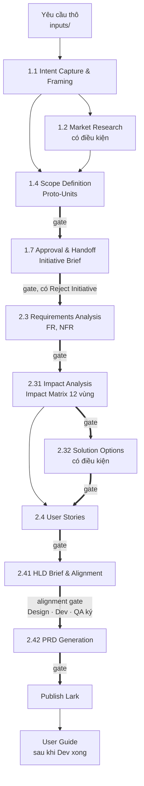

# UpLnD PO/BA AI Workflow

Quy trình để một PO hoặc BA làm việc cùng AI, biến một yêu cầu thô thành PRD đủ chi tiết cho Design, Dev và QA, trên một hệ thống đang chạy có người dùng thật và dữ liệu cũ. Đầu ra cuối cùng vẫn là PRD theo template công ty. Mọi artifact khác là bản phân tích nội bộ dẫn tới nó.

Aligned with AWS AI-DLC Workflows v2.10: Ideation and product-owned Inception stages, AI-DLC terminology and approval protocol, plus the `upbase-po` plugin: four stages for impact analysis, solution options, HLD brief and PRD generation. Construction and Operation are out of scope.

Thao tác từng bước: [USER-GUIDE.md](USER-GUIDE.md) · Thuật ngữ và họ mã: [GLOSSARY.md](GLOSSARY.md) · Luật tổ chức cho AI: [CLAUDE.md](CLAUDE.md) · Thiết kế và các quyết định đã duyệt: [PROPOSAL-aidlc-alignment.md](PROPOSAL-aidlc-alignment.md).

---

## Nguyên tắc nền

**AI đề xuất, người quyết.** AI đọc knowledge base, tra Swagger, dựng bản nháp, chỉ ra chỗ mâu thuẫn. PO chốt mọi quyết định về phạm vi, nghiệp vụ và ưu tiên; lời duyệt được ghi nguyên văn. Đây cũng là nguyên tắc nền của AI-DLC, phát biểu là *AI proposes, human validates*.

**Không bịa.** Thiếu thông tin nhẹ thì ghi `Assumption`. Thiếu tới mức ảnh hưởng phạm vi, business rule, dữ liệu hay luồng thì ghi `Open Question` và dừng hỏi. Ô không suy được đánh dấu `❓BA`.

**Dừng ở mức phân tích.** Cần biết một cơ chế kỹ thuật có tồn tại không thì hỏi PO, không tự đào Swagger rồi kết luận. Có endpoint không có nghĩa là có tính năng.

**Knowledge base là bản chụp, không phải chân lý.** Schema DB, Swagger và User Guide là nguồn sống. Yêu cầu chạm tới vùng nào thì đọc lại nguồn vùng đó.

---

## Hai phase, mười stage



*Mũi tên đậm là gate, chỗ PO duyệt artifact trước khi AI đi tiếp. Phase Ideation gồm 1.1 đến 1.7, phase Inception gồm 2.3 đến 2.42.*

| Stage | Nguồn | Artifact | PO làm gì |
|---|---|---|---|
| 1.1 Intent Capture & Framing | AWS | `intent-statement.md` | Trả lời câu hỏi về vấn đề, mục tiêu, stakeholder |
| 1.2 Market Research | AWS, có điều kiện | `competitive-analysis.md` | Chọn sản phẩm so sánh |
| 1.4 Scope Definition | AWS | `scope-document.md`, intent backlog gồm Proto-Unit | Chốt In, Out, Potential và ưu tiên |
| 1.7 Approval & Handoff | AWS | `initiative-brief.md`, một trang | Quyết đi tiếp, sửa, hay dừng |
| 2.3 Requirements Analysis | AWS | `requirements.md`, mã `FR1`, `NFR1`, `OQ1` | Trả lời lỗ hổng sau khi AI tra KB |
| 2.31 Impact Analysis | plugin `upbase-po` | `related-features-map.md`, `impact-matrix.md` | Chốt bản đồ tính năng bị chạm; quyết conflict |
| 2.32 Solution Options | plugin `upbase-po`, có điều kiện | `solution-options.md` | Chọn hướng giải |
| 2.4 User Stories | AWS | `stories.md`, mã `US1` gắn `PU1` | Xác nhận danh sách US |
| 2.41 HLD Brief & Alignment | plugin `upbase-po` | `hld-brief.md`, tối đa ba trang | Họp với lead Design, Dev, QA; lấy sign-off |
| 2.42 PRD Generation | plugin `upbase-po` | `prd.md`, `traceability.md` | Điền Field Intake; duyệt PRD |

Sáu stage lấy từ AWS AI-DLC được triển khai lại theo nghi thức của AWS trong phạm vi PO. Bốn stage của plugin `upbase-po` là phần AWS không có ở tầng nghiệp vụ, đánh số thập phân theo quy ước plugin của AWS, số chỉ để hiển thị.

### Profile

| Profile | Dấu hiệu | Stage chạy | Gate |
|---|---|---|---|
| **S** | Một màn, không đổi data model, không đổi rule có sẵn, không chạm module khác | 2.3, 2.42 (PRD rút gọn một US) | 2 |
| **M** | Tối đa hai module, thêm field nhưng không đổi quan hệ bảng, không conflict, đã rõ hướng giải | 1.1 và 1.4 duyệt chung, 2.3, 2.31, 2.4, 2.41, 2.42 | 6 |
| **L** | Từ ba module, hoặc đổi data model, hoặc có conflict, hoặc nhiều hướng giải | Đủ mười stage, 1.2 và 2.32 có điều kiện | 8 đến 10 |

Chọn ở `/new-intent`, AI đề xuất kèm lý do, PO có quyền đổi. Nghi ngờ thì lên profile. Giữa chừng cần thêm stage thì chọn "Add [stage]" tại gate, không đổi profile.

### Nghi thức một stage

Mọi stage chạy cùng bảy bước, định nghĩa một lần trong `.claude/protocol/stage-protocol.md`:

1. **Load**: state, decisions theo cột Read when, artifact đầu vào, KB, team memory.
2. **Ask**: questions file có lựa chọn A đến E và X, câu chặn đánh dấu, đề xuất kèm nguồn. PO trả lời theo một trong ba cách: AI hỏi từng câu, PO sửa file, hoặc trả lời trong chat.
3. **Confirm**: tóm tắt mọi câu trả lời, PO xác nhận đúng ý trước khi AI viết.
4. **Generate**: artifact theo template, mọi khối khẳng định có thẻ nguồn `[desc]`, `[Q3]`, `[KB-04 §3]`, `[assumption]`.
5. **Verify**: checklist của stage; reviewer độc lập `product-lead` ở stage quan trọng.
6. **Learn**: AI ghi `memory.md` của intent; tại gate hỏi "có gì cần nhớ cho lần sau không", dòng được giữ vào `.claude/memory/team.md`.
7. **Gate**: thông điệp hoàn thành năm phần, PO chọn Approve, Request Changes, Accept as-is, Add [stage], hoặc Reject Initiative ở 1.7.

### HLD Brief, chỗ khác với AWS

AWS cho ba agent Design, Developer, Quality góp ý vào User Stories. Ở đây ba vai đó là người thật và từng lệch nhau sau khi PRD đã viết: dự án Gamification sinh bốn change request sau PRD vì lệch với design và tech. Stage 2.41 sinh một tài liệu tối đa ba trang, AI viết phần tổng hợp, lead Design, Dev, QA ghi định hướng của mình trực tiếp trong repo, ba lead ký, rồi mới viết PRD chi tiết. Phần đầu PRD chép từ HLD Brief, không viết lại. Bản ký xong mới lên Lark.

---

## Artifact sinh ra

```
.claude/intents/<YYMMDD-slug>/
├── intent.md            bối cảnh, ràng buộc, Related intents, mapping Lark, Jira
├── state.md             profile, bảng stage sáu ký hiệu, việc kế tiếp, version từng artifact
├── decisions.md         DEC1..., lời PO nguyên văn, cột Read when
├── memory.md            quan sát trong lúc làm, bốn mục, đọc tại gate
├── inputs/              yêu cầu gốc, ảnh, csv
├── ideation/            intent-capture/ market-research/ scope-definition/ approval-handoff/
├── inception/           requirements-analysis/ impact-analysis/ solution-options/ user-stories/ hld-brief/ prd/
├── reviews/             review-<stage>-NN.md của product-lead
├── verification/        phase-check-ideation.md, phase-check-inception.md
├── archive/             bản đã duyệt tại mỗi gate, bản trước mỗi CR; không bao giờ sửa
├── design/              ảnh màn + order.txt
└── user-guide/
```

Tên file ổn định, version và trạng thái ở frontmatter. Không còn file `v0.x`; bản PO đã duyệt nằm trong `archive/`, nên AI sửa file làm việc mà không mất bản duyệt.

Mỗi mục của PRD truy được về một artifact đã qua gate: Problem, Objective, Out of scope, Stakeholder, Metrics, Solution, Proto-Units chép từ HLD Brief; Specific Requirement viết từ `stories.md`, `requirements.md`, Impact Matrix và Field Intake; bảng Traceability nối FR, US, BR.

---

## Cơ chế giữ chất lượng

| Cơ chế | Làm gì | Lấy từ |
|---|---|---|
| Gate với lời duyệt nguyên văn | PO duyệt từng artifact nền trước khi AI xây tiếp; "ok nhưng đổi X" là duyệt kèm chỉ thị | AWS approval gate |
| Reviewer độc lập | Agent `product-lead` chỉ nhận đường dẫn, không thấy hội thoại, trả READY hoặc NOT-READY kèm finding theo mức | AWS Product Lead agent |
| Thẻ nguồn và truy vết | Mọi khẳng định trong artifact nội bộ có nguồn; `po-tools.py trace` kiểm FR, US, BR, chặn gate khi có GAP hoặc ORPHAN | AWS traceability |
| Phase check | Kiểm ranh giới Ideation và Inception trước gate cuối của phase | AWS phase boundary |
| Archive tại gate | `po-tools.py archive` chụp bản duyệt, từ chối ghi đè | Sự cố 06/10/2026 ở dự án Group |
| Vòng học | Bài học giữ lại tại gate vào `team.md`, áp từ intent sau | AWS learnings ritual |
| Impact Analysis, Solution Options | Biết chạm gì trước khi chọn cách làm, so sánh trước khi chốt | Bohner và Arnold 1996; luồng cũ của repo |
| HLD Brief sign-off | Ba lead ký tầng cao trước khi viết chi tiết | Kinh nghiệm Gamification |
| Đối chiếu sau publish | Đếm lại heading, bảng, sơ đồ, ảnh trên Lark so với file | Luồng cũ của repo |

---

## Mapping sang AWS AI-DLC

| AWS AI-DLC v2.10 | Ở đây |
|---|---|
| Space, Intent | Repo này là space; mỗi yêu cầu là một intent trong `.claude/intents/` |
| Phase Initialization | `/new-intent`: scaffold, detection, chọn profile |
| Phase Ideation, stage 1.1 1.2 1.4 1.7 | Giữ nguyên tên, nghi thức và artifact; 1.3, 1.5, 1.6 ngoài phạm vi PO |
| Phase Inception, stage 2.3 2.4 | Giữ nguyên; 2.1 ứng với KB, 2.2 ứng với `team.md`, 2.5 đến 2.9 là việc của Design, Dev |
| Plugin | `upbase-po` thêm 2.31, 2.32, 2.41, 2.42; không sửa stage gốc |
| Workflow profile, scope | Profile S, M, L |
| Stage protocol, approval gate, questions file, summary confirmation, source tag, reviewer, learnings, traceability, archive | Viết lại bằng tiếng Việt trong `.claude/protocol/` |
| Proto-Unit | Sinh ở 1.4, Dev chốt Unit thật ở 2.7 |
| Engine, hook, sensor, binary `aidlc` | Không cài. Command của Claude Code đọc protocol trực tiếp |
| Construction, Operation | Ngoài phạm vi |

Thuật ngữ đầy đủ và họ mã: [GLOSSARY.md](GLOSSARY.md). Lý do chọn AWS làm chuẩn, so sánh với specs.md, và các quyết định D1 đến D12: [PROPOSAL-aidlc-alignment.md](PROPOSAL-aidlc-alignment.md).

---

## Phương pháp luận đứng sau

| Cơ chế trong luồng | Lấy từ | Ý gốc |
|---|---|---|
| Ideation rồi Inception, mỗi stage một artifact | AWS AI-DLC Workflows v2.10 | Vòng đời phát triển có AI, người duyệt tại mỗi stage |
| Khơi gợi, phân tích, đặc tả, kiểm chứng tách bạch | BABOK (IIBA) | Bốn hoạt động, không trộn |
| Gate giữa các stage | Stage-Gate, Robert G. Cooper, 1986 | Mỗi giai đoạn kết thúc bằng một cổng quyết định: đi tiếp, dừng, hay làm lại |
| Profile S, M, L | Rolling wave planning, PMBOK | Mức chi tiết tỉ lệ với mức bất định |
| Field Intake rồi mới viết chi tiết | Progressive elaboration, PMBOK | Làm rõ dần, không cố định chi tiết khi chưa đủ thông tin |
| Impact Matrix | Software Change Impact Analysis, Bohner và Arnold, 1996 | Trước khi sửa, xác định cái gì bị ảnh hưởng |
| Proto-Unit | Modular decomposition, David Parnas, 1972 | Mô-đun ghép lỏng, thay đổi được mà không kéo theo cái khác |
| `decisions.md` | Architecture Decision Record, Michael Nygard, 2011 | Ghi quyết định kèm bối cảnh, sau sáu tháng vẫn hiểu vì sao |
| AI đề xuất, người quyết | Paul Fitts, 1951; AI-DLC | Giao cho mỗi bên phần nó làm tốt hơn |

Chi phí sửa một lỗi yêu cầu tăng theo giai đoạn phát hiện (Barry Boehm, *Software Engineering Economics*, 1981). Gate là chỗ ép dừng để kiểm, vì artifact nào cũng là nền cho artifact sau: requirements sai thì Impact Matrix phân tích nhầm phạm vi, Impact Matrix sót thì PRD thiếu rule.

### Phần không lấy từ đâu cả

Năm quy tắc dưới đây sinh ra từ lỗi gặp phải khi chạy trên dự án thật:

| Quy tắc | Lỗi nó chặn |
|---|---|
| Đánh dấu `❓BA` thay vì suy đoán | AI điền một giá trị nghe hợp lý vào ô trống, Dev code theo, tới lúc test mới phát hiện giá trị đó không có thật |
| Knowledge base là bản chụp, chạm vùng nào đọc lại nguồn vùng đó | Bốn rule trong KB được phát hiện sai so với hệ thống trong một dự án |
| Có endpoint không có nghĩa là có tính năng | Sáu lần kết luận nhầm vì thấy endpoint trong Swagger trong khi tính năng đã bị gỡ khỏi giao diện |
| Dọn dấu vết quy trình trước khi bàn giao | Ký hiệu nội bộ lọt vào tài liệu gửi Dev, người đọc không tra được |
| Chụp bản duyệt trước khi sửa tiếp | Bản PO duyệt ở Gate 1 của dự án Group bị ghi đè mười lăm lần liên tiếp |

---

## Lịch sử

Luồng v1 (chín bước, bốn gate, tháng 9/2026) được giữ nguyên ở tag `pre-aidlc`; hướng dẫn cũ xem bằng `git show pre-aidlc:HUONG-DAN-SU-DUNG.md`. Ngày 09/10/2026 ba dự án Group, Gamification, Report-Phase-1 chuyển sang luồng v2 với artifact giữ nguyên nội dung và họ mã cũ, bảng mapping ở `intent.md` của mỗi intent; luồng v1 được gỡ cùng ngày.

## Nguồn và giấy phép

- AWS AI-DLC Workflows v2.10, https://github.com/awslabs/aidlc-workflows, giấy phép MIT-0. Repo này lấy từ đó: cấu trúc phase và stage, nghi thức stage và gate, vai Product Lead, cơ chế plugin, và gói kiến thức vai PO trong `.claude/knowledge/product/` có ghi dòng nguồn.
- Template PRD của công ty trên Lark wiki, xem `.claude/templates/prd.md`.
