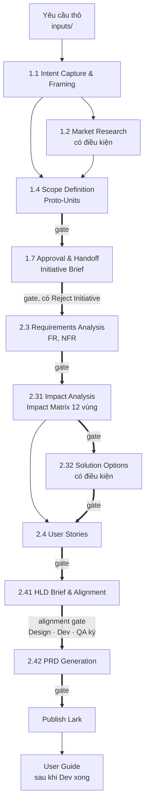

# PO Workflow

Repo này là bộ lệnh Claude Code để một PO hoặc BA làm việc cùng AI, đi từ một yêu cầu thô tới PRD theo template của công ty. Quy trình tách làm hai tầng: engine không phụ thuộc sản phẩm, và domain pack chứa mọi thứ riêng của sản phẩm trong `.claude/knowledge/domain/`. Domain đang cài là UpLnD của UpBase, một LMS đang chạy với người dùng thật và dữ liệu cũ, nên phần lớn công sức của quy trình nằm ở chỗ tìm ra tính năng mới chạm vào cái gì đang có, trước khi viết chi tiết.

Khung phase, stage, gate, thuật ngữ và nghi thức tham khảo từ [AWS AI-DLC Workflows v2.10](https://github.com/awslabs/aidlc-workflows), giới hạn trong hai phase Ideation và Inception thuộc phạm vi PO. Bốn stage AWS không có ở tầng nghiệp vụ được thêm vào dưới dạng plugin tên `po-workflow`. Đầu ra cuối cùng vẫn là PRD; mọi artifact khác là bản phân tích nội bộ dẫn tới nó.

Tài liệu liên quan:

- [USER-GUIDE.md](USER-GUIDE.md): hướng dẫn thao tác cho PO
- [DOMAIN-SETUP.md](DOMAIN-SETUP.md): dựng quy trình cho một sản phẩm hay công ty khác
- [GLOSSARY.md](GLOSSARY.md): thuật ngữ và họ mã
- [CLAUDE.md](CLAUDE.md): luật tổ chức cho AI

## Nguyên tắc nền

AI đề xuất, người quyết. AI đọc knowledge base, tra Swagger, dựng bản nháp và chỉ ra chỗ mâu thuẫn; PO chốt mọi quyết định về phạm vi, nghiệp vụ và ưu tiên, và lời chốt được ghi nguyên văn vào nhật ký quyết định của intent. AWS phát biểu cùng nguyên tắc này là AI proposes, human validates.

Không bịa. Thiếu thông tin nhẹ thì ghi assumption. Thiếu tới mức ảnh hưởng phạm vi, business rule, dữ liệu hay luồng thì ghi open question và dừng lại hỏi. Ô không suy được thì đánh dấu `❓PO` và để trống cho người có trách nhiệm điền.

Dừng ở mức phân tích. Cần biết một cơ chế kỹ thuật có tồn tại không thì hỏi PO, không tự đào Swagger rồi kết luận. Có endpoint không có nghĩa là có tính năng; hệ này đã sáu lần có endpoint chết.

Knowledge base là bản chụp. Schema DB, Swagger và User Guide là nguồn sống. Yêu cầu chạm tới vùng nào thì đọc lại nguồn vùng đó, và quá một tháng kể từ lần đối chiếu cuối cũng phải đọc lại.

## Bức tranh chung

Một yêu cầu là một intent, sống trong `.claude/intents/<YYMMDD-slug>/`. Intent đi qua hai phase của AWS trong phạm vi PO: Ideation để khung vấn đề và phạm vi, Inception để biến phạm vi thành yêu cầu, user story và PRD. Mỗi stage sinh một artifact, kết thúc bằng một gate do PO duyệt.



Số stage giữ nguyên của AWS: 1.1, 1.2, 1.4, 1.7 thuộc Ideation; 2.3, 2.4 thuộc Inception. Các số 1.3, 1.5, 1.6, 2.1, 2.2, 2.5 tới 2.9 là stage AWS giao cho kiến trúc sư, delivery, design hoặc developer, nên không có trong repo này. Bốn stage của plugin lấy số thập phân chèn vào giữa theo đúng quy ước plugin của AWS: 2.31 và 2.32 chạy sau 2.3, 2.41 và 2.42 chạy sau 2.4. Số chỉ để hiển thị thứ tự; định danh thật của stage là slug như `impact-analysis`.

| Stage | Nguồn | Artifact chính | Profile |
|---|---|---|---|
| 0 Khởi tạo, `/new-intent` | AWS Initialization | `intent.md`, `state.md`, `decisions.md`, `memory.md` | mọi profile |
| 1.1 Intent Capture & Framing | AWS | `intent-statement.md` | M, L |
| 1.2 Market Research | AWS, có điều kiện | `competitive-analysis.md` | L |
| 1.4 Scope Definition | AWS | `scope-document.md` với intent backlog gồm Proto-Unit | M, L |
| 1.7 Approval & Handoff | AWS | `initiative-brief.md`, một trang | L |
| 2.3 Requirements Analysis | AWS | `requirements.md` với FR, NFR, OQ | S, M, L |
| 2.31 Impact Analysis | plugin `po-workflow` | `related-features-map.md`, `impact-matrix.md` | M, L |
| 2.32 Solution Options | plugin `po-workflow`, có điều kiện | `solution-options.md` | L, hoặc M khi thêm stage |
| 2.4 User Stories | AWS | `stories.md` | M, L |
| 2.41 HLD Brief & Alignment | plugin `po-workflow` | `hld-brief.md`, tối đa ba trang | M, L |
| 2.42 PRD Generation | plugin `po-workflow` | `prd.md`, `traceability.md` | S, M, L |

Phần còn lại của tài liệu đi qua từng stage. Mỗi stage được tả theo cùng một khung: stage này để làm gì, AI làm gì, PO làm gì, artifact ra sao, gate hỏi gì, và chỗ nào khác AWS.

## Khởi tạo: /new-intent

Tương đương ba stage Initialization của AWS, gộp làm một lệnh chạy một mạch và chỉ hỏi PO ở cuối.

Bước 0.1 dựng cây thư mục intent từ template. Thư mục con của từng stage chỉ tạo khi stage chạy. Nếu PO viết mô tả yêu cầu ngay trong lệnh, AI lưu nguyên văn vào `inputs/request-<ngày>.md`.

- `intent.md`: bối cảnh
- `state.md`: trạng thái
- `decisions.md`: nhật ký quyết định
- `memory.md`: quan sát của AI
- `inputs/`: nơi PO đặt yêu cầu gốc, ảnh, csv

Bước 0.2 quét nhanh để chọn profile, không phải phân tích ảnh hưởng. AI đọc inputs, mục lục KB và bài học trong `team.md`, đoán module, màn, bảng và mail event bị chạm, kiểm xem vùng đó có thuộc phần KB chưa phủ hay có tính năng đang ẩn không, rồi tìm intent khác liên quan để ghi vào `intent.md`.

Bước 0.3 đề xuất profile S, M hoặc L kèm lý do theo từng dấu hiệu, hỏi PO bằng một câu duy nhất, rồi ghi `state.md` với đủ mười stage và `DEC1` là quyết định profile. Stage ngoài profile được đánh dấu bỏ qua ngay từ đầu, kèm lý do. Nghi ngờ giữa hai profile thì chọn profile lớn hơn.

PO làm ba việc, rồi mọi lần tiếp theo chỉ cần gọi `/po <slug>`:

- Trả lời câu hỏi profile
- Đặt tài liệu đầu vào vào `inputs/`
- Điền link Figma và Jira vào `intent.md` nếu đã có

## Phase Ideation

Ideation trả lời câu hỏi có đáng làm không và làm tới đâu. Phase kết thúc ở 1.7 bằng Initiative Brief một trang, nơi PO quyết đi tiếp, sửa, hay dừng intent. Trước khi mở gate 1.7, AI kiểm ranh giới phase:

- Mọi objective có hạng mục phục vụ
- Mọi Proto-Unit truy về một objective
- Out of scope không mâu thuẫn In scope
- Câu hỏi chặn đã đóng

Profile S bỏ cả phase này vì yêu cầu một màn không cần khung vấn đề riêng. Profile M chạy 1.1 và 1.4 rồi duyệt chung một gate, bỏ 1.7.

### 1.1 Intent Capture & Framing

Stage này khung vấn đề trước khi ai bàn tới giải pháp.

AI đọc nguyên văn inputs và tách giải pháp người yêu cầu đã nghĩ sẵn ra khỏi vấn đề: "thêm nút export" là giải pháp, còn vấn đề có thể là "không lấy được dữ liệu ra để đối chiếu". Giải pháp đó được giữ dưới nhãn Recommendation, chưa thành yêu cầu. AI tra KB 15 về định hướng sản phẩm và KB 16 về nguyên tắc mô hình hoá để biết yêu cầu thuộc tầng nào, phục vụ riêng UpBase hay mọi tenant.

Câu hỏi gửi PO xoay quanh bảy chỗ; câu nào đã có đáp án trong inputs thì không hỏi:

- Vấn đề theo góc nhìn người dùng
- Người dùng đang xoay xở thế nào khi chưa có tính năng
- Thành công đo bằng gì và lấy số ở đâu
- Vì sao làm lúc này
- Stakeholder nào quyết, ai chỉ cần được báo
- Bản đầu tiên không làm gì
- Portal nào, và hằng số nào phải cấu hình theo tenant

Artifact là `intent-statement.md` với các mục:

- Vấn đề
- Cách xoay xở hiện tại
- Objective kèm cách đo
- Lý do làm bây giờ
- Bản đồ stakeholder
- Ranh giới sản phẩm
- Tín hiệu phạm vi ban đầu
- Giải pháp người yêu cầu đề xuất
- Assumptions & Open Questions

Mọi khối khẳng định có thẻ nguồn: `[desc]` cho lời yêu cầu gốc, `[Q3]` cho câu trả lời, `[KB-15 §6]` cho KB, `[assumption]` cho giả định.

Ở profile L có reviewer Product Lead và gate riêng. Ở profile M, AI đánh dấu 1.1 chờ duyệt rồi chạy tiếp 1.4 trong cùng lượt, gate chung ở cuối 1.4.

### 1.2 Market Research

Stage có điều kiện: chỉ chạy khi PO muốn so với sản phẩm khác, hoặc 1.1 cho thấy cách làm chuẩn trên thị trường ảnh hưởng tới phạm vi. Không có quyết định nào phụ thuộc vào kết quả thì ghi bỏ qua và không chạy.

AI hỏi ba điều:

- So với sản phẩm nào, tối đa ba; mặc định với LMS là TalentLMS, Docebo và Moodle
- Xem khía cạnh nào: mô hình khái niệm, thuật ngữ, luồng chính, giới hạn, cách tích hợp
- Quyết định nào phụ thuộc vào kết quả

Khi thu thập, AI trích đúng nguồn kèm link và ngày đọc, không suy diễn tính năng từ tên menu. Trang trợ giúp của TalentLMS chặn tải tự động, nên bài được lấy qua API Zendesk và lưu nguyên văn vào `inputs/` để người sau không phải lấy lại.

Artifact `competitive-analysis.md` gồm:

- Bảng so sánh theo khía cạnh đã chọn
- Thuật ngữ nên dùng
- Điều đáng mượn và vì sao hợp với sản phẩm
- Điều không mượn và vì sao
- Đối chiếu với yêu cầu hiện tại, chỉ ra chỗ làm đổi phạm vi hay rule

Dự án Group dùng stage này sau khi PRD đã duyệt và phần đối chiếu sinh ra ba điểm thành change request.

### 1.4 Scope Definition

Stage này vạch biên: làm gì, không làm gì, để sau.

Ngoài In, Out và Potential, AI chia nhu cầu thành Proto-Unit, mã `PU1`, `PU2`. Proto-Unit là khái niệm của AWS ở stage 1.4: hạng mục của intent backlog, ứng viên để Dev chia Unit thật ở stage 2.7. Hạng mục Won't vẫn được định nghĩa, để Impact Analysis quét đúng. Bốn quy tắc chia:

- Chia theo cơ chế, không theo màn hình
- Tìm hạng mục nền phải có trước
- Tách hạng mục chạm mọi thứ như phân quyền, bật tắt, lịch sử
- Phụ thuộc một chiều, không có vòng

Câu hỏi gửi PO:

- Phạm vi nhỏ nhất vẫn có giá trị
- Hạng mục nào Must, Should, Could, Won't
- Phụ thuộc giữa các hạng mục
- Ưu tiên theo rủi ro, giá trị hay phụ thuộc
- Mốc cứng
- Thứ người đọc dễ tưởng là có mà không làm
- Hạng mục nào trùng tính năng đã có; AI tra KB và nêu mã trước khi hỏi mở rộng hay làm mới, vùng KB chưa phủ thì ghi `❓PO`

Artifact `scope-document.md` gồm:

- Bảng In, Out, Potential, mỗi dòng một câu kèm lý do và nguồn
- Constraints theo bốn nhóm: nghiệp vụ, tenant, tích hợp, dữ liệu cũ
- Bảng Proto-Unit với MoSCoW, portal, phụ thuộc và cờ trùng tính năng có sẵn
- Thứ tự gợi ý và mốc cứng

Profile M duyệt chung với 1.1; thông điệp gate gộp hai artifact và Request Changes phải nói sửa artifact nào.

### 1.7 Approval & Handoff

Stage này gói cả phase thành một trang để quyết đi tiếp hay dừng. AWS gọi lựa chọn dừng là Reject Initiative, và đây là gate duy nhất có lựa chọn đó.

AI chỉ hỏi ba câu, không cần tóm tắt xác nhận:

- Stakeholder đã thống nhất vấn đề và phạm vi chưa, ai chưa
- Rủi ro và giả định lớn nhất đã được nêu và chấp nhận chưa
- Có nguồn lực và mốc cho đợt này chưa

Rồi AI viết `initiative-brief.md` một trang:

- Vấn đề và mục tiêu
- Phạm vi biên
- Proto-Unit và ưu tiên
- Rủi ro và giả định lớn
- Quyết định đã chốt, lấy từ `decisions.md`
- Khuyến nghị go hay no-go kèm điều kiện

Đây là tài liệu bàn giao nên viết cho người đọc: không thẻ nguồn, mã kèm nội dung, không viết tắt. Kết quả kiểm ranh giới phase ghi vào `verification/phase-check-ideation.md`; không đạt thì sửa stage tương ứng trước khi mở gate. PO muốn thì publish lên Lark với tên `[Brief] <tên tính năng>`.

## Phase Inception

Inception biến phạm vi đã duyệt thành yêu cầu có mã, phân tích ảnh hưởng lên hệ đang chạy, chọn hướng giải khi có nhiều hướng, chia user story, chốt tầng cao với lead các team, rồi viết PRD. Phase kết thúc ở gate 2.42. Trước gate đó, AI chạy kiểm truy vết để mọi FR có US và mọi BR thuộc một US.

Profile S bắt đầu phase từ 2.3 và nhảy thẳng tới 2.42.

### 2.3 Requirements Analysis

Stage này biến phạm vi thành yêu cầu có mã ổn định: FR cho chức năng, NFR cho phi chức năng, OQ cho câu hỏi còn treo.

Việc đầu tiên của AI là tra KB cho từng hạng mục, trước khi hỏi bất cứ gì:

- Hạng mục đã có chưa, theo KB 01 đến 11
- Rule hiện có nào chi phối
- Có tính năng đang ẩn liên quan không
- Mail event nào liên quan, đang bật hay tắt, theo KB 13
- Hạng mục có rơi vào vùng KB chưa phủ không, theo KB 14

Yêu cầu trùng tính năng đã có được nêu ngay kèm mã KB, không để tới Impact Analysis. Ví dụ hay gặp: "thêm thông báo khi chấm xong" trong khi mail số 19 đã tồn tại nhưng đang tắt.

Chỉ sau đó AI mới hỏi lỗ hổng còn lại. Để tìm lỗ hổng, AI quét sáu chiều của AWS:

- Hành vi chức năng
- Phi chức năng đo được
- Kịch bản người dùng và góc
- Bối cảnh nghiệp vụ
- Tích hợp và dữ liệu
- Chất lượng

Góc hay sót được quét theo corner checklist trong domain pack, viết riêng cho sản phẩm đang cài. Với UpLnD đó là lớp đã kết thúc, học viên bị Block, một người thuộc nhiều nhóm, dữ liệu cũ trước ngày bật tính năng, mail gửi hàng loạt. Mỗi góc áp dụng phải kết thúc bằng một FR, một assumption có lý do, hoặc một dòng out of scope. AI không hỏi câu kỹ thuật cho Dev.

Artifact `requirements.md` gồm:

- Intent summary
- FR nhóm theo khả năng, mã `FR1`, `FR1.1`, ưu tiên MoSCoW, cờ Existing, New hay Changed kèm mã KB và thẻ nguồn
- NFR, chỉ khi đo được
- Constraints
- Assumptions & Open Questions với mã `OQ1`, cờ chặn và owner
- Out of scope
- Nguồn đã đọc kèm ngày đối chiếu, và phần chưa tra được

FR nói cái gì phải đúng, không nói làm thế nào: không có FR nào mô tả bảng, endpoint hay thuật toán.

Reviewer Product Lead chạy ở profile M và L. Gate trình số FR theo nhóm, NFR, OQ còn chặn, FR trùng thứ đã có, vùng `❓PO` và finding của reviewer.

### 2.31 Impact Analysis

Stage của plugin `po-workflow`. AWS không có stage tương đương ở tầng nghiệp vụ; phân tích ảnh hưởng của AWS nằm ở tầng kiến trúc. Stage này trả lời câu hỏi tính năng mới chạm gì trên hệ đang chạy, trước khi ai chọn cách làm.

Bước Ask của stage này khác các stage khác: thay vì hỏi, AI chủ động quét requirements, KB, schema và Swagger rồi dựng Related Features Map, bảng liệt kê hệ, tính năng, module, entity, endpoint liên quan với cột New hay Existing và nguồn. Bảng này trình cho PO soát: đủ chưa, sót gì, dòng nào không liên quan, `❓PO` nào chốt được. Nhận ra dễ hơn nhớ ra, nên PO soát một bản nháp thay vì kể từ đầu. Chỉ khi PO xác nhận bản đồ, AI mới sang Impact Matrix.

Impact Matrix dựng theo năm bước cố định:

1. Current Situation: đọc để tìm dependency, gồm module, entity và field, rule, process, permission, integration, mail event, tính năng ẩn
2. Desired Situation: lấy từ requirements
3. Ma trận 12 vùng: business process, module, màn và báo cáo, dữ liệu, API, role, business rule, NFR, notification và email, reporting, test, release. Mỗi dòng có severity và nguồn; vùng không ảnh hưởng vẫn ghi lý do. Trong bước này có ba việc con:
   - Tìm conflict theo bốn chiều rule, process, data, permission; escalate cho PO quyết thay vì tự giải
   - Xét ảnh hưởng hai chiều, cả New sang Old lẫn Old sang New, vì chiều sau hay bị bỏ
   - Kiểm coverage ở boundary, exception, shared entity, side effect
4. Transition: dữ liệu cũ, tương thích, cutover
5. Bốn câu kiểm chiều tenant theo KB 15

FR và NFR phát sinh trong lúc phân tích được bổ sung vào `requirements.md` dưới dạng FR mới với thẻ `[2.31]`, không sửa FR đã duyệt. Phụ lục nguồn đã đọc, kể cả phần chưa tra được, là bắt buộc. Gate trình tóm tắt theo severity, các conflict cần PO quyết, mỗi conflict thành một DEC. Stage kế là 2.32 nếu có từ hai hướng giải hoặc PO chưa có hướng; không thì ghi 2.32 bỏ qua kèm lý do và sang 2.4.

Hai shared entity dễ vỡ nhất của hệ này được nhắc thẳng trong checklist: `course_categories` là khoá ngoại của sáu bảng, và Question Bank được bốn nơi tiêu thụ.

### 2.32 Solution Options

Stage của plugin, có điều kiện: chạy khi có từ hai hướng giải hoặc PO chưa có hướng. AWS chỉ có ADR ở tầng kiến trúc; so sánh hướng ở tầng nghiệp vụ là phần repo thêm.

AI hỏi PO đã có định hướng chưa. Có thì AI nhận xét mức khớp với objective, điểm mạnh, lỗ hổng theo Impact Matrix, rồi gợi thêm một hai option. Định hướng của PO vẫn vào bảng như mọi option, quyết định dựa trên đánh đổi chứ không dựa trên thứ tự đề xuất. Để tránh hai option thực chất là một, AI ép option từ các góc khác nhau:

- Đổi quy trình, không cần code
- Cấu hình
- Mở rộng cái có sẵn
- Làm mới
- Cắt phạm vi

Artifact `solution-options.md` so sánh mọi option bằng cùng bảy tiêu chí:

- Business fit
- Tác động người dùng và quy trình
- Tác động hệ thống và dữ liệu, lấy từ Impact Matrix
- Effort tương đối
- Risk
- Dependency
- Nợ đóng cứng tenant

Effort và risk ghi Cao, Trung bình, Thấp kèm lý do, không bịa số giờ. Phần Recommendation nêu option, điều kiện, risk phải chấp nhận, và cái gì sẽ đổi kết luận. Approve ở gate nghĩa là chọn option, ghi DEC với lý do và trade-off chấp nhận.

### 2.4 User Stories

Stage này chia yêu cầu thành user story, mỗi US gắn vào một Proto-Unit và mỗi FR có US phủ. Ở AWS, stage 2.4 là nơi agent Design, Developer và Quality cùng góp ý vào story; ở đây ba vai đó là người thật và góp ý ở 2.41.

AI hỏi:

- Cách chia: theo luồng công việc, theo vai hay theo khả năng; AI đề xuất sẵn một cách
- Độ mịn, với quy ước một US là một mục tiêu hoàn chỉnh của người dùng, không chia theo màn hình, không chia theo rule
- US nào làm đợt này, US nào định nghĩa nhưng chưa làm
- Vai nào xuất hiện
- Proto-Unit từ 1.4 còn đúng không

Story có chữ "và" nối hai việc thì tách.

Artifact `stories.md` gồm:

- Bảng US với tên một câu tự nhiên theo vai, không ép khuôn "As a, I want", kèm vai, Proto-Unit, MoSCoW, FR nguồn và cờ làm đợt này; mỗi US thêm một đến ba dòng ý chính, acceptance criteria để ở PRD
- Bảng FR sang US với trạng thái OK, GAP, Deferred, N/A; GAP phải xử lý trước gate
- Bảng Proto-Unit gồm US, phụ thuộc, khả năng release độc lập, thay đổi so với 1.4 kèm lý do

Script `po-tools.py trace` chạy ở đây để bắt FR chưa có US và US mồ côi. Reviewer Product Lead chạy ở mọi profile có stage này.

### 2.41 HLD Brief & Alignment

Stage của plugin, sinh ra từ một vết thương cụ thể: dự án Gamification có bốn change request sau khi PRD đã viết vì lệch với design và tech. PRD dài, có bản tới 14.000 từ, lead các team không đọc hết. Stage này tạo một tài liệu tối đa ba trang để họp, để lead ghi định hướng của mình, và để chốt tầng cao trước khi AI viết chi tiết.

HLD Brief có mười hai mục. AI viết mục 1 đến 7 và 11 từ artifact đã duyệt, không thêm nội dung mới; mục 8, 9, 10 là của lead:

1. Tóm tắt mười dòng
2. Vấn đề và mục tiêu
3. Phạm vi
4. Giải pháp tổng thể
5. User story theo Proto-Unit
6. Ảnh hưởng và rủi ro, gồm bảng rủi ro đã chấp nhận, giả định chưa kiểm chứng và finding review còn treo, mỗi dòng kèm điều kiện
7. Quyết định cần chốt trong họp
8. Design Direction, Design lead viết
9. Technical Direction, Tech lead viết
10. Test Strategy, QA lead viết
11. Release và phụ thuộc
12. Sign-off

Đầu mỗi mục 8, 9, 10, AI ghi tối đa năm dòng điểm cần lưu ý cho vai đó, lấy từ Impact Matrix, constraints và corner checklist. Rủi ro đã chấp nhận nằm ở mục 6 vì nó là điều kiện đi kèm quyết định chứ không phải việc để sau.

Lead làm trực tiếp trên repo, không cần Claude Code:

- Pull, mở file, sửa đúng mục của mình và dòng của mình ở mục 12, commit
- Lead không mở được repo thì gửi PO dán nguyên văn kèm ghi chú và tin nhắn xác nhận lưu vào `decisions.md`
- Trước khi giao, AI chụp bản nháp vào `archive/` để khi lead ghi xong có diff theo mục
- Lead sửa nhầm mục của PO thì PO quyết nhận hay trả lại; định hướng mâu thuẫn artifact đã duyệt thì đi qua `/change-request`

Gate của stage là Alignment gate với bốn trạng thái ký: Đồng ý, Có ý kiến, Yêu cầu sửa, Chưa xem. Approve chỉ khi ba lead ghi Đồng ý hoặc Có ý kiến; một lead ghi Yêu cầu sửa thì gate là Request Changes. Thiếu chữ ký thì PO chọn Accept as-is kèm lý do, hoặc chờ. Sau Approve, brief lên version 1.0, được chụp archive và publish lên Lark với tên `[HLD] <tên tính năng>` làm bản cuối. Phần đầu PRD sau đó chép từ brief này, không viết lại.

Ý tưởng mục điểm lưu ý theo vai, bảng rủi ro và ba mức ký lấy từ một báo cáo họp Mob Review của dự án HRM, tương đương Mob Elaboration của AWS.

### 2.42 PRD Generation

Stage của plugin. AWS coi PRD là tài liệu đầu vào và không sinh nó; ở đây PRD là đầu ra cuối cùng và là tài liệu bàn giao duy nhất cho Dev, QA, Design. Ở profile M và L stage này yêu cầu HLD Brief đã duyệt; ở profile S chỉ cần requirements.

Bước Ask là Field Intake. AI tra trước khi hỏi:

- Impact Matrix: entity và màn bị chạm
- KB 12: bảng và khoá ngoại
- `components.schemas` trong Swagger: field hiện có kèm kiểu, bắt buộc và enum
- KB 01 đến 11: rule chi phối

Mỗi màn được phân loại A mới hoàn toàn, B sửa màn có sẵn, C chỉ đọc. Kết quả là một bảng duy nhất trong `field-intake-questions.md` với cột màn, field, hiện có hay chưa, kiểu, bắt buộc, giá trị hợp lệ, validate, rule chi phối; AI điền sẵn đề xuất từ KB và Swagger, để `❓PO` ở chỗ không suy được. Field hiện có chỉ hỏi phần thay đổi và migration. PO duyệt bảng này là bước xác nhận tóm tắt của stage, và profile S cũng phải qua, vì đây là chỗ hay sai nhất kể cả với yêu cầu nhỏ.

PRD viết theo template công ty:

- Tên mục do chủ template quyết được giữ nguyên: Metrics success, Specific Requirement, Pre - Condition, Conner case
- Tên mục do repo quyết đã đổi theo thuật ngữ AWS: References, Technical Direction, Data to Retain, Proto-Units, Traceability, Open Issues
- Phần đầu chép từ HLD Brief: Problem, Analytics, Objective, Out of scope cấp tính năng, Stakeholder, Metrics success, Solution với Technical Direction lấy từ mục 9 của brief, Proto-Units từ mục 5

Phần Specific Requirement viết liên tục từng US với sáu mục:

- User story
- Pre-condition
- Scenario
- Acceptance criteria, gồm bảng UI dạng A hoặc B, business rule mã `BR<US>.<n>` dẫn mã KB khi chạm tính năng có sẵn, data field và NFR
- Out of scope
- Conner case, để trống cho QA

Quy tắc cố định:

- Không có mục Database và API
- Không sequence diagram, cấu trúc bảng, thuật toán, thư viện
- Hằng số ghi rõ cứng hay cấu hình
- Field hiện có không được mô tả như mới; không bịa field
- Mục không áp dụng xoá hẳn; không giữ bảng ví dụ của template
- Không dấu vết quy trình; không viết tắt; dấu `·` giữa các mã
- Sơ đồ là khối Mermaid đặt đúng chỗ trong file, vì khi đẩy lên Lark bằng lark-cli chúng tự thành bảng trắng

Trước gate, AI chạy `po-tools.py trace` để dựng `traceability.md` và `verification/phase-check-inception.md`:

- Mọi FR có US, hoặc Deferred, N/A có lý do
- Mọi US truy về FR
- Mọi BR thuộc một US có trong PRD

Có GAP hoặc ORPHAN thì sửa trước. Reviewer Product Lead chạy ở mọi profile. Gate trình từng US một dòng, BR mới và rule hiện có bị chạm, field và mail bị ảnh hưởng, mục đã xoá và vì sao, kết quả truy vết, finding review. Request Changes trỏ mã cụ thể như `US2 BR2.3` để sửa nhắm đích. Sau Approve, PRD lên version 1.0, chụp archive, và `/publish-lark prd` đẩy lên Lark.

Profile S viết PRD rút gọn: metadata, Document version, Problem, Objective, Out of scope, References, Specific Requirement với một US; bỏ Analytics, Stakeholder, Metrics success, Solution, Proto-Units.

## Sau PRD

Ba tiện ích dùng sau gate 2.42, và cũng dùng được giữa chừng.

`/publish-lark` đẩy Initiative Brief, HLD Brief hoặc PRD đã duyệt lên Lark wiki. Tài liệu nằm trong intent node dưới node cha chung, không nằm thẳng dưới node cha. Lần đầu tạo doc bằng `lark-cli docs +create`; lần sau cập nhật đúng doc cũ bằng `docs +update --command overwrite`, giữ token và tên PO đã đặt trên Lark. Sau khi đẩy, AI đọc lại và đếm heading, bảng, dòng bảng, gạch đầu dòng, bảng trắng so với file nguồn, vì API trả thành công không có nghĩa nội dung vào đúng chỗ. Ảnh design phải chèn lại mỗi lần đẩy vì ảnh không nằm trong file markdown.

`/change-request` dùng khi yêu cầu đổi sau khi một stage đã duyệt. AI phân loại trước, vì thay đổi nhỏ trong stage đang mở chỉ cần sửa và trình lại gate. Thay đổi chạm stage đã duyệt thì ghi `CR<n>` vào `decisions.md` kèm nguyên văn PO, chụp artifact bị ảnh hưởng vào `archive/` với nhãn pre-CR, trình bảng ảnh hưởng gồm stage mở lại, artifact sẽ đổi và gate phải duyệt lại, rồi mới sửa đúng phần bị chạm. Stage re-entry lấy stage thấp nhất bị sai lệch:

- Vấn đề và mục tiêu: về 1.1
- Phạm vi: về 1.4
- FR mới: về 2.3
- Phát hiện ảnh hưởng mới: về 2.31
- Đổi hướng giải: về 2.32
- Danh sách US: về 2.4
- Định hướng của lead: về 2.41, lead ký lại
- Chi tiết US: về 2.42

Trước gate 2.42 chạy lại truy vết và kiểm business rule mồ côi, mã tham chiếu gãy, out of scope lỗi thời.

`/generate-user-guide` viết hướng dẫn người dùng cuối từ PRD đã duyệt, sau khi Dev làm xong, theo template và đích ghi trong domain pack; với UpLnD là GitBook, một repo cho học viên và một cho vận hành. Tính năng chạm nhiều đối tượng thì mỗi đối tượng một bài riêng. Sau khi viết, KB trong `knowledge/domain/` được cập nhật ngược với rule mới và field đổi, nếu không lần Impact Analysis sau sẽ phân tích trên dữ liệu cũ.

## Nghi thức chung của mọi stage

Mọi stage chạy cùng bảy bước, định nghĩa một lần trong `.claude/protocol/stage-protocol.md`; command của từng stage chỉ chứa phần riêng.

1. Load: đọc `state.md`, `decisions.md` theo cột Read when để không hỏi lại câu đã có đáp án, `intent.md`, artifact đầu vào, file KB mà command liệt kê và `team.md`
2. Ask: viết questions file. Mỗi câu có lựa chọn A đến E và X cho "khác", dòng "vì sao hỏi", lựa chọn đề xuất kèm nguồn, cờ chặn, và dòng `[Answer]:` để ghi câu trả lời nguyên văn. Lần đầu AI hỏi PO muốn trả lời theo cách nào, Guide me, Edit file hay Chat, rồi dùng cách đó cho cả intent
3. Confirm: tóm tắt mọi câu trả lời thành gạch đầu dòng và hỏi Looks correct hay Request changes trước khi viết
4. Generate: viết artifact theo template với thẻ nguồn ở mọi khối khẳng định
5. Verify: chạy checklist của stage, mục có nhãn BLOCK chưa đạt thì không mở gate; gọi reviewer ở stage có reviewer
6. Learn: ghi quan sát vào `memory.md` của intent dưới bốn mục Interpretations, Deviations, Tradeoffs, Open questions. Trước gate hỏi PO có gì cần nhớ cho lần sau; dòng được giữ chuyển sang `team.md` và áp dụng từ intent sau
7. Gate: trình thông điệp hoàn thành năm phần: artifact ở đâu, điểm chính, giả định và câu hỏi mở, finding của reviewer, dòng tiến độ

Tại gate PO có năm lựa chọn:

- Approve
- Request Changes, kèm nội dung sửa
- Accept as-is, từ lần trình thứ ba trở đi, nhận bản hiện tại kèm lý do được ghi lại
- Add [stage], chạy thêm một stage ngoài profile
- Reject Initiative, chỉ ở 1.7

Lời duyệt tự nhiên vẫn được: "ok nhưng đổi tên trường X" là Approve kèm chỉ thị, "duyệt, hôm nay dừng ở đây" là Approve kèm tạm dừng. Sau Approve, AI ghi DEC với nguyên văn, chụp artifact vào `archive/<slug>/<artifact>-v<N>-<ngày>.md`, đổi trạng thái stage và in dòng tiến độ.

Reviewer là agent `product-lead`, chỉ nhận đường dẫn, không thấy hội thoại hay `memory.md`, nên phán đoán độc lập với người viết. Reviewer ghi một file trong `reviews/` với verdict READY hoặc NOT-READY và bảng finding theo ba mức Critical, Major, Minor; READY khi không có Critical và tối đa hai Major. AI không tự sửa theo finding; finding đi vào gate để PO quyết sửa hay ghi Accepted risk.

Trạng thái mỗi stage trong `state.md` dùng sáu ký hiệu:

- `[ ]` chưa làm
- `[-]` đang làm
- `[?]` chờ duyệt
- `[R]` đang sửa
- `[x]` đã duyệt
- `[S]` bỏ qua kèm lý do

Tên file artifact ổn định, version và trạng thái ở frontmatter; bản PO đã duyệt nằm trong `archive/` nên AI sửa file làm việc mà không mất bản duyệt. Quy tắc này chặn đúng sự cố ngày 06/10/2026 ở dự án Group, khi bản BRD đã duyệt bị ghi đè mười lăm lần.

## Profile

Profile tương đương scope của AWS, đổi tên để không lẫn với phạm vi tính năng. Profile quyết định stage nào chạy, nghi thức nào bật và artifact chi tiết tới đâu.

| Profile | Dấu hiệu | Stage chạy | Reviewer | Gate |
|---|---|---|---|---|
| S | Một màn, không đổi data model, không đổi rule có sẵn, không chạm module khác | 2.3 rồi 2.42 với PRD rút gọn | chỉ 2.42 | 2 |
| M | Tối đa hai module, thêm field nhưng không đổi quan hệ bảng, không conflict, đã rõ hướng giải | 1.1 và 1.4 duyệt chung, 2.3, 2.31, 2.4, 2.41, 2.42 | 2.3, 2.4, 2.42 | 6 |
| L | Một trong số: từ ba module, đổi data model hoặc quan hệ, conflict với rule hiện có, chạm tính năng ẩn, nhiều hướng giải, tích hợp ngoài hoặc job nền, migration dữ liệu cũ, không hoàn tác được | Đủ mười stage; 1.2 và 2.32 có điều kiện | 1.1, 2.3, 2.4, 2.42 | 8 đến 10 |

Ở profile S, tóm tắt xác nhận chỉ chạy ở Field Intake và vòng học tắt. Ở M và L, cả hai bật. PO tắt được một nghi thức cho riêng một intent bằng cách ghi vào `state.md` phần Switches kèm nguyên văn.

## Engine và domain pack

Repo có hai tầng. Engine là phần không phụ thuộc sản phẩm: protocol, command, template chung của artifact, verification checklist, agent Product Lead, script, và gói kiến thức vai PO chép từ AWS trong `.claude/knowledge/product/`. Domain pack là mọi thứ riêng của sản phẩm và công ty, nằm trọn trong `.claude/knowledge/domain/`:

- `domain.md`, manifest: sản phẩm và portal, nguồn sống và bản chốt kèm ngày đối chiếu, bản đồ KB, dữ kiện từng stage cần, đích publish và đích User Guide
- KB sản phẩm, với UpLnD là 16 file từ `00-index.md` tới `16-domain-principles.md`
- `corner-checklist.md`, góc hay sót viết theo nghiệp vụ của sản phẩm; bản gốc chung của AWS giữ ở `knowledge/product/corner-checklist-aws.md`
- `templates/`, template PRD và User Guide theo chuẩn công ty, kèm bản gốc của chủ template

Command không ghi cứng dữ kiện sản phẩm. Mỗi stage đọc `domain.md` ở bước Load, lấy đúng mục của mình, rồi mở KB mà manifest trỏ tới. Ví dụ 2.31 lấy danh sách shared entity dễ vỡ và câu hỏi tenant từ mục 4 của manifest, không từ command. Nên đổi sang sản phẩm khác là thay thư mục domain, làm mới `memory/team.md` và `intents/`, còn engine giữ nguyên. Cách dựng một domain mới, gồm thu nguồn, dựng KB cùng AI, điền manifest, viết lại corner checklist và chạy thử, nằm ở [DOMAIN-SETUP.md](DOMAIN-SETUP.md); lệnh `/new-domain` làm phần khung.

## Cấu trúc một intent

```
.claude/intents/<YYMMDD-slug>/
├── intent.md            bối cảnh, ràng buộc, intent liên quan, mapping Lark, Jira
├── state.md             profile, bảng stage sáu ký hiệu, việc kế tiếp, version từng artifact
├── decisions.md         DEC1..., lời PO nguyên văn, cột Read when, bảng CR, Accepted risks
├── memory.md            quan sát trong lúc làm, bốn mục, đọc tại gate
├── inputs/              yêu cầu gốc, ảnh, csv
├── ideation/            intent-capture/ market-research/ scope-definition/ approval-handoff/
├── inception/           requirements-analysis/ impact-analysis/ solution-options/ user-stories/ hld-brief/ prd/
├── reviews/             review-<slug>-NN.md của product-lead
├── verification/        phase-check-ideation.md, phase-check-inception.md
├── archive/             bản đã duyệt tại mỗi gate, bản trước mỗi CR; không bao giờ sửa
├── design/              ảnh màn + order.txt
└── user-guide/
```

Ba intent chuyển từ luồng cũ ngày 09/10/2026 giữ họ mã cũ trong tài liệu của chúng và có bảng mapping riêng trong `intent.md`; BRD cũ nằm ở `ideation/brd.md` thay cho ba stage Ideation.

## Mapping sang AWS AI-DLC

| AWS AI-DLC v2.10 | Ở đây |
|---|---|
| Space, Intent | Repo này là space; mỗi yêu cầu là một intent trong `.claude/intents/` |
| Phase Initialization | `/new-intent`: scaffold, detection, chọn profile |
| Phase Ideation, stage 1.1 1.2 1.4 1.7 | Giữ nguyên tên, nghi thức và artifact; 1.3, 1.5, 1.6 ngoài phạm vi PO |
| Phase Inception, stage 2.3 2.4 | Giữ nguyên; 2.1 ứng với KB, 2.2 ứng với `team.md`, 2.5 đến 2.9 là việc của Design và Dev |
| Plugin | `po-workflow` thêm 2.31, 2.32, 2.41, 2.42; không sửa stage gốc |
| Workflow profile, scope | Profile S, M, L |
| Stage protocol, approval gate, questions file, summary confirmation, source tag, reviewer, learnings, traceability, archive | Viết lại bằng tiếng Việt trong `.claude/protocol/` |
| Product Agent, Product Lead | AI trong phiên làm vai Product; agent `product-lead` làm reviewer |
| Proto-Unit | Sinh ở 1.4, Dev chốt Unit thật ở 2.7 |
| Knowledge pack của Product Agent | Chép vào `.claude/knowledge/product/`; corner checklist gốc giữ ở `corner-checklist-aws.md`, mỗi domain viết lại bản của mình trong domain pack |
| Engine, hook, sensor, binary `aidlc` | Không cài. Command của Claude Code đọc protocol trực tiếp |
| Construction, Operation | Ngoài phạm vi |

Lý do chọn AWS làm chuẩn thay vì bản specs.md, so sánh ưu nhược điểm và các quyết định D1 đến D12 nằm trong đề xuất đã duyệt ngày 09/10/2026. File đề xuất đã gỡ khỏi repo, còn trong lịch sử git: `git show 04060e8:PROPOSAL-aidlc-alignment.md`.

## Phương pháp luận đứng sau

| Cơ chế trong luồng | Lấy từ | Ý gốc |
|---|---|---|
| Ideation rồi Inception, mỗi stage một artifact | AWS AI-DLC Workflows v2.10 | Vòng đời phát triển có AI, người duyệt tại mỗi stage |
| Khơi gợi, phân tích, đặc tả, kiểm chứng tách bạch | BABOK (IIBA) | Bốn hoạt động, không trộn |
| Gate giữa các stage | Stage-Gate, Robert G. Cooper, 1986 | Mỗi giai đoạn kết thúc bằng một cổng quyết định: đi tiếp, dừng, hay làm lại |
| Profile S, M, L | Rolling wave planning, PMBOK | Mức chi tiết tỉ lệ với mức bất định |
| Field Intake rồi mới viết chi tiết | Progressive elaboration, PMBOK | Làm rõ dần, không cố định chi tiết khi chưa đủ thông tin |
| Impact Matrix | Software Change Impact Analysis, Bohner và Arnold, 1996 | Trước khi sửa, xác định cái gì bị ảnh hưởng |
| Proto-Unit | Modular decomposition, David Parnas, 1972 | Mô-đun ghép lỏng, thay đổi được mà không kéo theo cái khác |
| `decisions.md` | Architecture Decision Record, Michael Nygard, 2011 | Ghi quyết định kèm bối cảnh, sau sáu tháng vẫn hiểu vì sao |
| AI đề xuất, người quyết | Paul Fitts, 1951; AI-DLC | Giao cho mỗi bên phần nó làm tốt hơn |

Chi phí sửa một lỗi yêu cầu tăng theo giai đoạn phát hiện, như Barry Boehm chỉ ra trong Software Engineering Economics năm 1981. Gate là chỗ ép dừng để kiểm, vì artifact nào cũng là nền cho artifact sau: requirements sai thì Impact Matrix phân tích nhầm phạm vi, Impact Matrix sót thì PRD thiếu rule.

### Phần không lấy từ đâu cả

Năm quy tắc dưới đây sinh ra từ lỗi gặp phải khi chạy trên dự án thật.

| Quy tắc | Lỗi nó chặn |
|---|---|
| Đánh dấu `❓PO` thay vì suy đoán | AI điền một giá trị nghe hợp lý vào ô trống, Dev code theo, tới lúc test mới phát hiện giá trị đó không có thật |
| Knowledge base là bản chụp, chạm vùng nào đọc lại nguồn vùng đó | Bốn rule trong KB được phát hiện sai so với hệ thống trong một dự án |
| Có endpoint không có nghĩa là có tính năng | Sáu lần kết luận nhầm vì thấy endpoint trong Swagger trong khi tính năng đã bị gỡ khỏi giao diện |
| Dọn dấu vết quy trình trước khi bàn giao | Ký hiệu nội bộ lọt vào tài liệu gửi Dev, người đọc không tra được |
| Chụp bản duyệt trước khi sửa tiếp | Bản PO duyệt ở Gate 1 của dự án Group bị ghi đè mười lăm lần liên tiếp |

## Lịch sử

Luồng v1 với chín bước và bốn gate chạy từ tháng 9/2026 và được giữ nguyên ở tag `pre-aidlc`; hướng dẫn cũ xem bằng `git show pre-aidlc:HUONG-DAN-SU-DUNG.md`. Ngày 09/10/2026 quy trình được chuẩn hoá theo AWS AI-DLC, ba dự án Group, Gamification và Report-Phase-1 chuyển sang cấu trúc intent với artifact giữ nguyên nội dung, và luồng v1 được gỡ cùng ngày. Cùng ngày, phần riêng của sản phẩm được tách thành domain pack trong `.claude/knowledge/domain/`, repo đổi tên từ `po-workflow-upbase` thành `po-workflow`.

## Nguồn và giấy phép

- AWS AI-DLC Workflows v2.10, https://github.com/awslabs/aidlc-workflows, giấy phép MIT-0. Repo này lấy từ đó cấu trúc phase và stage, nghi thức stage và gate, vai Product Lead, cơ chế plugin, và gói kiến thức vai PO trong `.claude/knowledge/product/`, mỗi file có dòng nguồn
- Template PRD của công ty lấy từ Lark wiki, bản gốc giữ ở `.claude/knowledge/domain/templates/prd-template-goc-lark.md`
