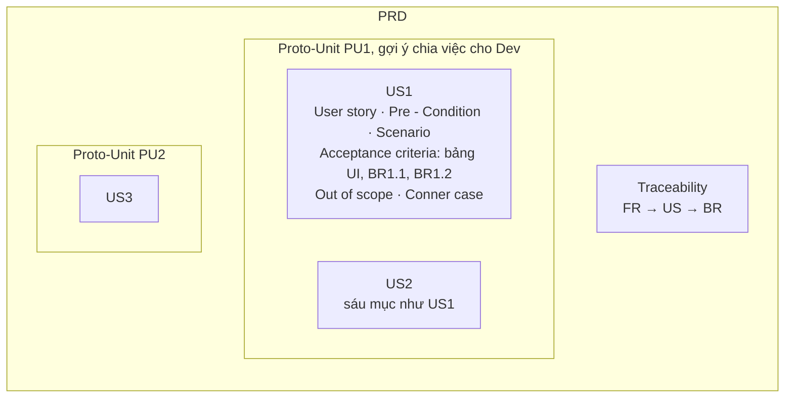

# User Guide: PO Workflow

Hệ thống này giúp PO và BA đi từ yêu cầu thô tới PRD bàn giao theo template công ty, rồi tới User Guide sau khi Dev làm xong. Bạn nói chuyện với AI bằng tiếng Việt và không cần biết lập trình. Từ 09/10/2026 mọi yêu cầu chạy theo luồng chuẩn hoá từ AWS AI-DLC; ba dự án Group, Gamification và Report-Phase-1 đã chuyển sang luồng này và giữ họ mã cũ trong tài liệu của chúng.

Tài liệu này nói cách thao tác. Tài liệu liên quan:

- [README.md](README.md): phương pháp và lý do của từng stage
- [GLOSSARY.md](GLOSSARY.md): thuật ngữ và họ mã

## Mục lục

1. [Workflow làm gì](#1-workflow-làm-gì)
2. [Cài đặt](#2-cài-đặt)
3. [Cấu trúc thư mục](#3-cấu-trúc-thư-mục)
4. [Chạy một intent từ đầu tới PRD](#4-chạy-một-intent-từ-đầu-tới-prd)
5. [Trả lời AI: câu hỏi, tóm tắt, gate](#5-trả-lời-ai-câu-hỏi-tóm-tắt-gate)
6. [Tham khảo lệnh](#6-tham-khảo-lệnh)
7. [Knowledge](#7-knowledge)
8. [Xử lý vấn đề thường gặp](#8-xử-lý-vấn-đề-thường-gặp)
9. [Git và lead các team](#9-git-và-lead-các-team)

## 1. Workflow làm gì

Một yêu cầu là một intent. Intent đi qua hai phase, Ideation để khung vấn đề và phạm vi, Inception để ra yêu cầu, user story và PRD. Có mười stage, mỗi stage sinh một artifact và kết thúc bằng một gate do bạn duyệt. Trong số đó chỉ Initiative Brief, HLD Brief, PRD và User Guide là tài liệu bàn giao; còn lại là bản phân tích nội bộ.

| Stage | Artifact | Gate | Nơi lưu trong intent |
|---|---|---|---|
| 1.1 Intent Capture & Framing | `intent-statement.md` | L: gate riêng. M: duyệt chung với 1.4 | `ideation/intent-capture/` |
| 1.2 Market Research | `competitive-analysis.md` | chỉ khi bạn muốn so với sản phẩm khác | `ideation/market-research/` |
| 1.4 Scope Definition | `scope-document.md`, danh sách Proto-Unit | gate | `ideation/scope-definition/` |
| 1.7 Approval & Handoff | Initiative Brief, một trang | gate, có lựa chọn dừng intent | `ideation/approval-handoff/` |
| 2.3 Requirements Analysis | `requirements.md`, mã `FR1`, `NFR1` | gate | `inception/requirements-analysis/` |
| 2.31 Impact Analysis | `related-features-map.md`, `impact-matrix.md` | gate | `inception/impact-analysis/` |
| 2.32 Solution Options | `solution-options.md` | gate, chỉ khi có nhiều hướng giải | `inception/solution-options/` |
| 2.4 User Stories | `stories.md`, mã `US1` | gate | `inception/user-stories/` |
| 2.41 HLD Brief & Alignment | HLD Brief, tối đa ba trang | alignment gate, ba lead ký | `inception/hld-brief/` |
| 2.42 PRD Generation | PRD, `traceability.md` | gate | `inception/prd/` |
| Sau khi Dev xong | User Guide | | `user-guide/` |

Stage 2.31, 2.32, 2.41 và 2.42 là phần repo thêm, gọi là plugin `po-workflow`. Sáu stage còn lại lấy từ AWS AI-DLC.

### Đầu ra cuối cùng trông thế nào

PRD là tài liệu bàn giao cuối. Bên trong, Proto-Unit chứa user story, user story chứa acceptance criteria và business rule; Traceability nối FR, US, BR để không sót.



Thứ tự làm ra chúng thì ngược lại: Proto-Unit có từ 1.4, FR từ 2.3, US từ 2.4, còn acceptance criteria chỉ viết ở 2.42. Unit thật là của Dev, chốt ở stage 2.7 sau khi nhận PRD, nên trong PRD chỉ có Proto-Unit.

### Profile quyết định đi mấy stage

Khi tạo intent, AI đề xuất profile kèm lý do và bạn có quyền đổi. Không chắc S hay M thì chọn M.

| Profile | Dấu hiệu | Stage chạy | Gate |
|---|---|---|---|
| S | Một màn, không đổi data model, không đổi rule có sẵn, không chạm module khác | 2.3 rồi 2.42, PRD rút gọn một US | 2 |
| M | Tối đa hai module, thêm field nhưng không đổi quan hệ bảng, không conflict, đã rõ hướng giải | 1.1 và 1.4 duyệt chung, 2.3, 2.31, 2.4, 2.41, 2.42 | 6 |
| L | Từ ba module, hoặc đổi data model, hoặc có conflict, hoặc nhiều hướng giải | Đủ mười stage; 1.2 và 2.32 chỉ khi cần | 8 đến 10 |

### Gate là gì

Gate là điểm dừng bắt buộc. AI không chuyển sang stage sau cho tới khi bạn duyệt rõ ràng. Mỗi artifact là nền cho artifact sau, nên một lỗi ở requirements mà không ai chặn sẽ đi thẳng vào Impact Matrix và PRD, và lúc phát hiện ra thì phải làm lại hết.

## 2. Cài đặt

### 2.1 VS Code và Claude Code

1. Tải VS Code tại https://code.visualstudio.com
2. Trong VS Code nhấn `Ctrl+Shift+X` (Windows) hoặc `Cmd+Shift+X` (Mac), tìm Claude Code của Anthropic, bấm Install
3. Bấm icon Claude ở thanh bên trái, chọn Sign in with Anthropic
4. Gõ `Xin chào` vào ô chat. AI trả lời tiếng Việt là được

### 2.2 Git

Windows tải tại https://git-scm.com/download/win, giữ mặc định, chỉ chọn "Use Visual Studio Code as Git's default editor". Mac đã có sẵn, hoặc chạy `xcode-select --install`.

Cấu hình một lần:

```bash
git config --global user.name "Tên của bạn"
git config --global user.email "email@upbase.vn"
```

### 2.3 Mở đúng thư mục

Vào File, chọn Open Folder, chọn thư mục `po-workflow`. Claude Code chỉ đọc được file trong thư mục đang mở; mở sai thì AI không thấy KB và các lệnh không chạy. Kiểm tra: panel Explorer hiện `po-workflow`, bên dưới có `.claude/` và `CLAUDE.md`.

### 2.4 Python cho script kiểm tra

Script `.claude/scripts/po-tools.py` cần Python 3.9 trở lên, Mac có sẵn. Không có cũng chạy được workflow, AI sẽ kiểm tay.

### 2.5 Lark CLI cho publish

`lark-cli` nằm ở `~/.local/node/bin`. Lần đầu dùng, hoặc khi AI báo token hết hạn, chạy `lark-cli auth login` rồi cấp quyền trong trình duyệt. Đây là việc bình thường, không phải lỗi.

### 2.6 Chụp màn hình cho User Guide, tuỳ chọn

`.mcp.json` đã cấu hình sẵn Playwright. Lần đầu mở project, Claude Code hỏi approve MCP server, chọn đồng ý. Không dùng thì khi viết User Guide gõ `skip-screenshot`.

## 3. Cấu trúc thư mục

```
po-workflow/
├── CLAUDE.md                  AI đọc mỗi phiên: phạm vi, quy ước, nguồn tra cứu
├── README.md                  phương pháp, từng stage, mapping sang AWS AI-DLC
├── USER-GUIDE.md              file này
├── DOMAIN-SETUP.md            dựng quy trình cho một sản phẩm khác
├── GLOSSARY.md                thuật ngữ, tên stage, họ mã
└── .claude/
    ├── commands/              mỗi stage một lệnh, cộng tiện ích
    ├── protocol/              nghi thức chung: stage, gate, review, câu hỏi, profile
    ├── templates/             mẫu artifact chung của engine
    ├── verification/          checklist từng stage và tiện ích
    ├── agents/product-lead.md reviewer độc lập
    ├── knowledge/
    │   ├── domain/            domain pack: domain.md, KB UpLnD 16 file, corner checklist, templates/ PRD và User Guide của công ty
    │   └── product/           kiến thức vai PO từ AWS, không phụ thuộc sản phẩm
    ├── memory/team.md         bài học đã giữ lại tại gate
    ├── scripts/po-tools.py    truy vết, chụp archive, kiểm trạng thái
    └── intents/
        └── 261009-ten-intent/
            ├── intent.md          bối cảnh, Figma, Jira, Lark
            ├── state.md           đang ở stage nào, việc kế tiếp
            ├── decisions.md       mọi quyết định, lời bạn nguyên văn
            ├── memory.md          AI ghi quan sát, bạn đọc tại gate
            ├── inputs/            đặt tài liệu đầu vào ở đây
            └── ideation/  inception/  reviews/  verification/  archive/  design/  user-guide/
```

Hai file đáng mở nhất trong mỗi intent là `state.md`, cho biết đang ở đâu và ai phải làm gì tiếp, và `decisions.md`, bộ nhớ của intent mà AI tra để không hỏi lại câu đã có đáp án. Đừng xoá hai file này.

## 4. Chạy một intent từ đầu tới PRD

### Bước 0: tạo intent

```
/new-intent Báo cáo giai đoạn 1
```

Tên tự do. AI tạo thư mục `.claude/intents/261009-bao-cao-giai-doan-1/`, đọc nhanh KB để đoán vùng bị chạm, rồi hỏi một câu để chốt profile, kiểu "Profile M: 7 stage, 6 gate. Đồng ý, đổi profile, hay đổi depth?".

Sau đó bạn đặt tài liệu đầu vào như mô tả yêu cầu, email, biên bản họp, ảnh vào `inputs/`. Viết mô tả ngay trong lệnh cũng được, AI lưu nguyên văn. Có link Figma hay Jira thì điền vào `intent.md`.

### Bước 1 trở đi: gọi /po

```
/po 261009-bao-cao-giai-doan-1
```

Mỗi lần gọi, AI đọc `state.md` rồi chạy stage kế tiếp hoặc tiếp tục stage đang dở. Làm nhiều intent song song thì luôn ghi tên intent trong lệnh.

Mỗi stage đi qua bảy bước; cách trả lời ở mục 5:

1. AI đọc nền
2. Hỏi bằng questions file
3. Tóm tắt để bạn xác nhận
4. Viết artifact
5. Tự kiểm bằng checklist và reviewer
6. Ghi bài học
7. Trình gate

### Ideation, profile M và L

Ở 1.1 và 1.4, AI hỏi về vấn đề, cách người dùng đang xoay xở, mục tiêu đo được, stakeholder, rồi về phạm vi In, Out, Potential và cách chia hạng mục thành Proto-Unit. Profile M duyệt hai artifact này chung một gate.

1.2 chỉ chạy khi bạn muốn so với TalentLMS, Docebo, Moodle hay sản phẩm khác. Không cần thì AI ghi bỏ qua.

Ở 1.7, profile L, AI gói mọi thứ thành Initiative Brief một trang và hỏi ba câu. Gate này có ba đường: đi tiếp, sửa, hoặc Reject Initiative để dừng hẳn. Muốn thì publish lên Lark với tên `[Brief] <tên tính năng>`.

### Inception

2.3 Requirements Analysis. AI tra KB trước, chỉ hỏi lỗ hổng còn lại, rồi viết yêu cầu có mã `FR1`, `FR1.1`, `NFR1`. Yêu cầu trùng tính năng đã có được nêu ngay kèm mã KB. Profile S bắt đầu từ đây.

2.31 Impact Analysis. AI trình Related Features Map trước: module, màn, bảng, endpoint, mail, rule nào liên quan. Bạn xem và bổ sung chỗ sót. Đây là chỗ dễ đóng góp nhất, vì bạn chỉ cần nhận ra cái thiếu chứ không phải nhớ từ đầu. Rồi AI dựng Impact Matrix 12 vùng, tìm conflict, FR còn thiếu, coverage gap, transition, tenant. Gặp conflict thì AI hỏi bạn quyết, không tự giải.

2.32 Solution Options, khi có nhiều hướng giải. AI hỏi bạn đã có định hướng chưa. Có thì nhận xét và gợi thêm; chưa thì dựng hai ba option, so theo bảy tiêu chí, đưa khuyến nghị có điều kiện. Duyệt gate là chọn option.

2.4 User Stories. Danh sách US gắn vào Proto-Unit, mỗi FR có US phủ. Bạn xác nhận danh sách; chi tiết viết ở PRD.

2.41 HLD Brief & Alignment. AI viết bản tối đa ba trang từ mọi thứ đã duyệt, để trống ba mục cho lead Design, Dev, QA và ghi sẵn vài dòng điểm cần lưu ý cho mỗi vai. Bạn gửi lead đường dẫn file trong repo; họ ghi mục của mình và ký ở mục 12, xem mục 9. Họp xong, gọi lại `/po`, AI trình diff và mở alignment gate. Đủ ba chữ ký mới duyệt; sau duyệt AI publish bản cuối lên Lark với tên `[HLD] <tên tính năng>`.

2.42 PRD Generation. AI tra KB, Swagger, Impact Matrix rồi gom một bảng Field Intake về field, rule, validate cho từng màn; bạn điền. Rồi AI viết PRD: phần đầu chép từ HLD Brief, phần Specific Requirement chi tiết từng US với sáu mục theo template công ty. Trước gate AI chạy kiểm truy vết FR, US, BR; có lỗ hổng thì sửa trước. Duyệt xong:

```
/publish-lark <intent> prd     đẩy PRD lên Lark wiki
/generate-user-guide <intent>  viết User Guide sau khi Dev xong
/change-request <intent>       khi yêu cầu đổi giữa chừng
```

## 5. Trả lời AI: câu hỏi, tóm tắt, gate

### Questions file

Mỗi stage có một file câu hỏi, ví dụ `requirements-analysis-questions.md`. Mỗi câu gồm:

- Lựa chọn A, B, C, và `X. Khác`; lựa chọn AI đề xuất có ghi nguồn
- Dòng `Chặn: có` khi thiếu đáp án thì không viết tiếp được
- Dòng `[Answer]:` để ghi câu trả lời

Lần đầu AI hỏi bạn muốn trả lời theo cách nào, rồi dùng cách đó cho cả intent:

| Cách | Bạn làm gì |
|---|---|
| Guide me | AI hỏi từng câu trong chat, bạn trả lời, AI ghi vào file |
| Edit file | Bạn mở file, điền sau `[Answer]:`, nói "xong" |
| Chat | Bạn viết tự nhiên một lượt, AI tách ra từng câu |

AI ghi câu trả lời nguyên văn, không diễn giải. Trả lời mơ hồ hoặc mâu thuẫn với câu trước thì AI hỏi lại một câu ngắn.

### Tóm tắt xác nhận

Trước khi viết artifact, AI tóm tắt mọi câu trả lời thành gạch đầu dòng và hỏi Looks correct hay Request changes. Đây là chỗ bắt hiểu nhầm rẻ nhất.

### Gate

AI trình thông điệp hoàn thành năm phần: artifact ở đâu, điểm chính, giả định và câu hỏi mở, finding của reviewer, dòng tiến độ. Bạn trả lời:

| Trả lời | Nghĩa |
|---|---|
| Approve | Ổn, đi tiếp. AI chụp bản duyệt vào `archive/`, ghi DEC |
| Request Changes | Nói rõ sửa gì, AI sửa và trình lại |
| Accept as-is | Từ lần trình thứ ba, nhận bản hiện tại kèm lý do ghi lại |
| Add [stage] | Chạy thêm một stage ngoài profile, ví dụ thêm 2.32 |
| Reject Initiative | Chỉ ở 1.7, dừng intent |

Viết tự nhiên cũng được: "ok nhưng đổi tên trường X" là duyệt kèm chỉ thị, AI làm rồi báo một dòng. "Duyệt, hôm nay dừng ở đây" là duyệt và tạm dừng. Trả lời không rõ thì AI hỏi lại, không tự coi là duyệt.

### Bài học

Tại gate AI hỏi "Có gì cần nhớ cho lần sau không?" kèm vài quan sát của nó. Chọn dòng đáng giữ hoặc trả lời "không có". Dòng giữ lại vào `.claude/memory/team.md` và áp dụng từ intent sau.

## 6. Tham khảo lệnh

| Lệnh | Dùng khi |
|---|---|
| `/new-intent <tên>` | Tạo intent mới, chọn profile |
| `/po <intent>` | Chạy stage kế tiếp hoặc tiếp tục. Lệnh chính |
| `/po-status [intent]` | Bảng trạng thái mọi intent, kiểm lệch giữa state và file |
| `/po-review <file>` | Review độc lập bằng agent Product Lead; thêm `--shadow` cho tài liệu người khác viết |
| `/change-request <intent>` | Đổi hoặc bổ sung yêu cầu giữa chừng; tự kích hoạt khi bạn nói "tôi đổi yêu cầu", "bổ sung" |
| `/publish-lark <intent> <artifact>` | Đẩy Initiative Brief, HLD Brief, PRD đã duyệt lên Lark |
| `/generate-user-guide <intent>` | Viết User Guide sau khi Dev xong |
| `/new-domain <sản phẩm>` | Dựng khung domain pack cho sản phẩm mới, chạy trong repo mới. Xem DOMAIN-SETUP.md |

Lệnh của từng stage như `/intent-capture` hay `/prd-generation` tồn tại, nhưng gọi qua `/po` để state được cập nhật đúng.

### Đổi yêu cầu giữa chừng

Đừng sửa lẻ tẻ. AI làm theo thứ tự:

1. Ghi `CR1` vào `decisions.md` kèm lời bạn
2. Chụp artifact bị ảnh hưởng vào `archive/`
3. Đề xuất stage phải quay lại và gate phải duyệt lại, chờ bạn xác nhận
4. Chạy xuôi từ đó, chỉ sửa phần bị chạm

HLD Brief đổi thì lead ký lại; PRD đổi thì publish lại Lark sau khi duyệt.

## 7. Knowledge

Mọi thứ riêng của sản phẩm nằm trong domain pack `.claude/knowledge/domain/`. File AI đọc đầu tiên là `domain.md`, manifest cho biết sản phẩm là gì, nguồn nào còn sống, KB nào trả lời câu gì, và mỗi stage cần dữ kiện gì. KB sản phẩm có 16 file, bắt đầu từ `00-index.md`:

- `01` đến `11`: nghiệp vụ theo module
- `12`: data model
- `13`: mail event
- `14`: API surface, kể cả vùng KB chưa phủ
- `15`: định hướng sản phẩm và ràng buộc đa tenant
- `16`: nguyên tắc mô hình hoá

Cùng thư mục có `corner-checklist.md`, danh sách góc hay sót viết riêng cho LMS, như lớp đã kết thúc, học viên bị Block, một người nhiều nhóm, dữ liệu cũ trước ngày bật tính năng, mail hàng loạt; AI quét nó ở 2.3 và 2.42. Thư mục con `templates/` chứa template PRD và User Guide theo chuẩn công ty.

Kiến thức vai PO nằm trong `.claude/knowledge/product/`, chép từ AWS AI-DLC và không phụ thuộc sản phẩm. Muốn dùng quy trình cho một sản phẩm hay công ty khác, đọc [DOMAIN-SETUP.md](DOMAIN-SETUP.md) rồi chạy `/new-domain` trong một repo mới; engine giữ nguyên, chỉ thay domain pack.

### Quy ước ký hiệu

| Ký hiệu | Nghĩa |
|---|---|
| `BR-COURSE-01` | Business rule có sẵn trong User Guide, đáng tin |
| `KB-COURSE-01` | AI trích từ văn xuôi, chưa được duyệt, cần bạn xác nhận |
| `❓PO` | Chưa rõ, không dùng làm căn cứ |
| `[suy ra]` | AI suy luận, không phải câu chữ trực tiếp |
| Hidden | Tính năng đã có code nhưng tạm ẩn, vẫn phải xét khi phân tích |

### Ba giới hạn cần nhớ

KB chỉ phủ khoảng một nửa hệ thống. Ops có 25 nhóm chức năng và LMS có 8 nhóm không có trong User Guide. Trước khi tin "vùng này không bị ảnh hưởng", xem `14-api-surface.md` mục 1 và 2.

Rule `KB-*` chưa được duyệt. 110 rule loại này do AI trích ra, cần bạn xác nhận trước khi dùng làm ràng buộc trong PRD.

KB là bản chụp, không phải bản gốc. Schema DB trên [Lark Data Architecture](https://upbasevn.sg.larksuite.com/wiki/MaFpweI68iKNMvkTioLlJ1uJgQd), Swagger staging và GitBook là nguồn sống: yêu cầu chạm tới dữ liệu thì AI tự đọc lại. 30 mail event và SIS là bản chốt, không còn file gốc, nên AI sẽ hỏi bạn chứ không tự suy. Nguồn sống nên kiểm lại mỗi tháng một lượt: mở phiên mới và bảo "đọc lại schema DB trên Lark, đối chiếu với KB 12".

## 8. Xử lý vấn đề thường gặp

| Tình huống | Cách xử lý |
|---|---|
| AI chọn nhầm intent | Nói "sai rồi, tôi muốn làm intent X", AI chuyển ngay |
| AI hỏi lại câu đã trả lời | Kiểm `decisions.md` và questions file, có thể câu trả lời chưa được ghi |
| Không biết đang ở đâu | `/po-status` |
| AI viết dài, sai trọng tâm | Nhắc thẳng. AI có xu hướng mở rộng phạm vi, cứ kéo về |
| Tài liệu dài, AI bắt đầu sót | Gõ `/compact` rồi gọi lại `/po`, state trên đĩa nên không mất gì |
| Reviewer báo NOT-READY nhưng bạn thấy ổn | Nói rõ finding nào chấp nhận, AI ghi Accepted risk vào `decisions.md` |
| Lead chưa ký HLD Brief | Chờ, hoặc Accept as-is kèm lý do; lý do được ghi lại |
| Lark không kết nối được | AI hỏi bạn cấp quyền lại qua trình duyệt, việc bình thường |
| Không chụp được màn hình | Gõ `skip-screenshot`, AI để placeholder và liệt kê ảnh còn thiếu |
| Muốn biết AI dựa vào đâu | Hỏi thẳng. Mọi artifact nội bộ có thẻ nguồn và mục nguồn đã đọc |

Khi AI nói "không chắc", đó là hành vi đúng. Workflow ép AI đánh dấu `❓PO` và open question thay vì đoán. Thấy nhiều `❓PO` nghĩa là yêu cầu còn thiếu thông tin, không phải AI kém.

## 9. Git và lead các team

```bash
git pull                      # lấy bản mới nhất trước khi làm
git add .
git commit -m "HLD Brief báo cáo giai đoạn 1, bản chờ ký"
git push
```

Xung đột khi pull thì hỏi AI, đừng tự sửa tay nếu không quen.

### Lead Design, Dev, QA ghi vào HLD Brief

Lead làm trực tiếp trên repo, không cần Claude Code; sửa trên GitHub web cũng được.

1. Pull, mở `.claude/intents/<intent>/inception/hld-brief/hld-brief.md`.
2. Chỉ sửa mục của mình: Design mục 8, Tech mục 9, QA mục 10, và dòng của mình ở mục 12 với một trong bốn trạng thái Chưa xem, Có ý kiến, Đồng ý, Yêu cầu sửa. Đầu mỗi mục có vài dòng in nghiêng AI gợi ý điểm cần lưu ý cho vai của bạn; trả lời chúng rồi viết định hướng bên dưới. Có ý kiến về mục khác thì ghi ở cuối mục của mình dưới tiêu đề "Ý kiến với mục N". Yêu cầu sửa thì ghi rõ sửa gì.
3. Commit ngay, message `hld(<intent>): design direction`, `tech direction` hoặc `qa direction`, rồi push.

Lead không mở được repo thì gửi nội dung cho PO. PO dán nguyên văn, mở đầu bằng "(ghi theo tên, ngày)", và lưu tin nhắn xác nhận vào `decisions.md`.
