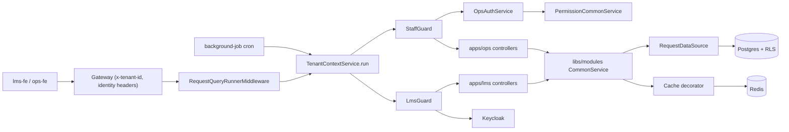
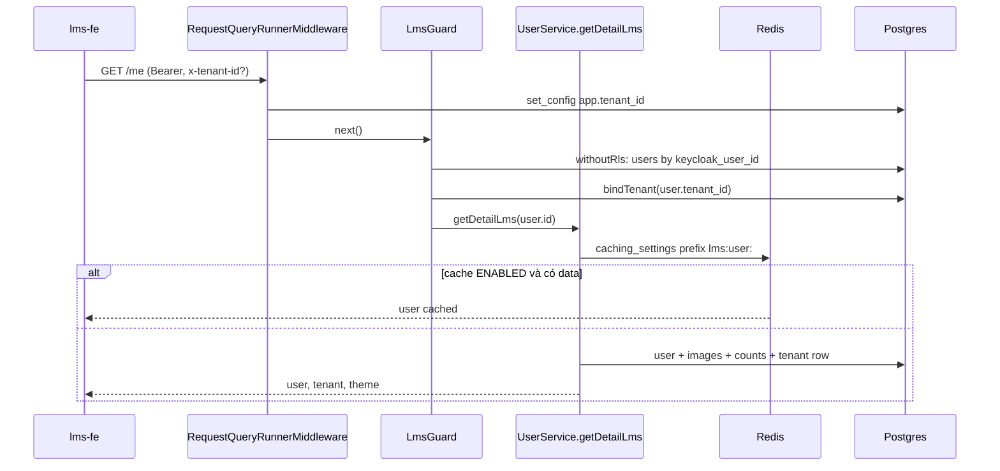
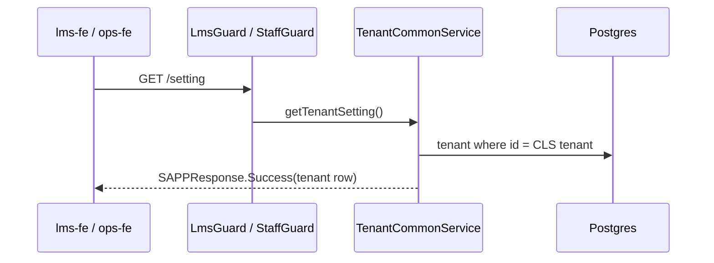
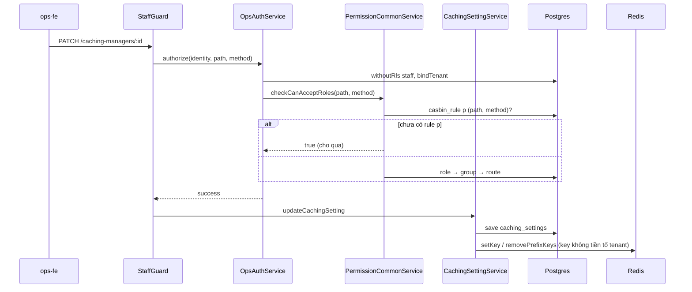

# Architecture — lms-be

> Focused scan, `origin/staging` @ `1051114`. Convention của repo không chép lại: `openspec/conventions/backend.md` (vị trí code, API, DTO, Kafka/job, performance), `database.md`, `patterns.md`.

## Architecture Analysis

### System Overview
Monorepo Nx gồm 7 app NestJS (`apps/lms`, `apps/ops`, `apps/background-job-service`, `apps/event-processor-service`, `apps/notification-service`, `apps/mock-test-service`, `apps/video-service`) dùng chung các lib `@sapp/*` (`tsconfig.base.json:19-29`). Một Postgres chung có RLS theo tenant, Redis cho cache, Keycloak cho định danh, Kafka giữa các service. Danh sách module: `code-structure.md`.

### Architectural Style
**Modular monolith nhiều deployable** (Hybrid): code chung một repo và một DB, nhưng build thành nhiều image chạy riêng (`.github/workflows/deploy-staging.yml:136` deploy theo batch `ops lms mock-test` / `notification background-job video event-processor`). Business logic dùng chung nằm ở `libs/modules` (`*CommonService`), app chỉ có controller + service mỏng. Mọi app import `ShareModule` global (`libs/modules/src/lib/share.module.ts:63-70`).

### Component Relationships

Text fallback: request HTTP đi qua middleware mở scope tenant (một connection riêng), rồi guard (LMS hoặc Ops) xác thực Keycloak và gắn tenant, rồi controller gọi CommonService trong `libs/modules`; service đọc ghi Postgres qua `RequestDataSource` (cùng connection đã set tenant) và có thể đi qua `@Cache` (Redis). Cron dùng `runForEachTenant` để mở scope tenant tuần tự.

### Data Flow
- Tenant: header `x-tenant-id` (`libs/database/src/lib/extends/request-query-runner.middleware.ts:51-53`) → CLS + `set_config('app.tenant_id')` trên connection riêng (`tenant-context.service.ts:34-45`). Header trống thì guard `bindTenant` theo actor (`tenant-context.service.ts:83-101`).
- Đọc ghi DB: `RequestDataSource` trả `manager`/`createQueryRunner` của connection trong CLS (`libs/database/src/lib/extends/request-data-source.ts:70-71`).
- Cache: key `tenant:{id}:{prefix}{id}` (`libs/services/src/lib/redis/cache.service.ts:17-20`); bật hay không do row `caching_settings` (`cache.decorator.ts:41-65`).

### Key Design Decisions
1. **RLS ở DB thay vì filter ở code**: policy `FOR ALL` + `FORCE` (`libs/database/migrations/1789930000000-enable-rls-on-tenant-tables.ts:45-53`), có cửa bypass `app_rls_bypassed()` (`1789994000000-add-rls-bypass-to-tenant-policies.ts:14-21`).
2. **Một connection mỗi request** giữ GUC tenant; reset + rollback transaction treo khi trả pool (`tenant-context.service.ts:132-149`).
3. **Guard gắn theo route, không có `APP_GUARD`**: `apps/lms/src/main.ts:28-46` chỉ có `ValidationPipe` + `ClassSerializerInterceptor`.
4. **Quyền Ops khai bằng metadata Swagger**, quét lúc khởi động ghi `casbin_rule` từng tenant (`permission.service.ts:57-80`).
5. **Cache bật/tắt bằng dữ liệu**, không bằng code (`cache.decorator.ts:64-65`).

### Improvement Opportunities
- Thêm cột/bảng cấu hình theo tenant (hiện `tenant` chỉ 6 cột text, `tenant.entity.ts:7-26`) và bỏ hardcode +7 (`timezone.constants.ts:1-4`).
- Đồng bộ key Redis: admin Ops xoá key **không** tiền tố tenant (`libs/services/src/lib/redis/redis-cache.service.ts:21,81-113`), trong khi `@Cache` đọc key có tiền tố → xem `code-quality-assessment.md` TD-1.
- Mặc định từ chối cho route Ops chưa khai quyền (hiện cho qua, `permission.service.ts:94-105`).

## Interaction Diagrams

### 1. Học viên vào hệ thống — `GET /api/v1/me`

Text fallback: middleware set tenant (`request-query-runner.middleware.ts:29-38`) → `LmsGuard` verify token, kiểm `azp`, tra user bỏ RLS, gắn tenant (`lms.guard.ts:42-70`) → `getDetailLms` bọc `@Cache` key `lms:user:{id}` (`user.service.ts:3118-3121`); khi cache bật thì thân hàm **không chạy**. Không có ghi DB nào; không có `last_login`.

### 2. Đọc cấu hình tenant — `GET /api/v1/setting`

Text fallback: controller LMS `app.controller.ts:41-51` / Ops `app.controller.ts:58-68` → `tenant.service.ts:18-23` đọc tenant id từ CLS, `findOne` bảng `tenant` (bảng này không có RLS, không nằm trong `TABLES` của migration RLS). Không cache.

### 3. Admin sửa cấu hình qua guard quyền — mẫu `PATCH /api/v1/caching-managers/:id`

Text fallback: `staff.guard.ts:31-57` → `ops-auth.service.ts:143-179` (whitelist role `superadmin`, route `/api/v1/me`, `libs/constants/src/lib/role/role.ts:8-9`) → `permission.service.ts:88-138` → controller `caching-settings.controller.ts:256-275` (`tags: []`) → `caching-settings.service.ts:238-257`.

## Infrastructure Constraints

| Ràng buộc | Hiện trạng | Bằng chứng |
|---|---|---|
| Tenant | Bảng có `tenant_id` phải thêm policy `tenant_isolation_<table>` có điều kiện bypass; `tenant_id` tự điền khi insert nếu CLS có tenant | `1789994000000-...ts:7,21`; `libs/database/src/lib/extends/tenant-id.subscriber.ts:27-36` |
| RLS ngoài scope | Không có tenant thì GUC = uuid nil → RLS trả 0 dòng | `tenant.constants.ts:3-4`, `tenant-context.service.ts:41-44` |
| Bypass | Chỉ guard dùng `withoutRls` | `lms.guard.ts:59-61`, `ops-auth.service.ts:148` |
| Transaction | Không có transaction bao request; service tự `startTransaction` (63 file), dùng chung connection của request; scope kết thúc mà còn transaction thì rollback | `request-query-runner.interceptor.ts:9-12`, `request-data-source.ts:71`, `tenant-context.service.ts:134-136` |
| Idempotency | Không có cơ chế dedupe/"lần đầu trong ngày" nào; endpoint bootstrap đều chỉ đọc | `app.controller.ts:20-51` |
| Job theo tenant | `runForEachTenant` tuần tự, lỗi tenant nào log rồi bỏ qua; mọi `@Cron` giờ VN | `tenant-context.service.ts:168-184`; `apps/background-job-service/src/app/app.controller.ts:19-209` |
| Realtime | Có dependency socket.io nhưng không có `@WebSocketGateway` nào | `package.json:47,52,132` |

**Đường ghi vào bảng chính liên quan lát**
- `tenant`: chỉ migration INSERT (`1789920000000-add-tenant-id-to-core-tables.ts:67`, `1789950000000-add-tenant-id-to-facility-tables.ts:37`); runtime chỉ đọc (`tenant.service.ts:20`, `user.service.ts:3142`, `apps/ops/src/staffs/staffs.service.ts:477`).
- `caching_settings`: chỉ `CachingSettingService` ở Ops (`caching-settings.service.ts:202,223,249,269`).
- `users`: không có cột `last_login`/`last_active`; `GET /me` không ghi `users` (`user.service.ts:3122-3158`).
- `staffs.keycloak_user_id`: ghi ngầm trong guard khi khớp email (`ops-auth.service.ts:132`).
