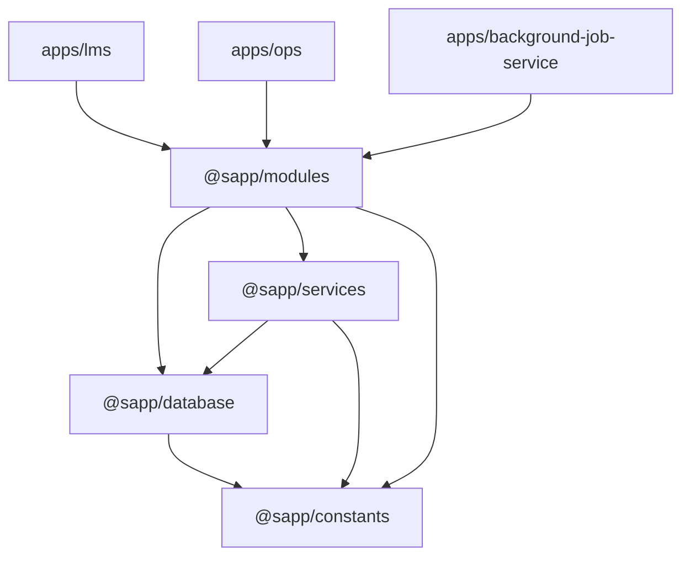

# Dependencies — lms-be

> `origin/staging` @ `1051114`. Version thư viện: `technology-stack.md` (không lặp lại ở đây). File này ghi quan hệ phụ thuộc trong phạm vi lát.

## Internal Dependencies

Text fallback: app phụ thuộc `@sapp/modules` (qua `ShareModule` global, `libs/modules/src/lib/share.module.ts:63-70`); `@sapp/modules` dùng `@sapp/database` (entity, `RequestDataSource`, `TenantContextService`), `@sapp/services` (Redis, Keycloak, Casbin), `@sapp/constants`. `@sapp/services` import ngược `@sapp/database` cho `CachingSetting`, `getRequestTenantId` (`libs/services/src/lib/redis/cache.decorator.ts:6`, `cache.service.ts:5`).

| Từ | Tới | Loại | Bằng chứng |
|---|---|---|---|
| `ShareModule` | `DatabaseModule`, `ThirdPartyModule`, `KeycloakModule`, `TenantCommonModule`… | Module import (global) | `share.module.ts:61-70` |
| `ThirdPartyModule` | `RedisCacheModule`, `CasbinModule`, `FcmModule`… | Module import (global) | `libs/services/src/lib/third-party.service.ts:10-30` |
| `DatabaseModule` | `ClsModule.forRoot`, `TypeOrmModule` | Global, điểm mount CLS duy nhất | `libs/database/src/lib/database.module.ts:19-31` |
| `LmsGuard` | `UserService`, `KeycloakJwtService`, `KeycloakService`, `TenantContextService` | Inject | `apps/lms/src/auth/guard/lms.guard.ts:22-30` |
| `OpsAuthService` | `Staff` repo, `KeycloakService`, `RoleCommonService`, `PermissionCommonService`, `TenantContextService` | Inject | `apps/ops/src/auth/ops-auth.service.ts:24-30` |
| `UserService.getDetailLms` | `Tenant` repo, `@Cache` | Đọc chéo bảng tenant trong module user | `libs/modules/src/lib/user/user.service.ts:3141-3142` |
| `CachingSettingService` | `RedisCacheService` | Inject | `apps/ops/src/caching-settings/caching-settings.service.ts:201,250-255` |

**Coupling đáng chú ý**
- `@Cache` inject ngầm `cacheService`, `dataSource`, `cls` vào class dùng nó qua property injection (`cache.decorator.ts:18-25`) → service nào dùng `@Cache` phụ thuộc ẩn vào `RedisCacheModule` + `DatabaseModule`.
- Cờ `is_super_student`, `is_operator`, `is_supporter` được guard nạp vào `request.user` (`user.service.ts:3186-3193`) — mọi logic loại "Test Account" (PRD `C10`) sẽ dựa vào đây nếu PO chọn một trong ba cờ.

## External Dependencies (runtime, lát)

| Hệ thống | Dùng ở | Kiểu gọi | Lỗi thì sao | Bằng chứng |
|---|---|---|---|---|
| PostgreSQL | mọi request | Connection riêng/request, GUC tenant | Request lỗi | `tenant-context.service.ts:36-45` |
| Redis | `@Cache`, Ops caching admin, Bull | `cache-manager` + `ioredis` | Chưa thấy fallback khi Redis lỗi trong `@Cache` [suy ra từ `cache.decorator.ts:42,69` không try/catch] | `redis-cache.module.ts:15-64` |
| Keycloak | Verify token (guard), activity (`my-learnings`) | HTTP, retry | `my-learnings` lỗi toàn bộ | `lms.guard.ts:47`; `keycloak.service.ts:449-456`; `courses.service.ts:205` |
| Gateway | Gắn `x-tenant-id`, identity header | Header | Không có header → tenant gắn theo actor | `request-query-runner.middleware.ts:51-53`; `lms.guard.ts:42-44` |

## Casbin
`casbin` có trong dependencies và `CasbinModule` được nạp (`third-party.service.ts:13`), nhưng kiểm quyền Ops lúc request là truy vấn tay bảng `casbin_rule` (`libs/modules/src/lib/permission/permission.service.ts:95-129`), không gọi enforcer. Chi tiết: codekb vùng cũ `authz-tenant.md` (sẽ chuyển vào `areas/`).

## WIP dependency
Nhánh `origin/draft/gamification` thêm FK từ 10 bảng `gamification_*` tới `tenant` và `users` (vd `libs/database/migrations/1790000000000-create-gamification-tables.ts:81,97,225` trên nhánh đó). Chưa merge; xem `reverse-engineering-timestamp.md`.
