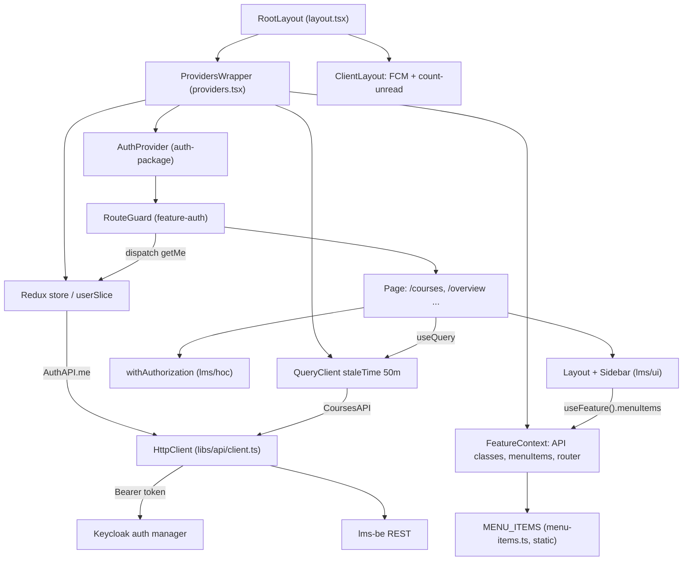
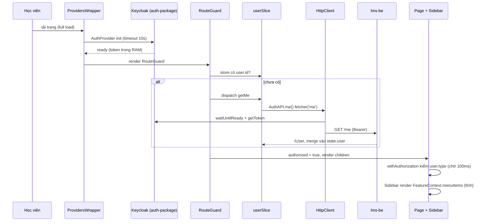
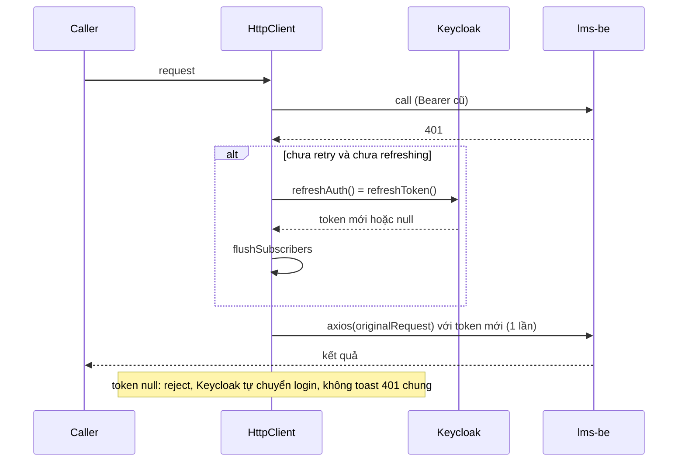

# Architecture — lms-fe (focused: learner shell)

Convention (stack, alias, placement, provider nesting) ở `lms-fe/.claude/rules/01-code-placement.md`, `03-architecture-patterns.md` — không chép lại. File này chỉ ghi phần đã kiểm bằng code `origin/staging` @ `a7a5734d3`.

## Architecture Analysis

### System Overview
lms-pro là SPA client-driven trên Next.js 14 App Router. `RootLayout` render server shell, mọi data fetch ở client (`apps/lms-pro/src/app/layout.tsx:87-88,135-143`). Một `ProvidersWrapper` bọc Redux + chuỗi provider (`apps/lms-pro/src/app/providers.tsx:340-399`). Auth Keycloak qua `@upbase-tech/auth-package`, gọi BE lms-be REST qua một axios client dùng chung `@lms/api` (`libs/api/client.ts:89-252`).

### Architectural Style
Modular monolith FE (monorepo): app mỏng + `features/*` (nghiệp vụ) + `libs/*` (dùng chung). Bằng chứng: app inject API class, menu, router vào `FeatureContext` để `libs/ui` và `features/*` dùng mà không import app (`providers.tsx:167-210`, `libs/state/contexts/FeatureContext.tsx:34-105`). Module tuỳ khách hàng bật bằng registry tĩnh (`apps/lms-pro/src/app/module-registry.ts:10-16`).

### Component Relationships

Text fallback: RootLayout → ProvidersWrapper (Redux, FeatureContext, QueryClient, AuthProvider) → RouteGuard (dispatch `getMe` vào userSlice) → page (`withAuthorization`, `Layout` + `Sidebar` đọc `menuItems` tĩnh từ FeatureContext). Mọi API đi qua HttpClient gắn Bearer token từ Keycloak tới lms-be. ClientLayout chạy notification song song.

### Data Flow
1. Keycloak init trong `AuthProvider`, hạn chờ 10s rồi toast và render tiếp (`providers.tsx:131-136,363-368`).
2. `RouteGuard` thấy store chưa có `user.id` → `getMe(userContextApi)` (`RouteGuard.tsx:26,35-44,57-58`) → `ReduxUserApi.getMe` → `AuthAPI.me()` → `fetcher('me')` (`libs/api/redux/User/user.ts:13-17`, `libs/api/api/profile/index.ts:58-60`) → merge toàn bộ payload vào `state.user` (`libs/state/redux/slice/User/User.tsx:228-233`).
3. Trang đọc server state bằng React Query v3, defaults `staleTime: 3000000`, `refetchOnWindowFocus: false` (`providers.tsx:109-116`). My Learning tự override `staleTime: 0, refetchOnMount: 'always'` (`apps/lms-pro/src/app/courses/page.tsx:169-175`).
4. Response được map tại page, không có lớp mapper riêng (`courses/page.tsx:177-193`).

### Key Design Decisions
- **Token chỉ trong RAM**, cookie cũ bị xoá (`apps/lms-pro/src/utils/helpers/keycloak.ts:42-51`). Request chờ `auth.waitUntilReady()` trước khi gắn header (`apps/lms-pro/src/services/request.ts:17-20`).
- **DI qua context** thay vì import trực tiếp: `FeatureContext` là container, không chứa flag (`FeatureContext.tsx:34-97`).
- **Menu tĩnh**: `MENU_ITEMS = makeMenuLevel(MENU_OPTIONS)` tính lúc import (`menu-items.ts:171`), `showMenu` là hằng (`menu-items.ts:34,140`), `MenuItem` chỉ ẩn khi `showMenu === false` (`libs/ui/layout/MenuItem/index.tsx:379`).
- **Lỗi HTTP tập trung**: toast trong interceptor, trừ `silent`/`toastExceptions`/401 chung (`libs/api/client.ts:42-53,202-218`).
- **Static export tuỳ chọn**: `output: 'export'` khi `NEXT_EXPORT=true` (`apps/lms-pro/next.config.js:12,37`).

### Improvement Opportunities
- Menu cần nguồn động (selector/hook) để ẩn/hiện runtime theo cấu hình tổ chức; hiện không thể (`menu-items.ts:171`, `providers.tsx:192`).
- Thêm lớp mapper/typing cho response (`CoursesAPI.getMyLearnings(): Promise<any>`, `libs/api/api/courses/index.ts:77-78`).
- Retry sau refresh dùng `axios(originalRequest)` toàn cục, không qua instance (`libs/api/client.ts:191`) → response interceptor (toast, redirect 403) không áp cho lần retry.
- Tín hiệu "app được mở/quay lại" chưa có điểm bám chung (xem Infrastructure Constraints).

## Interaction Diagrams

### 1. Học viên mở app → Sidebar

Text fallback: tải trang → AuthProvider chờ Keycloak (≤10s) → RouteGuard: store trống thì `GET /me` (header chờ `waitUntilReady`) và merge vào store → render page → `withAuthorization` chờ 100ms, so `user.type` → Sidebar render menu tĩnh. Điều hướng client sau đó **không** gọi lại `/me` vì store đã có `user.id` (`RouteGuard.tsx:35-44`).

### 2. Token hết hạn (401) → refresh

Text fallback: 401 → đánh `_retry`, một request duy nhất gọi `getAuthManager().refreshToken()`; các request khác vào hàng đợi; có token thì retry 1 lần, không có thì reject cả hàng đợi (`libs/api/client.ts:155-196`, `apps/lms-pro/src/services/request.ts:26`). 401 không mã hoặc `401|000000` không toast (`client.ts:78-86,151-153`).

## Infrastructure Constraints

| Ràng buộc | Hiện trạng | Bằng chứng | Hệ quả cho lát |
|---|---|---|---|
| Tenant | FE **không** gửi header tenant; interceptor chỉ gắn `Authorization`. Keycloak một realm cố định từ env. Branding tenant chưa nối (`null`) | `libs/api/client.ts:114-123`; `keycloak.ts:33-37`; `tenant-branding.ts:3` | Công tắc US14 phải đến từ response BE theo user; FE không tự biết tenant |
| Cấu hình tenant / flag | Không có endpoint, store, context nào cho flag | `FeatureContext.tsx:34-97`; `User.tsx:228-233` | Cần query mới (PRD §8 `GET /gamification/me`) |
| Cache React Query | Mặc định stale 50 phút, không refetch khi focus | `providers.tsx:109-116` | Bật/tắt công tắc phía ops không hiện ở học viên tới khi reload, trừ khi query tự override |
| Lỗi bị nuốt | `toastExceptions` + `silent` + 401 chung không toast | `client.ts:42-53,212-218` | Call gamification nền nên `silent: true` |
| 403 | Mọi mã `403*` redirect `/`, **kể cả request `silent`** | `client.ts:219-223` | Trạng thái "ẩn" không được trả 403 |
| Static export | `output: 'export'` khi `NEXT_EXPORT=true`; `[page]` chỉ sinh `overview` | `next.config.js:12,37`; `[page]/layout.tsx:8-11` | Route `/gamification` phải là folder riêng |
| Realtime | Chỉ FCM; `onMessageListener` là Promise resolve **một lần**; không socket/EventSource/`refetchInterval` | `libs/utils/firebase.ts:47-56`; `client-layout.tsx:30-32` | Toast US5 cần kênh mới hoặc sửa listener |
| Tín hiệu "vào hệ thống" | `GET /me` chỉ khi store trống (mỗi lần full load); không listener `visibilitychange`/`focus`; chỉ `pagehide` | `RouteGuard.tsx:35-58`; `client.ts:67-71` | US5 BR-5.1 không bám được vào code hiện có |
| Múi giờ | Format ngày theo giờ thiết bị (`dayjs` + `utc`, không plugin timezone) | `libs/utils/common.ts:30-38`; `MyLearningHeader.tsx:120-122` | BR-5.3/BR-14.9 (giờ tổ chức) chưa có nguồn ở FE |
