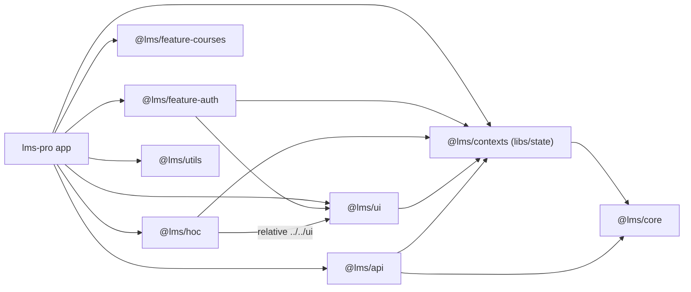

# Dependencies — lms-fe (focused: learner shell)

Version thư viện ở `technology-stack.md`. Quy tắc thêm dep, `catalog:`, registry `@upbase-tech/*`: `lms-fe/.claude/rules/04-imports-and-dependencies.md`.

## Internal cross-package dependencies (vùng quét)

Text fallback: app phụ thuộc mọi package; `feature-auth` → `contexts`, `ui`; `hoc` → `contexts`, `ui` (qua đường dẫn tương đối); `ui` → `contexts`; `api` ↔ `contexts` (xem vòng dưới); tất cả → `core`.

| From | To | Import | Bằng chứng |
|---|---|---|---|
| `features/auth` | `@lms/contexts`, `@lms/core`, `@lms/ui`, `@lms/utils` | `getMe`, `useFeature`, `UpBaseLoadingGlobal`, `setCookie` | `features/auth/src/components/RouteGuard.tsx:1-4` |
| `libs/HOC` | `@lms/contexts`, `libs/ui` (tương đối) | `useFeature`, `userReducer` | `libs/HOC/src/withAuthorization.tsx:2-4` |
| `libs/ui` Sidebar | `@lms/contexts`, `@lms/assets`, `@lms/utils` | `useFeature` | `libs/ui/layout/Sidebar/index.tsx:2-4` |
| `libs/api` redux | `@lms/contexts` | type `IUser` | `libs/api/redux/User/user.ts:4` |
| `libs/api` profile | `@lms/contexts` | type request đổi mật khẩu | `libs/api/api/profile/index.ts:1-6` |
| `libs/state` User slice | `@lms/core` | `USER_STATUS`, `USER_TYPE` | `libs/state/redux/slice/User/User.tsx:1` |
| app menu | `@lms/core`, `@lms/utils`, `module-registry` | `makeMenuLevel`, `modules` | `apps/lms-pro/src/constants/menu-items.ts:1-5` |
| app request | `@lms/api`, `@upbase-tech/auth-package` | `configureHttpClient`, `getAuthManager` | `apps/lms-pro/src/services/request.ts:1-4` |

### Vòng phụ thuộc
- `@lms/api` → `@lms/contexts` (type, `libs/api/redux/User/user.ts:4`) trong khi `@lms/contexts` nhận API qua tham số/DI (`FeatureContext.tsx:34-41`) — vòng ở mức type, chưa gây lỗi runtime.
- `keycloak.ts` ↔ `services/request.ts`: tránh bằng cách `request.ts` lấy `getAuthManager` thẳng từ package (`apps/lms-pro/src/services/request.ts:6-8`).

## External dependencies (vùng quét)

| Dependency | Loại | Vai trò | Bằng chứng |
|---|---|---|---|
| lms-be REST | Service | Mọi data học viên; endpoint ở `api-documentation.md` | `libs/api/client.ts:93-95` |
| Keycloak | Service (IdP) | Đăng nhập, token, refresh, session device | `apps/lms-pro/src/utils/helpers/keycloak.ts:32-37,68-79` |
| Firebase Cloud Messaging | Service | Push notification | `libs/utils/firebase.ts:31-56` |
| `@upbase-tech/auth-package` | Private package (repo `lms-package`) | Auth manager + `AuthProvider` | `apps/lms-pro/src/app/providers.tsx:55,363-368` |
| `@upbase-tech/design-tokens` | Private package | Branding tenant | `apps/lms-pro/src/app/layout.tsx:3`; `libs/hooks/useTenantTheme.ts:2-9` |
| Sentry, HubSpot widget, GA/GTM | Third-party | Monitoring / chat / analytics | `apps/lms-pro/next.config.js:2`; `providers.tsx:233-323,380` |

## Lệch tài liệu
- `.claude/rules/04` ghi `design-tokens` "chưa khai báo ở lms-fe", nhưng lms-pro khai `@upbase-tech/design-tokens: 1.0.0` và dùng thật (`apps/lms-pro/package.json:54`; `layout.tsx:3`; `providers.tsx:56`).
- Root `package.json` chỉ khai 4 package `@upbase-tech/*` (L119-122), thiếu `auth-package`/`design-tokens` mà lms-pro khai riêng.

## Dependency mới PRD dự kiến (chưa có)
`socket.io-client` v4 + env `NEXT_PUBLIC_GAMIFICATION_SOCKET_URL` (PRD §Frontend 1). Không có trên staging (grep rỗng).
