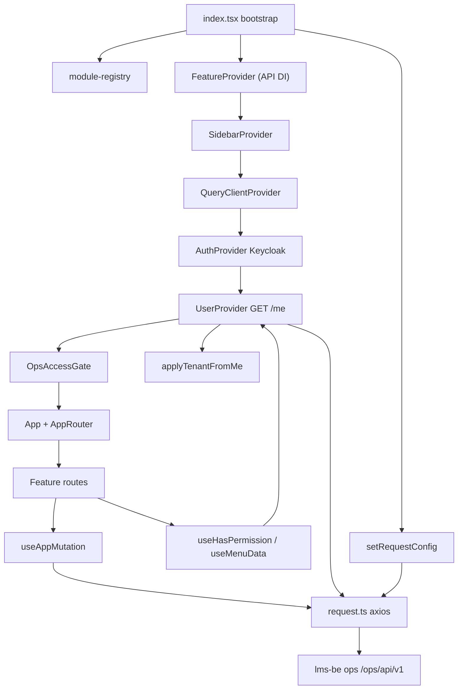
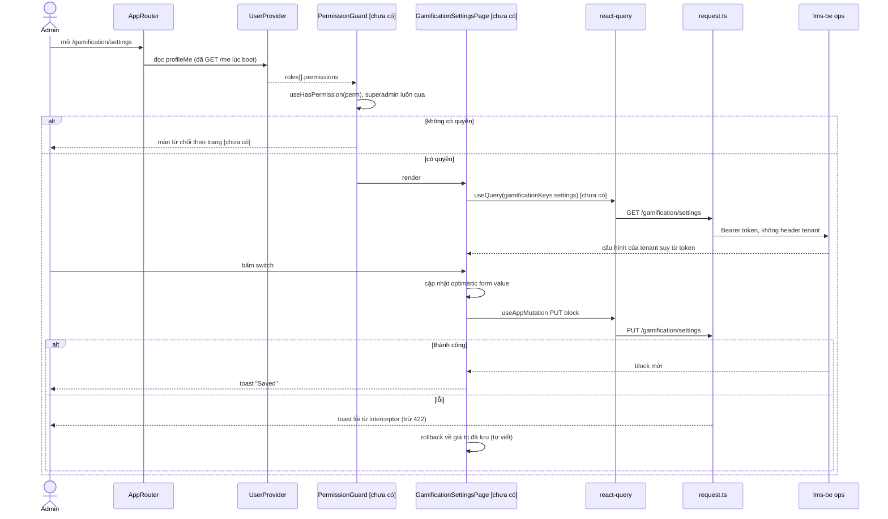

# Architecture

> Focused scan vùng settings / permission / HTTP / tenant. Convention repo không chép lại: xem ops-fe `.claude/rules/*` và `.claude/inventory/*`.

## Architecture Analysis

### System Overview

SPA React 18 + Vite (`apps/ops-fe/vite.config.ts:7-60`), monorepo pnpm (`pnpm-workspace.yaml`: `apps/*`, `libs/*`, `features/*`). App shell `apps/ops-fe` nạp các `features/*` dưới dạng `AppModule {name, routes, pageLink, sidebarIds?}` (`libs/core/src/types/common.ts:42-47`). Gọi BE `lms-be` app `ops` qua một axios instance dùng chung (`libs/service/src/request.ts:53-55`), base URL `VITE_API_PUBLIC` = `…/ops/api/v1/` (`apps/ops-fe/.env.example:1`).

### Architectural Style

Modular monolith phía client (plugin module viết tay): `module-registry.ts:18-34` liệt kê module → `bootstrap.ts:5-27` gộp `pageLink` + `sidebarIds` → `AppRouter.tsx:64` render route của từng module. Dependency injection API qua `FeatureProvider` (`apps/ops-fe/src/index.tsx:128-188`): feature lấy `XxxAPI` bằng `useFeature()` thay vì import thẳng app.

### Component Relationships

Text fallback: `index.tsx` cấu hình HTTP client và bọc cây provider theo thứ tự FeatureProvider → SidebarProvider → QueryClientProvider → AuthProvider → UserProvider → OpsAccessGate → App (`apps/ops-fe/src/index.tsx:127-211`). Route của feature dùng hook quyền đọc `profileMe` từ UserProvider; mutation đi qua `useAppMutation` → `request.ts` → BE.

### Data Flow

1. Boot: `initTenant()` (`index.tsx:14`), áp theme cache (`index.tsx:17`), `initApp()` dựng pageLink/sidebarIds (`index.tsx:20`).
2. Mọi request: interceptor chờ Keycloak sẵn sàng rồi gắn `Authorization: Bearer` (`index.tsx:94-102`, `request.ts:101-112`). 401 → refresh một lần qua `auth.refreshToken()` (`request.ts:114-168`).
3. `UserProvider` gọi `GET /me` một lần khi mount (`libs/state/src/context/UserProvider.tsx:160-187`) → `profileMe` (roles, permissions) + `tenantContext` (`applyTenantFromMe`, `libs/utils/src/tenant-theme.ts:50-64`). 403 → `accessDenied` (L178-184).
4. Server state: react-query v3, mặc định `refetchOnWindowFocus: false` (`index.tsx:104-111`). Ghi: `useAppMutation` → toast success + invalidate theo `queryKey`/`queryKeyPrefix` (`libs/hooks/src/use-app-mutation.tsx:43-57`).
5. Lỗi: interceptor toàn cục toast mọi lỗi trừ 422, 413, `/me` 403 và `toastExceptions` (`request.ts:170-187`, `215-234`).

### Key Design Decisions

- **Tenant không đi qua FE**: không header tenant nào được gắn (`request.ts:90-112`); BE suy tenant từ token (`index.tsx:11-13` comment; BE `lms-be apps/ops/src/app/app.controller.ts:34-43`).
- **Quyền chỉ ở mức toàn app + menu**: gate toàn app khi `/me` 403; route không có guard theo trang — `AppRouter.tsx:41` chỉ fallback `
No access
` khi route thiếu `element`. `withAuthComponents` chỉ kiểm đăng nhập (`libs/HOC/src/with-auth-components.tsx:5-15`).
- **Menu ẩn/hiện theo 2 lớp**: `visibleSidebarList` (`libs/state/src/context/SidebarContext.tsx:28-44`) + `filterMenu*` theo permission (`libs/hooks/src/permission/useMenuData.tsx:898-978`).
- **Error toast tập trung** ở interceptor, nên form không cần tự toast lỗi HTTP (trừ 422).

### Improvement Opportunities

- Thêm guard quyền theo trang dùng chung (nhánh WIP đã có `PermissionRoute`, xem `reverse-engineering-timestamp.md` › WIP branches).
- Chuẩn hoá ô số "lưu khi blur/Enter" và switch "lưu ngay + rollback" thành component/hook dùng chung (hiện mỗi chỗ tự làm, xem `component-inventory.md`).
- `module-registry.ts` viết tay và `scripts/generate-customer.js` giữ map riêng (L18-52) → dễ lệch khi thêm feature.

## Interaction Diagrams

AS-IS = các khối có thật trên staging; [chưa có] = phải xây cho US14/US8.

Text fallback: Admin mở route → (guard theo trang, chưa có) đọc `profileMe` mà `UserProvider` đã nạp từ `GET /me` → `useHasPermission` quyết định. Có quyền: trang load cấu hình bằng react-query qua `request.ts` (Bearer, không tenant header). Bấm switch: form đổi giá trị trước (`HookFormSwitch` gọi `onChange` rồi `onSubmit`, `libs/ui/src/base/switch/HookFormSwitch.tsx:19-22`) → `useAppMutation` PUT → thành công toast; lỗi thì interceptor toast (`request.ts:215-234`) và trang tự rollback (mẫu rollback tay: `features/department/src/components/title/StaffTitleTable.tsx:62-76`).

## Infrastructure Constraints

- **Tenant**: FE không gửi tenant (`libs/service/src/request.ts:90-112`); tenant đến từ token, BE đọc qua CLS (`lms-be libs/modules/src/lib/tenant/tenant.service.ts:18-23`). FE chỉ có `tenantContext` từ `/me` (`UserProvider.tsx:171`), không có timezone (`libs/core/src/types/tenant-theme.ts:26-36`) → biên ngày US5 hoàn toàn ở BE.
- **Quyền**: client-side, từ `profileMe.roles[].permissions` (`useHasPermission.tsx:16-42`); `/me` chỉ gọi một lần, đổi quyền phải reload. Chưa có permission code gamification (`libs/core/src/constants/permission.ts` không chứa `gamif`).
- **Ghi không transaction / idempotency phía FE**: `useAppMutation` không tuần tự hoá, không huỷ request cũ, không gắn version (`use-app-mutation.tsx:30-62`) → hai PUT liên tiếp cùng khối có thể về sai thứ tự; PRD §7 yêu cầu chống ghi đè → phải tự làm (queue theo khối hoặc so `updated_at`) [suy ra].
- **Cache**: react-query không refetch khi focus (`index.tsx:107`), `useAppMutation` invalidate theo key; chưa có `gamificationKeys` (`libs/core/src/constants/queryKeyFactory/index.ts:1-24`).
- **Retry**: 401 retry một lần (`request.ts:125-131`); query lỗi retry mặc định react-query với backoff (`index.tsx:108`).
