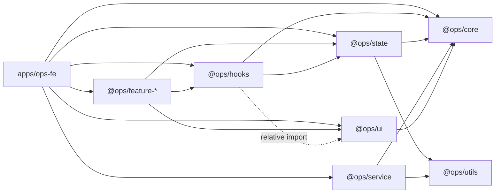

# Dependencies

> Version: xem `technology-stack.md`. Ở đây ghi quan hệ phụ thuộc trong vùng lát.

## Internal cross-package dependencies

Text fallback: app phụ thuộc mọi lib + feature; feature dùng hooks/ui/state; `@ops/hooks` đọc `@ops/state` (`useHasPermission.tsx:3`) và import tương đối vào `libs/ui` (`libs/hooks/src/use-confirm.tsx:2`); `@ops/state` dùng `@ops/utils` (`UserProvider.tsx:7`); `@ops/service` dùng `@ops/utils`, `@ops/core` (`request.ts:4-6`).

| From | To | Bằng chứng |
|---|---|---|
| `libs/hooks/permission` | `@ops/state` `useUserContext`, `useFeature`, `useSidebarContext` | `useHasPermission.tsx:3`, `usePermissions.ts:4`, `useMenuData.tsx:2` |
| `libs/hooks/use-confirm` | `libs/ui/src/common/PopupConfirm` (đường dẫn tương đối, vượt ranh package) | `use-confirm.tsx:2` |
| `libs/state/UserProvider` | `@ops/utils` `applyTenantFromMe`, `@upbase-tech/auth-package`, `@upbase-tech/tenant-context` (type) | `UserProvider.tsx:7-9` |
| `libs/state/UserProvider` | API inject `UsersAPI`, `StaffAPI` từ `FeatureProvider` | `UserProvider.tsx:89`, `apps/ops-fe/src/index.tsx:165,174` |
| `libs/service/request` | cấu hình auth do app tiêm (`setRequestConfig`) — lib không biết Keycloak | `request.ts:18-31`, `apps/ops-fe/src/index.tsx:94-102` |
| `libs/utils/tenant-theme` | `@upbase-tech/design-tokens`, `@upbase-tech/tenant-context` | `tenant-theme.ts:1-4` |
| `apps/ops-fe/module-registry` | 15 `@ops/feature-*` | `module-registry.ts:2-16` |

## External dependencies trong lát

| Package | Dùng ở | Ghi chú |
|---|---|---|
| `@upbase-tech/auth-package` | `apps/ops-fe/src/services/auth.ts:1`, `index.tsx:31`, `libs/HOC/src/with-auth-components.tsx:1` | Repo riêng `lms-package`; bug bên trong sửa ở đó |
| `@upbase-tech/tenant-context` | `index.tsx:9`, `tenant-theme.ts:3-4` | Nguồn `TenantContext`; không mang timezone ở phía FE đang dùng |
| `react-query` v3 | `use-app-mutation.tsx:2`, `index.tsx:36` | Dedupe `react-query` ở Vite (`vite.config.ts:16`) |
| `react-number-format` | `NumberField.tsx:4` | Hành vi rỗng → `minNumber` do wrapper, không phải thư viện |
| `antd` | `PopupConfirm.tsx:1` (Modal) | Popover có sẵn trong antd, chưa có wrapper |

## Backend dependency

`lms-be` app `ops`: `GET /me` (`apps/ops/src/app/app.controller.ts:34-43`). Gamification endpoints chưa có (`api-documentation.md`). Tenant suy từ token ở BE (CLS) — chi tiết ở codekb `lms-be`.

## Build-time

`scripts/generate-customer.js` phụ thuộc thư mục `configs/*.json` (`configs/customer-a.json`, `customer-b.json`) và hai map feature (L18-52).
