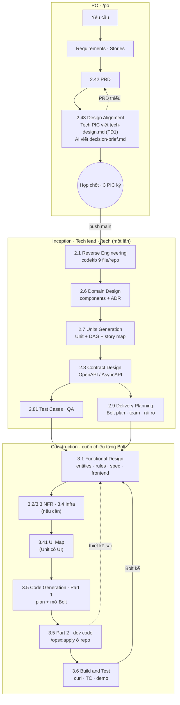
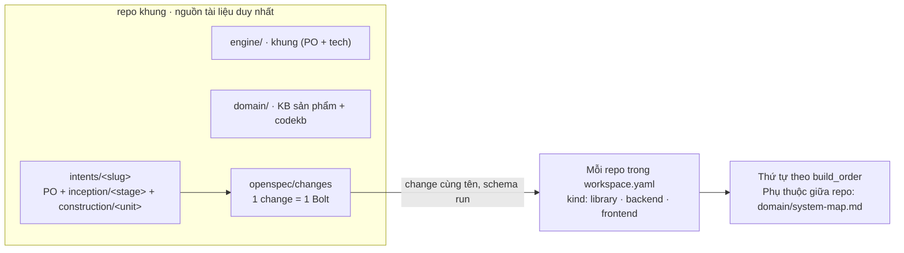

# Workflow Tech: từ PRD đã duyệt đến code

> Khung **AWS AI-DLC** (bản chép nguyên văn ở `engine/tech/aidlc/`). PO làm Ideation + Inception phần nghiệp vụ, kết thúc ở
> gate 2.43 Design Alignment. Tech làm Inception phần kỹ thuật + Construction, code bằng **OpenSpec**.
> Nghi thức: `engine/tech/protocol/tech-protocol.md`. Repo và owner: `system-map.md`.

## 0. Đọc nhanh

| | |
|---|---|
| Đầu vào | Gate 2.43 Design Alignment đã duyệt: PRD approve, `inception/tech-design/tech-design.md` (Tech Design 1) và Decision Brief đã ký |
| Đầu ra | Code đã merge `staging`, test case đã chạy, contract Final |
| 3 chặng | **Inception** (thiết kế chung, chạy 1 lần) → **Construction** (thiết kế từng Bolt) → **Code** (từng repo) |
| 2 nơi chạy | **Store** repo khung — mọi tài liệu · **Repo dev** — chỉ code + `context.md`, `tasks.md`, `progress.md` |
| Vai | **Tech lead tác giả** (FE hoặc BE) viết chặng 1, 2 · **Lead còn lại** soi chéo · **BE lead** luôn ký contract · **QA lead** viết test case · **Owner Bolt** (dev fullstack) code chặng 3 |

Quy tắc vàng:
- Tài liệu chỉ nằm ở store. Repo dev chỉ trỏ tới, không chép.
- Mỗi stage: **viết → reviewer → sửa → READY → gate → ghi `DEC-T*`** vào `decisions.md`. Chưa READY không mở gate.
- Code thấy thiết kế sai: **dừng**, sửa ở store, lead duyệt lại. Không tự sửa trong code.
- **Thiết kế chi tiết chỉ bắt đầu sau khi họp 2.43 chốt.** Tech Design 1 là bản sơ lược đem đi họp, không phải thiết kế cuối.

### Lối vào theo vai — không nhớ lệnh thì gõ một lệnh này

| Vai | Mở Claude ở | Gõ | Menu hiện ra |
|---|---|---|---|
| Tech lead (FE / BE) | store (gốc repo khung) | `/tech` | Chờ duyệt → Đang làm → Intent mới đã qua 2.43 → Construction |
| Owner Bolt (fullstack) | store (gốc repo khung) | `/bolt [change]` | Bolt đang dở / Bolt mới / Tất cả → mở change `run` mọi repo, task, Jira, branch, code từng repo, review, PR |
| Dev FE | repo `kind: frontend` hoặc `library`, hoặc workspace chung `E:/UP_BASE` | `/fe` | Làm tiếp → Bolt mới → Sửa bug → Việc khác. Gõ ở workspace chung thì chọn repo trước (lms-package, lms-fe, ops-fe), rồi chạy đúng lệnh của repo đó |
| Dev BE | repo `kind: backend` | `/be` | Làm tiếp → Việc mới → Sửa bug → Việc khác |
| PO | store (gốc repo khung) | `/po` | Theo stage PO |

Menu hiện ngay khi gõ lệnh (không quét trước); chọn nhánh nào mới quét phần đó.

### File dùng chung mọi stage

| File | Để làm gì |
|---|---|
| `<intent>/tech-state.md` | **Bảng điều khiển** phần Tech: PRD version, Tech Design 1, phạm vi, ai làm gì, stage `[ ] [-] [?] [x] [S]`, Bolt đang ở đâu, Next action, log. Router `/tech` đọc file này |
| `<intent>/decisions.md` | **Sổ quyết định chung của intent.** Tech ghi `DEC-T<n>`, nguyên văn lời người duyệt, accepted risk, cột *Read when*. Không mở sổ riêng |
| `<stage>/reviews/review-<stage>-NN.md` | Biên bản `tech-reviewer`: READY / NOT READY, finding `R-01…`. Gate chỉ mở khi vòng cuối READY |
| `<stage>/<stage>-questions.md` | Câu hỏi có lựa chọn + `[đề xuất]`, `[Answer]:` nguyên văn. Bước 2 chuẩn của mọi stage AWS |
| `<stage>/traceability.json` | Truy vết upstream → target (2.6, 2.7, 3.1). Sensor dùng để bắt GAP / ORPHAN |

## 1. Luồng



Điểm cần nhớ: **mục 0 của Tech Design 1 là chỗ Tech soi PRD có đủ để thiết kế chưa** (R1–R11). Thiếu thì ghi vào mục 7
*Ý kiến về PRD* và mục 8 *Rủi ro và câu hỏi cần chốt*, hai mục này chảy thẳng vào Decision Brief để họp quyết. Không có
gate riêng cho việc check PRD, và không ai sửa PRD ngoài PO qua `/change-request`.

## 2. Bảng stage

| Stage | Ai | Artifact (trong intent) | Duyệt |
|---|---|---|---|
| 2.1 Reverse Engineering | Tech lead | `domain/codekb/<repo>/` 9 file | — |
| 2.6 Domain Design | Tech lead | `inception/domain-design/components.md`, `decisions.md` (ADR), `traceability.json` | FE + BE lead |
| 2.7 Units Generation | Tech lead | `inception/units-generation/unit-of-work*.md` (DAG yaml), `traceability.json` | FE + BE lead |
| 2.8 Contract Design | Tech lead | `inception/contract-design/contract-summary.md` | **BE lead ký** + FE lead |
| 2.81 Test Cases · plugin | QA | `inception/test-cases/test-cases.md` | QA lead |
| 2.9 Delivery Planning | Tech lead | `inception/delivery-planning/` bolt-plan · team-allocation · risk-and-sequencing-rationale · external-dependency-map | Họp 4 bên |
| 3.1 Functional Design | Tech lead | `construction/<unit>/functional-design/` entities · rules · functional-spec · traceability.json (+ frontend-components) | FE + BE lead |
| 3.2–3.4 NFR, Infra (nếu cần) | Tech lead / BE lead | `construction/<unit>/nfr-*/`, `infrastructure-design/` | Lead |
| 3.41 UI Map · plugin | Tech lead | `construction/<unit>/ui-map/ui-map.md` | FE lead |
| 3.5 Code Generation | Plan: tech lead · Code: owner | `construction/<unit>/code-generation/`, change Bolt ở `openspec/`, change `run` ở repo | Plan: FE + BE lead · Code: PR |
| 3.6 Build and Test | Owner + QA | `construction/build-and-test/<bnn>/` | QA lead + demo |

Mỗi stage: đọc file chuẩn AWS (file stage tương ứng trong `engine/tech/aidlc/stages/`) → hỏi → xác nhận → viết → sensor
(`tech-tools.py check`) → review `tech-reviewer` → gate.

## 3. Bolt

Bolt (AWS 2.9) = lượt xây gồm 1+ Unit, có Definition of Done, confidence hypothesis, owner; kết thúc bằng thứ chạy được,
demo được. **B01 = walking skeleton**: Unit đầu DAG, lát mỏng nhất qua mọi điểm tích hợp thật. Mỗi Unit ở đúng một Bolt;
thứ tự theo DAG của 2.7.

| Cần biết | Xem ở |
|---|---|
| Bolt nào, Unit nào, thứ tự, DoD | `inception/delivery-planning/bolt-plan.md` |
| Ai làm, năng lực | `inception/delivery-planning/team-allocation.md` |
| Vì sao thứ tự này, ràng buộc release | `inception/delivery-planning/risk-and-sequencing-rationale.md` |
| Bolt / Unit đang ở stage nào | Bảng Construction trong `tech-state.md` |
| Trong repo đang làm tới đâu | `openspec/changes/<bolt>/tasks.md` + `progress.md` ở repo code |
| Thiếu / trùng / vòng | `python engine/tech/scripts/tech-tools.py check intents/<slug>` |
| Jira | 1 Bolt = 1 Story, subtask theo repo, assignee = owner (`/jira-tasks`) |

## 4. Sơ đồ workspace



### 4.1 repo khung

```
<repo khung>/
├── CLAUDE.md → AGENTS.md              luật cho AI: phần PO + phần Tech
├── SETUP.md · workspace.yaml          cài đặt một lệnh · khai báo repo và người
├── scripts/                           setup.py sinh .claude/ từ engine + workspace.yaml · doctor.py kiểm
│   └── settings.base.json             nền của .claude/settings.json: quyền, luật chặn, 4 hook của luồng PO
├── engine/                            KHUNG, không phụ thuộc sản phẩm
│   ├── protocol · stages · templates · verification · standards · knowledge · commands · agents · scripts    PO
│   └── tech/                          Tech
│       ├── aidlc/                     CHUẨN AWS chép nguyên văn (MIT-0, không sửa)
│       ├── stages/                    13 stage Tech · commands/ tech.md, bolt.md, opsx/
│       ├── protocol/tech-protocol.md · templates/ · agents/tech-reviewer.md · scripts/tech-tools.py
│       └── knowledge/                 workflow.md (file này) · system-map.md · intent-handoff.md
├── domain/                            SẢN PHẨM đang cài: domain.md, KB 00–16, corner checklist,
│   └── codekb/<repo>/                 templates PRD + User Guide, codekb 9 file mỗi repo
├── memory/                            team.md (theo engine) · project.md (theo sản phẩm)
├── intents/<yymmdd-slug>/             MỘT FEATURE
│   ├── intent.md · state.md · decisions.md · memory.md · inputs/ · design/ · ideation/        PO
│   ├── inception/requirements-analysis · impact-analysis · solution-options · user-stories · prd    PO
│   ├── inception/tech-design/ · ux-design/ · test-design/ · decision-brief/                   2.43 ba PIC + họp
│   ├── tech-state.md                                         Tech: trạng thái stage + Bolt
│   ├── inception/domain-design · units-generation · contract-design · test-cases · delivery-planning
│   ├── construction/<unit>/functional-design · nfr-* · infrastructure-design · ui-map · code-generation
│   ├── construction/build-and-test/<bnn>/
│   └── archive/                                              bản đã duyệt tại mỗi gate
├── .claude/                           SINH RA, không sửa tay: commands/ · agents/ · settings.json
├── .openspec-store/store.yaml         store id của repo khung + remote
└── openspec/                          config.yaml · schemas/bolt/ · changes/<slug>-bnn-<tên>/ · specs/
```

### 4.2 Repo code

```
<repo>/openspec/
├── config.yaml                        trỏ store của repo khung + gate của repo
├── schemas/run/                       change chỉ gồm context → tasks; apply ghi progress.md
└── changes/<slug>-bnn-<tên>/          context.md (trỏ plan, contract, functional design, ui-map) · tasks.md · progress.md · ui/
```

Repo nào đang trong workflow, đường dẫn, owner, convention và gate của từng repo: [`workspace.yaml`](../../../workspace.yaml).
Phụ thuộc giữa các repo và package dùng chung của sản phẩm đang cài: `domain/system-map.md`.

**Repo phải được nối store trước khi chạy 3.5.** Cấu trúc trên là đích, không phải hiện trạng: kiểm bằng
`openspec doctor` chạy trong repo đó, phải thấy store của khung ở mục `References`. Chưa nối thì `openspec new change
--schema run` sẽ hỏng. Hiện trạng từng repo của sản phẩm đang cài ghi ở `domain/system-map.md` mục "Nối store".

## 5. Tình huống thường gặp

| Tình huống | Làm gì |
|---|---|
| Hôm sau làm tiếp | Store: `/tech <slug>` (đọc `tech-state.md`). Repo dev: `/opsx:apply <change>` (đọc `progress.md`) |
| Phải dừng giữa task | Pause: commit `wip(<scope>): pause <task> — <lý do>` → push, ghi khối `### Pause` trong `progress.md` (lý do, blocker, SHA, điều kiện làm tiếp). Không `git stash` |
| Tài liệu ở store đổi khi đang code | `/opsx:apply` tự so "Store commit" trong `context.md` với store → dừng, tóm tắt, đề xuất `/opsx:update` |
| BE lên staging, bỏ mock | So spec API trên staging với contract trước; lệch thì dừng, báo BE lead, không sửa FE cho khớp BE |
| PO đổi PRD giữa chừng | `/tech <slug>` báo stage bị ảnh hưởng → mở lại `[R]`; Bolt đang code thì `/opsx:update` |
| PRD thiếu, thấy lúc viết Tech Design 1 | Ghi mục 7 và mục 8 của `tech-design.md` → Decision Brief → họp 2.43 quyết → PO `/change-request` |
| Contract thiếu "Approved by" | `/opsx:apply` dừng. Nhờ BE lead ký ở store |
| Việc nhỏ chỉ một repo, không có intent | Dùng luồng riêng của repo đó, không mở intent. Xem `domain/system-map.md` |
| Sensor báo lỗi | Đọc dòng lỗi (`GAP`, `TC-GAP`, `ORPHAN`, `YAML`…), sửa artifact tương ứng, chạy lại |
| Thêm repo mới vào workflow | Thêm mục vào `workspace.yaml`, chạy `python scripts/setup.py`, rồi 2.1 Reverse Engineering cho repo đó |

## 6. Bảng cổng

| Stage | Ai duyệt |
|---|---|
| 2.43 Design Alignment | Ba PIC ký Decision Brief (gate của PO) |
| 2.6, 2.7 | FE + BE lead |
| 2.8 | **BE lead ký** "Approved by" cuối `contract-summary.md` |
| 2.81 | QA lead (Sign-off cuối file) |
| 2.9 | Họp FE, BE, PO, QA, owner |
| 3.1, 3.5 plan | FE + BE lead |
| 3.41 | FE lead |
| Code | Review PR + `/be:review` / `/fe:review` / `/ui-gate review` + `/opsx:verify` |
| 3.6 | QA lead |

Mọi gate Tech chỉ mở khi review của stage đó READY, và quyết định ghi một dòng `DEC-T*` trong `decisions.md`.

## 7. Bảng tra lệnh

| Lệnh | Chạy ở | Dùng khi |
|---|---|---|
| `/tech <slug>` | store | Chạy stage kế tiếp / tiếp tục chỗ dở |
| `/tech <slug> nhảy tới <stage>` | store | Chạy một stage cụ thể |
| `/tech <slug> bolt <Bnn>` | store | Construction cho một Bolt |
| `/bolt [change]` | store | Chạy cả Bolt FE + BE ở một chỗ |
| `python engine/tech/scripts/tech-tools.py check intents/<slug> [--stage=…] [--unit=…] [--bolt=…]` | store | Sensor: định dạng, DAG, phủ US/BR/TC |
| `openspec validate <change> --strict` | store, repo dev | Kiểm change hợp lệ |
| `/jira-tasks` | repo FE | Tạo subtask Jira từ bolt-plan |
| `/opsx:apply <change>` | repo dev | Code theo `tasks.md`, ghi `progress.md` |
| `/ui-gate build` · `/ui-gate review` | repo `kind: frontend` | Trước khi code UI · trước khi tick task UI |
| `/be:review` · `/fe:review` | repo dev (phiên mới) | Review độc lập trước PR |
| `/opsx:verify` · `/opsx:update` · `/opsx:archive` | repo dev | Trước PR · thiết kế đổi · sau merge |

## 8. Cài đặt

Theo `SETUP.md` ở gốc repo: cài phần mềm cần có, chạy `python scripts/setup.py`, mở Claude Code tại gốc repo khung.
Kiểm lại bất kỳ lúc nào bằng `python scripts/doctor.py`.

Rủi ro đã biết: Stores và custom schema của OpenSpec đang beta → giữ đúng version khóa trong `workspace.yaml`.
Chuẩn AWS cập nhật → làm theo `engine/tech/aidlc/README.md`.
