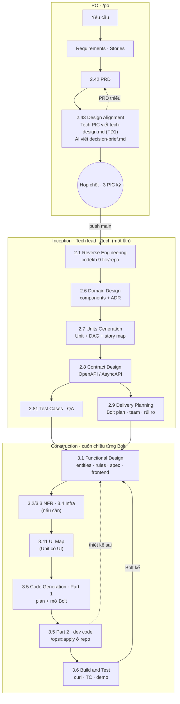
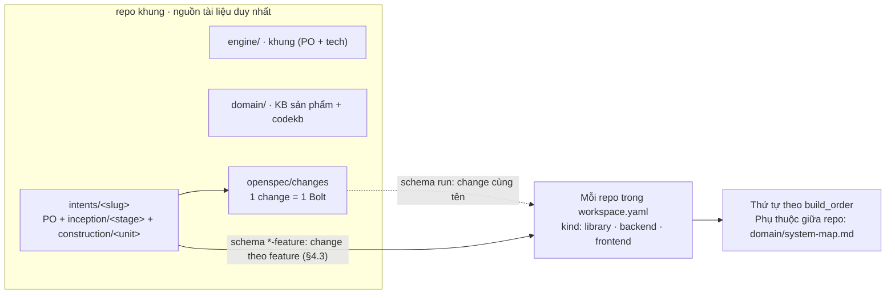

# Workflow Tech: từ PRD đã duyệt đến code

> Khung **AWS AI-DLC** (bản chép nguyên văn ở `engine/tech/aidlc/`). PO làm Ideation + Inception phần nghiệp vụ, kết thúc ở
> gate 2.43 Design Alignment. Tech làm Inception phần kỹ thuật + Construction, code bằng **OpenSpec**.
> Nghi thức: `engine/tech/protocol/tech-protocol.md`. Repo và owner: `system-map.md`.

## 0. Đọc nhanh

| | |
|---|---|
| Đầu vào | Gate 2.43 Design Alignment đã duyệt: PRD approve, `inception/tech-design/tech-design.md` (Tech Design 1) và Decision Brief đã ký |
| Đầu ra | Code đã merge `staging`, test case đã chạy, contract Final |
| 3 chặng | **Inception** (thiết kế chung, chạy 1 lần) → **Construction** (thiết kế từng Bolt) → **Code** (từng repo) |
| 2 nơi chạy | **Store** repo khung — mọi tài liệu · **Repo dev** — chỉ code + `context.md`, `tasks.md`, `progress.md` |
| Vai | **Tech lead tác giả** (FE hoặc BE) viết chặng 1, 2 · **Lead còn lại** soi chéo · **BE lead** luôn ký contract · **QA lead** viết test case · **Owner Bolt** (dev fullstack) code chặng 3 |

Quy tắc vàng:
- Tài liệu **nghiệp vụ** (PRD, UX design, test case) và thiết kế **chung** của intent chỉ nằm ở store. Repo dev trỏ tới, không chép.
- Thiết kế **riêng của một repo** thì nằm trong change của repo đó, xem [§4.3](#43-schema-change-theo-repo). Store không giữ bản sao.
- Mỗi stage: **viết → reviewer → sửa → READY → gate → ghi `DEC-T*`** vào `decisions.md`. Chưa READY không mở gate.
- Code thấy thiết kế sai: **dừng**, sửa ở store, lead duyệt lại. Không tự sửa trong code.
- **Thiết kế chi tiết chỉ bắt đầu sau khi họp 2.43 chốt.** Tech Design 1 là bản sơ lược đem đi họp, không phải thiết kế cuối.

### Lối vào theo vai — không nhớ lệnh thì gõ một lệnh này

| Vai | Mở Claude ở | Gõ | Menu hiện ra |
|---|---|---|---|
| Tech lead (FE / BE) | store (gốc repo khung) | `/tech` | Chờ duyệt → Đang làm → Intent mới đã qua 2.43 → Construction |
| Owner Bolt (fullstack) | store (gốc repo khung) | `/bolt [change]` | Bolt đang dở / Bolt mới / Tất cả → kiểm cổng, task, Jira, branch. Repo `flow: opsx`: mở change `run`, code bằng subagent, review, PR. Repo `flow: comet`: bàn giao, người mở phiên `/comet` trong repo (Open → Design → Build → Verify → Archive) |
| Dev FE | repo `kind: frontend` hoặc `library`, hoặc workspace chung `E:/UP_BASE` | `/fe` | Làm tiếp → Bolt mới → Sửa bug → Việc khác. Gõ ở workspace chung thì chọn repo trước (lms-package, lms-fe, ops-fe), rồi chạy đúng lệnh của repo đó |
| Dev BE | repo `kind: backend` | `/be` | Làm tiếp → Việc mới → Sửa bug → Việc khác |
| PO | store (gốc repo khung) | `/po` | Theo stage PO |

Menu hiện ngay khi gõ lệnh (không quét trước); chọn nhánh nào mới quét phần đó.

### File dùng chung mọi stage

| File | Để làm gì |
|---|---|
| `<intent>/tech-state.md` | **Bảng điều khiển** phần Tech: PRD version, Tech Design 1, phạm vi, ai làm gì, stage `[ ] [-] [?] [x] [S]`, Bolt đang ở đâu, Next action, log. Router `/tech` đọc file này |
| `<intent>/decisions.md` | **Sổ quyết định chung của intent.** Tech ghi `DEC-T<n>`, nguyên văn lời người duyệt, accepted risk, cột *Read when*. Không mở sổ riêng |
| `<stage>/reviews/review-<stage>-NN.md` | Biên bản `tech-reviewer`: READY / NOT READY, finding `R-01…`. Gate chỉ mở khi vòng cuối READY |
| `<stage>/<stage>-questions.md` | Câu hỏi có lựa chọn + `[đề xuất]`, `[Answer]:` nguyên văn. Bước 2 chuẩn của mọi stage AWS |
| `<stage>/traceability.json` | Truy vết upstream → target (2.6, 2.7, 3.1). Sensor dùng để bắt GAP / ORPHAN |

## 1. Luồng



Điểm cần nhớ: **mục 0 của Tech Design 1 là chỗ Tech soi PRD có đủ để thiết kế chưa** (R1–R11). Thiếu thì ghi vào mục 7
*Ý kiến về PRD* và mục 8 *Rủi ro và câu hỏi cần chốt*, hai mục này chảy thẳng vào Decision Brief để họp quyết. Không có
gate riêng cho việc check PRD, và không ai sửa PRD ngoài PO qua `/change-request`.

### 1.1 Từng bước: bước nào sinh ra file nào

Bảng dưới là **toàn bộ đường đi của một intent**, từ lúc PO nhận yêu cầu tới lúc change được lưu trữ. Cột *Sinh ra* lấy
nguyên dòng `Produces` / `Record` trong file stage tương ứng — sửa stage thì sửa cả ở đây. Cột *Để làm gì* nói file đó
dùng vào việc gì và bước nào đọc lại nó, suy từ dòng `Consumes` của các stage sau; đây là phần diễn giải, không phải
nguyên văn stage.

Đường dẫn rút gọn: `<I>` = `intents/<slug>/` trong store · `<U>` = `<I>construction/<unit-name>/` · `<R>` = gốc repo dev.
Mục [§2](#2-bảng-stage) là bản tóm tắt của chặng Tech; mục này là bản đầy đủ gồm cả chặng PO và cả phần chạy trong repo.

#### A. Ideation — PO, `/po` ở store

| Bước | Sinh ra | Để làm gì | Gate |
|---|---|---|---|
| 1.1 intent-capture | `<I>ideation/intent-capture/intent-statement.md` · `intent-capture-questions.md`. Khởi tạo `<I>intent.md`, `state.md`, `memory.md`, `decisions.md` | `intent-statement.md` chốt vấn đề, người dùng và stakeholder — mọi stage sau đều quy chiếu về nó. Bốn file khởi tạo là bộ khung sống của intent: `state.md` giữ vị trí hiện tại, `decisions.md` giữ mọi `DEC`, `memory.md` giữ ngữ cảnh giữa các phiên. `*-questions.md` lưu câu hỏi đã hỏi PO và câu trả lời, để stage sau không hỏi lại | — |
| 1.2 market-research | `<I>ideation/market-research/competitive-analysis.md` · `market-research-questions.md` | Cách sản phẩm khác giải cùng bài toán, làm căn cứ cắt phạm vi ở 1.4 và biện hộ cho lựa chọn trong PRD. Không có thì phạm vi dễ bị quyết bằng cảm tính | — |
| 1.4 scope-definition | `<I>ideation/scope-definition/scope-document.md` · `scope-definition-questions.md` | Ranh giới trong/ngoài phạm vi, mốc cứng, và bảng Proto-Unit `PU` — đầu vào trực tiếp của 2.3, 2.4 và 2.7. Đây là nơi duy nhất nói *không làm gì*, để chặn phình việc về sau | — |
| 1.7 approval-handoff | `<I>ideation/approval-handoff/initiative-brief.md` · `approval-handoff-questions.md` · `<I>verification/phase-check-ideation.md` | `initiative-brief.md` là bản một trang đem đi xin duyệt chặng Ideation. `phase-check-ideation.md` là biên bản tự kiểm: liệt kê artifact nào đủ, thiếu gì, để gate có cái mà soi thay vì duyệt chay | **Gate Ideation** |

#### B. Inception phần nghiệp vụ — PO, `/po` ở store

| Bước | Sinh ra | Để làm gì | Gate |
|---|---|---|---|
| 2.3 requirements-analysis | `<I>inception/requirements-analysis/requirements.md` · `requirements-analysis-questions.md` | Danh sách yêu cầu chức năng `RC` kèm cột Existing / New / Changed — biết cái nào là sửa cái đang có, cái nào dựng mới. 2.4, 2.42, 2.6, 2.7 đều đọc; cột New/Changed là thứ quyết định khối lượng thật | — |
| 2.31 impact-analysis | `<I>inception/impact-analysis/related-features-map.md` · `impact-matrix.md` · `impact-analysis-questions.md` | `impact-matrix.md` liệt từng vùng hệ thống bị chạm, mức rủi ro và câu hỏi mở `OQ` — đây là nơi Tech nhìn ra việc ngoài phạm vi màn hình (migration, quyền, job nền). `related-features-map.md` chỉ ra tính năng cũ nào va vào, để không phá cái đang chạy | — |
| 2.32 solution-options *(có điều kiện)* | `<I>inception/solution-options/solution-options.md` · `solution-options-questions.md` | So sánh từ hai hướng giải trở lên kèm đánh đổi, để PO chốt một hướng trước khi viết PRD. Chỉ sinh khi thật sự có nhiều hướng; bỏ qua thì PRD phải tự mang lý do chọn | — |
| 2.4 user-stories | `<I>inception/user-stories/stories.md` · `user-stories-questions.md` | Danh sách US đã cắt và xếp ưu tiên, chưa có tiêu chí chấp nhận. Là xương sống để 2.42 viết AC và BR vào, và để 2.7 map US sang Unit | — |
| 2.42 prd-generation | `<I>inception/prd/prd.md` · `field-intake-questions.md` · `traceability.md` · `<I>verification/phase-check-inception.md` | `prd.md` là **nguồn sự thật nghiệp vụ duy nhất** — US, AC, BR, field, màn. Mọi stage Tech đọc nó; code thấy nó sai thì dừng và quay lại PO, không tự sửa. `traceability.md` nối `RC` → US → AC để biết yêu cầu nào chưa được phủ. `phase-check-inception.md` là biên bản tự kiểm trước khi xin approve | **PRD approve** |
| 2.43 design-alignment | Ba team **người** viết: `<I>inception/ux-design/ux-design.md` (Design PIC) · `inception/tech-design/tech-design.md` (Tech PIC, = TD1) · `inception/test-design/test-design.md` (QA PIC). AI của PO chỉ tạo khung + frontmatter, rồi viết `<I>inception/decision-brief/decision-brief.md` · `design-alignment-questions.md` | `ux-design.md` cấp mã màn `SCR` và trường hợp biên `EC` cho PRD và cho 3.41. `tech-design.md` (TD1) là bản sơ lược đem đi họp: mục 0 soi PRD đủ chưa (R1–R11), mục 7–8 đẩy ý kiến và rủi ro vào Decision Brief. `test-design.md` kiểm AC có test được không, trước khi code. `decision-brief.md` gom bất đồng của ba PIC thành các quyết định cần chốt trong một buổi họp — ký xong mới mở được chặng Tech | **Ba PIC ký Decision Brief** |

Đây là ranh giới bàn giao: qua được 2.43 thì phần Tech mới bắt đầu.

#### C. Inception phần kỹ thuật — Tech lead, `/tech` ở store, chạy một lần cho cả intent

| Bước | Sinh ra | Để làm gì | Gate |
|---|---|---|---|
| 2.1 reverse-engineering | `domain/codekb/<repo>/` — 9 file: `business-overview`, `architecture`, `code-structure`, `api-documentation`, `component-inventory`, `technology-stack`, `dependencies`, `code-quality-assessment`, `reverse-engineering-timestamp` | Bản đồ code hiện có của từng repo, **dùng lại cho mọi intent** chứ không riêng intent này — nên nằm ở `domain/`, không nằm trong `intents/`. 2.6 và 3.5 đọc để biết cái gì đã có mà tái dùng; `reverse-engineering-timestamp` cho biết bản quét còn mới hay đã STALE cần quét lại | — |
| 2.6 domain-design | `<I>inception/domain-design/`: `components.md`, `decisions.md` (ADR), `domain-design-questions.md`, `traceability.json` | `components.md` là danh mục component / building block cần có, kèm yaml + sơ đồ — 2.7 cắt Unit dựa trên nó, 2.8 tìm contract trên ranh giới của nó. `decisions.md` ở đây là **ADR**, ghi lý do chọn kiến trúc để sau này không ai hỏi lại (khác `<I>decisions.md` vốn ghi `DEC-T`). `traceability.json` nối ngược component về `RC`/US | FE + BE lead |
| 2.7 units-generation | `<I>inception/units-generation/`: `unit-of-work.md`, `unit-of-work-dependency.md` (DAG), `unit-of-work-story-map.md`, `units-generation-questions.md`, `traceability.json` | Chia việc thành Unit of Work. `unit-of-work-dependency.md` là **DAG**: quyết định thứ tự làm, và mỗi cạnh của nó là một contract ứng viên cho 2.8. `unit-of-work-story-map.md` map US → Unit, để biết Unit nào xong thì US nào chạy được; 2.9 xếp Bolt và 3.1 thiết kế đều đi từ đây | FE + BE lead |
| 2.8 contract-design | `<I>inception/contract-design/contract-summary.md` · `contract-design-questions.md` | Contract giữa các Unit và API public dạng OpenAPI / AsyncAPI — **điểm hẹn FE ↔ BE**. FE dựng mock theo nó mà không chờ BE; `x-curl` trong đó là thứ 3.6 dùng để test tích hợp. BE lead ký nên nó mới là cam kết, không phải đề xuất; lên `Final` sau 3.6 | **BE lead ký** |
| 2.81 test-cases | `<I>inception/test-cases/test-cases.md` · `test-cases-questions.md` | Test case viết **trước khi code**, từ AC/BR của PRD + mã lỗi của contract. Là tiêu chí xong của Bolt ở 3.6, và là thứ giữ cho DoD không bị diễn giải lỏng lẻo lúc demo | QA lead |
| 2.9 delivery-planning | `<I>inception/delivery-planning/`: `bolt-plan.md`, `team-allocation.md`, `risk-and-sequencing-rationale.md`, `external-dependency-map.md`, `delivery-planning-questions.md` | `bolt-plan.md` gom Unit thành Bolt, mỗi Bolt một giả thuyết + DoD + mốc demo — chặng Construction chạy cuốn chiếu theo đúng danh sách này. `team-allocation.md` nói Bolt nào của ai (`/fe mới` đọc để lọc việc của bạn). `risk-and-sequencing-rationale.md` giữ **lý do** của thứ tự, để sau này đổi thứ tự thì biết đang phá cái gì. `external-dependency-map.md` liệt thứ chờ bên ngoài | Họp 4 bên |

#### D. Construction — Tech lead, cuốn chiếu **từng Unit**

| Bước | Sinh ra | Để làm gì | Gate |
|---|---|---|---|
| 3.1 functional-design | `<U>functional-design/`: `entities.md`, `rules.md`, `functional-spec.md`, `frontend-components.md` *(Unit có UI)*, `functional-design-questions.md`, `traceability.json` | Thiết kế **không gắn công nghệ** của một Unit: `entities.md` là data model, `rules.md` là BR của PRD viết lại ở mức thi hành được, `functional-spec.md` là hành vi từng luồng. `frontend-components.md` liệt component UI cần có, là đầu vào bắt buộc của 3.41. Đây là tầng mà code đọc để biết *làm gì*; thấy nó sai thì dừng và sửa ở store | FE + BE lead |
| 3.2 nfr-requirements *(nếu cần)* | `<U>nfr-requirements/` — 6 file + `traceability.json` | Đặt **con số** cho hiệu năng, bảo mật, mở rộng, tin cậy, quan sát và lựa chọn công nghệ. Không có nó thì NFR nằm ở dạng câu chữ mơ hồ và 3.6 không test được. Stack đã cố định, không NFR riêng → `[S]` | Lead |
| 3.3 nfr-design *(nếu cần)* | `<U>nfr-design/` — 6 file + `traceability.json` | Cách đáp ứng từng con số ở 3.2 (cache, RLS, queue, cron…), ghi kèm `file:line` của pattern đã có trong repo để code không phát minh lại. Chỉ chạy khi 3.2 đã chạy | Lead |
| 3.4 infrastructure-design *(nếu cần)* | `<U>infrastructure-design/`: `infrastructure-specification.md`, `monitoring-design.md`, `cicd-pipeline.md`, `traceability.json` | Hạ tầng phải dựng thêm (queue, cron riêng, bucket, biến môi trường), cách giám sát và đường deploy. Sinh ra để việc hạ tầng được duyệt trước, không phát sinh lúc release. Phần lớn Unit không đổi hạ tầng → `[S]` | BE lead |
| 3.41 ui-map *(Unit có UI)* | `<U>ui-map/ui-map.md` | Nối màn của Unit sang Figma và sang **component có sẵn** trong `.claude/inventory/*` của repo FE, kèm token và asset. Mục đích là chặn dev dựng lại cái đã có; `/ui-gate` ở repo soi theo chính file này | FE lead |
| 3.5 code-generation **Part 1 — plan** | `<U>code-generation/`: `code-generation-plan.md`, `code-generation-questions.md`, `unit-test-instructions.md`, `code-summary.md`, `traceability.json` · **change Bolt** `openspec/changes/<slug>-<bnn>-<tên>/` ở store · change `run` cùng tên ở mỗi repo dev | `code-generation-plan.md` là kế hoạch code chia theo repo, đánh mã task (`BE-1`, `OPS-1`…) — lead duyệt **trước khi** gõ dòng code nào. `unit-test-instructions.md` nói test gì ở mức Unit. `code-summary.md` ghi lại cái đã code, 3.6 đọc để build và test. Change ở store là bản gốc của Bolt; change `run` ở mỗi repo là bản chỉ-trỏ, giữ repo sạch tài liệu | FE + BE lead |

#### E. 3.5 Part 2 — dev code trong repo

Từ đây rời store. File sinh ra phụ thuộc **schema của repo** ([§4.3](#43-schema-change-theo-repo)):

| Schema | Lệnh | Sinh ra, theo thứ tự | Để làm gì |
|---|---|---|---|
| `run` | `openspec new change <tên>` | `<R>openspec/changes/<tên>/`: `.openspec.yaml` → `context.md` (trỏ store, ghi "Store commit") → `tasks.md` | Dùng khi thiết kế **đã có ở store**. `.openspec.yaml` khai schema và cờ (`skip_specs`). `context.md` chỉ trỏ sang store kèm "Store commit" — ghim đúng bản thiết kế đang code, để sau này đọc lại biết code theo bản nào. `tasks.md` là checklist thi hành, tick tới đâu biết tới đó |
| `be-feature` · `fe-feature` | `/opsx:new <tên> --schema <schema>` rồi `/opsx:propose` | `.openspec.yaml` → `proposal.md` → `specs/<capability>/spec.md` *(bỏ qua khi `skip_specs: true` — phần lớn change FE)* → `design.md` *(BE thêm `design.dbml`)* → `tasks.md` → `assignment.md` → `jira-task.md` | Dùng khi **không đi qua store** (đường ngắn, việc nhỏ): thiết kế sinh ngay trong repo. `proposal.md` nêu vì sao và đổi gì; `specs/**` là delta spec, thứ duy nhất chảy vào `openspec/specs/` lúc archive; `design.md` / `design.dbml` là thiết kế kỹ thuật và schema DB; `assignment.md` chốt owner từng WP — `apply` chỉ mở khi nó ghi `Đã chốt`; `jira-task.md` để đẩy sang Jira |

Mỗi artifact chỉ mở được khi artifact nó `requires` đã xong — đồ thị khai trong `openspec/schemas/<schema>/schema.yaml`.

Rồi vòng code, lặp tới khi hết task:

| Bước | Lệnh | Sinh ra / đổi | Để làm gì |
|---|---|---|---|
| Bàn giao *(repo `flow: comet`)* | `/bolt` | `handoff.md` trong change Bolt ở store *(không phải artifact của schema `bolt`)*, theo `engine/tech/templates/handoff.md` | Gom vào một file những gì mọi phiên `/comet` ở các repo phải dùng chung: Store commit, quyết định chung, đường dẫn cần đọc, tiến độ từng repo. Phiên trong repo đọc mục của mình trước `/comet-open`, nên không phải dán gói bàn giao từ terminal. `/bolt` cập nhật cột Trạng thái khi quay lại |
| Mở khoá code | — | `*-feature`: `apply` chỉ chạy khi `assignment.md` ghi `Trạng thái: Đã chốt`; mỗi dev chỉ làm WP có owner trùng `git config user.email` | Chặn code trước khi phân công xong, và chặn hai dev đụng cùng một WP |
| Trước khi code UI | `/ui-gate build` | báo cáo build gate | Chỉ ra component, token, asset đã có để dùng lại — đọc **trước** khi dựng UI thì mới có tác dụng. Báo cáo không lưu thành artifact của change |
| Code | `/opsx:apply <change>` | tick `tasks.md` · tạo và bồi `progress.md` *(file này **không** phải artifact của schema, sinh ra trong lúc code)* | `tasks.md` cho biết còn bao nhiêu việc. `progress.md` là **nhật ký code**: phiên sau mở lên là biết đang dở ở đâu, khối `### Pause` ghi blocker và điều kiện làm tiếp; 3.6 cũng đọc nó. Vì sinh trong lúc code nên không nằm trong đồ thị `requires` của schema |
| Sau khi code UI | `/ui-gate review` | báo cáo review; `PASS` mới được tick task UI | Soi UI vừa dựng so với `ui-map.md` và inventory. Là cổng cứng: chưa `PASS` thì task UI không được tick, nên không trôi sang PR |
| Trước PR | `/fe:review` · `/be:review` *(phiên Claude mới)* | danh sách lỗi; hết lỗi Chặn mới đi tiếp | Soi lại code bằng **phiên sạch** — phiên vừa code đã quá quen với lựa chọn của chính nó nên hay bỏ qua lỗi của mình |
| Trước PR | `/opsx:verify` | kết quả kiểm change | Kiểm change đủ và nhất quán: task còn sót, artifact thiếu, spec lệch — bắt trước khi reviewer người phải bắt |
| PR | — | mô tả PR viết theo `openspec/schemas/<schema>/templates/pr.md`; template này **không sinh file trong change** | Giữ mô tả PR cùng một khuôn để người review biết tìm gì ở đâu. Là template render lúc viết PR, nên không để lại file nào trong change |

#### F. Đóng Bolt và lưu trữ

| Bước | Ai | Sinh ra | Để làm gì |
|---|---|---|---|
| 3.6 build-and-test | Owner + QA | `<I>construction/build-and-test/<bnn>/`: `build-instructions.md`, `integration-test-instructions.md`, `performance-test-instructions.md` *(nếu có NFR)*, `security-test-instructions.md` *(nếu có NFR)*, `build-and-test-summary.md`, `test-results.md`, `cross-unit-traceability.md` | Bộ hồ sơ đóng Bolt. `*-instructions.md` là cách dựng và chạy test — viết ra để người khác lặp lại được, không chỉ máy owner chạy được. `test-results.md` là bằng chứng cho DoD lúc demo. `cross-unit-traceability.md` soi xem các Unit ghép lại có phủ hết US của Bolt không; qua bước này contract mới lên `Final` |
| Sau khi PR merge | Dev | `/opsx:archive` **di chuyển nguyên vẹn** `openspec/changes/<tên>/` → `openspec/changes/archive/YYYY-MM-DD-<tên>/`. Không gộp, không xoá, không viết lại file nào | Dọn `changes/` để `openspec list` chỉ còn việc đang mở, mà vẫn giữ nguyên hồ sơ để tra lại. Change có delta spec thì lúc này mới chảy vào `openspec/specs/<capability>/spec.md` — tức là ảnh chụp *hệ thống hiện có*, khác với change vốn là *thay đổi* |

Hai điều hay nhầm ở bước lưu trữ:

- Change khai `skip_specs: true` thì **không có delta spec**, nên `/opsx:archive` bỏ hẳn bước đồng bộ và `openspec/specs/`
  của repo không nhận gì. Chỉ change có `specs/**/*.md` mới chảy vào `openspec/specs/<capability>/spec.md`.
- Task chưa tick hết thì lệnh **cảnh báo rồi hỏi**, không chặn. Đừng tick khống cho qua; ghi một khối ghi chú đầu
  `tasks.md` nói rõ thực tế rồi mới lưu trữ.

#### Ba file được ghi ở **mọi** bước

| File | Khi nào | Để làm gì |
|---|---|---|
| `<I><stage>/reviews/review-<stage>-NN.md` | Sau mỗi vòng `tech-reviewer`. Gate chỉ mở khi vòng cuối READY | Giữ lại **cái đã bị bắt lỗi và đã sửa**, để vòng sau không bắt lại chuyện cũ và để gate thấy artifact đã qua mấy vòng |
| `<I>decisions.md` | Mỗi lần qua gate: một dòng `DEC-T<n>`, nguyên văn lời người duyệt | Sổ quyết định của intent. Ghi **nguyên văn** nên tra lại là biết người duyệt thực sự nói gì, không phải bản diễn giải. Mọi tài liệu khác trích `DEC` thay vì chép lại lý do |
| `<I>state.md` *(PO)* · `<I>tech-state.md` *(Tech)* | Sau mỗi bước: đổi ký hiệu stage, Next action, log | Vị trí hiện tại của intent: stage nào xong, đang làm gì, bước kế là gì. Đây là file `/po`, `/tech`, `/bolt` đọc đầu tiên để dựng menu — không cập nhật thì lần sau mở lên sẽ chạy nhầm bước |

#### Đường ngắn — có thật, đang dùng

Intent không cần component mới, không cần Unit mới có thể bỏ qua `2.6` → `2.9` và đi thẳng từ 2.43 sang một kế hoạch
task viết tay, miễn ghi `DEC-T*` nêu lý do. `261005-group` đang chạy kiểu này: sau 2.43 chỉ có
`construction/fe-task-plan.md`, không có `domain-design/`, `units-generation/`, `contract-design/`,
`delivery-planning/`. Khi đó đơn vị change ở repo là **feature** (`*-feature`), không phải Bolt.

## 2. Bảng stage

Bản đầy đủ gồm cả chặng PO và phần chạy trong repo: [§1.1](#11-từng-bước-bước-nào-sinh-ra-file-nào).

| Stage | Ai | Artifact (trong intent) | Duyệt |
|---|---|---|---|
| 2.1 Reverse Engineering | Tech lead | `domain/codekb/<repo>/` 9 file | — |
| 2.6 Domain Design | Tech lead | `inception/domain-design/components.md`, `decisions.md` (ADR), `traceability.json` | FE + BE lead |
| 2.7 Units Generation | Tech lead | `inception/units-generation/unit-of-work*.md` (DAG yaml), `traceability.json` | FE + BE lead |
| 2.8 Contract Design | Tech lead | `inception/contract-design/contract-summary.md` | **BE lead ký** + FE lead |
| 2.81 Test Cases · plugin | QA | `inception/test-cases/test-cases.md` | QA lead |
| 2.9 Delivery Planning | Tech lead | `inception/delivery-planning/` bolt-plan · team-allocation · risk-and-sequencing-rationale · external-dependency-map | Họp 4 bên |
| 3.1 Functional Design | Tech lead | `construction/<unit>/functional-design/` entities · rules · functional-spec · traceability.json (+ frontend-components) | FE + BE lead |
| 3.2–3.4 NFR, Infra (nếu cần) | Tech lead / BE lead | `construction/<unit>/nfr-*/`, `infrastructure-design/` | Lead |
| 3.41 UI Map · plugin | Tech lead | `construction/<unit>/ui-map/ui-map.md` | FE lead |
| 3.5 Code Generation | Plan: tech lead · Code: owner | `construction/<unit>/code-generation/`, change Bolt ở `openspec/`, change `run` ở repo | Plan: FE + BE lead · Code: PR |
| 3.6 Build and Test | Owner + QA | `construction/build-and-test/<bnn>/` | QA lead + demo |

Mỗi stage: đọc file chuẩn AWS (file stage tương ứng trong `engine/tech/aidlc/stages/`) → hỏi → xác nhận → viết → sensor
(`tech-tools.py check`) → review `tech-reviewer` → gate.

## 3. Bolt

Bolt (AWS 2.9) = lượt xây gồm 1+ Unit, có Definition of Done, confidence hypothesis, owner; kết thúc bằng thứ chạy được,
demo được. **B01 = walking skeleton**: Unit đầu DAG, lát mỏng nhất qua mọi điểm tích hợp thật. Mỗi Unit ở đúng một Bolt;
thứ tự theo DAG của 2.7.

| Cần biết | Xem ở |
|---|---|
| Bolt nào, Unit nào, thứ tự, DoD | `inception/delivery-planning/bolt-plan.md` |
| Ai làm, năng lực | `inception/delivery-planning/team-allocation.md` |
| Vì sao thứ tự này, ràng buộc release | `inception/delivery-planning/risk-and-sequencing-rationale.md` |
| Bolt / Unit đang ở stage nào | Bảng Construction trong `tech-state.md` |
| Trong repo đang làm tới đâu | `openspec/changes/<tên>/tasks.md` + `progress.md` ở repo code; schema `*-feature` thì tên change theo **feature**, không theo Bolt |
| Thiếu / trùng / vòng | `python engine/tech/scripts/tech-tools.py check intents/<slug>` |
| Jira | 1 Bolt = 1 Story, subtask theo repo, assignee = owner (`/jira-tasks`) |

## 4. Sơ đồ workspace



### 4.1 repo khung

```
<repo khung>/
├── CLAUDE.md → AGENTS.md              luật cho AI: phần PO + phần Tech
├── SETUP.md · workspace.yaml          cài đặt một lệnh · khai báo repo và người
├── scripts/                           setup.py sinh .claude/ từ engine + workspace.yaml · doctor.py kiểm
│   └── settings.base.json             nền của .claude/settings.json: quyền, luật chặn, 4 hook của luồng PO
├── engine/                            KHUNG, không phụ thuộc sản phẩm
│   ├── protocol · stages · templates · verification · standards · knowledge · commands · agents · scripts    PO
│   └── tech/                          Tech
│       ├── aidlc/                     CHUẨN AWS chép nguyên văn (MIT-0, không sửa)
│       ├── stages/                    13 stage Tech · commands/ tech.md, bolt.md, opsx/
│       ├── protocol/tech-protocol.md · templates/ · agents/tech-reviewer.md · scripts/tech-tools.py
│       └── knowledge/                 workflow.md (file này) · system-map.md · intent-handoff.md
├── domain/                            SẢN PHẨM đang cài: domain.md, KB 00–16, corner checklist,
│   └── codekb/<repo>/                 templates PRD + User Guide, codekb 9 file mỗi repo
├── memory/                            team.md (theo engine) · project.md (theo sản phẩm)
├── intents/<yymmdd-slug>/             MỘT FEATURE
│   ├── intent.md · state.md · decisions.md · memory.md · inputs/ · design/ · ideation/        PO
│   ├── inception/requirements-analysis · impact-analysis · solution-options · user-stories · prd    PO
│   ├── inception/tech-design/ · ux-design/ · test-design/ · decision-brief/                   2.43 ba PIC + họp
│   ├── tech-state.md                                         Tech: trạng thái stage + Bolt
│   ├── inception/domain-design · units-generation · contract-design · test-cases · delivery-planning
│   ├── construction/<unit>/functional-design · nfr-* · infrastructure-design · ui-map · code-generation
│   ├── construction/build-and-test/<bnn>/
│   └── archive/                                              bản đã duyệt tại mỗi gate
├── .claude/                           SINH RA, không sửa tay: commands/ · agents/ · settings.json
├── .openspec-store/store.yaml         store id của repo khung + remote
└── openspec/                          config.yaml · schemas/bolt/ · changes/<slug>-bnn-<tên>/ · specs/
```

### 4.2 Repo code

```
<repo>/openspec/
├── config.yaml                        trỏ store của repo khung + gate của repo
├── schemas/                           mỗi repo một bộ, xem bảng dưới
└── changes/<tên>/                     artifact theo schema của repo · progress.md · ui/
```

Repo nào đang trong workflow, đường dẫn, owner, convention và gate của từng repo: [`workspace.yaml`](../../../workspace.yaml).
Phụ thuộc giữa các repo và package dùng chung của sản phẩm đang cài: `domain/system-map.md`.

**Repo phải được nối store trước khi chạy 3.5.** Cấu trúc trên là đích, không phải hiện trạng: kiểm bằng
`openspec doctor` chạy trong repo đó, phải thấy store của khung ở mục `References`. Chưa nối thì `openspec new change`
sẽ hỏng. Hiện trạng từng repo của sản phẩm đang cài ghi ở `domain/system-map.md` mục "Nối store".

### 4.3 Schema change theo repo

Không có một schema chung cho mọi repo. Mỗi repo chọn schema theo **khối lượng thiết kế mà repo đó tự sở hữu**:

| Schema | Repo | Đơn vị change | Artifact | Thiết kế nằm ở |
|---|---|---|---|---|
| `be-feature` | lms-be | **1 feature** | proposal · specs · design (+`design.dbml`) · tasks · assignment · jira-task | trong change |
| `fe-feature` | ops-fe | **1 feature** | proposal · specs · design · tasks · assignment · jira-task | trong change |
| `run` | lms-fe, và change Bolt cũ ở ops-fe | **1 Bolt** | context (trỏ store) · tasks | ở store |

Hai schema `*-feature` dùng chung **mô hình Work Package**: `tasks.md` chia thành WP, `assignment.md` gán mỗi WP một
owner theo `git config user.email`, và `apply` chỉ mở khi `assignment.md` ở trạng thái `Đã chốt` — nhờ đó **nhiều dev
làm song song trên một change** mà không giẫm file của nhau ("Phạm vi file" của các WP không chồng nhau).

Chọn schema nào:

- Repo tự quyết **cách** làm ở mức có sequence diagram, phân rã màn hoặc bảng dữ liệu riêng → `*-feature`. Thiết kế đó
  không có chỗ nào khác để ở, vì store chỉ giữ thiết kế chung của intent.
- Repo chỉ thi hành một kế hoạch đã có sẵn ở store (ui-map, code-generation plan) → `run`. Change chỉ là con trỏ.
- Đổi schema cho một repo là **quyết định của tech lead repo đó**, ghi `DEC-T*` vào `decisions.md` của intent đang chạy.
  Change đang dở giữ nguyên schema cũ; chỉ change mới dùng schema mới.

`openspec new change <tên> --schema <schema>`; bỏ `--schema` thì lấy `schema:` mặc định trong `openspec/config.yaml`
của repo.

## 5. Tình huống thường gặp

| Tình huống | Làm gì |
|---|---|
| Hôm sau làm tiếp | Store: `/tech <slug>` (đọc `tech-state.md`). Repo dev: `/opsx:apply <change>` (đọc `progress.md`) |
| Phải dừng giữa task | Pause: commit `wip(<scope>): pause <task> — <lý do>` → push, ghi khối `### Pause` trong `progress.md` (lý do, blocker, SHA, điều kiện làm tiếp). Không `git stash` |
| Tài liệu ở store đổi khi đang code | `/opsx:apply` tự so "Store commit" trong `context.md` với store → dừng, tóm tắt, đề xuất `/opsx:update` |
| BE lên staging, bỏ mock | So spec API trên staging với contract trước; lệch thì dừng, báo BE lead, không sửa FE cho khớp BE |
| PO đổi PRD giữa chừng | `/tech <slug>` báo stage bị ảnh hưởng → mở lại `[R]`; Bolt đang code thì `/opsx:update` |
| PRD thiếu, thấy lúc viết Tech Design 1 | Ghi mục 7 và mục 8 của `tech-design.md` → Decision Brief → họp 2.43 quyết → PO `/change-request` |
| Contract thiếu "Approved by" | `/opsx:apply` dừng. Nhờ BE lead ký ở store |
| Việc nhỏ chỉ một repo, không có intent | Dùng luồng riêng của repo đó, không mở intent. Xem `domain/system-map.md` |
| Sensor báo lỗi | Đọc dòng lỗi (`GAP`, `TC-GAP`, `ORPHAN`, `YAML`…), sửa artifact tương ứng, chạy lại |
| Thêm repo mới vào workflow | Thêm mục vào `workspace.yaml`, chạy `python scripts/setup.py`, rồi 2.1 Reverse Engineering cho repo đó |

## 6. Bảng cổng

| Stage | Ai duyệt |
|---|---|
| 2.43 Design Alignment | Ba PIC ký Decision Brief (gate của PO) |
| 2.6, 2.7 | FE + BE lead |
| 2.8 | **BE lead ký** "Approved by" cuối `contract-summary.md` |
| 2.81 | QA lead (Sign-off cuối file) |
| 2.9 | Họp FE, BE, PO, QA, owner |
| 3.1, 3.5 plan | FE + BE lead |
| 3.41 | FE lead |
| Code | Review PR + `/be:review` / `/fe:review` / `/ui-gate review` + `/opsx:verify` |
| 3.6 | QA lead |

Mọi gate Tech chỉ mở khi review của stage đó READY, và quyết định ghi một dòng `DEC-T*` trong `decisions.md`.

## 7. Bảng tra lệnh

| Lệnh | Chạy ở | Dùng khi |
|---|---|---|
| `/tech <slug>` | store | Chạy stage kế tiếp / tiếp tục chỗ dở |
| `/tech <slug> nhảy tới <stage>` | store | Chạy một stage cụ thể |
| `/tech <slug> bolt <Bnn>` | store | Construction cho một Bolt |
| `/bolt [change]` | store | Chạy cả Bolt FE + BE ở một chỗ; repo `flow: comet` thì bàn giao cho phiên `/comet` trong repo |
| `/comet-open <change>` rồi `/comet-design` → `/comet-build` → `/comet-verify` → `/comet-archive` | repo `flow: comet` | Vòng đời một change ở repo: người gọi từng pha, hook cổng Tech chặn rời Design khi contract chưa Agreed. `/comet-hotfix`, `/comet-tweak` cho việc nhỏ |
| `python engine/tech/scripts/tech-tools.py check intents/<slug> [--stage=…] [--unit=…] [--bolt=…]` | store | Sensor: định dạng, DAG, phủ US/BR/TC |
| `openspec validate <change> --strict` | store, repo dev | Kiểm change hợp lệ |
| `/jira-tasks` | repo FE | Tạo subtask Jira từ bolt-plan |
| `/opsx:apply <change>` | repo dev | Code theo `tasks.md`, ghi `progress.md` |
| `/ui-gate build` · `/ui-gate review` | repo `kind: frontend` | Trước khi code UI · trước khi tick task UI |
| `/be:review` · `/fe:review` | repo dev (phiên mới) | Review độc lập trước PR |
| `/opsx:verify` · `/opsx:update` · `/opsx:archive` | repo dev | Trước PR · thiết kế đổi · sau merge |

## 8. Cài đặt

Theo `SETUP.md` ở gốc repo: cài phần mềm cần có, chạy `python scripts/setup.py`, mở Claude Code tại gốc repo khung.
Kiểm lại bất kỳ lúc nào bằng `python scripts/doctor.py`.

Rủi ro đã biết: Stores và custom schema của OpenSpec đang beta → giữ đúng version khóa trong `workspace.yaml`.
Chuẩn AWS cập nhật → làm theo `engine/tech/aidlc/README.md`.
