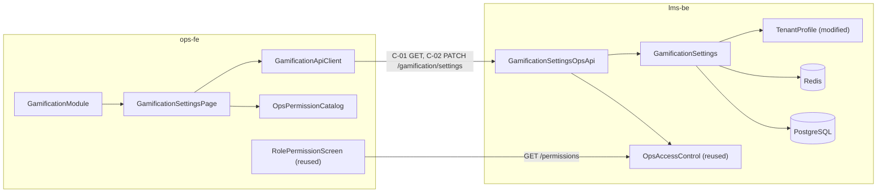

# Components: Gamification, lát Nền tảng (US14 · US15)

Lát Nền tảng: hai công tắc (US14) và phân quyền cấu hình (US15). 9 component: 4 ở lms-be, 5 ở ops-fe; 4 mới, 2 sửa, 3 dùng lại (lms-be dựng trên WP0, ADR-001). lms-fe không chạm (ADR-006). Thiết kế BE gốc là change `upbase-221099-gamification` của BE lead (DEC-T1); file này chỉ cắt phần thuộc lát và ghi chỗ đổi so với bản đó (ADR-002 đến ADR-005). Quyết định ở `decisions.md`, câu hỏi kỹ thuật ở `domain-design-questions.md`.

Quy ước: `status` = `new` · `modified` · `reused`. `code_refs` là `file:line` đã kiểm trên `origin/staging` (lms-be 610f100, ops-fe 1e01033bf). `[2.43 Qn]` = câu trả lời Qn ở `inception/prd-readiness/prd-readiness-questions.md`.

```yaml
components:
  # ---------------- lms-be ----------------
  - name: TenantProfile
    repo: lms-be
    status: reused
    summary: "Hồ sơ tổ chức; nguồn múi giờ tổ chức cho mọi biên ngày của gamification."
    behaviour: >-
      Múi giờ IANA của tổ chức, mặc định Asia/Ho_Chi_Minh — WP0 đã thêm, B01 không sửa (ADR-001).
      Không có API ghi, không có ô chọn trên màn Gamification (BR-14.9). Lát này chỉ lưu; US5, US6 đọc ở Unit sau.
    responsibilities:
      - Lưu múi giờ của tenant
    code_refs:
      - "WP0 65d3aad: libs/database/migrations/1789996500000-add-timezone-to-tenant.ts, tenant.entity.ts:34 (cột timezone đã có)"
      - "libs/modules/src/lib/tenant/tenant.service.ts:18-23 (đọc tenant theo CLS)"
    depends_on: []
    dependents: []
    external_dependencies:
      - name: PostgreSQL
        kind: database
        purpose: Bảng tenant (không RLS)
    entities:
      - name: Tenant
        identifier: id
        attributes: [name, subdomain, timezone]

  - name: GamificationSettings
    repo: lms-be
    status: modified
    summary: "Cấu hình gốc của gamification theo tổ chức: hai công tắc chung và các mốc thời gian."
    behaviour: >-
      Mỗi tổ chức đúng một bản ghi. Chưa có thì tạo bản mặc định mọi công tắc tắt khi đọc lần đầu
      (BR-14.6, [2.43 Q4]). Đổi một công tắc mỗi lần ghi (ADR-004). Bật Gamification lần đầu ghi
      first_enabled_at, mỗi lần bật ghi last_enabled_at; bật Visibility lần đầu ghi
      visibility_first_enabled_at (ADR-005, [2.43 Q2]). Visibility chỉ bật được khi Gamification đang bật;
      tắt Gamification giữ nguyên giá trị Visibility (BR-14.2). Đọc qua cache Redis có tiền tố tenant,
      xoá ngay khi ghi, không cache trong bộ nhớ tiến trình (ADR-003, [2.43 Q3]).
      Bảng, entity, seed đã có ở WP0 (ADR-001); B01 thêm cột visibility_first_enabled_at và service đọc/ghi.
      Các cột của US8–US11 có sẵn trong bảng; lát này không đọc ghi chúng.
    responsibilities:
      - Đọc cấu hình của tenant hiện tại (tạo mặc định nếu chưa có)
      - Ghi một công tắc chung, áp rule BR-14.1, BR-14.2, BR-14.5
      - Giữ cache đồng nhất với DB ngay sau khi ghi
    code_refs:
      - "WP0 65d3aad: libs/database/src/lib/entities/gamification/gamification-setting.entity.ts:7-58; 1789997000000-create-gamification-tables.ts:151-176"
      - "libs/services/src/lib/redis/cache.service.ts:16-19 (khoá tenant:{id}:{key}), :34 getCache, :44 setCache, :56 deleteCache"
      - "libs/database/src/lib/extends/request-tenant.ts:21 (getRequestTenantId)"
    depends_on: [TenantProfile]
    dependents:
      - component: GamificationSettingsOpsApi
        interaction: Đọc và ghi công tắc
    external_dependencies:
      - name: PostgreSQL
        kind: database
        purpose: Bảng gamification_settings có tenant_id + RLS
      - name: Redis
        kind: cache
        purpose: Cache cấu hình theo tenant
    entities:
      - name: GamificationSetting
        identifier: id
        attributes: [tenant_id, is_enabled, is_visible, first_enabled_at, last_enabled_at, visibility_first_enabled_at]

  - name: GamificationSettingsOpsApi
    repo: lms-be
    status: new
    summary: "Endpoint Ops đọc và ghi cấu hình chung, có khai quyền."
    behaviour: >-
      GET trả hai công tắc và cờ đã từng hiển thị; PATCH nhận đúng một công tắc. Khai quyền theo
      ADR-002: GET thuộc ba quyền, PATCH chỉ quyền sửa. Không nhận múi giờ (ADR-004).
    responsibilities:
      - Xác thực staff, kiểm quyền qua guard Ops sẵn có
      - Validate body, trả lỗi theo quy ước Ops
    code_refs:
      - "apps/ops/src/auth/ops-auth.service.ts:178 (checkCanAcceptRoles trong authorize)"
      - "apps/ops/src/app/app.module.ts:69-133 (imports module)"
    depends_on: [GamificationSettings, OpsAccessControl]
    dependents:
      - component: GamificationApiClient
        interaction: REST C-01, C-02
    external_dependencies: []
    entities: []

  - name: OpsAccessControl
    repo: lms-be
    status: reused
    summary: "Phân quyền Ops bằng Casbin, quyền sinh từ metadata Swagger lúc Ops khởi động."
    behaviour: >-
      Dùng nguyên trạng. security[0] sinh quyền hiện trên màn role; tags gắn route vào quyền.
      Route có tags thì chỉ role có quyền mới qua (ADR-002).
    responsibilities:
      - Sinh quyền và gắn route theo metadata
      - Chặn route theo role của staff
    code_refs:
      - "libs/modules/src/lib/scan-operation/scan-operation.service.ts:91-93 (gom security[0]), :101 (group = tags), :145-152 (dòng p)"
      - "libs/modules/src/lib/permission/permission.service.ts:57 (scanAndSyncPermissions), :317-369 (ghi quyền g-p), :94-105 (route chưa có p thì cho qua)"
    depends_on: []
    dependents:
      - component: GamificationSettingsOpsApi
        interaction: Kiểm quyền endpoint
    external_dependencies:
      - name: PostgreSQL
        kind: database
        purpose: Bảng casbin_rule
    entities: []

  # ---------------- ops-fe ----------------
  - name: GamificationModule
    repo: ops-fe
    status: new
    summary: "Feature module @ops/feature-gamification: route, sidebar id, đăng ký white-label."
    behaviour: >-
      Một route /gamification, một mục menu. Đăng ký như các feature khác để bản build theo khách hàng
      bật tắt được module.
    responsibilities:
      - Khai route và page link
      - Đăng ký module vào app và generator khách hàng
    code_refs:
      - "apps/ops-fe/src/module-registry.ts:16,33 (đăng ký module)"
      - "features/cache/src/index.ts:5-10 (mẫu AppModule)"
      - "scripts/generate-customer.js:33,51 (FEATURE_MODULE_MAP, FEATURE_FOLDER_MAP)"
    depends_on: [GamificationSettingsPage]
    dependents: []
    external_dependencies: []
    entities: []

  - name: GamificationSettingsPage
    repo: ops-fe
    status: new
    summary: "Trang cấu hình Gamification; lát này chỉ có khối chung hai công tắc."
    behaviour: >-
      Vào được khi có ít nhất một trong ba quyền, không có thì màn 403 sẵn có (BR-15.3, [2.43 Q1]).
      Khối chung chỉ hiện khi có quyền xem hoặc sửa cấu hình; chỉ quyền sửa mới bật tắt được (BR-15.7).
      Công tắc Visibility chỉ hiện khi Gamification bật (BR-14.2). Bấm là lưu (BR-14.10), trừ hai thao tác
      hỏi lại bằng popover: tắt Gamification, bật Visibility khi chưa từng hiển thị (BR-14.13, [2.43 Q2]).
      Lưu xong báo Saved; lỗi thì công tắc về giá trị đã lưu (BR-14.12).
    responsibilities:
      - Hiện và đổi hai công tắc theo quyền
      - Hỏi lại hai thao tác, báo kết quả lưu
    code_refs:
      - "libs/ui/src/base/switch/HookFormSwitch.tsx:19-22 (đổi giá trị trước khi gọi onSubmit)"
      - "libs/ui/src/common/PopupConfirm.tsx (xác nhận sẵn có là antd Modal, không dùng cho popover BR-14.13 → antd Popconfirm)"
      - "libs/ui/src/base/switch/HookFormSwitch.tsx:6 (chưa có prop disabled; sửa thêm cho chế độ chỉ xem)"
      - "apps/ops-fe/src/components/access-denied/index.tsx:30 (nút gọi logOut, không dùng; 403 bằng antd Result)"
      - "libs/hooks/src/permission/useHasPermission.tsx (kiểm quyền, SUPER_ADMIN luôn qua)"
    depends_on: [GamificationApiClient, OpsPermissionCatalog]
    dependents:
      - component: GamificationModule
        interaction: Render ở route /gamification
    external_dependencies: []
    entities: []

  - name: GamificationApiClient
    repo: ops-fe
    status: new
    summary: "API class GamificationAPI + types, inject qua FeatureContext."
    behaviour: "getSettings, updateSetting (một công tắc). Theo mẫu API class của ops-fe."
    responsibilities:
      - Gọi C-01, C-02
    code_refs:
      - "apps/ops-fe/src/apis/cache/index.ts:1-30 (mẫu API class)"
      - "libs/state/src/context/FeatureContext.tsx:1,51 (khai service)"
      - "apps/ops-fe/src/index.tsx:39,132 (inject)"
    depends_on: [GamificationSettingsOpsApi]
    dependents:
      - component: GamificationSettingsPage
        interaction: Đọc, ghi cấu hình
    external_dependencies: []
    entities: []

  - name: OpsPermissionCatalog
    repo: ops-fe
    status: modified
    summary: "Hằng mã quyền và mục menu theo quyền."
    behaviour: >-
      Thêm ba mã quyền gamification (ADR-002) và mục menu Gamification hiện khi có ít nhất một quyền
      (BR-15.3).
    responsibilities:
      - Khai mã quyền dùng chung với lms-be
      - Lọc mục menu theo quyền
    code_refs:
      - "libs/core/src/constants/permission.ts:147,242-243 (nhóm quyền, ID_SIDE_BAR)"
      - "libs/hooks/src/permission/useMenuData.tsx:1431-1437 (menuSystemAdministration, adminPermission)"
    depends_on: []
    dependents:
      - component: GamificationSettingsPage
        interaction: Kiểm quyền
    external_dependencies: []
    entities: []

  - name: RolePermissionScreen
    repo: ops-fe
    status: reused
    summary: "Màn role sẵn có; nhóm quyền mới tự hiện."
    behaviour: "Render mọi nhóm quyền từ GET /permissions; gamification_management hiện thành 'gamification' (BR-15.1)."
    responsibilities:
      - Gán quyền gamification cho role
    code_refs:
      - "features/role/src/components/roles/add-role/AddRole.tsx:38,224"
      - "features/role/src/components/roles/detail/PermissionDetail.tsx:89"
    depends_on: [OpsAccessControl]
    dependents: []
    external_dependencies: []
    entities: []
```

## Component Diagram



*Text fallback: ops-fe trang cấu hình gọi lms-be qua C-01, C-02; lms-be ghi bảng gamification_settings, cache Redis theo tenant, kiểm quyền bằng Casbin sẵn có; màn role sẵn có lấy nhóm quyền mới từ Casbin.*

## Component Summary

| Component | Repo | Status | US | BR chính |
|---|---|---|---|---|
| TenantProfile | lms-be | reused (WP0) | US14 | BR-14.9 |
| GamificationSettings | lms-be | modified (WP0 + delta) | US14 | BR-14.1, 14.2, 14.5, 14.6, 14.8 |
| GamificationSettingsOpsApi | lms-be | new | US14, US15 | BR-14.10, 15.2, 15.3, 15.7 |
| OpsAccessControl | lms-be | reused | US15 | BR-15.1, 15.6 |
| GamificationModule | ops-fe | new | US14 | — |
| GamificationSettingsPage | ops-fe | new | US14, US15 | BR-14.2, 14.10–14.13, 15.3, 15.7 |
| GamificationApiClient | ops-fe | new | US14 | — |
| OpsPermissionCatalog | ops-fe | modified | US15 | BR-15.3 |
| RolePermissionScreen | ops-fe | reused | US15 | BR-15.1 |

## Entity Ownership

| Entity | Chủ ghi | Ai đọc |
|---|---|---|
| Tenant.timezone | TenantProfile (migration, không có API ghi) | Unit sau (US5, US6) |
| GamificationSetting | GamificationSettings | GamificationSettingsOpsApi; Unit sau mọi luồng ghi nhận |
| casbin_rule (quyền gamification) | OpsAccessControl (quét lúc Ops khởi động) | Guard Ops, màn role |

## External Dependencies

| Phụ thuộc | Dùng cho | Rủi ro |
|---|---|---|
| PostgreSQL | gamification_settings (RLS), tenant | RLS phải có bypass như bảng sẵn có |
| Redis | Cache cấu hình | Mất Redis thì đọc DB (chậm hơn, không sai) |
| Casbin (`casbin_rule`) | Quyền | Quét bỏ qua ở `NODE_ENV=LOCAL` → không test chặn quyền ở local |

## Rationale
- Không thêm component ở lms-fe: lát không có màn học viên; đọc trạng thái hiển thị chỉ có ý nghĩa khi có màn (ADR-006).
- Gộp đọc và ghi cấu hình vào một component lms-be như design gốc (đầu việc 3, 10), tách API Ops thành component riêng vì nó mang phần quyền.

## Nguồn thay thế đã dùng
- Không có `stories.md`, `hld-brief.md` (intent v1, 2.41 `[S]`): US và AC lấy từ PRD; hướng kỹ thuật thay HLD Brief mục 9 ghi ở `decisions.md`.
- Input BE: change `upbase-221099-gamification` của lms-be (DEC-T1), không chép, chỉ trích bảng và đầu việc liên quan.
