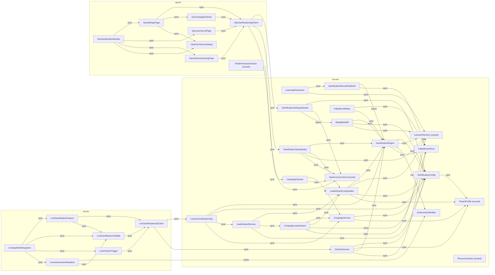

# Components: Gamification, cả intent (19 US)

35 component: lms-be 21 (11 new, 6 modified, 4 reused); ops-fe 8 (3 new, 4 modified, 1 reused); lms-fe 6 (2 new, 4 modified). Thiết kế BE gốc là change `upbase-221099-gamification` (DEC-T1): catalogue này lấy building block từ đó, cộng phần FE, và ghi chỗ đổi ở `decisions.md` (ADR-008 đến ADR-018). Câu hỏi kỹ thuật ở `domain-design-questions.md` Lô 2.

Quy ước: `status` = `new` · `modified` (có code trên nhánh WIP hoặc staging, phải sửa) · `reused` (dùng nguyên). `code_refs` ghi ref đã kiểm. `[2.43 Qn]` = câu trả lời ở `inception/prd-readiness/prd-readiness-questions.md`. Không có request/response (2.8), không có kiểu dữ liệu (3.1).

```yaml

components:
  # ---------------- lms-be ----------------
  - name: TenantProfile
    repo: lms-be
    status: reused
    summary: "Hồ sơ tổ chức; nguồn múi giờ cho mọi biên ngày, tuần, khung, campaign."
    behaviour: "Cột timezone IANA mặc định Asia/Ho_Chi_Minh (WP0). Không có API ghi (BR-14.9). Mọi biên ngày của check-in (C9), khung bảng xếp hạng (C6, BR-6.16 tuần bắt đầu thứ Hai) và campaign (BR-20.3) đổi từ múi giờ này sang UTC."
    responsibilities:
      - "Lưu múi giờ tenant"
    code_refs:
      - "lms-be origin/feature/gamification @9006b80: libs/database/src/lib/entities/tenant/tenant.entity.ts:34"
      - "libs/modules/src/lib/gamification/config/gamification-config.service.ts:84 getTimezone"
    depends_on: []
    dependents:
      - component: GamificationConfig
        interaction: "Đọc múi giờ"
      - component: CheckinService
        interaction: "Biên ngày"
      - component: LeaderboardComputation
        interaction: "Biên khung"
      - component: CampaignService
        interaction: "Biên ngày"
    external_dependencies:
      - name: "PostgreSQL"
        kind: database
        purpose: "Bảng tenant"
    entities:
      - name: Tenant
        identifier: id
        attributes: [name, subdomain, timezone]
  - name: GamificationConfig
    repo: lms-be
    status: modified
    summary: "Cấu hình gamification theo tổ chức: hai công tắc chung, bốn chức năng, bảng điểm, huy hiệu, tiêu chí hạng, công tắc bảng xếp hạng."
    behaviour: "Một nguồn đọc cấu hình cho mọi app (lms, ops, mock-test, event-processor, background-job). Cache Redis theo tenant, xoá khi ghi, không cache trong bộ nhớ (ADR-003, áp cho cả năm khối). Ghi từng trường (ADR-004 mở rộng). Áp rule chéo khi ghi: khoá tiêu chí hạng khi tắt Points/Badges (BR-10.7) mà giữ giá trị, không tắt được tiêu chí đang chạy cuối cùng (BR-10.8), không tắt được bảng đang chạy cuối cùng (BR-11.5), check-in step 5 và trần max(40, nền) lưu ở dữ liệu (BR-8.5a, C2). Đổi cấu hình chỉ áp từ lúc lưu (C4): không tính lại gì. Bật Badges hoặc một loại thì API Ops phát việc trao bù (BR-9.9). Giá trị mặc định theo design (2.43 Q15). Đọc trạng thái đã tính sẵn: tiêu chí đang chạy, bảng đang chạy. leaderboard_version chỉ đổi qua hàm của component này (xoá cache cùng lúc), đọc con trỏ không qua cache TTL dài (ADR-018)."
    responsibilities:
      - "Đọc cấu hình của tenant (tạo mặc định nếu chưa có)"
      - "Ghi một trường cấu hình, áp rule chéo"
      - "Giữ cache đồng nhất với DB"
    code_refs:
      - "lms-be origin/feature/gamification @9006b80: gamification-config.service.ts:38 (GamificationConfigService), :55 getConfig"
      - "lms-be origin/feature/gamification @9006b80: apps/ops/src/gamification-setting/* (WP3 service con theo khối)"
      - "lms-be origin/feature/gamification @9006b80: 1789998000000-seed-gamification-defaults.ts"
    depends_on:
      - component: TenantProfile
        interaction: "Đọc múi giờ"
        style: sync
    dependents:
      - component: GamificationEngine
        interaction: "Đọc cấu hình"
      - component: CheckinService
        interaction: "Đọc công tắc, điểm nền"
      - component: LeaderboardComputation
        interaction: "Đọc, đổi leaderboard_version"
      - component: LeaderboardService
        interaction: "Đọc công tắc"
      - component: CampaignService
        interaction: "Đọc công tắc"
      - component: BadgeBackfill
        interaction: "Đọc loại đang bật"
      - component: LearnerGamificationApi
        interaction: "Đọc công tắc"
      - component: GamificationSettingsOpsApi
        interaction: "Đọc, ghi"
    external_dependencies:
      - name: "PostgreSQL"
        kind: database
        purpose: "5 bảng cấu hình có RLS"
      - name: "Redis"
        kind: cache
        purpose: "Cache cấu hình theo tenant"
    entities:
      - name: GamificationSetting
        identifier: id
        attributes: [tenant_id, is_enabled, is_visible, points_enabled, badges_enabled, levels_enabled, leaderboard_enabled, lb_show_points, lb_show_activities, lb_show_courses, lb_show_badges, lb_show_levels, level_cap_enabled, level_cap, first_enabled_at, last_enabled_at, visibility_first_enabled_at, leaderboard_version]
      - name: PointRule
        identifier: id
        attributes: [tenant_id, source, is_enabled, points, checkin_settings]
      - name: BadgeType
        identifier: id
        attributes: [tenant_id, type, is_enabled]
      - name: Badge
        identifier: id
        attributes: [badge_type_id, milestone, name, default_name, description, image_resource_id]
        references:
          - entity: Resource
            owned_by: ResourceLibrary
            relationship: "mỗi mốc trỏ tới một ảnh trong kho tài nguyên, mất ảnh thì dùng ảnh mặc định (BR-1.7)"
      - name: LevelCriterion
        identifier: id
        attributes: [tenant_id, category, is_enabled, multiplier]
  - name: ResourceLibrary
    repo: lms-be
    status: reused
    summary: "Kho tài nguyên dùng chung; nguồn ảnh huy hiệu."
    behaviour: "Dùng nguyên trạng luồng tải lên và chọn từ kho. Giới hạn ảnh theo kho (2.43 Q12)."
    responsibilities:
      - "Lưu và phục vụ ảnh"
    code_refs:
      - "libs/database/src/lib/entities/resource/resource.entity.ts:21"
      - "apps/ops/src/resources/resources.controller.ts:281,435,597-735"
    depends_on: []
    dependents: []
    external_dependencies:
      - name: "PostgreSQL"
        kind: database
        purpose: "Bảng resources"
      - name: "Object storage"
        kind: object-store
        purpose: "File ảnh"
    entities:
      - name: Resource
        identifier: id
        attributes: [tenant_id, name, file_key, location, is_default]
  - name: OpsAccessControl
    repo: lms-be
    status: reused
    summary: "Phân quyền Ops bằng Casbin, quyền sinh từ metadata Swagger."
    behaviour: "Dùng nguyên trạng; mọi endpoint gamification bên Ops khai security[0] có tên quyền và tags = mã quyền (ADR-002, áp cho cả WP3)."
    responsibilities:
      - "Sinh quyền, gắn route"
      - "Chặn route theo role"
    code_refs:
      - "libs/modules/src/lib/scan-operation/scan-operation.service.ts:91-93,101,145-152"
      - "libs/modules/src/lib/permission/permission.service.ts:94-105"
    depends_on: []
    dependents:
      - component: GamificationSettingsOpsApi
        interaction: "Kiểm quyền"
      - component: GamificationOpsDataApi
        interaction: "Kiểm quyền"
      - component: CampaignOpsApi
        interaction: "Kiểm quyền"
      - component: RolePermissionScreen
        interaction: "Đọc danh sách quyền"
    external_dependencies:
      - name: "PostgreSQL"
        kind: database
        purpose: "casbin_rule"
    entities: []
  - name: LearnerDirectory
    repo: lms-be
    status: reused
    summary: "Người dùng và lượt ghi danh có sẵn: cờ Test Account, trạng thái Block, rời tổ chức, class_user."
    behaviour: "Dùng nguyên trạng. Test Account = users.is_operator (C10, 2.43 OQ-48); Block/rời = users.status (BLOCKED, DELETED…), không có mốc thời điểm (ADR-017). Lượt ghi danh = class_user_instances (C5)."
    responsibilities:
      - "Cung cấp trạng thái người dùng và lượt ghi danh"
    code_refs:
      - "lms-be origin/feature/gamification @9006b80: libs/database/src/lib/entities/user/user.entity.ts:86-88 (status), :189 (is_operator)"
      - "libs/database/src/lib/entities/class/class-user-instances.entity.ts:15,30"
    depends_on: []
    dependents:
      - component: GamificationEngine
        interaction: "Đọc is_operator, class_user"
      - component: LearningFlowHooks
        interaction: "Đọc class_user.status trước/sau"
      - component: LeaderboardComputation
        interaction: "Lọc Test Account, Block"
      - component: CampaignLeaderboard
        interaction: "Chốt danh sách đủ điều kiện"
      - component: BadgeBackfill
        interaction: "Liệt kê học viên"
      - component: GamificationOpsDataApi
        interaction: "Tên, trạng thái"
    external_dependencies:
      - name: "PostgreSQL"
        kind: database
        purpose: "users, class_user_instances"
    entities:
      - name: User
        identifier: id
        attributes: [tenant_id, status, is_operator, full_name, avatar]
      - name: ClassUser
        identifier: id
        attributes: [tenant_id, user_id, class_id, status, learning_progress]
        references:
          - entity: User
            owned_by: LearnerDirectory
            relationship: "mỗi lượt ghi danh thuộc một học viên"
  - name: FailedEventStore
    repo: lms-be
    status: modified
    summary: "Lưu lần ghi nhận lỗi (publish hoặc engine) để chạy lại."
    behaviour: "Ghi dòng PENDING kèm payload gốc (payload giữ occurred_at gốc, BR-13.8). Đọc PENDING theo tenant, theo mốc occurred_at (cho điều kiện đóng băng campaign). Đã có ở WP1 (publisher ghi khi publish lỗi)."
    responsibilities:
      - "Ghi, đọc, đổi trạng thái sự kiện lỗi"
    code_refs:
      - "lms-be origin/feature/gamification @9006b80: libs/modules/src/lib/gamification/engine/gamification-record.publisher.ts:35-60 (saveFailedEvent)"
    depends_on: []
    dependents:
      - component: GamificationEngine
        interaction: "Ghi sự kiện lỗi"
      - component: GamificationRecordPublisher
        interaction: "Ghi khi publish lỗi"
      - component: CheckinService
        interaction: "Ghi khi publish lỗi"
      - component: FailedEventRetry
        interaction: "Đọc, đổi trạng thái"
      - component: CampaignLeaderboard
        interaction: "Kiểm còn PENDING trước biên"
    external_dependencies:
      - name: "PostgreSQL"
        kind: database
        purpose: "gamification_failed_events"
    entities:
      - name: FailedEvent
        identifier: id
        attributes: [tenant_id, payload, error_message, status, retry_count]
  - name: GamificationEngine
    repo: lms-be
    status: modified
    summary: "Ghi nhận một sự kiện học: sổ giao dịch, chỉ số, xét huy hiệu, xét hạng, trong một transaction."
    behaviour: "Điểm vào record(payload, {isRetry}) (Facade, chuỗi Eligibility → Point → Badge → Level). Cửa chặn: Gamification tắt hoặc Test Account (C10) → không ghi; trùng (class_user_id, source, object_id) → dừng (C5, BR-13.1, BR-13.5 bằng unique index). Points hoặc hành động tắt → ghi dòng 0 điểm (BR-13.13) để chỉ số đếm chạy tiếp. Khoá dòng UserStats FOR UPDATE. Huy hiệu: so counter với mốc của loại đang bật. Hạng: mỗi tiêu chí đang chạy cộng floor(sau/m) − floor(trước/m), chặn trần (BR-10.2, BR-10.4a); tiêu chí huy hiệu đọc total_badges_acquired chỉ tăng (ADR-011). occurred_at là thời điểm gốc (BR-13.8, C11). Dòng ghi kèm tên nội dung tại lúc ghi (cột mới object_name_snapshot, BR-3.11). Điểm vào thứ hai awardBackfill(user, badgeType): chỉ Badge → Level, không điểm, không thông báo (BR-9.9). Lỗi khi không phải lần chạy lại → ghi FailedEvent. Sau commit báo AchievementNotifier khi đang hiển thị, không phải lần chạy lại, không phải backfill, điểm > 0 (BR-2.1, BR-2.4, BR-2.5, BR-2.10). Đã có ở WP1."
    responsibilities:
      - "Ghi sổ giao dịch POINT/BADGE/LEVEL"
      - "Cập nhật UserStats"
      - "Xét huy hiệu, xét hạng, trao bù"
      - "Báo thành tích sau commit"
    code_refs:
      - "lms-be origin/feature/gamification @9006b80: libs/modules/src/lib/gamification/engine/gamification-engine.service.ts:44-47 record(payload, options.isRetry)"
      - "lms-be origin/feature/gamification @9006b80: apps/event-processor-service/src/app/gamification-record.handler.ts:14"
      - "lms-be origin/feature/gamification @9006b80: 1789997000000-create-gamification-tables.ts:276 (UQ dedup)"
    depends_on:
      - component: GamificationConfig
        interaction: "Đọc cấu hình"
        style: sync
      - component: LearnerDirectory
        interaction: "Đọc is_operator, class_user"
        style: sync
      - component: AchievementNotifier
        interaction: "Đẩy thông báo sau commit"
        style: event
      - component: FailedEventStore
        interaction: "Ghi sự kiện lỗi"
        style: sync
    dependents:
      - component: GamificationRecordPublisher
        interaction: "Sự kiện tới consumer event-processor"
      - component: CheckinService
        interaction: "Consumer gọi record CHECKIN với streak_day"
      - component: FailedEventRetry
        interaction: "Chạy lại record"
      - component: LeaderboardComputation
        interaction: "Đọc ledger, UserStats"
      - component: BadgeBackfill
        interaction: "awardBackfill theo học viên"
      - component: LearnerGamificationApi
        interaction: "Đọc UserStats, ledger"
      - component: GamificationOpsDataApi
        interaction: "Đọc ledger, UserStats"
    external_dependencies:
      - name: "PostgreSQL"
        kind: database
        purpose: "Ledger, user stats"
    entities:
      - name: AchievementHistory
        identifier: id
        attributes: [tenant_id, user_id, event_type, point_source, class_user_id, point_object_type, point_object_id, object_name_snapshot (mới), points, streak_day, badge_id, level, occurred_at]
        references:
          - entity: Badge
            owned_by: GamificationConfig
            relationship: "dòng BADGE trỏ tới một mốc"
          - entity: User
            owned_by: LearnerDirectory
            relationship: "thuộc một học viên"
          - entity: ClassUser
            owned_by: LearnerDirectory
            relationship: "dòng POINT trỏ tới lượt ghi danh (C5)"
      - name: UserStats
        identifier: id
        attributes: [tenant_id, user_id, total_points, points_by_source, level, level_up_at, current_streak, last_checkin_date, total_checkin_days, total_activities_completed, total_tests_passed, total_courses_completed, total_badges_acquired, last_points_at, last_activity_at, last_course_at, last_badge_at]
        references:
          - entity: User
            owned_by: LearnerDirectory
            relationship: "một dòng mỗi học viên"
  - name: GamificationRecordPublisher
    repo: lms-be
    status: modified
    summary: "Đưa sự kiện ghi nhận từ app nguồn sang engine qua Kafka."
    behaviour: "publish(payload) → topic process_gamification_record, key = user_id để giữ thứ tự theo học viên (ADR-009); lỗi publish thì ghi FailedEvent, không throw (NFR-GAM-01). Đã có ở WP1."
    responsibilities:
      - "Publish sự kiện ghi nhận"
    code_refs:
      - "lms-be origin/feature/gamification @9006b80: libs/modules/src/lib/gamification/engine/gamification-record.publisher.ts:23"
    depends_on:
      - component: GamificationEngine
        interaction: "Sự kiện tới consumer event-processor"
        style: async
      - component: FailedEventStore
        interaction: "Ghi khi publish lỗi"
        style: sync
    dependents:
      - component: LearningFlowHooks
        interaction: "Publish sự kiện hoàn thành (ADR-009)"
    external_dependencies:
      - name: "Kafka"
        kind: queue
        purpose: "process_gamification_record"
    entities: []
  - name: LearningFlowHooks
    repo: lms-be
    status: modified
    summary: "Điểm gắn vào các luồng học có sẵn để phát sự kiện hoàn thành, không sửa logic tiến độ."
    behaviour: "Sau khi lưu tiến độ (sau commit nếu luồng có transaction), bọc try/catch, publish: ACTIVITY_COMPLETED (chỉ Learning Activity), COURSE_COMPLETED (so class_user.status trước/sau, bỏ khoá BR-SKIP), TEST_PASSED (BR-TEST, lần chấm đầu theo BR-REGRADE). Điểm gắn: (1) lms createCourseSectionProgress — section vừa hoàn thành và class_user chuyển COMPLETED trong transaction; (2) lms updateUserCourseSectionProgress — đánh dấu FINISHED một section, không đổi class_user.status, không mở transaction: chỉ phát ACTIVITY_COMPLETED khi section là Learning Activity (3.1 xác nhận loại); (3) mock-test saveUserProgressAfterSubmit (gọi từ hai đường nộp bài) và handlePostSubmitEvents: TEST_PASSED khi đạt, COURSE_COMPLETED khi class_user chuyển COMPLETED; (4) mock-test createTopicAttempt, createCaseStudyAttempt: không có điểm Test/Case Study (Định nghĩa chỉ số) nhưng có thể làm class_user COMPLETED → COURSE_COMPLETED; (5) ops finishGrading: TEST_PASSED lần chấm đầu. Chỉ bắt lúc chuyển trạng thái (BR-13.2). Không hook handleProgress, syncLearningProgress (đường tính lại). Đủ các điểm của design gốc đầu việc 8, thêm (2)."
    responsibilities:
      - "Phát sự kiện hoàn thành từ lms, mock-test-service, ops"
    code_refs:
      - "libs/modules/src/lib/class/class.service.ts:10079 createCourseSectionProgress (commit :10274-10277)"
      - "libs/modules/src/lib/class/class.service.ts:10395 updateUserCourseSectionProgress (:10447 FINISHED, không đổi class_user)"
      - "lms-be origin/feature/gamification @9006b80: apps/mock-test-service/src/quiz/quiz.service.ts:1330 saveUserProgressAfterSubmit (gọi ở :262, :790; COMPLETED ở :1448), :662 handlePostSubmitEvents, :3018 createTopicAttempt (COMPLETED :3269), :3344 createCaseStudyAttempt (COMPLETED :3558)"
      - "libs/modules/src/lib/quiz-attempt-grading/quiz-attempt-grading.service.ts:2988 finishGrading (sau commit ~:3122)"
    depends_on:
      - component: GamificationRecordPublisher
        interaction: "Publish sự kiện hoàn thành (ADR-009)"
        style: sync
      - component: LearnerDirectory
        interaction: "Đọc class_user.status trước/sau"
        style: sync
    dependents: []
    external_dependencies: []
    entities: []
  - name: CheckinService
    repo: lms-be
    status: new
    summary: "Ghi nhận ngày có mặt và chuỗi khi học viên chủ động mở UpLMS."
    behaviour: "Endpoint check-in do lms-fe gọi khi có tương tác thật (ADR-010, thay hook LmsGuard). Bỏ qua Test Account. Endpoint publish topic có sẵn process_gamification_checkin, thành công mới SET NX tenant:user:ngày; publish lỗi thì ghi FailedEvent và không đặt khoá, lần mở sau trong ngày thử lại (BR-5.11). Consumer check-in (của component này, ở event-processor) chèn Checkin unique (user, ngày) (BR-5.1, BR-13.6), tính chuỗi rồi gọi engine.record kiểu CHECKIN trong cùng tiến trình; ngày cắt theo múi giờ tenant (BR-5.3). Chuỗi: n = current_streak + 1 nếu last_checkin_date là hôm qua và hôm qua chuỗi đang chạy, ngược lại n = 1 (BR-5.6); last_checkin_date trước ngày của last_enabled_at → n = 1 (BR-5.12). Points hoặc check-in đang tắt: vẫn chèn Checkin và tăng total_checkin_days, đặt current_streak = 0, ghi dòng 0 điểm; nên ngày bật lại đầu tiên có n = 1 và bật lại giữa ngày không cộng (BR-5.15). Điểm = min(nền + (n−1)×5, max(40, nền)) (BR-5.4), nền đọc lúc ghi (BR-5.9). Không cần cột mới."
    responsibilities:
      - "Endpoint check-in lms"
      - "Consumer check-in"
      - "Tính chuỗi và điểm check-in"
    code_refs:
      - "lms-be origin/feature/gamification @9006b80: libs/constants/src/lib/kafka/kafka.constants.ts (GAMIFICATION_CHECKIN, GAMIFICATION_RECORD)"
      - "apps/lms/src/auth/guard/lms.guard.ts:38-82 (không hook ở đây, ADR-010)"
    depends_on:
      - component: GamificationConfig
        interaction: "Đọc công tắc, điểm nền"
        style: sync
      - component: TenantProfile
        interaction: "Biên ngày"
        style: sync
      - component: GamificationEngine
        interaction: "Consumer gọi record CHECKIN với streak_day"
        style: sync
      - component: FailedEventStore
        interaction: "Ghi khi publish lỗi"
        style: sync
    dependents:
      - component: LmsGamificationApiClient
        interaction: "POST check-in"
    external_dependencies:
      - name: "Redis"
        kind: cache
        purpose: "SET NX theo ngày"
      - name: "Kafka"
        kind: queue
        purpose: "process_gamification_checkin (có sẵn)"
    entities:
      - name: Checkin
        identifier: id
        attributes: [tenant_id, user_id, checkin_date]
        references:
          - entity: User
            owned_by: LearnerDirectory
            relationship: "mỗi ngày có mặt thuộc một học viên"
  - name: FailedEventRetry
    repo: lms-be
    status: new
    summary: "Cron chạy lại sự kiện lỗi."
    behaviour: "Cron 15 phút mỗi tenant: lấy PENDING, gọi engine.record(payload, isRetry) — mang occurred_at gốc, không thông báo (BR-13.8); thành công hoặc trùng → RESOLVED, lỗi → retry_count + 1, đủ 5 lần → GAVE_UP và log GAMIFICATION_RECORD_GAVE_UP cho cảnh báo kỹ thuật; không có màn Ops (2.43 Q9, ADR-012). Engine không ghi thêm FailedEvent khi isRetry, nên không có vòng."
    responsibilities:
      - "Cron chạy lại"
      - "Phát log cảnh báo"
    code_refs:
      - "apps/background-job-service/src/app/app.controller.ts:19 (mẫu @Cron)"
      - "lms-be origin/feature/gamification @9006b80: gamification-engine.handlers.spec.ts:605 (isRetry không ghi thêm lỗi)"
    depends_on:
      - component: FailedEventStore
        interaction: "Đọc, đổi trạng thái"
        style: sync
      - component: GamificationEngine
        interaction: "Chạy lại record"
        style: sync
    dependents: []
    external_dependencies: []
    entities: []
  - name: AchievementNotifier
    repo: lms-be
    status: new
    summary: "Đẩy thành tích realtime tới học viên đang online."
    behaviour: "Gateway socket.io mới trong app lms (chưa có gateway nào): xác thực token như LmsGuard, mỗi user một room; app khác (event-processor nơi engine chạy) emit qua redis-emitter. Event gamification:achievements, mỗi thành tích một item theo thứ tự phát sinh, không gộp (BR-2.9). Không xếp hàng khi offline (BR-2.1). Không email, không Notification Ops (BR-2.2, BR-2.3)."
    responsibilities:
      - "Gateway socket.io + Redis adapter"
      - "Emit theo room user"
    code_refs:
      - "package.json: @nestjs/websockets, @nestjs/platform-socket.io, socket.io (đã có)"
      - "libs/interface/src/lib/socket/index.ts (interface cũ, chưa dùng)"
    depends_on: []
    dependents:
      - component: GamificationEngine
        interaction: "Đẩy thông báo sau commit"
      - component: LmsAchievementRealtime
        interaction: "socket.io gamification:achievements"
    external_dependencies:
      - name: "Redis"
        kind: cache
        purpose: "Pub/sub cho socket.io"
      - name: "@socket.io/redis-adapter, @socket.io/redis-emitter"
        kind: third-party-api
        purpose: "Dependency mới, chưa có trong package.json"
    entities: []
  - name: LeaderboardComputation
    repo: lms-be
    status: new
    summary: "Định nghĩa chỉ số xếp hạng một chỗ và ghi snapshot."
    behaviour: "computeRange(metric, from, to, pointSources?) đọc ledger và UserStats, loại Test Account, Block, rời (BR-6.7, BR-6.8); xếp hạng giá trị giảm dần, đạt sớm hơn trên, rồi tên A–Z (BR-6.4); người chưa có chỉ số không có thứ hạng (BR-6.6; hạng 1 = chưa có, BR-6.16). Chủ duy nhất của LeaderboardSnapshot: ghi version, đổi con trỏ leaderboard_version qua GamificationConfig (xoá cache, ADR-003), xoá version cũ chừa version 0 và version liền trước (ADR-018). Dùng chung cho bảng chung, campaign, danh sách học viên Ops."
    responsibilities:
      - "computeRange"
      - "Ghi, đọc, dọn snapshot"
    code_refs:
      - "lms-be origin/feature/gamification @9006b80: libs/modules/src/lib/gamification/leaderboard/ (khung WP0)"
      - "lms-be origin/feature/gamification @9006b80: 1789997000000-create-gamification-tables.ts:394-403 (snapshot index)"
    depends_on:
      - component: GamificationEngine
        interaction: "Đọc ledger, UserStats"
        style: sync
      - component: LearnerDirectory
        interaction: "Lọc Test Account, Block"
        style: sync
      - component: GamificationConfig
        interaction: "Đọc, đổi leaderboard_version"
        style: sync
      - component: TenantProfile
        interaction: "Biên khung"
        style: sync
    dependents:
      - component: LeaderboardService
        interaction: "Tính và ghi snapshot"
      - component: CampaignLeaderboard
        interaction: "computeRange, ghi snapshot"
      - component: GamificationOpsDataApi
        interaction: "computeRange, snapshot"
    external_dependencies:
      - name: "PostgreSQL"
        kind: database
        purpose: "gamification_leaderboard_snapshops"
    entities:
      - name: LeaderboardSnapshot
        identifier: id
        attributes: [tenant_id, version, date_range_code, date_range, campaign_id, category, user_id, achieved_value, achieved_at, rank]
        references:
          - entity: Campaign
            owned_by: CampaignService
            relationship: "dòng campaign trỏ tới một campaign"
          - entity: User
            owned_by: LearnerDirectory
            relationship: "một dòng mỗi học viên mỗi bảng"
  - name: LeaderboardService
    repo: lms-be
    status: new
    summary: "Cron tính sẵn bảng chung và đọc bảng, vị trí của tôi."
    behaviour: "Cron 00:00, 08:00, 16:00 giờ tổ chức cho từng tenant: năm khung × (Points, Activities, Courses) + Badges, Level ở All time (BR-6.2b, BR-6.12); All time từ first_enabled_at (BR-6.16); tuần bắt đầu thứ Hai. Cùng lượt gọi CampaignLeaderboard cho bảng tạm tính rồi mới đổi con trỏ (BR-19.5). Tính đủ năm chỉ số kể cả bảng đang ẩn (US11 NFR). Đọc: bảng theo con trỏ, vị trí của tôi + một người dưới + khoảng cách người trên (BR-7.*)."
    responsibilities:
      - "Cron bảng chung"
      - "Đọc bảng, vị trí"
    code_refs:
      - "lms-be origin/feature/gamification @9006b80: apps/background-job-service/src/gamification/gamification-job.module.ts (khung WP0)"
    depends_on:
      - component: LeaderboardComputation
        interaction: "Tính và ghi snapshot"
        style: sync
      - component: CampaignLeaderboard
        interaction: "Tính bảng tạm tính campaign cùng version"
        style: sync
      - component: GamificationConfig
        interaction: "Đọc công tắc"
        style: sync
    dependents:
      - component: LearnerGamificationApi
        interaction: "Đọc bảng, vị trí"
    external_dependencies: []
    entities: []
  - name: CampaignService
    repo: lms-be
    status: new
    summary: "Campaign: tạo, sửa, xoá, trạng thái theo ngày."
    behaviour: "Trạng thái suy ra từ ngày theo múi giờ tổ chức, không lưu (BR-20.3). Luật sửa theo trạng thái, xét tại lúc lưu (BR-20.6, BR-20.10); ngày bắt đầu sớm nhất là ngày mai; ít nhất một loại hành động; tên tối đa (2.43 Q13). Bảng Courses luôn có, không có cờ (2.43 Q6). Gamification tắt: chỉ đọc (BR-15.8); vẫn cho tắt khi có campaign chạy, campaign không nhận gì trong lúc tắt (2.43 Q7)."
    responsibilities:
      - "CRUD campaign"
      - "Luật theo trạng thái"
    code_refs:
      - "lms-be origin/feature/gamification @9006b80: libs/database/src/lib/entities/gamification/ (entity gamification_campaigns, WP0)"
    depends_on:
      - component: GamificationConfig
        interaction: "Đọc công tắc"
        style: sync
      - component: TenantProfile
        interaction: "Biên ngày"
        style: sync
    dependents:
      - component: CampaignLeaderboard
        interaction: "Đọc campaign"
      - component: LearnerGamificationApi
        interaction: "Đọc campaign"
      - component: CampaignOpsApi
        interaction: "CRUD"
    external_dependencies:
      - name: "PostgreSQL"
        kind: database
        purpose: "gamification_campaigns"
    entities:
      - name: Campaign
        identifier: id
        attributes: [tenant_id, name, start_date, end_date, point_sources, is_show_activity_board, created_by, updated_by]
  - name: CampaignLeaderboard
    repo: lms-be
    status: new
    summary: "Bảng tạm tính, chốt người tham gia và đóng băng kết quả campaign."
    behaviour: "Tạm tính: LeaderboardService gọi trong lượt cron (BR-19.5). Points lọc point_source thuộc campaign; Activities, Courses đếm cả dòng 0 điểm (BR-19.2, BR-19.3, BR-19.3a). Chốt người tham gia: job 15 phút, lần chạy đầu sau biên kết thúc ghi danh sách học viên đủ điều kiện lúc đó (không Test Account, không Block, còn trong tổ chức) (C12, ADR-017). Đóng băng: campaign đã qua biên kết thúc 24 giờ và không còn FailedEvent PENDING có occurred_at trước biên (2.43 Q8, ADR-013); advisory lock theo campaign, tính trên danh sách đã chốt, ghi version 0 qua LeaderboardComputation một lần, không tính lại (BR-21.1–21.3). Trong 24 giờ chờ, bảng tạm tính của campaign đã kết thúc cũng lọc theo danh sách đã chốt (không theo trạng thái Block hiện tại), để người bị Block sau kết thúc không biến mất rồi xuất hiện lại."
    responsibilities:
      - "Tính bảng campaign"
      - "Chốt người tham gia"
      - "Đóng băng một lần"
    code_refs:
      - "lms-be openspec/changes/upbase-221099-gamification/design.md:211-255 (luồng 6)"
    depends_on:
      - component: CampaignService
        interaction: "Đọc campaign"
        style: sync
      - component: LeaderboardComputation
        interaction: "computeRange, ghi snapshot"
        style: sync
      - component: FailedEventStore
        interaction: "Kiểm còn PENDING trước biên"
        style: sync
      - component: LearnerDirectory
        interaction: "Chốt danh sách đủ điều kiện"
        style: sync
    dependents:
      - component: LeaderboardService
        interaction: "Tính bảng tạm tính campaign cùng version"
    external_dependencies:
      - name: "PostgreSQL"
        kind: database
        purpose: "Danh sách chốt"
    entities:
      - name: CampaignParticipant
        identifier: id
        attributes: [tenant_id, campaign_id, user_id, captured_at]
        references:
          - entity: Campaign
            owned_by: CampaignService
            relationship: "thuộc một campaign"
          - entity: User
            owned_by: LearnerDirectory
            relationship: "một học viên"
  - name: BadgeBackfill
    repo: lms-be
    status: new
    summary: "Trao bù huy hiệu khi bật Badges hoặc bật lại một loại."
    behaviour: "Nhận việc từ API Ops sau khi lưu, chạy nền theo lô học viên của tenant, gọi engine.awardBackfill: chèn BADGE còn thiếu, thời điểm đạt = lúc trao bù, không thông báo (BR-9.9), tăng total_badges_acquired (ADR-011). Mục tiêu xong ≤ 5 phút với 10.000 học viên (cách hiểu 'ngay' của BR-9.9, đo ở 3.2). Bỏ qua nếu loại đã tắt lại trước khi tới lượt."
    responsibilities:
      - "Trao bù theo lô"
    depends_on:
      - component: GamificationEngine
        interaction: "awardBackfill theo học viên"
        style: sync
      - component: GamificationConfig
        interaction: "Đọc loại đang bật"
        style: sync
      - component: LearnerDirectory
        interaction: "Liệt kê học viên"
        style: sync
    dependents:
      - component: GamificationSettingsOpsApi
        interaction: "Phát việc trao bù (BR-9.9)"
    external_dependencies:
      - name: "Kafka"
        kind: queue
        purpose: "Việc trao bù theo tenant"
    entities: []
  - name: LearnerGamificationApi
    repo: lms-be
    status: new
    summary: "API học viên ở app lms."
    behaviour: "Thông tin của tôi kèm cờ hiển thị từng chức năng (lms-fe ẩn hiện theo BR-1.8); lịch sử 20 mục mỗi lần, chỉ dòng điểm > 0, ẩn dòng theo chức năng (BR-3.1a, BR-3.10); huy hiệu loại đang bật (BR-4.*); quy tắc cho hai panel; bảng xếp hạng và vị trí của tôi theo khung cố định hoặc campaign, không có khoảng tự do (BR-6.15); danh sách campaign đang chạy rồi đã kết thúc, ẩn bảng Points của campaign khi Points tắt (BR-1.8, BR-19.8); điểm và hạng cho khối My Learning. Không truy cập được khi Gamification/Visibility tắt hoặc Test Account (BR-1.1, BR-1.5)."
    responsibilities:
      - "Đọc dữ liệu học viên"
    code_refs:
      - "apps/lms/src/app/app.controller.ts:20 (mẫu getMe)"
      - "lms-be origin/feature/gamification @9006b80: apps/lms/src/gamification/gamification.module.ts (rỗng)"
    depends_on:
      - component: GamificationEngine
        interaction: "Đọc UserStats, ledger"
        style: sync
      - component: GamificationConfig
        interaction: "Đọc công tắc"
        style: sync
      - component: LeaderboardService
        interaction: "Đọc bảng, vị trí"
        style: sync
      - component: CampaignService
        interaction: "Đọc campaign"
        style: sync
    dependents:
      - component: LmsGamificationApiClient
        interaction: "REST học viên"
    external_dependencies: []
    entities: []
  - name: GamificationSettingsOpsApi
    repo: lms-be
    status: modified
    summary: "API Ops đọc và ghi năm khối cấu hình."
    behaviour: "WP3 đã có GET/PUT năm khối với tags rỗng, security chỉ có group, PUT cả khối kèm timezone. Đổi: ghi từng trường cho cả năm khối (ADR-004), tên quyền + tags cho mọi endpoint (ADR-002, ADR-016), bỏ timezone (ADR-004). Đọc thuộc ba quyền; ghi chỉ quyền sửa (BR-15.7). Sau khi bật Badges hoặc một loại thì phát việc trao bù."
    responsibilities:
      - "Endpoint cấu hình Ops"
    code_refs:
      - "lms-be origin/feature/gamification @9006b80: apps/ops/src/gamification-setting/gamification-setting.controller.ts:18 (GAMIFICATION_SECURITY chỉ có group), :35-196 GET/PUT, :43 tags: []"
    depends_on:
      - component: GamificationConfig
        interaction: "Đọc, ghi"
        style: sync
      - component: OpsAccessControl
        interaction: "Kiểm quyền"
        style: sync
      - component: BadgeBackfill
        interaction: "Phát việc trao bù (BR-9.9)"
        style: async
    dependents:
      - component: OpsGamificationApiClient
        interaction: "REST cấu hình"
    external_dependencies: []
    entities: []
  - name: GamificationOpsDataApi
    repo: lms-be
    status: new
    summary: "API Ops chỉ đọc: danh sách học viên, nhật ký ghi nhận, bảng xem trước, kết quả campaign, export."
    behaviour: "Danh sách học viên (US12): All time đọc UserStats, khoảng khác computeRange; ẩn cột theo chức năng; loại Block (BR-12.*). Nhật ký (US22): ledger toàn tổ chức, lọc học viên, loại sự kiện, hành động, khoảng ngày, hiện dòng 0 điểm, giữ dòng của người đã Block (BR-22.*). Bảng xem trước (2.43 Q16): snapshot All time theo công tắc Show. Kết quả campaign và export mọi bảng (BR-21.*). Export trả dữ liệu cho ops-fe dựng xlsx, có giới hạn dòng (ADR-014). Quyền xem học viên (BR-22.7); Gamification tắt vẫn đọc (BR-15.8)."
    responsibilities:
      - "Endpoint đọc dữ liệu Ops"
    code_refs:
      - "apps/ops/src/users/users.controller.ts:496 (mẫu export JSON)"
      - "libs/interface/src/lib/dto/pagination/pagination.dto.ts:5"
    depends_on:
      - component: GamificationEngine
        interaction: "Đọc ledger, UserStats"
        style: sync
      - component: LeaderboardComputation
        interaction: "computeRange, snapshot"
        style: sync
      - component: LearnerDirectory
        interaction: "Tên, trạng thái"
        style: sync
      - component: OpsAccessControl
        interaction: "Kiểm quyền"
        style: sync
    dependents:
      - component: OpsGamificationApiClient
        interaction: "REST dữ liệu"
    external_dependencies: []
    entities: []
  - name: CampaignOpsApi
    repo: lms-be
    status: new
    summary: "API Ops tạo, sửa, xoá, liệt kê campaign."
    behaviour: "Ghi chỉ quyền sửa; đọc danh sách thuộc ba quyền (2.43 Q1). Đang chạy chỉ lưu tên, báo field bị bỏ; đã kết thúc, đã bắt đầu (xoá), Gamification tắt thì từ chối (BR-20.6, BR-20.10, BR-15.8)."
    responsibilities:
      - "Endpoint campaign Ops"
    depends_on:
      - component: CampaignService
        interaction: "CRUD"
        style: sync
      - component: OpsAccessControl
        interaction: "Kiểm quyền"
        style: sync
    dependents:
      - component: OpsGamificationApiClient
        interaction: "REST campaign"
    external_dependencies: []
    entities: []
  # ---------------- ops-fe ----------------
  - name: OpsGamificationModule
    repo: ops-fe
    status: modified
    summary: "Feature @ops/feature-gamification: route, nhóm menu ba mục."
    behaviour: "B01 có một route /gamification. Thêm route Learners (US12) và Achievement history (US22); menu thành nhóm cha có con, mỗi mục hiện theo quyền."
    responsibilities:
      - "Route, sidebar ids"
    code_refs:
      - "features/gamification/src/index.ts, routes.tsx (WT, B01)"
      - "features/notification/src/index.ts:9-14 (mẫu nhiều sidebarIds)"
      - "libs/hooks/src/permission/useMenuData.tsx:799-838 (mẫu nhóm menu)"
    depends_on:
      - component: OpsSettingsPage
        interaction: "Render route cấu hình"
        style: sync
      - component: OpsLearnerListPage
        interaction: "Render route học viên"
        style: sync
      - component: OpsAchievementLogPage
        interaction: "Render route nhật ký"
        style: sync
      - component: OpsPermissionCatalog
        interaction: "Ẩn hiện mục menu"
        style: sync
    dependents: []
    external_dependencies: []
    entities: []
  - name: OpsSettingsPage
    repo: ops-fe
    status: modified
    summary: "Trang cấu hình: khối chung, Points, Badges, Levels, Leaderboard (kèm xem trước), Campaign."
    behaviour: "Tự lưu từng ô khi rời ô/Enter, công tắc khi bấm (BR-14.10); lỗi tại ô (BR-14.11). Khối khoá theo BR-14.7, BR-10.7, BR-11.4 mà giữ giá trị; cảnh báo cố định BR-10.8, BR-11.5. Mốc huy hiệu chỉ đọc, tên/mô tả/hình từng mốc (US9). Khối Campaign: quyền sửa thấy đủ, quyền học viên chỉ xem (2.43 Q1), Gamification tắt chỉ xem (BR-15.8)."
    responsibilities:
      - "Bốn khối cấu hình + xem trước"
      - "Khung khối Campaign"
    code_refs:
      - "features/gamification/src/pages/GamificationSettingsPage.tsx (WT, B01)"
      - "libs/ui/src/base/upload-file/ModalUploadFile/ModalUploadFile.tsx:48 (chọn ảnh)"
    depends_on:
      - component: OpsGamificationApiClient
        interaction: "Đọc, ghi cấu hình, xem trước"
        style: sync
      - component: OpsCampaignPanels
        interaction: "Khối Campaign"
        style: sync
      - component: OpsPermissionCatalog
        interaction: "Kiểm quyền"
        style: sync
    dependents:
      - component: OpsGamificationModule
        interaction: "Render route cấu hình"
    external_dependencies: []
    entities: []
  - name: OpsCampaignPanels
    repo: ops-fe
    status: new
    summary: "Danh sách campaign, panel Campaign Settings, panel kết quả + xuất Excel."
    behaviour: "Form có nút Save/Cancel, không tự lưu (US20); field khoá theo trạng thái; xoá bằng xác nhận cạnh nút. Kết quả: ba tab, top 3, Show All, không dòng You, nhãn tạm tính / chính thức; xuất Excel mỗi bảng một sheet (BR-21.4)."
    responsibilities:
      - "UI campaign Ops"
    code_refs:
      - "libs/ui/src/base/BaseDrawer.tsx:62"
      - "libs/utils/src/helpers/export.ts:409"
    depends_on:
      - component: OpsGamificationApiClient
        interaction: "Gọi API campaign"
        style: sync
    dependents:
      - component: OpsSettingsPage
        interaction: "Khối Campaign"
    external_dependencies: []
    entities: []
  - name: OpsLearnerListPage
    repo: ops-fe
    status: new
    summary: "Danh sách học viên và hạng (US12), xuất Excel."
    behaviour: "Khoảng ngày tự do + nút nhanh (RangePicker thêm presets); khoảng cụ thể thì ẩn Level, Badges (BR-12.4); bấm tên mở nhật ký đã lọc."
    responsibilities:
      - "Màn danh sách học viên"
    code_refs:
      - "features/class-and-course/src/pages/class/class-list/index.tsx:64-175 (mẫu list)"
      - "libs/ui/src/base/rangeDateTime/RangePicker.tsx:22"
      - "libs/utils/src/helpers/export.ts:585 fetchAllPages"
    depends_on:
      - component: OpsGamificationApiClient
        interaction: "Đọc danh sách"
        style: sync
    dependents:
      - component: OpsGamificationModule
        interaction: "Render route học viên"
    external_dependencies: []
    entities: []
  - name: OpsAchievementLogPage
    repo: ops-fe
    status: new
    summary: "Nhật ký ghi nhận toàn tổ chức (US22)."
    behaviour: "Bảng chỉ đọc, lọc học viên, loại sự kiện (kèm hành động), khoảng ngày; chuỗi Details ngắn; dòng 0 điểm thêm '· points off'. Không xuất file."
    responsibilities:
      - "Màn nhật ký"
    code_refs:
      - "libs/ui/src/common/table/Table.tsx:16-30"
    depends_on:
      - component: OpsGamificationApiClient
        interaction: "Đọc nhật ký"
        style: sync
    dependents:
      - component: OpsGamificationModule
        interaction: "Render route nhật ký"
    external_dependencies: []
    entities: []
  - name: OpsGamificationApiClient
    repo: ops-fe
    status: modified
    summary: "GamificationAPI + types cho mọi endpoint Ops gamification."
    behaviour: "B01 có getSettings, updateSetting (đang mock). Thêm năm khối, campaign, học viên, nhật ký, xem trước, kết quả."
    responsibilities:
      - "Gọi API Ops"
    code_refs:
      - "apps/ops-fe/src/apis/gamification/index.ts (WT, B01, USE_MOCK)"
      - "apps/ops-fe/src/apis/cache/index.ts:1-30 (mẫu)"
    depends_on:
      - component: GamificationSettingsOpsApi
        interaction: "REST cấu hình"
        style: sync
      - component: GamificationOpsDataApi
        interaction: "REST dữ liệu"
        style: sync
      - component: CampaignOpsApi
        interaction: "REST campaign"
        style: sync
    dependents:
      - component: OpsSettingsPage
        interaction: "Đọc, ghi cấu hình, xem trước"
      - component: OpsCampaignPanels
        interaction: "Gọi API campaign"
      - component: OpsLearnerListPage
        interaction: "Đọc danh sách"
      - component: OpsAchievementLogPage
        interaction: "Đọc nhật ký"
    external_dependencies: []
    entities: []
  - name: OpsPermissionCatalog
    repo: ops-fe
    status: modified
    summary: "Hằng mã quyền, ẩn hiện menu và khối theo quyền."
    behaviour: "Ba mã quyền (ADR-002); mục Learners, Achievement history chỉ hiện với gr_view_gamification_learners."
    responsibilities:
      - "Mã quyền, lọc menu"
    code_refs:
      - "libs/core/src/constants/permission.ts:149 (WT)"
      - "libs/hooks/src/permission/useMenuData.tsx:1437-1466 (WT)"
    depends_on: []
    dependents:
      - component: OpsGamificationModule
        interaction: "Ẩn hiện mục menu"
      - component: OpsSettingsPage
        interaction: "Kiểm quyền"
    external_dependencies: []
    entities: []
  - name: RolePermissionScreen
    repo: ops-fe
    status: reused
    summary: "Màn role; nhóm quyền gamification tự hiện."
    behaviour: "Render mọi nhóm quyền từ GET /permissions."
    responsibilities:
      - "Gán quyền cho role"
    code_refs:
      - "features/role/src/components/roles/add-role/AddRole.tsx:38,224"
    depends_on:
      - component: OpsAccessControl
        interaction: "Đọc danh sách quyền"
        style: sync
    dependents: []
    external_dependencies: []
    entities: []
  # ---------------- lms-fe ----------------
  - name: LmsGamificationFeature
    repo: lms-fe
    status: modified
    summary: "@lms/feature-gamification: màn Gamification, dải tóm tắt, hai panel, lịch sử, bảng xếp hạng, vị trí của tôi, campaign, tab Badges, khối My Learning."
    behaviour: "Dựng tiếp từ nhánh WIP feature/uplms-sprint-2/gamification-feature (ADR-015): đã có màn, dải tóm tắt, hai panel, lịch sử, năm bảng gồm Activities, bộ chọn chỉ năm khung cố định (BR-6.15), tab Badges, banner My Learning; dữ liệu mock. Còn thiếu: API thật thay mock, lối vào và màn campaign (US19), rà ẩn hiện theo bảng BR-1.8 bản v0.14 (nút Achievement History khi Points tắt, bảng Points của campaign), rà chuỗi theo PRD v0.14."
    responsibilities:
      - "Màn học viên"
    code_refs:
      - "lms-fe origin/feature/uplms-sprint-2/gamification-feature: features/gamification/src/module.tsx (slot GAMIFICATION_PAGE, GAMIFICATION_BADGES_TAB)"
      - "...: features/gamification/src/hooks/useLeaderboardParams.ts:14 (chỉ khung cố định), types/model.ts:90 (board activities)"
      - "...: mocks/mockFetch.ts (thay bằng API)"
    depends_on:
      - component: LmsGamificationApiClient
        interaction: "Đọc dữ liệu"
        style: sync
      - component: LmsGamificationVisibility
        interaction: "Ẩn hiện theo công tắc"
        style: sync
    dependents:
      - component: LmsAppShellIntegration
        interaction: "Render slot"
    external_dependencies: []
    entities: []
  - name: LmsAppShellIntegration
    repo: lms-fe
    status: modified
    summary: "Chỗ sửa trong app lms-pro: menu, route, My Learning, tab Badges ở My Profile."
    behaviour: "Mục menu ẩn ở runtime khi không hiển thị; route /gamification trả notFound khi tắt (BR-1.1); khối điểm và hạng trên My Learning (US1); tab Badges trong cả items desktop và mobile, deep link ?tab=badges (US4). Nhánh WIP đã làm phần lớn."
    responsibilities:
      - "Gắn feature vào app"
    code_refs:
      - "apps/lms-pro/src/constants/menu-items.ts"
      - "apps/lms-pro/src/app/courses/page.tsx:286-305"
      - "apps/lms-pro/src/app/[page]/page.tsx:157,193,274"
      - "libs/ui/layout/Sidebar/index.tsx:30,104-111"
    depends_on:
      - component: LmsGamificationFeature
        interaction: "Render slot"
        style: sync
      - component: LmsGamificationVisibility
        interaction: "Ẩn menu, route, tab"
        style: sync
      - component: LmsCheckinTrigger
        interaction: "Gắn tín hiệu check-in"
        style: sync
      - component: LmsAchievementRealtime
        interaction: "Gắn kết nối realtime"
        style: sync
    dependents: []
    external_dependencies: []
    entities: []
  - name: LmsGamificationVisibility
    repo: lms-fe
    status: modified
    summary: "Cờ hiển thị phía học viên đọc từ /gamification/me."
    behaviour: "404 hoặc lỗi thì ẩn hết; trả cờ points, badges, levels, leaderboard để từng thành phần ẩn theo BR-1.8. Test Account như Visibility tắt (2.43 A7)."
    responsibilities:
      - "Cờ hiển thị"
    code_refs:
      - "...gamification-feature: libs/hooks/useGamificationVisibility.ts"
    depends_on:
      - component: LmsGamificationApiClient
        interaction: "Đọc /me"
        style: sync
    dependents:
      - component: LmsGamificationFeature
        interaction: "Ẩn hiện theo công tắc"
      - component: LmsAppShellIntegration
        interaction: "Ẩn menu, route, tab"
      - component: LmsAchievementRealtime
        interaction: "Chỉ nghe khi hiển thị"
    external_dependencies: []
    entities: []
  - name: LmsCheckinTrigger
    repo: lms-fe
    status: new
    summary: "Phát tín hiệu check-in khi học viên chủ động mở hoặc quay lại UpLMS."
    behaviour: "Gọi endpoint check-in ở tương tác thật đầu tiên (pointerdown, keydown, touchstart, điều hướng route) sau khi tải trang hoặc khi tab chuyển sang visible rồi có tương tác; không gọi từ request nền, socket, refetch (BR-5.1, ADR-010). Khoá phía client theo (user, ngày theo múi giờ tổ chức lấy từ thông tin của tôi) để không gọi lặp trong ngày; khoá chỉ là tối ưu, BE vẫn chặn trùng (BR-5.3)."
    responsibilities:
      - "Tín hiệu check-in"
    code_refs:
      - "apps/lms-pro/src/app/client-layout.tsx:38-45 (mẫu first-interaction)"
    depends_on:
      - component: LmsGamificationApiClient
        interaction: "POST check-in"
        style: sync
    dependents:
      - component: LmsAppShellIntegration
        interaction: "Gắn tín hiệu check-in"
    external_dependencies: []
    entities: []
  - name: LmsAchievementRealtime
    repo: lms-fe
    status: modified
    summary: "Kết nối socket.io, hiện thẻ thành tích."
    behaviour: "Thay mock emitter của nhánh WIP bằng socket.io client; thẻ góc dưới phải, 5 giây, tối đa 4 thẻ, dừng khi trỏ chuột (2.43 Q10); không gộp; dedupe nhiều tab; lỗi không ảnh hưởng thao tác học."
    responsibilities:
      - "Realtime + toast"
    code_refs:
      - "...gamification-feature: features/gamification/src/realtime/GamificationRealtime.tsx (mock, TODO step-08)"
      - "apps/lms-pro/src/app/providers.tsx:354 (Toaster)"
    depends_on:
      - component: AchievementNotifier
        interaction: "socket.io gamification:achievements"
        style: event
      - component: LmsGamificationVisibility
        interaction: "Chỉ nghe khi hiển thị"
        style: sync
    dependents:
      - component: LmsAppShellIntegration
        interaction: "Gắn kết nối realtime"
    external_dependencies: []
    entities: []
  - name: LmsGamificationApiClient
    repo: lms-fe
    status: new
    summary: "GamificationAPI phía học viên."
    behaviour: "Theo mẫu API class + react-query v3 của lms-pro."
    responsibilities:
      - "Gọi API lms"
    code_refs:
      - "libs/api/api/notification/index.ts (mẫu)"
      - "apps/lms-pro/src/api/queryKey.ts"
    depends_on:
      - component: LearnerGamificationApi
        interaction: "REST học viên"
        style: sync
      - component: CheckinService
        interaction: "POST check-in"
        style: sync
    dependents:
      - component: LmsGamificationFeature
        interaction: "Đọc dữ liệu"
      - component: LmsGamificationVisibility
        interaction: "Đọc /me"
      - component: LmsCheckinTrigger
        interaction: "POST check-in"
    external_dependencies: []
    entities: []
```

## Component Diagram



*Text fallback: lms-fe (feature gamification, cờ hiển thị, tín hiệu check-in, realtime) gọi API học viên và endpoint check-in của lms-be, nghe socket thành tích. ops-fe (trang cấu hình, campaign, danh sách học viên, nhật ký) gọi ba nhóm API Ops. Ở lms-be, hook luồng học và check-in đưa sự kiện vào GamificationEngine; engine ghi sổ giao dịch và chỉ số, báo AchievementNotifier; LeaderboardService và CampaignLeaderboard tính sẵn từ dữ liệu engine; mọi phần đọc GamificationConfig.*

## Component Summary

| Component | Repo | Status | Purpose | Depends On | Dependents | Entities Owned | US |
|---|---|---|---|---|---|---|---|
| TenantProfile | lms-be | reused | Hồ sơ tổ chức; nguồn múi giờ cho mọi biên ngày, tuần, khung, campaign. | — | GamificationConfig, CheckinService, LeaderboardComputation, CampaignService | Tenant | US5, US6, US14, US20 |
| GamificationConfig | lms-be | modified | Cấu hình gamification theo tổ chức: hai công tắc chung, bốn chức năng, bảng điểm, huy hiệu, tiêu chí hạng, công tắc bảng xếp hạng. | TenantProfile | GamificationEngine, CheckinService, LeaderboardComputation, LeaderboardService, CampaignService, BadgeBackfill, LearnerGamificationApi, GamificationSettingsOpsApi | GamificationSetting, PointRule, BadgeType, Badge, LevelCriterion | US8, US9, US10, US11, US14 |
| ResourceLibrary | lms-be | reused | Kho tài nguyên dùng chung; nguồn ảnh huy hiệu. | — | — | Resource | US9, US4 |
| OpsAccessControl | lms-be | reused | Phân quyền Ops bằng Casbin, quyền sinh từ metadata Swagger. | — | GamificationSettingsOpsApi, GamificationOpsDataApi, CampaignOpsApi, RolePermissionScreen | — | US15 |
| LearnerDirectory | lms-be | reused | Người dùng và lượt ghi danh có sẵn: cờ Test Account, trạng thái Block, rời tổ chức, class_user. | — | GamificationEngine, LearningFlowHooks, LeaderboardComputation, CampaignLeaderboard, BadgeBackfill, GamificationOpsDataApi | User, ClassUser | US1–US13, US19–US22 |
| FailedEventStore | lms-be | modified | Lưu lần ghi nhận lỗi (publish hoặc engine) để chạy lại. | — | GamificationEngine, GamificationRecordPublisher, CheckinService, FailedEventRetry, CampaignLeaderboard | FailedEvent | US13 |
| GamificationEngine | lms-be | modified | Ghi nhận một sự kiện học: sổ giao dịch, chỉ số, xét huy hiệu, xét hạng, trong một transaction. | GamificationConfig, LearnerDirectory, AchievementNotifier, FailedEventStore | GamificationRecordPublisher, CheckinService, FailedEventRetry, LeaderboardComputation, BadgeBackfill, LearnerGamificationApi, GamificationOpsDataApi | AchievementHistory, UserStats | US1, US2, US3, US4, US9, US10, US13 |
| GamificationRecordPublisher | lms-be | modified | Đưa sự kiện ghi nhận từ app nguồn sang engine qua Kafka. | GamificationEngine, FailedEventStore | LearningFlowHooks | — | US13 |
| LearningFlowHooks | lms-be | modified | Điểm gắn vào các luồng học có sẵn để phát sự kiện hoàn thành, không sửa logic tiến độ. | GamificationRecordPublisher, LearnerDirectory | — | — | US13, US5 |
| CheckinService | lms-be | new | Ghi nhận ngày có mặt và chuỗi khi học viên chủ động mở UpLMS. | GamificationConfig, TenantProfile, GamificationEngine, FailedEventStore | LmsGamificationApiClient | Checkin | US5 |
| FailedEventRetry | lms-be | new | Cron chạy lại sự kiện lỗi. | FailedEventStore, GamificationEngine | — | — | US13 |
| AchievementNotifier | lms-be | new | Đẩy thành tích realtime tới học viên đang online. | — | GamificationEngine, LmsAchievementRealtime | — | US2 |
| LeaderboardComputation | lms-be | new | Định nghĩa chỉ số xếp hạng một chỗ và ghi snapshot. | GamificationEngine, LearnerDirectory, GamificationConfig, TenantProfile | LeaderboardService, CampaignLeaderboard, GamificationOpsDataApi | LeaderboardSnapshot | US6, US7, US12, US19, US21 |
| LeaderboardService | lms-be | new | Cron tính sẵn bảng chung và đọc bảng, vị trí của tôi. | LeaderboardComputation, CampaignLeaderboard, GamificationConfig | LearnerGamificationApi | — | US6, US7, US11, US19 |
| CampaignService | lms-be | new | Campaign: tạo, sửa, xoá, trạng thái theo ngày. | GamificationConfig, TenantProfile | CampaignLeaderboard, LearnerGamificationApi, CampaignOpsApi | Campaign | US20 |
| CampaignLeaderboard | lms-be | new | Bảng tạm tính, chốt người tham gia và đóng băng kết quả campaign. | CampaignService, LeaderboardComputation, FailedEventStore, LearnerDirectory | LeaderboardService | CampaignParticipant | US19, US21 |
| BadgeBackfill | lms-be | new | Trao bù huy hiệu khi bật Badges hoặc bật lại một loại. | GamificationEngine, GamificationConfig, LearnerDirectory | GamificationSettingsOpsApi | — | US9 |
| LearnerGamificationApi | lms-be | new | API học viên ở app lms. | GamificationEngine, GamificationConfig, LeaderboardService, CampaignService | LmsGamificationApiClient | — | US1, US3, US4, US6, US7, US19 |
| GamificationSettingsOpsApi | lms-be | modified | API Ops đọc và ghi năm khối cấu hình. | GamificationConfig, OpsAccessControl, BadgeBackfill | OpsGamificationApiClient | — | US8–US11, US14, US15 |
| GamificationOpsDataApi | lms-be | new | API Ops chỉ đọc: danh sách học viên, nhật ký ghi nhận, bảng xem trước, kết quả campaign, export. | GamificationEngine, LeaderboardComputation, LearnerDirectory, OpsAccessControl | OpsGamificationApiClient | — | US11, US12, US21, US22 |
| CampaignOpsApi | lms-be | new | API Ops tạo, sửa, xoá, liệt kê campaign. | CampaignService, OpsAccessControl | OpsGamificationApiClient | — | US20 |
| OpsGamificationModule | ops-fe | modified | Feature @ops/feature-gamification: route, nhóm menu ba mục. | OpsSettingsPage, OpsLearnerListPage, OpsAchievementLogPage, OpsPermissionCatalog | — | — | US12, US14, US22 |
| OpsSettingsPage | ops-fe | modified | Trang cấu hình: khối chung, Points, Badges, Levels, Leaderboard (kèm xem trước), Campaign. | OpsGamificationApiClient, OpsCampaignPanels, OpsPermissionCatalog | OpsGamificationModule | — | US8–US11, US14, US20 |
| OpsCampaignPanels | ops-fe | new | Danh sách campaign, panel Campaign Settings, panel kết quả + xuất Excel. | OpsGamificationApiClient | OpsSettingsPage | — | US20, US21 |
| OpsLearnerListPage | ops-fe | new | Danh sách học viên và hạng (US12), xuất Excel. | OpsGamificationApiClient | OpsGamificationModule | — | US12 |
| OpsAchievementLogPage | ops-fe | new | Nhật ký ghi nhận toàn tổ chức (US22). | OpsGamificationApiClient | OpsGamificationModule | — | US22 |
| OpsGamificationApiClient | ops-fe | modified | GamificationAPI + types cho mọi endpoint Ops gamification. | GamificationSettingsOpsApi, GamificationOpsDataApi, CampaignOpsApi | OpsSettingsPage, OpsCampaignPanels, OpsLearnerListPage, OpsAchievementLogPage | — | US8–US12, US14, US20–US22 |
| OpsPermissionCatalog | ops-fe | modified | Hằng mã quyền, ẩn hiện menu và khối theo quyền. | — | OpsGamificationModule, OpsSettingsPage | — | US15 |
| RolePermissionScreen | ops-fe | reused | Màn role; nhóm quyền gamification tự hiện. | OpsAccessControl | — | — | US15 |
| LmsGamificationFeature | lms-fe | modified | @lms/feature-gamification: màn Gamification, dải tóm tắt, hai panel, lịch sử, bảng xếp hạng, vị trí của tôi, campaign, tab Badges, khối My Learning. | LmsGamificationApiClient, LmsGamificationVisibility | LmsAppShellIntegration | — | US1, US3, US4, US6, US7, US19 |
| LmsAppShellIntegration | lms-fe | modified | Chỗ sửa trong app lms-pro: menu, route, My Learning, tab Badges ở My Profile. | LmsGamificationFeature, LmsGamificationVisibility, LmsCheckinTrigger, LmsAchievementRealtime | — | — | US1, US4, US5, US2 |
| LmsGamificationVisibility | lms-fe | modified | Cờ hiển thị phía học viên đọc từ /gamification/me. | LmsGamificationApiClient | LmsGamificationFeature, LmsAppShellIntegration, LmsAchievementRealtime | — | US1, US14 |
| LmsCheckinTrigger | lms-fe | new | Phát tín hiệu check-in khi học viên chủ động mở hoặc quay lại UpLMS. | LmsGamificationApiClient | LmsAppShellIntegration | — | US5 |
| LmsAchievementRealtime | lms-fe | modified | Kết nối socket.io, hiện thẻ thành tích. | AchievementNotifier, LmsGamificationVisibility | LmsAppShellIntegration | — | US2 |
| LmsGamificationApiClient | lms-fe | new | GamificationAPI phía học viên. | LearnerGamificationApi, CheckinService | LmsGamificationFeature, LmsGamificationVisibility, LmsCheckinTrigger | — | US1–US7, US19 |

## Entity Ownership

| Entity | Owning Component | Identifier | Attributes | References |
|---|---|---|---|---|
| Tenant | TenantProfile | id | name, subdomain, timezone | — |
| GamificationSetting | GamificationConfig | id | tenant_id, is_enabled, is_visible, points_enabled, badges_enabled, levels_enabled, leaderboard_enabled, lb_show_points, lb_show_activities, lb_show_courses, lb_show_badges, lb_show_levels, level_cap_enabled, level_cap, first_enabled_at, last_enabled_at, visibility_first_enabled_at, leaderboard_version | — |
| PointRule | GamificationConfig | id | tenant_id, source, is_enabled, points, checkin_settings | — |
| BadgeType | GamificationConfig | id | tenant_id, type, is_enabled | — |
| Badge | GamificationConfig | id | badge_type_id, milestone, name, default_name, description, image_resource_id | Resource (ResourceLibrary) |
| LevelCriterion | GamificationConfig | id | tenant_id, category, is_enabled, multiplier | — |
| Resource | ResourceLibrary | id | tenant_id, name, file_key, location, is_default | — |
| User | LearnerDirectory | id | tenant_id, status, is_operator, full_name, avatar | — |
| ClassUser | LearnerDirectory | id | tenant_id, user_id, class_id, status, learning_progress | User (LearnerDirectory) |
| FailedEvent | FailedEventStore | id | tenant_id, payload, error_message, status, retry_count | — |
| AchievementHistory | GamificationEngine | id | tenant_id, user_id, event_type, point_source, class_user_id, point_object_type, point_object_id, object_name_snapshot (mới), points, streak_day, badge_id, level, occurred_at | Badge (GamificationConfig); User (LearnerDirectory); ClassUser (LearnerDirectory) |
| UserStats | GamificationEngine | id | tenant_id, user_id, total_points, points_by_source, level, level_up_at, current_streak, last_checkin_date, total_checkin_days, total_activities_completed, total_tests_passed, total_courses_completed, total_badges_acquired, last_points_at, last_activity_at, last_course_at, last_badge_at | User (LearnerDirectory) |
| Checkin | CheckinService | id | tenant_id, user_id, checkin_date | User (LearnerDirectory) |
| LeaderboardSnapshot | LeaderboardComputation | id | tenant_id, version, date_range_code, date_range, campaign_id, category, user_id, achieved_value, achieved_at, rank | Campaign (CampaignService); User (LearnerDirectory) |
| Campaign | CampaignService | id | tenant_id, name, start_date, end_date, point_sources, is_show_activity_board, created_by, updated_by | — |
| CampaignParticipant | CampaignLeaderboard | id | tenant_id, campaign_id, user_id, captured_at | Campaign (CampaignService); User (LearnerDirectory) |

## External Dependencies

| Component | Dependency | Kind | Purpose |
|---|---|---|---|
| TenantProfile | PostgreSQL | database | Bảng tenant |
| GamificationConfig | PostgreSQL | database | 5 bảng cấu hình có RLS |
| GamificationConfig | Redis | cache | Cache cấu hình theo tenant |
| ResourceLibrary | PostgreSQL | database | Bảng resources |
| ResourceLibrary | Object storage | object-store | File ảnh |
| OpsAccessControl | PostgreSQL | database | casbin_rule |
| LearnerDirectory | PostgreSQL | database | users, class_user_instances |
| FailedEventStore | PostgreSQL | database | gamification_failed_events |
| GamificationEngine | PostgreSQL | database | Ledger, user stats |
| GamificationRecordPublisher | Kafka | queue | process_gamification_record |
| CheckinService | Redis | cache | SET NX theo ngày |
| CheckinService | Kafka | queue | process_gamification_checkin (có sẵn) |
| AchievementNotifier | Redis | cache | Pub/sub cho socket.io |
| AchievementNotifier | @socket.io/redis-adapter, @socket.io/redis-emitter | third-party-api | Dependency mới, chưa có trong package.json |
| LeaderboardComputation | PostgreSQL | database | gamification_leaderboard_snapshops |
| CampaignService | PostgreSQL | database | gamification_campaigns |
| CampaignLeaderboard | PostgreSQL | database | Danh sách chốt |
| BadgeBackfill | Kafka | queue | Việc trao bù theo tenant |

## Rationale

| Component | Vì sao tách riêng |
|---|---|
| GamificationEngine | Một chỗ duy nhất ghi sổ giao dịch và chỉ số, mọi app gọi chung (design gốc G8 Facade); tách khỏi luồng học để lỗi không lan sang thao tác học |
| LearningFlowHooks | Sửa code có sẵn của ba app khác nhau; vòng đời theo luồng học, không theo gamification |
| CheckinService | Nguồn sự kiện khác (mở app chứ không phải hoàn thành), có chặn lặp theo ngày và tính chuỗi riêng |
| AchievementNotifier | Hạ tầng realtime mới, đổi theo kênh đẩy, không theo nghiệp vụ điểm |
| LeaderboardComputation | Một định nghĩa chỉ số và một chủ ghi snapshot cho bảng chung, campaign, danh sách Ops; nằm dưới cả LeaderboardService và CampaignLeaderboard nên đồ thị không vòng |
| LeaderboardService / CampaignLeaderboard | Nhịp 8 tiếng và nhịp đóng băng khác nhịp tức thì của engine; campaign có luật chốt người tham gia và đóng băng một lần riêng |
| FailedEventStore tách FailedEventRetry | Publisher, engine, check-in cùng ghi lỗi; cron chạy lại gọi engine. Tách kho lỗi xuống dưới cùng thì engine → kho, cron → engine + kho, không vòng |
| GamificationRecordPublisher | Ranh giới Kafka giữa app nguồn và engine (ADR-009), có đường lỗi riêng |
| LearnerDirectory (reused) | Dữ liệu người dùng và ghi danh có sẵn, nhiều component đọc; khai ra để thấy phụ thuộc và chủ entity |
| CampaignService | Dữ liệu và luật sửa theo trạng thái riêng, do vận hành tạo |
| BadgeBackfill | Chạy nền theo lô khi bật cấu hình, không nằm trong request Ops |
| GamificationConfig | Đọc rất nhiều, ghi rất ít; cache và rule chéo giữa năm khối ở một chỗ |
| Ba API Ops tách theo quyền | Cấu hình (quyền sửa), dữ liệu chỉ đọc (quyền học viên), campaign (ghi theo quyền sửa) |
| lms-fe tách Visibility, CheckinTrigger, Realtime khỏi Feature | Ba phần chạy ở mọi màn (gắn vào app shell), còn Feature chỉ là màn |

**Alternatives Rejected**
- Một API Ops chung cho mọi endpoint gamification: bị loại vì ba nhóm quyền khác nhau (BR-15.7) dễ khai nhầm `tags`.
- Gộp CampaignLeaderboard vào LeaderboardService: bị loại vì đóng băng có điều kiện chờ, chốt người tham gia và khoá riêng; job đóng băng chạy độc lập với cron. Cả hai dùng chung LeaderboardComputation (chủ của LeaderboardSnapshot) nên không ai ghi thẳng bảng của component khác.
- Engine tự chạy lại lỗi của mình: bị loại vì tạo vòng engine ↔ retry; cron tách riêng gọi engine với isRetry.
- Bảng tổng hợp chỉ số theo ngày cho US12, US22: hoãn, chỉ thêm khi đo NFR 2.43 Q14 không đạt (ADR-014, OQ-T4).

## Nguồn thay thế đã dùng
- Không có `stories.md`, `hld-brief.md` (intent v1): US, BR lấy từ PRD v0.14 + câu trả lời 2.43.
- Code: lms-be ở `origin/feature/gamification` @9006b80 (gồm WP0, WP3, WP1), ops-fe staging + working tree B01, lms-fe staging + nhánh WIP `feature/uplms-sprint-2/gamification-feature`.
