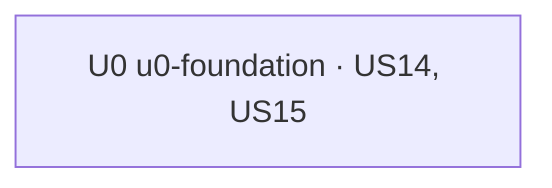

# Unit of Work Dependency: Gamification, lát Nền tảng

Một Unit, không có cạnh giữa Unit. Contract của lát là REST giữa ops-fe và lms-be bên trong U0 (2.8).

```yaml
units:
  - name: u0-foundation
    kind: service
    depends_on: []
```

## Dependency DAG



| Unit | Phụ thuộc | Vì sao |
|---|---|---|
| U0 | — | Chỉ dựa vào code có sẵn trên `staging` (Casbin, Redis, tenant) |

Unit của các lát sau (Điểm, Hiển thị cho học viên…) sẽ phụ thuộc U0; thêm vào DAG khi tech-state mở rộng phạm vi.
