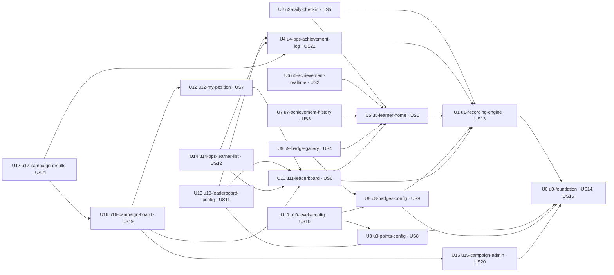

# Unit of Work Dependency: Gamification, cả intent

DAG 18 Unit, không vòng. Chỉ mô tả topo; thứ tự làm và đường găng thuộc 2.9.

```yaml
units:
  - name: u0-foundation
    kind: service
    depends_on: []
  - name: u1-recording-engine
    kind: service
    depends_on: [u0-foundation]
  - name: u2-daily-checkin
    kind: service
    depends_on: [u1-recording-engine, u5-learner-home]
  - name: u3-points-config
    kind: service
    depends_on: [u0-foundation]
  - name: u4-ops-achievement-log
    kind: service
    depends_on: [u1-recording-engine]
  - name: u5-learner-home
    kind: service
    depends_on: [u1-recording-engine]
  - name: u6-achievement-realtime
    kind: service
    depends_on: [u5-learner-home]
  - name: u7-achievement-history
    kind: service
    depends_on: [u5-learner-home]
  - name: u8-badges-config
    kind: service
    depends_on: [u0-foundation, u1-recording-engine]
  - name: u9-badge-gallery
    kind: service
    depends_on: [u5-learner-home, u8-badges-config]
  - name: u10-levels-config
    kind: service
    depends_on: [u3-points-config, u8-badges-config]
  - name: u11-leaderboard
    kind: service
    depends_on: [u1-recording-engine, u5-learner-home]
  - name: u12-my-position
    kind: service
    depends_on: [u11-leaderboard]
  - name: u13-leaderboard-config
    kind: service
    depends_on: [u3-points-config, u4-ops-achievement-log, u11-leaderboard]
  - name: u14-ops-learner-list
    kind: service
    depends_on: [u4-ops-achievement-log, u11-leaderboard]
  - name: u15-campaign-admin
    kind: service
    depends_on: [u0-foundation]
  - name: u16-campaign-board
    kind: service
    depends_on: [u11-leaderboard, u12-my-position, u15-campaign-admin]
  - name: u17-campaign-results
    kind: service
    depends_on: [u4-ops-achievement-log, u16-campaign-board]
```

## Dependency DAG



*Text fallback: mũi tên A → B nghĩa là A phụ thuộc B. U0 ở gốc, U1 trên U0; nhánh cấu hình Ops (U3, U8, U10, U13), nhánh học viên (U5 → U2, U6, U7, U9, U11), bảng xếp hạng (U11 → U12, U13, U14), campaign (U15 → U16 → U17); U4 là chủ API dữ liệu Ops cho U13, U14, U17.*

| Unit | Phụ thuộc | Vì sao |
|---|---|---|
| U0 | — | Chỉ dựa vào code có sẵn trên nhánh chung (WP0, WP3, Casbin, Redis) |
| U1 | U0 | Cần công tắc Gamification và quyết định quyền của U0; engine đọc GamificationConfig |
| U2 | U1, U5 | Check-in gọi engine record (U1); dùng API client, múi giờ, app shell do U5 dựng |
| U3 | U0 | Khối Points nằm trên trang và API cấu hình của U0 |
| U4 | U1 | Nhật ký đọc ledger do U1 ghi |
| U5 | U1 | Màn đọc UserStats do U1 ghi |
| U6 | U5 | Thẻ thông báo chỉ hiện khi cờ hiển thị của U5 bật; emit từ engine U1 (qua U5) |
| U7 | U5 | Panel lịch sử mở từ panel How to collect points của U5 |
| U8 | U0, U1 | Khối Badges trên trang U0; trao bù gọi engine U1 |
| U9 | U5, U8 | Tab mở từ ô Badges của U5; đọc cấu hình huy hiệu U8 |
| U10 | U3, U8 | Tiêu chí hạng khoá theo Points (U3) và Badges (U8) |
| U11 | U1, U5 | Snapshot tính từ ledger, UserStats của U1; mở rộng API học viên và màn của U5 |
| U12 | U11 | Đọc snapshot, thứ hạng của U11 |
| U13 | U3, U4, U11 | Bảng khoá theo Points (U3); xem trước thêm vào GamificationOpsDataApi của U4, đọc snapshot U11 |
| U14 | U4, U11 | computeRange của U11; bấm tên mở nhật ký U4, chung nhóm menu |
| U15 | U0 | Khối Campaign trên trang U0 |
| U16 | U11, U12, U15 | Bảng tạm tính chạy trong cron U11, khối vị trí của tôi U12, campaign của U15 |
| U17 | U4, U16 | Đóng băng kết quả do U16 tạm tính; kết quả Ops thêm vào GamificationOpsDataApi của U4 |

## Integration points

| Giữa | Kiểu | Nội dung |
|---|---|---|
| Mọi Unit ↔ U0 | Shared data | `gamification_settings` + cache (GamificationConfig) |
| U1 ↔ U2, U8, U6 | Gọi trong process / event | `engine.record`, `engine.awardBackfill`, emit sau commit |
| U1 → U4, U5, U7, U9, U11, U14 | Shared data | Ledger `gamification_achievement_history`, `gamification_user_stats` |
| U11 → U12, U13, U14, U16 | Shared data + gọi | `LeaderboardSnapshot`, `computeRange`, con trỏ version |
| U15 → U16 → U17 | Shared data | `gamification_campaigns`, snapshot campaign, `CampaignParticipant` |
| FE ↔ BE mỗi Unit | REST / socket.io | Contract 2.8 |

## Parallel development
Các tập Unit không phụ thuộc nhau, làm song song được khi Unit gốc của chúng đã có:
- Trên gốc U0: {U1, U3, U15} độc lập với nhau
- Trên U1: {U4, U5, U8} độc lập với nhau
- Trên U5: {U2, U6, U7, U11} độc lập với nhau; U9 cần thêm U8
- Trên U11: {U12, U13 (cần U3, U4), U14 (cần U4)} độc lập với nhau
- U15 độc lập với mọi nhánh trừ U0; U16 cần U11, U12, U15
