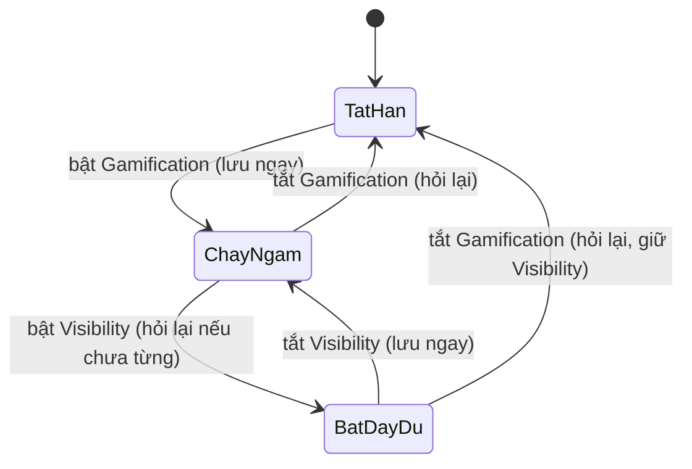

# Functional Spec: U0 `u0-foundation`

## WF-1 Mở trang Gamification
1. Vận hành mở mục Gamification (menu chỉ hiện khi có ít nhất một quyền, BR15.3).
2. Không có quyền nào → màn không có quyền (BR15.3).
3. Hệ thống đọc cấu hình của tổ chức; chưa có thì tạo mặc định (BR14.6).
4. Có quyền xem hoặc sửa cấu hình → hiện khối chung; chỉ quyền sửa mới bấm được (BR15.7). Chỉ có quyền xem danh sách học viên → trang trống ở lát này (BR15.7).
5. Khối chung: công tắc `Gamification`; nếu bật thì thêm `Visibility in UpLMS` và dòng giải thích (BR14.2).

## WF-2 Bật / tắt `Gamification`

*Text fallback: tắt hẳn → chạy ngầm khi bật Gamification; chạy ngầm ↔ bật đầy đủ bằng Visibility; mọi trạng thái về tắt hẳn khi tắt Gamification, có hỏi lại.*

- Bật: lưu ngay; ghi thời điểm bật gần nhất, lần đầu ghi thời điểm đầu tiên (BR14.5).
- Tắt: popover (BR14.13); Xác nhận → lưu, Visibility ẩn nhưng giữ giá trị (BR14.2); Huỷ → không lưu.

## WF-3 Bật / tắt `Visibility in UpLMS`
- Chỉ khi `Gamification` bật (BR14.2); yêu cầu đổi Visibility (bật hay tắt) khi đang tắt hẳn bị từ chối.
- Bật khi chưa từng bật: popover (BR14.13) → Xác nhận lưu, ghi thời điểm bật Visibility đầu tiên; đã từng bật: lưu ngay.
- Tắt: lưu ngay.

## WF-4 Lưu một công tắc
1. Gửi đúng một công tắc (BR14.10). Không hợp lệ → từ chối (BR14.11).
2. Không có quyền sửa → từ chối (BR15.7).
3. Giá trị bằng giá trị đang lưu → không ghi, coi là thành công.
4. Ghi, làm mới bản giữ sẵn để lần đọc sau thấy ngay (BR14.10).
5. Thành công → `Saved`; lỗi → về giá trị đã lưu, báo lỗi (BR14.12).

## WF-5 Gán quyền
1. Sau khi bản mới lên môi trường, nhóm quyền Gamification xuất hiện ở màn role (BR15.1).
2. Quản trị gán quyền cho role; người thuộc role thấy thay đổi sau khi tải lại thông tin (BR15.6).

## Lỗi và biên
| Tình huống | Hành vi |
|---|---|
| Hai lần đọc đầu tiên đồng thời | Một bản cấu hình (BR14.6) |
| Hai người cùng đổi hai công tắc khác nhau | Cả hai lưu được, không đè nhau (BR14.10) |
| Hai người cùng đổi một công tắc | Người sau thắng; màn người trước thấy giá trị mới khi tải lại |
| Mất kết nối khi lưu | Về giá trị đã lưu, báo lỗi (BR14.12) |
