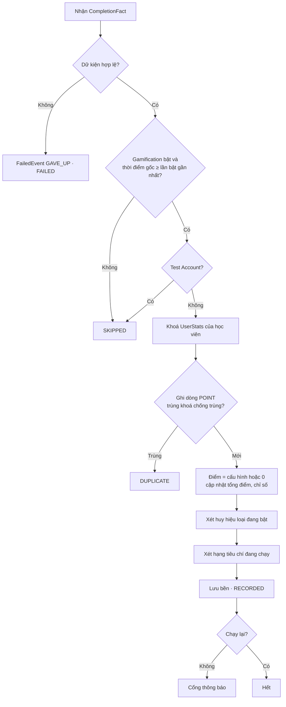
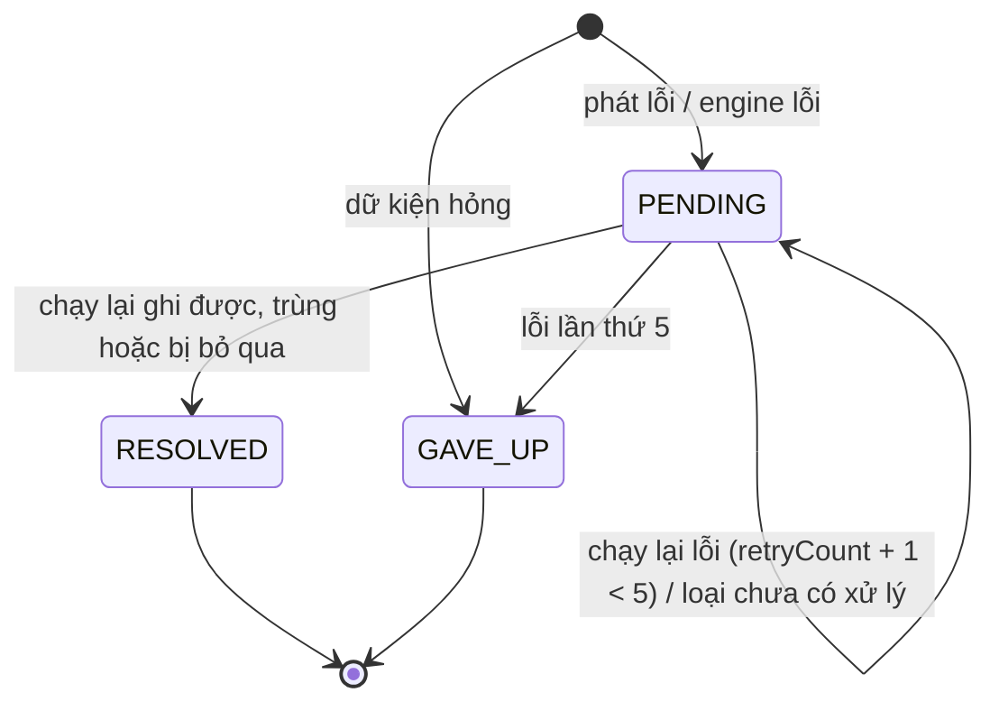
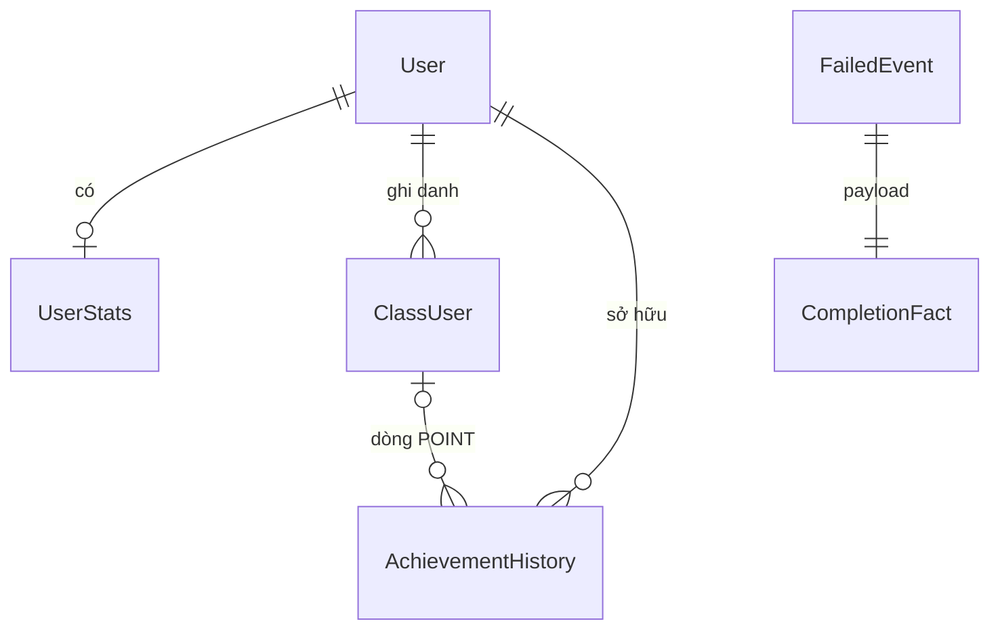

# Functional Spec: U1 `u1-recording-engine`

Unit không có UI. Nghiệm thu bằng dữ liệu sổ giao dịch, `UserStats`, `FailedEvent` (TC-101…TC-125). Nguồn sự thật cho luồng và máy trạng thái; dữ liệu ở `entities.md`, quyết định ở `rules.md`.

## Phạm vi
| Có ở U1 | Không ở U1 |
|---|---|
| Năm luồng học phát CompletionFact (bảng Điểm gắn) | Check-in (U2), trao bù huy hiệu (U8) |
| Engine: ba cửa, ghi sổ, chỉ số, xét huy hiệu và hạng theo cấu hình hiện có | Đổi cấu hình điểm, huy hiệu, hạng (U3, U8, U10) |
| Lưu lỗi, chạy lại 15 phút | Màn Ops cho lỗi (không có, ADR-012) |
| Cổng thông báo + bản không làm gì | Gửi thông báo thật (U6) |
| Tên nội dung lúc ghi | Hiển thị lịch sử (U7, U4) |

## Điểm gắn
Mỗi điểm gắn: đọc trạng thái trước lần lưu, chờ luồng học lưu xong, lọc sớm (BR13.19), dựng CompletionFact với thời điểm hoàn thành, phát; mọi lỗi bị chặn (BR13.7, BR13.20).

| # | Thao tác của học viên / người chấm | Phát gì | Điều kiện (rules) | Nguồn code @9006b80 |
|---|---|---|---|---|
| H1 | Mở / xem xong nội dung trong khoá | ACTIVITY_COMPLETED; COURSE_COMPLETED | Section là Learning Activity và vừa có tiến độ hoàn thành (BR13.17, BR13.2); lượt ghi danh từ chưa hoàn thành sang hoàn thành (BR13.20; khoá bỏ qua không đi đường này, BR13.16) | `libs/modules/src/lib/class/class.service.ts:10079`, commit `:10277`; tiến độ mới = vừa hoàn thành `:10040-10055` |
| H2 | Đánh dấu một section đã xong (cập nhật tiến độ có sẵn) | ACTIVITY_COMPLETED | Section là Learning Activity và tiến độ đổi từ chưa xong sang xong; không đổi lượt ghi danh nên không có COURSE_COMPLETED | `libs/modules/src/lib/class/class.service.ts:10395`, `:10446-10452` (không giao dịch) |
| H3 | Nộp bài | TEST_PASSED; ACTIVITY_COMPLETED; COURSE_COMPLETED | Bài Test trong lượt ghi danh: Graded = No → phát khi nộp; Graded = Yes có điểm ngay (tự chấm, hoặc chỉ trắc nghiệm) → phát khi lượt đạt; còn lại chờ H5 (BR13.14). 'Chuyển trạng thái' của bài Test = lượt này đạt, không phải tiến độ bài. Quiz trong Learning Activity làm hoạt động chuyển hoàn thành → ACTIVITY_COMPLETED (BR13.17); lượt ghi danh chuyển hoàn thành → COURSE_COMPLETED (BR13.20) | `apps/mock-test-service/src/quiz/quiz.service.ts:189` (commit `:293`); tiến độ bài Test có từ lượt nộp đầu `:1540-1570`; không tạo bản chấm khi chỉ trắc nghiệm `apps/mock-test-service/src/app/grade.service.ts:172-178`, `:735` (commit `:824`); hoàn thành khoá `:1446-1452` |
| H4 | Bắt đầu một chủ đề của Case Study / bắt đầu Case Study | COURSE_COMPLETED | Chỉ khi lượt ghi danh chuyển hoàn thành; Case Study không có TEST_PASSED, không ACTIVITY_COMPLETED (BR13.14, BR13.17) | `apps/mock-test-service/src/quiz/quiz.service.ts:3018` chủ đề Case Study `:3048-3051` (commit `:3299`), `:3344` (commit `:3588`) |
| H5 | Người chấm hoàn tất chấm tay | TEST_PASSED | Lần đầu một bản chấm của lượt đi tới kết thúc, theo lịch sử chấm (BR13.15); bài Test Graded = Yes và lượt đạt (BR13.14); thời điểm = lúc chấm xong | `libs/modules/src/lib/quiz-attempt-grading/quiz-attempt-grading.service.ts:2988` (commit `:3117`); gửi duyệt IN_REVIEW `:3538-3558`, kết thúc từ IN_REVIEW `:3061-3075`, yêu cầu chấm lại từ FINISHED hoặc IN_REVIEW tạo bản chấm mới `:3616-3673` |

Không gắn (quyết định 2.6, `components.md` LearningFlowHooks): đường tính lại tiến độ (`class.service.ts:16110`, `apps/event-processor-service/src/app/progress.service.ts:251`) và mọi đường vận hành đặt thẳng hoàn thành (thêm học viên, khôi phục, cho qua Foundation, gia hạn: `class.service.ts:2795`, `:4079`, `:8909`, `:10552`). Hệ quả: khoá chỉ thành hoàn thành qua đường tính lại thì không có COURSE_COMPLETED (Ghi chú cho PO).

## WF-1 Học viên hoàn thành nội dung (H1–H4)
1. Luồng học đọc trạng thái hiện tại của section và lượt ghi danh (BR13.20).
2. Luồng học lưu tiến độ như hiện nay, không đổi gì (Nguyên tắc nền).
3. Sau khi lưu xong, điểm gắn xác định các chuyển trạng thái theo bảng Điểm gắn. Không có chuyển trạng thái → dừng.
4. Lọc sớm: Gamification tắt hoặc Test Account → dừng; đọc lỗi → đi tiếp (BR13.19).
5. Dựng CompletionFact (hành động, học viên, lượt ghi danh, nội dung, tên, thời điểm hoàn thành) cho từng chuyển trạng thái, theo thứ tự: hoạt động / bài Test trước, khoá sau.
6. Phát. Phát lỗi → lưu FailedEvent RECORD PENDING (BR13.8). Thao tác học trả kết quả như thường (BR13.7).

## WF-2 Người chấm hoàn tất chấm tay (H5)
1. Trước khi lưu, đọc lịch sử chấm của lượt: đã từng có bản chấm kết thúc → không phát (BR13.15).
2. Lưu kết quả chấm như hiện nay (kể cả khi kết thúc từ bước duyệt).
3. Bài Test Graded = Yes, lượt gắn lượt ghi danh và đạt (BR13.14) → bước 4–6 của WF-1 với hành động TEST_PASSED.

## WF-3 Engine ghi một CompletionFact

*Text fallback: kiểm dữ kiện → cửa bật và thời điểm → Test Account → khoá stats → ghi POINT (trùng thì DUPLICATE) → điểm theo cấu hình hoặc 0 → huy hiệu → hạng → lưu bền → báo cổng thông báo nếu không phải chạy lại.*

1. Kiểm dữ kiện; hỏng → BR13.25.
2. Cửa thời điểm (BR13.18), Test Account (BR13.4) → SKIPPED, không ghi gì.
3. Mở một lần ghi không tách rời; khoá `UserStats` của học viên, tạo nếu chưa có (BR13.5).
4. Ghi dòng POINT với điểm theo BR13.13 và tên theo BR13.23; trùng → DUPLICATE, không đổi gì (BR13.1).
5. Cập nhật `UserStats`: điểm > 0 thì cộng tổng điểm và điểm theo nguồn; chỉ số theo hành động +1 (hoạt động, bài Test, khoá — BR13.12); mốc thời gian lấy giá trị muộn hơn.
6. Huy hiệu (khi Badges bật): mọi mốc của loại đang bật mà chỉ số đã chạm và học viên chưa có → dòng BADGE, `totalBadgesAcquired` tăng (ADR-011). Mốc và cách so do cấu hình hiện có quyết; đổi cấu hình thuộc U8.
7. Hạng (khi Levels bật): theo tiêu chí đang chạy, chặn trần; dòng LEVEL cho từng hạng mới. Quy tắc tiêu chí thuộc U10.
8. Lưu bền → RECORDED. Lỗi bất kỳ ở bước 3–8 → huỷ cả lần ghi; không phải chạy lại thì lưu FailedEvent RECORD PENDING; trả FAILED (BR13.8, BR13.26).
9. Sau khi lưu bền, không phải chạy lại: gọi cổng thông báo với các thành tích vừa ghi (BR13.24).

## WF-4 Chạy lại
1. Mỗi 15 phút, với từng tổ chức, lấy FailedEvent PENDING cũ trước; một sự kiện chỉ một bộ chạy (BR13.21).
2. Theo loại (BR13.22): RECORD → WF-3 ở chế độ chạy lại (thời điểm gốc, không thông báo, không lưu thêm FailedEvent).
3. RECORDED / DUPLICATE / SKIPPED → RESOLVED. FAILED → retryCount + 1; đủ 5 → GAVE_UP + log GAMIFICATION_RECORD_GAVE_UP.

### Máy trạng thái FailedEvent

*Text fallback: PENDING → RESOLVED khi chạy lại xong; ở lại PENDING khi lỗi dưới 5 lần hoặc loại chưa có xử lý; GAVE_UP khi lỗi lần 5 hoặc dữ kiện hỏng ngay từ đầu. RESOLVED, GAVE_UP là trạng thái cuối.*

## Kịch bản
| Kịch bản | Kết quả | Rule | TC |
|---|---|---|---|
| Hoàn thành Learning Activity, mở lại 3 lần | 1 dòng POINT; mở lại không phát (không chuyển trạng thái) | BR13.1, BR13.2 | TC-101 |
| Cùng CompletionFact gửi hai lần | Lần hai DUPLICATE | BR13.1, BR13.26 | TC-102 |
| Đã xong trước khi bật, mở lại sau khi bật | Không phát | BR13.2 | TC-103 |
| Xong trước bật mà tiến độ khoá bị đặt lại hoàn thành sau bật | Không COURSE_COMPLETED | BR13.20 | TC-103 |
| Hoàn thành lúc tắt, xử lý sau khi bật (trễ Kafka) | SKIPPED | BR13.18 | TC-118 |
| Test Account học | Không phát (lọc sớm) hoặc SKIPPED; không dòng nào | BR13.4, BR13.19 | TC-105 |
| Hai tab cùng hoàn thành | 1 dòng | BR13.5 | TC-106 |
| Kafka hỏng | Học vẫn thành công; FailedEvent; chạy lại mang giờ gốc | BR13.7, BR13.8 | TC-108, TC-109 |
| Lỗi mãi | GAVE_UP sau 5 lần, log GAMIFICATION_RECORD_GAVE_UP (TC-110 ghi mã khác, báo QA) | BR13.21 | TC-110 |
| Học lại trong lượt ghi danh mới | Điểm tính lại; số khoá = 2 | BR13.10, BR13.12 | TC-112, TC-114 |
| Points tắt | Dòng 0 điểm, chỉ số + huy hiệu chạy | BR13.13 | TC-116, TC-117 |
| Bài Test 60 / 80 / 90 với ngưỡng 70 | Chỉ lượt 80 phát | BR13.14, BR13.1 | TC-119 |
| Bài Test không chấm điểm | Phát khi hoàn thành | BR13.14 | TC-120 |
| Quiz trong hoạt động, Case Study, Storyline | Chỉ ACTIVITY_COMPLETED cho hoạt động | BR13.17, BR13.14 | TC-121 |
| Chấm lại trượt → đạt / đạt → đạt | Không phát | BR13.15 | TC-122, TC-123 |
| Chấm lần đầu trượt → duyệt → chấm lại → đạt (lần đầu đã kết thúc) | Không phát | BR13.15 | TC-122 |
| Chấm lần đầu → bị trả từ bước duyệt trước khi kết thúc → chấm lại đạt → kết thúc | Phát (lần kết thúc đầu tiên) | BR13.15 | [thêm TC, báo QA] |
| Video đang xem dở lúc bật, xem tiếp đủ sau bật | Phát | BR13.2 | TC-104 |
| Learning Activity Text + Ảnh mở 1 giây | Phát, mở lại không cộng | BR13.9 | TC-111 |
| Thêm lại học viên (lựa chọn "ghi nhận đã xong" chưa có trong hệ thống) | Lượt mới chưa học, không phát gì tới khi học | BR13.10 | TC-113 (cần sửa, báo QA) |
| Khoá Foundation bỏ qua / được cho qua | Không COURSE_COMPLETED cho khoá Foundation; khoá chính vẫn tính khi học xong | BR13.16 | TC-124 (diễn đạt lại, báo QA) |
| Đo thời gian hoàn thành | Chênh p95 ≤ 200 ms | BR13.7 | TC-125 |

## ER (dẫn xuất từ `entities.md`)

*Text fallback: một học viên có tối đa một UserStats, nhiều lượt ghi danh và nhiều dòng sổ; dòng POINT (trừ check-in) trỏ một lượt ghi danh; mỗi FailedEvent chứa một CompletionFact.*

## Rules (dẫn xuất từ `rules.md`)
Ba cửa: BR13.18, BR13.4, BR13.1/BR13.5. Phát: BR13.2, BR13.9, BR13.14–BR13.17, BR13.19, BR13.20. Ghi: BR13.12, BR13.13, BR13.23, BR13.26. Lỗi: BR13.7, BR13.8, BR13.21, BR13.22, BR13.25. Thông báo: BR13.24.

## Ghi chú
- **Ngày công**: giữ 3,5 (U1 đã ký vượt trần). Có thêm điểm gắn Quiz trong hoạt động ở H3 và cửa thời điểm; bù lại engine, publisher, consumer đã có (WP1). 3.5 xem lại.
- **Cho PO** (ghi `tech-state.md`): khoá chỉ hoàn thành qua đường tính lại tiến độ không sinh điểm khoá. PRD BR-13.10 nói vận hành chọn "ghi nhận đã xong khoá" khi thêm lại học viên, nhưng hệ thống chưa có lựa chọn này. Thêm lại luôn bắt đầu lại từ đầu. Hành vi gamification vẫn đúng.
- **Cho PO — SKIP_FOUNDATION rồi học nốt (BR13.16)**: Khi học viên tự bỏ qua Foundation (SKIP_FOUNDATION) rồi sau đó quay lại học và hoàn thành Foundation thực sự, hệ thống sẽ phát COURSE_COMPLETED cho khoá Foundation đó. PRD BR-SKIP nói "khoá bỏ qua không tính là hoàn thành" nhưng không có cờ lọc nào trên lượt ghi danh Foundation. Câu hỏi: học viên bỏ qua rồi học thật xong thì có tính điểm khoá không? Nếu không: cần thêm cờ hoặc đọc `foundation_status` trên khoá chính và lọc ở H1. TC-124 cần cập nhật sau khi PO chốt.
