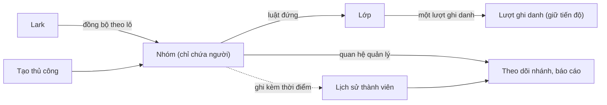

# [HLD] Nhóm học viên (Group)

| | |
|---|---|
| Owner | Bùi Đức Huy (PO) |
| Design PIC | Ghi theo vai; PIC điền tên khi ký |
| Tech PIC | Ghi theo vai; PIC điền tên khi ký |
| QA PIC | Ghi theo vai; PIC điền tên khi ký |
| Cách góp ý | Không tổ chức họp. PIC ghi phần của mình vào file này qua merge request, PO duyệt và merge. Không đặt hạn |

Tài liệu dài tối đa ba trang; mục 1 đọc hết trong khoảng một phút. PIC của từng team viết mục 8, 9, 10 trực tiếp trong file này trên repo, mỗi người chỉ sửa mục của mình và dòng của mình ở mục 12. PRD chi tiết bản v0.3 đã có trên Lark. Sau khi mục 12 đủ chữ ký, PRD được cập nhật theo định hướng của các PIC, và bản brief đã ký được đưa lên Lark làm bản chính thức.

Mục 1 đến 7 và mục 11 tổng hợp từ các tài liệu đã duyệt. Nội dung các mục này chỉ thay đổi qua change request ở tài liệu nguồn rồi tổng hợp lại vào đây, không sửa trực tiếp trong brief. Mục 8, 9, 10 thuộc về PIC: các dòng in nghiêng ở đầu mỗi mục là gợi ý của PO, PIC viết nội dung bên dưới.

## 1. Tóm tắt
- Vấn đề: hệ thống chưa có cách gom học viên thành một tập ổn định để giao nội dung, theo dõi và tổng hợp số liệu; mọi thao tác hiện phải đi qua Lớp.
- Đối tượng: L&D khi giao nội dung, quản lý trực tiếp khi theo dõi nhân sự của mình, nhân sự vận hành khi lập báo cáo theo phòng ban.
- Chỉ số mục tiêu: 60% lượt ghi danh mới đến từ nhóm sau hai tháng; không còn trường hợp phải gán bổ sung thủ công; báo cáo quý khi chạy lại cho đúng số liệu đã chốt.
- Phạm vi: nhóm nhiều cấp từ hai nguồn (đồng bộ Lark và tạo thủ công), luật đứng đưa thành viên vào Lớp, quan hệ quản lý và mentor, lịch sử thành viên, báo cáo theo mốc thời gian, xử lý khi rời nhóm. Phần lớn chức năng nằm ở UpLMS Ops.
- Thay đổi lớn nhất: thêm một cách ghi danh thứ hai do hệ thống tự thực hiện, và một lớp dữ liệu lịch sử thành viên làm nguồn cho mọi báo cáo theo nhóm.
- Rủi ro lớn nhất: ma trận phân quyền hiện có chưa được đối chiếu; lần đồng bộ đầu tiên tác động tới 384 người cùng lúc.
- Phụ thuộc lớn nhất: cơ chế đồng bộ Lark hiện có phải mở rộng được từ dữ liệu người sang dữ liệu cơ cấu.
- Ràng buộc bắt buộc: nhóm chỉ chứa người; mỗi người chỉ có một lượt ghi danh cho một khoá; mọi thay đổi thành viên được lưu kèm thời điểm; luật đứng tuân theo luật của Lớp.
- Quyết định còn mở: bốn câu hỏi ở mục 7, đều do Dev quyết.
- Tài liệu chi tiết: PRD v0.3 gồm 20 user story và 130 business rule, duyệt ngày 12/10/2026.

## 2. Vấn đề và mục tiêu
Để giao một khoá cho một phòng 55 người, nhân sự vận hành phải chọn thủ công từng người hoặc nhập tệp danh sách, và người vào phòng sau thời điểm đó không được giao. Quản lý trực tiếp không xem được tiến độ của nhân sự mình phụ trách vì hệ thống không lưu quan hệ quản lý. Vận hành không tổng hợp được số liệu theo phòng ban. Dự án Gamification đã phải hoãn bộ lọc bảng xếp hạng theo nhóm vì thiếu chức năng này. Cơ cấu tổ chức đã có đủ trên Lark: 384 nhân sự, 53 phòng ban, 4 cấp.

| Mục tiêu | Đo bằng |
|---|---|
| O1 Giao nội dung cho một tập người ổn định | Tỉ lệ lượt ghi danh sinh ra từ nhóm đạt 60% sau hai tháng |
| O2 Thành viên mới tự nhận nội dung đã giao | Số lần phải gán bổ sung thủ công ở nhóm bật tự ghi danh bằng 0 |
| O3 Quản lý xem được tiến độ nhân sự mình phụ trách | Tỉ lệ quản lý mở màn theo dõi nhánh mỗi tháng đạt 50% |
| O4 Cộng dồn số liệu theo cơ cấu | Số lượt xem báo cáo cộng dồn; ngưỡng xác định sau tháng đầu |
| O5 Tái dựng danh sách thành viên tại một mốc quá khứ | Chênh lệch giữa báo cáo chạy lại và bản đã chốt bằng 0 |

## 3. Phạm vi
| In | Out | Để sau |
|---|---|---|
| Nhóm tối đa 6 cấp, giá trị cấu hình được; nguồn là Lark (chỉ đọc) hoặc tạo thủ công; một người thuộc được nhiều nhóm; nhóm cha bao gồm nhánh con khi đọc dữ liệu | Đồng bộ ngược về Lark, vì Lark là hệ thống gốc | Dùng nhóm làm danh sách người nhận thông báo từ Ops |
| Thêm và gỡ thành viên thủ công hoặc qua tệp; lưu lịch sử vào và ra nhóm kèm thời điểm, không giới hạn thời gian lưu | Nhóm dành cho nhân sự vận hành | Phạm vi dữ liệu nhiều mức theo vai trò |
| Giao nội dung bằng luật đứng; hai công tắc "chảy xuống nhánh con" và "tự ghi danh người vào sau", mặc định tắt | Nhóm chứa nội dung, vì nhóm chỉ chứa người | |
| Gán quản lý, suy ra quản lý theo cây, chỉ định quản lý chính; mentor đi theo nhóm vào lớp; màn theo dõi nhánh ở Ops; học viên xem quản lý của mình ở UpLMS | Thay đổi cơ chế ghi danh của Lớp | |
| Báo cáo cộng dồn tại một mốc thời gian; nhật ký thành viên; lưu trữ nhóm, chỉ cho xoá nhóm chưa có lịch sử | Xoá nhóm đã có lịch sử, xoá bớt lịch sử, chia dữ liệu học theo nhánh, nhóm động theo điều kiện, chuyển lớp | |
| Người nghỉ việc được đánh dấu kết thúc lượt ghi danh; người rời nhóm khi chưa học được hệ thống tự gỡ khỏi khoá; người rời nhóm khi đang học thì quản lý nhận email; hai mail event mới | | |

## 4. Giải pháp tổng thể

Nhóm là đối tượng để gán. Nghĩa vụ học và tiến độ được lưu ở Lớp, còn báo cáo theo nhóm lấy dữ liệu từ lịch sử thành viên.

- Nhóm chỉ chứa người. Quan hệ giữa người và nội dung chỉ tồn tại trong Lớp.
- Luật đứng được kích hoạt khi giao nội dung, khi có người vào nhóm và khi bật công tắc tự ghi danh. Khi lớp đã kết thúc, luật đứng dừng mà không báo lỗi và ghi nhật ký.
- Mỗi người chỉ có một lượt ghi danh cho một khoá, và một lượt có thể có nhiều nhóm nguồn. Người rời một nhóm vẫn giữ lượt ghi danh nếu nhóm khác của họ còn giao lớp đó.
- Khi đồng bộ, mỗi người thuộc nhóm sâu nhất trên nhánh của mình; nhóm cha bao gồm nhánh con ở mọi màn đọc dữ liệu.
- Khi rời nhóm, người nghỉ việc được đánh dấu kết thúc lượt ghi danh, người chưa học được hệ thống tự gỡ, còn người đang học thì quản lý nhận email và quyết định.
- Phạm vi dữ liệu xác định theo từng màn: màn theo dõi nhánh dùng quan hệ quản lý, màn giao nội dung dùng vai trò hệ thống.
- Mỗi vai trò dùng một tài khoản riêng; tài khoản kiểm thử bị loại khỏi mọi logic và báo cáo.

## 5. User story theo nhóm bàn giao
| Unit | US | Tên | Ý chính | Thứ tự |
|---|---|---|---|---|
| U1 Khung nhóm | US1 | Tạo và sửa nhóm | Mã nhóm duy nhất; cây tối đa 6 cấp | 1 |
| U1 Khung nhóm | US2 | Di chuyển một nhánh | Giữ nguyên thành viên và nội dung đã giao | 1 |
| U1 Khung nhóm | US3 | Thêm và gỡ thành viên thủ công | Khi gỡ, xét tình trạng học của từng khoá | 1 |
| U1 Khung nhóm | US4 | Thêm và gỡ thành viên qua tệp | Dòng lỗi không chặn các dòng hợp lệ | 1 |
| U1 Khung nhóm | US6 | Xem danh sách nhóm | Cây tải theo từng nhánh; số thành viên tính cả nhánh con | 1 |
| U3 Giao nội dung | US7 | Giao nội dung cho nhóm | Chọn lớp cụ thể; không áp dụng hồi tố | 2 |
| U3 Giao nội dung | US8 | Bật tắt tự ghi danh | Công tắc riêng cho từng cặp nhóm và lớp | 2 |
| U7 Nền tảng | US14 | Lưu trữ nhóm | Luật đứng ngừng chạy; lượt ghi danh đã sinh giữ nguyên | 3 |
| U7 Nền tảng | US15 | Tra nhật ký thành viên | Chỉ đọc; lưu toàn bộ lịch sử | 3 |
| U7 Nền tảng | US18 | Báo cáo cộng dồn theo nhóm | Tính theo danh sách thành viên tại mốc đã chọn | 3 |
| U2 Đồng bộ cơ cấu | US5 | Nhóm đồng bộ từ Lark | Đồng bộ theo lô; chỉ đọc; thành viên thuộc nhóm sâu nhất | 4 |
| U4 Quan hệ người | US9 | Gán quản lý cho nhóm | Một nhóm có nhiều quản lý; email báo người được gán | 5 |
| U4 Quan hệ người | US10 | Suy ra quản lý theo cây | Kế thừa từ nhóm cha gần nhất; tính tại thời điểm đọc | 5 |
| U4 Quan hệ người | US11 | Chỉ định quản lý chính | Mỗi học viên có tối đa một quản lý chính | 5 |
| U4 Quan hệ người | US12 | Gán mentor cho nhóm | Mentor của nhóm trở thành mentor của lớp được giao | 5 |
| U4 Quan hệ người | US13 | Cảnh báo nhóm trống quản lý | Gắn nhãn cảnh báo; chuyển toàn bộ phụ trách sang người khác | 5 |
| U5 Phạm vi và hiển thị | US16 | Quản lý theo dõi nhánh | Màn ở Ops; dữ liệu theo quan hệ quản lý | 6 |
| U5 Phạm vi và hiển thị | US17 | Học viên xem quản lý | Hiển thị tên, ảnh, email | 6 |
| U6 Vòng đời nhân sự | US19 | Rời nhóm khi chưa học | Tự gỡ khỏi khoá, trừ khi nhóm khác còn giao lớp đó | 7 |
| U6 Vòng đời nhân sự | US20 | Báo quản lý khi còn nghĩa vụ học | Một email cho mỗi lần rời nhóm; cảnh báo việc mất tiến độ | 7 |

Thứ tự gợi ý: U1 và U3 đi trước vì cho ra chức năng dùng được ngay; U7 đi trước U2 và U4 vì lịch sử thành viên phải sẵn sàng trước khi dữ liệu bắt đầu tích luỹ. Dev quyết định thứ tự thực tế. Chi tiết từng user story nằm trong PRD `inception/prd/prd.md`; PIC đọc phần này trước khi viết mục 8, 9, 10.

## 6. Ảnh hưởng tới hệ thống hiện có và rủi ro
| Vùng | Thay đổi | Mức |
|---|---|---|
| Lớp và ghi danh | Thêm cách ghi danh thứ hai qua nhóm; không sinh lượt ghi danh trùng; lớp Foundation đi kèm như khi thêm thủ công | High |
| Dữ liệu người dùng | Bảng users chưa có quan hệ cơ cấu và là khoá ngoại của 15 bảng; class_user_instances là khoá ngoại của 6 bảng | High |
| Phân quyền | Phạm vi theo nhánh là chiều phân quyền mới; ma trận quyền hiện có chưa được đối chiếu | High |
| Báo cáo | Report LMS và Sis Dashboard dùng lớp làm khoá; báo cáo theo nhóm lấy dữ liệu từ lịch sử thành viên; bộ lọc chuyển sang dạng động | High |
| Mail và đồng bộ Lark | Mail chào mừng gửi theo từng người được ghi danh; thêm hai mail event mới; đồng bộ mở rộng từ người sang cơ cấu, lần đầu tạo 53 nhóm và 384 quan hệ thành viên | High |
| Rule hiện có, nhóm cũ, vùng chưa tra cứu | 8 rule bị tác động; Group Management bị bỏ, dữ liệu bảng cũ chờ Dev kiểm tra; lịch dạy và phòng học chưa được tra cứu | Medium |

Triển khai theo hai lần bật. Lần thứ nhất đồng bộ cây tổ chức và thành viên, chưa giao nội dung nào; lần thứ hai mở chức năng giao nội dung. Nếu bật cùng lúc, lần đồng bộ đầu có thể kích hoạt luật đứng và gửi mail hàng loạt. Lịch sử thành viên chỉ có từ ngày bật. Khi tắt luật đứng, các lượt ghi danh đã sinh không được thu hồi tự động.

| # | Loại | Nội dung | Ai chấp nhận, ngày | Điều kiện kèm theo |
|---|---|---|---|---|
| 1 | Giả định | Cơ chế đồng bộ Lark mở rộng được sang dữ liệu cơ cấu | PO, 05/10/2026 | Dev xác nhận ở mục 9 |
| 2 | Giả định | Cây tổ chức trên Lark đủ tin cậy, không cần đối soát thủ công | PO, 05/10/2026 | Có nhật ký đồng bộ để tra cứu khi sai lệch |
| 3 | Rủi ro chấp nhận | Báo cáo chỉ xem lại được tới ngày bật tính năng | PO, 06/10/2026 | Thông báo rõ cho người dùng khi bàn giao |
| 4 | Rủi ro chấp nhận | Người thuộc hai nhánh thì cả hai quản lý đều xem được toàn bộ dữ liệu học của họ | PO, 05/10/2026 | Tổ chức không xếp một người vào hai nhánh nếu không chấp nhận điều này |
| 5 | Rủi ro chấp nhận | Gỡ học viên khỏi lớp làm mất tiến độ; hệ thống chưa có chức năng chuyển lớp | PO, 06/10/2026 | Email gửi quản lý có câu cảnh báo cố định |
| 6 | Finding còn mở | US13 gộp hai việc: cảnh báo nhóm trống quản lý và chuyển phụ trách | PO, 12/10/2026 | Giữ một user story vì cả hai thuộc cùng tình huống quản lý rời vị trí |
| 7 | Giả định | Chưa có số liệu vận hành thực tế | PO, 06/10/2026 | Ngưỡng của O4 xác định sau tháng vận hành đầu tiên |

## 7. Quyết định cần chốt
| # | Câu hỏi | Lựa chọn | Ai quyết | Hạn |
|---|---|---|---|---|
| 1 | Bảng groups và group_user_instances của chức năng nhóm cũ có dữ liệu thật hay không | Bỏ, giữ lại, hoặc chuyển đổi | Dev | Trước U1 |
| 2 | Xuất ma trận quyền hiện có để nối phạm vi theo quan hệ quản lý với vai trò hệ thống ở màn theo dõi nhánh | Ghi cách nối ở mục 9 | Dev | Trước U5 |
| 3 | Cột roles.is_group trong schema có ý nghĩa gì | Dùng lại, tách riêng, hoặc xác nhận không liên quan | Dev | Trước U4 |
| 4 | Hộp xác nhận gỡ học viên khỏi lớp đã có cảnh báo mất tiến độ hay chưa | Nếu chưa, thêm một câu cảnh báo | Dev | Trước U6 |

Hai điểm PO đã quyết ngày 12/10/2026: loại quan hệ là cố định, gồm quản lý và mentor; tài khoản kiểm thử và tài khoản trả lời bình luận được tạo trong UpLMS Ops, không qua Lark.

## 8. Design Direction
*Điểm cần lưu ý cho Design, tổng hợp từ tài liệu đã duyệt:*
*1. Các màn mới đều thuộc UpLMS Ops. Cây nhóm hoạt động tương tự cây thư mục: tải theo từng nhánh, số thành viên tính cả nhánh con, kết quả tìm kiếm hiển thị đường dẫn từ nhóm gốc. Nhóm đã lưu trữ được ẩn mặc định ở mọi ô chọn nhóm.*
*2. Nhóm đồng bộ chỉ cho phép xem: các nút Sửa, Di chuyển, Thêm và gỡ thành viên được ẩn và thay bằng một dòng giải thích. Nút Xoá chỉ hiển thị với nhóm chưa có lịch sử.*
*3. Màn giao nội dung có hai công tắc "chảy xuống nhánh con" và "tự ghi danh người vào sau", mặc định tắt, mỗi công tắc có tooltip. Cảnh báo vượt sức chứa là một dòng thông báo ở danh sách học viên của lớp và không chặn thao tác.*
*4. Tên "Nhóm" dễ gây nhầm với support group đang có ở Ops; nhãn menu, nhãn màn và ô chọn cần phân biệt rõ hai khái niệm.*
*5. UpLMS chỉ thêm khối "Quản lý của tôi" trên hồ sơ học viên, gồm ảnh, họ tên, email, không hiển thị số điện thoại, quản lý chính đứng đầu. Màn theo dõi nhánh ở Ops sắp xếp theo số khoá quá hạn và không hiển thị phần trăm tiến độ.*

Design PIC viết theo khung dưới. Ý không áp dụng ghi "không áp dụng", không bỏ trống.
- Luồng màn chính:
- Pattern tái dùng:
- Ràng buộc hiển thị:
- Cần nghiên cứu hoặc thử với người dùng:
- Cần PO quyết:

## 9. Technical Direction
*Điểm cần lưu ý cho Tech, tổng hợp từ PRD và phân tích ảnh hưởng. Mỗi dòng là một nhóm vấn đề; chi tiết đầy đủ ở mục 6 và các mục TDD, Dữ liệu phải lưu, Vấn đề tồn đọng của PRD:*
*1. Bốn ràng buộc bắt buộc: nhóm chỉ chứa người; mỗi người chỉ có một lượt ghi danh cho một khoá, và một lượt có thể có nhiều nhóm nguồn; mọi thay đổi thành viên được lưu kèm thời điểm và không bị xoá, kể cả khi người đó nghỉ việc hoặc nhóm bị lưu trữ; luật đứng tuân theo luật của Lớp. Năm loại dữ liệu phải lưu: thời điểm vào và ra nhóm, lý do rời nhóm, nguồn của nhóm, nguồn của lượt ghi danh, trạng thái lượt ghi danh.*
*2. Thực thể dùng chung: users là khoá ngoại của 15 bảng; class_user_instances là khoá ngoại của 6 bảng dữ liệu học; bảng groups cũ chưa rõ có dữ liệu hay không; support-groups trùng tên khái niệm và không có tenant_id. Quan hệ quản lý kế thừa được tính tại thời điểm đọc, không lưu thành dữ liệu riêng.*
*3. Luật đứng chạy ở chế độ nền tại ba thời điểm. Khi gặp lớp đã kết thúc, luật dừng mà không báo lỗi và ghi nhật ký. Ghi danh qua nhóm cũng đưa học viên vào lớp Foundation như ghi danh thủ công, và mail chào mừng vẫn được gửi. Đồng bộ chạy theo lô. Triển khai hai lần bật để lần đồng bộ đầu không kích hoạt luật đứng. Khi rollback, lượt ghi danh đã sinh không được thu hồi.*
*4. Phạm vi dữ liệu xác định theo từng màn: màn theo dõi nhánh dùng quan hệ quản lý, màn giao nội dung dùng vai trò hệ thống; hai phạm vi không được cộng gộp hay lấy phần giao. Ma trận quyền Casbin hiện có chưa được đối chiếu. Mỗi vai trò dùng một tài khoản riêng; tài khoản kiểm thử được nhận diện bằng cờ is_operator và bị loại khỏi mọi logic.*
*5. Tenant: số cấp tối đa cấu hình theo tổ chức, mặc định là 6; mọi bảng mới phải có tenant_id; loại quan hệ là cố định. Đồng bộ Lark nên được thiết kế như một bộ chuyển đổi đưa dữ liệu vào một cấu trúc cơ cấu chuẩn, để tenant khác dùng được hệ thống nhân sự khác. Hai vùng chưa tra cứu: lịch dạy và phòng học.*

Đây là định hướng kỹ thuật, đầu vào cho phần chi tiết của PRD. Tech PIC viết theo khung dưới; ý không áp dụng ghi "không áp dụng", không bỏ trống.
- Hướng tiếp cận:
- Thành phần hiện có bị chạm:
- Dữ liệu phải giữ lại:
- Điểm tích hợp và phụ thuộc kỹ thuật:
- Ràng buộc và NFR mục tiêu:
- Độ lớn và thứ tự từng Unit:
- Dev tự quyết ở detailed design:
- Cần PO quyết:

## 10. Test Strategy
*Điểm cần lưu ý cho QA, tổng hợp từ business rule và các trường hợp biên đã rà soát:*
*1. Các trường hợp đã có rule và cần ca kiểm thử: lớp đã kết thúc thì luật đứng dừng mà không báo lỗi; vượt sức chứa vẫn thêm học viên và chỉ cảnh báo; tài khoản kiểm thử không xuất hiện ở bất kỳ màn hay báo cáo nào; người nghỉ việc được đánh dấu kết thúc lượt ghi danh và vẫn được tính trong báo cáo quá khứ; người thuộc hai nhóm cùng giao một lớp vẫn giữ lượt ghi danh khi rời một nhóm; giao nội dung không áp dụng hồi tố.*
*2. Các trường hợp chưa có rule, cần PO hoặc Dev quyết trước khi viết ca kiểm thử: đồng bộ bị lỗi giữa chừng; quyền quản lý bị thu hồi trong lúc đang xem báo cáo; cây tổ chức trên Lark thay đổi lớn giữa hai lần đồng bộ.*
*3. Vùng kiểm thử hồi quy: thêm và gỡ học viên khỏi lớp, lớp Foundation, mail số 11, 12 và 23 đến 26, toàn bộ dashboard, phân quyền, đồng bộ Lark, Comment Replier.*
*4. Dữ liệu kiểm thử cần chuẩn bị: một cây giả bốn cấp có người thuộc hai nhánh, lớp có Foundation, lớp đã kết thúc, lớp gần đạt sức chứa, tài khoản kiểm thử, một nhánh chưa gán quản lý để kiểm tra kế thừa.*
*5. Báo cáo theo mốc quá khứ: ghi nhận số liệu tại một mốc, sau đó thêm thành viên mới và chuyển một thành viên sang trạng thái nghỉ việc; chạy lại báo cáo tại cùng mốc phải cho đúng số liệu ban đầu.*

QA PIC viết theo khung dưới. Ý không áp dụng ghi "không áp dụng", không bỏ trống.
- Phạm vi test:
- Vùng hồi quy:
- Dữ liệu và môi trường test:
- Tiêu chí vào và ra:
- Góc cần PO chốt:

## 11. Release và phụ thuộc
| Việc | Phụ thuộc | Mốc |
|---|---|---|
| U1, sau đó U3 | Không có | Chưa có target release; chưa tạo Epic và Story trên Jira |
| U7 | U1; phải hoàn thành trước khi dữ liệu thành viên bắt đầu tích luỹ | Trước lần bật đồng bộ đầu tiên |
| U2 | U1; quyết định số 1 ở mục 7 | Lần bật thứ nhất, chưa giao nội dung |
| U4 và U5 | U1; quyết định số 2 và 3 | Sau lần bật thứ nhất |
| U6 | U2 và U3; quyết định số 4 | Lần bật thứ hai |
| Gamification và Report Phase 1 | Chức năng này | Theo lịch của hai dự án đó |
| Thiết kế trên Figma | Chưa có | Design PIC ghi ở mục 8 |

## 12. Sign-off
Trạng thái: "Đồng ý" là duyệt · "Có ý kiến" là duyệt kèm ghi chú đã viết trong mục của mình · "Yêu cầu sửa" là chưa duyệt, nội dung cần sửa ghi ở cột Ghi chú · "Chưa xem".

| Vai trò | Tên | Trạng thái | Ngày | Ghi chú |
|---|---|---|---|---|
| Product | Bùi Đức Huy | Đồng ý | 12/10/2026 | |
| Design | | Chưa xem | | |
| Dev | | Chưa xem | | |
| QA | | Chưa xem | | |
