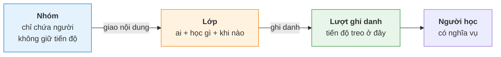
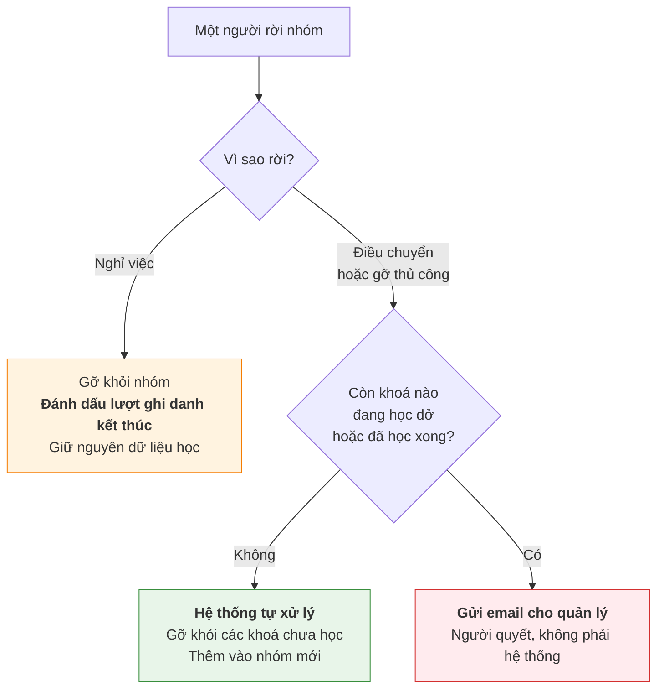
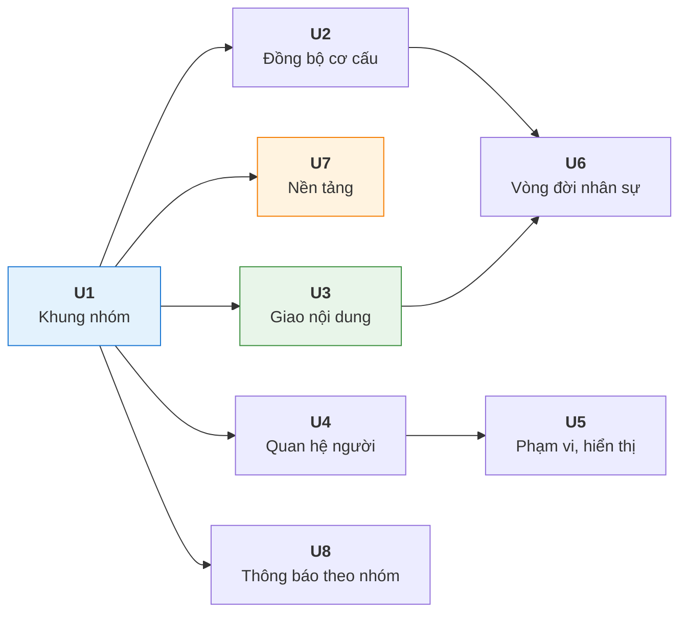
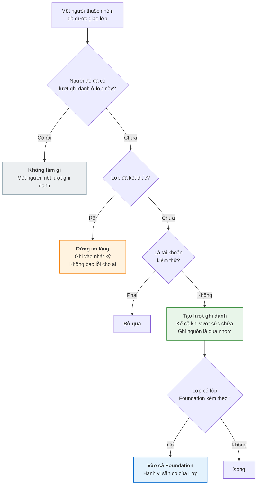

# [PRD] Nhóm học viên

| | |
| --- | --- |
| Mã tính năng | LMS-F002. Mã ngắn đổi sang mã đầy đủ theo quy ước: US1 là US-LMS-F002-01, AC1.1 là AC-LMS-F002-01.1 |
| PO | Bùi Đức Huy |
| Design PIC · Tech PIC · QA PIC | Design PIC: `inception/ux-design/ux-design.md` v0.1 · Tech PIC: `inception/tech-design/be-technical-design.md`, `inception/tech-design/fe-technical-design.md` v2.2 · QA PIC: chưa có `test-design.md`, tạm bỏ qua ở đợt viết lại này |
| Mốc phát hành | |
| Epic Jira | |
| Figma | Chưa có. Flow prototype khung xám: `inception/ux-design/flow-prototype.html` |
| Tài liệu liên quan | `[BRD] Group — Nhóm học viên` · Dự án Gamification *(`US16` bộ lọc bảng xếp hạng theo nhóm đang chờ chức năng này)* · Dữ liệu cơ cấu tham chiếu: file xuất từ Lark ngày 05/10/2026, 384 nhân sự, 53 phòng ban, 4 cấp · Thiết kế màn: `ux-design.md`, mã màn `SCR1` đến `SCR29`, trường hợp biên `EC-01` đến `EC-27` |

---

# Lịch sử phiên bản

| Phiên bản | Ngày | Người cập nhật | Nội dung | Phạm vi ảnh hưởng |
| --- | --- | --- | --- | --- |
| v0.1 | 06/10/2026 | Bùi Đức Huy | Bản đầu — 20 user story, 122 business rule, 7 nhóm bàn giao | — |
| v0.2 | 09/10/2026 | Bùi Đức Huy | Sau khi đối chiếu với TalentLMS: `US16` ghi rõ màn theo dõi nhánh ở UpLMS Ops · thêm mail event `MAIL-GRP-02` báo người được gán quản lý hoặc nhận chuyển phụ trách · thêm câu cảnh báo mất tiến độ vào `MAIL-GRP-01`. Sau review: chỉ định quản lý chính (`US11`) cũng gửi `MAIL-GRP-02`, email gộp khi chuyển phụ trách chỉ liệt nhóm mới, phần mentor không báo. 128 business rule | `US9` · `US11` · `US13` · `US16` · `US20` |
| v0.3 | 12/10/2026 | Bùi Đức Huy | Sau review user story: người thuộc **nhiều nhóm cùng giao một lớp** thì rời một nhóm vẫn giữ lượt ghi danh khi nhóm kia còn giao (`BR-3.7` · `BR-19.7`, mở rộng `BR-7.9`, thêm điều kiện không bắn `MAIL-GRP-01`) · cột Nguồn của danh sách user story dẫn thêm `RC-02` `RC-07` `RC-20` và trỏ bảng truy vết · Vấn đề tồn đọng #2 ghi lý do ma trận quyền không chặn viết PRD, thêm #7 ba góc chưa có luật. 130 business rule | `US3` · `US7` · `US19` · `US20` |
| v0.4 | 20/10/2026 | Bùi Đức Huy | Thêm khối tiêu chí chấp nhận cho cả 20 user story, 104 tiêu chí, mỗi business rule có ít nhất một tiêu chí kiểm nó. Tiêu chí cho nhánh lỗi hoặc bị từ chối có ở mọi user story mà PRD đã định nghĩa nhánh đó; tám user story còn lại ghi ở Vấn đề tồn đọng #8. Thêm dòng Ưu tiên cho từng user story. Vấn đề tồn đọng #3 và #4 chuyển sang đã quyết. Không đổi business rule, màn, field | `US1` đến `US20` |
| v0.5 | 20/10/2026 | Bùi Đức Huy | Cập nhật thông tin tài liệu ở bảng đầu sau khi duyệt v0.4: trạng thái tài liệu và người duyệt. Không đổi nội dung | — |
| v0.6 | 20/10/2026 | Bùi Đức Huy | CR5: chuyển sang template PRD chuẩn của PO-Workflow. Giữ nguyên mọi user story, tiêu chí chấp nhận, business rule, màn, field. Thêm mục Chuyển đổi và triển khai, lấy từ bản phân tích ảnh hưởng; mục Trường hợp ngoại lệ cho từng user story; mục Giả định; câu hỏi mở #9, #10, #11. Bỏ bảng trạng thái tài liệu và mục Comments CR6: bỏ giới hạn số cấp của cây nhóm (bỏ ba business rule về số cấp tối đa của `US1`, `US2` và hai tiêu chí chấp nhận kiểm chúng; mã cũ không cấp lại); một người được đồng thời là quản lý, mentor và thành viên của một nhóm bằng một tài khoản học viên, tài khoản đó vào UpLMS Ops cho đúng màn của vai; thông báo gửi quản lý không gửi cho chính người đó; người vừa là mentor vừa là thành viên tạm được tự chấm; `US18` thành tab Báo cáo trong chi tiết nhóm thay cho dashboard | Cấu trúc toàn tài liệu · `US1` · `US2` · `US9` · `US11` · `US12` · `US13` · `US16` · `US18` · `US20` |
| v0.7 | 25/10/2026 | Bùi Đức Huy | CR7: viết lại theo file thiết kế của Design PIC và Tech PIC; QA tạm bỏ qua. Mã màn `SCR` và trường hợp biên `EC` vào từng user story; chữ giao diện tiếng Anh; thêm `US21` thông báo gửi theo nhóm; bỏ phòng ban và đơn vị kinh doanh của nhân sự vận hành; đồng bộ cơ cấu theo sự kiện kèm một lần chạy toàn bộ mỗi đêm; báo cáo quá khứ đọc từ bản chụp trạng thái cuối ngày, gom theo cây hiện tại; năm loại ghi nhật ký ngoài `US15` thành nhật ký hệ thống; bản điện thoại cho màn của quản lý và khối quản lý của học viên; không tự chỉ định mình làm quản lý chính, không chuyển phụ trách cho chính mình; hộp xác nhận xoá nhóm; quyền chỉ xem nhóm. Đóng câu hỏi mở #7 một phần, #9, #12, #14. Sau review lần 06: email báo người rời nhóm gửi quản lý không có đường dẫn hồ sơ; tài khoản đã khoá không tính là quản lý, mentor có hiệu lực; không xoá nhóm có nhóm con, khôi phục cả nhánh; định nghĩa trạng thái lượt ghi danh; đếm người không trùng; tính ngày theo giờ Việt Nam | `US1` đến `US21` · mục 1, 3, 4, 5, 7, 8, 9, 10 |
| v0.8 | 26/10/2026 | Bùi Đức Huy | CR8: đợt này báo cáo theo nhóm chỉ ở thời điểm hiện tại (`US18`). Phần báo cáo tại một mốc quá khứ và việc chụp trạng thái học cuối ngày tách thành `US22`, ưu tiên Should, để sau; ba business rule về mốc quá khứ chuyển sang `US22` với mã mới, mã cũ không cấp lại | `US18` · `US22` · mục 2, 3, 4, 5, 7, 8, 10 |
| v0.9 | 03/11/2026 | Lê Hương Giang | Làm rõ di chuyển nhánh có người đang học và thông báo xác nhận; dùng bộ lọc chung cho cây và bảng, bỏ công tắc hiện nhóm lưu trữ và bộ lọc cấp; thêm nhóm cha trong bảng, đưa nguồn thành nhãn cạnh tên; thống nhất nhãn và ý nghĩa khối xem trước; chặn gỡ lớp khi đã phát sinh hoạt động học | US2 di chuyển nhánh · US6 danh sách nhóm · US7 giao và gỡ lớp · US14 hiển thị nhóm lưu trữ |

---

# 1. Bối cảnh và mục tiêu

## Vấn đề

Hệ thống không có cách gom học viên thành một tập hợp ổn định để giao nội dung và theo dõi. Mọi thứ hiện phải làm qua **Lớp**, mà Lớp gắn với đúng một khoá học và có thời hạn, nên nó không thay thế được.

Ba nhóm người gặp vấn đề, theo ba cách khác nhau.

**L&D khi giao bài học.** Muốn giao một khoá cho toàn bộ phòng Fulfillment HCM thì phải chọn tay 55 người, hoặc nhập một file danh sách. Làm xong, tuần sau có người mới vào phòng thì không ai nhớ phải gán bổ sung, trừ khi có người rà lại bằng tay.

**Quản lý trực tiếp khi theo dõi.** Không có cách nào xem tiến độ học của riêng những người mình phụ trách. Hệ thống không biết ai quản lý ai, nên cũng không lọc được.

**Vận hành khi làm báo cáo.** Không cộng dồn được số liệu theo phòng ban hay theo khối, vì không có cấu trúc nào để cộng theo.

Hệ quả đã thấy ở tính năng khác: dự án Gamification phải hoãn bộ lọc bảng xếp hạng theo nhóm, và ghi nhận rằng quản lý trực tiếp chưa có công cụ riêng. Cả hai đều chờ đúng chức năng này.

## Bằng chứng

### Cơ cấu tổ chức hiện có

Xuất từ Lark ngày 05/10/2026:

| | Số |
|---|---|
| Nhân sự trong cây tổ chức | **384** |
| Phòng ban riêng biệt | **53** |
| Khối ở cấp 1 | 5 — `ECOM` · `VẬN HÀNH` · `Tech` · `CHUYỂN ĐỔI SỐ` · `BOD` |
| Độ sâu cây | **4 cấp** |

Phân bố nhân sự theo độ sâu phòng ban:

| Cấp | Phòng ban | Người |
|---|---|---|
| 1 | 2 | 6 |
| 2 | 22 | 203 |
| 3 | 27 | 166 |
| 4 | 2 | 9 |

Phòng ban đông nhất có **55 người** *(`ECOM / Fulfillment HCM`)*. Hơn một nửa nhân sự nằm ở cấp 2. Chỉ 9 người trong 384 nằm ở cấp sâu nhất.

**Cơ cấu này đã tồn tại đầy đủ trên Lark, nhưng UpLnD không có nó.** Hệ thống hiện đồng bộ được danh sách người, không đồng bộ cơ cấu.

### Cách vận hành đang xoay xở

❓PO **Chưa khảo sát trực tiếp.** Phần dưới suy luận từ những gì hệ thống hiện có, xem giả định A1 ở mục 9. Cần người viết xác nhận hoặc bổ sung số liệu thật.

| Hướng | Hiện trạng suy ra |
|---|---|
| Cách làm hiện tại | Tạo Lớp rồi thêm học viên, chọn tay hoặc nhập file danh sách |
| Tiêu chí quyết định | Dựa vào danh sách phòng ban giữ ngoài hệ thống — file Excel hoặc tra trên Lark |
| Chi phí | Mỗi lần giao một khoá cho một phòng ban là một lần lập danh sách |
| Chỗ sai | Người mới vào phòng sau khi đã giao bài thì bị bỏ sót. Người chuyển phòng vẫn còn trong lớp cũ |

> Con số đáng bổ sung nếu có: một tháng vận hành giao bài bao nhiêu lần, mỗi lần mất bao lâu, đã từng sót người chưa và hậu quả thế nào.

## Mục tiêu

| Mã | Kết quả muốn đạt |
|---|---|
| `O1` | Giao nội dung cho một tập người ổn định, không phải lập danh sách lại mỗi lần |
| `O2` | Người mới vào tập đó **tự nhận** nội dung đã giao, không cần ai nhớ gán bổ sung |
| `O3` | Quản lý xem được tiến độ học của riêng những người mình phụ trách |
| `O4` | Số liệu cộng dồn được theo cơ cấu tổ chức, từ một phòng ban lên tới cả khối |
| `O5` | Biết được tại một thời điểm trong quá khứ ai thuộc nhóm nào, để báo cáo cũ vẫn đọc được |

## Các bên liên quan

| Bên liên quan | Liên quan thế nào |
|---|---|
| **Nhân sự vận hành** | Dựng nhóm, quản lý thành viên, giao nội dung cho nhóm, gán người quản lý, gửi thông báo theo nhóm |
| **L&D** | Giao bài học theo nhóm thay vì theo danh sách người |
| **Quản lý trực tiếp** | Xem tiến độ học của người trong nhánh mình phụ trách, trên UpLMS Ops, bằng chính tài khoản học viên của mình, trên máy tính hoặc điện thoại. Vào UpLMS Ops qua đường dẫn trong email hoặc địa chỉ UpLMS Ops. Có thể đồng thời là thành viên của nhóm mình quản lý. Nhận email khi được gán làm quản lý và khi có người rời nhóm còn nghĩa vụ học |
| **Học viên** | Nhận nội dung qua nhóm. Xem ai là quản lý của mình |
| **Mentor** | Đi theo nhóm vào lớp, phụ trách đúng nhóm đó. Dùng tài khoản học viên của mình để chấm bài trên UpLMS Ops; có thể đồng thời là thành viên của nhóm |
| Hệ thống nhân sự *(Lark)* | Nguồn cơ cấu tổ chức. Hệ gốc, UpLnD chỉ đọc |

---

# 2. Tiêu chí thành công

Đề xuất. Mỗi mục tiêu có ít nhất một cách đo, tất cả đều lấy được từ dữ liệu hệ thống sẽ có — không cần khảo sát riêng.

| Mã | Tiêu chí | Cách đo | Ngưỡng | Mục tiêu | Nhóm HEART |
| --- | --- | --- | --- | --- | --- |
| SC1 | Vận hành chuyển sang giao bài qua nhóm thay vì lập danh sách tay | Tỉ lệ lượt ghi danh sinh ra từ đường nhóm | **≥ 60%** lượt ghi danh mới đến từ nhóm, sau 2 tháng kể từ ngày bật | O1 | Adoption |
| SC2 | Người mới vào nhóm tự nhận nội dung, không ai phải nhớ gán bổ sung | Số người nhận nội dung tự động sau khi gia nhập | **0** trường hợp phải gán bổ sung thủ công cho người mới, với nhóm đã bật công tắc tự ghi danh | O2 | Task Success |
| SC3 | Quản lý thật sự dùng công cụ theo dõi | Số quản lý mở màn theo dõi nhánh mình | **≥ 50%** người được gán quản lý mở màn đó ít nhất một lần mỗi tháng | O3 | Engagement |
| SC4 | Báo cáo theo cơ cấu dùng được thay cho việc ghép tay | Số lượt xem báo cáo cộng dồn theo nhóm | Có số liệu nền sau tháng đầu; đặt ngưỡng ở lần rà tiếp theo | O4 | Task Success |
| SC5 | Báo cáo quá khứ ra đúng con số đã xem trước đó | Chạy lại báo cáo của cùng một nhóm, cùng một mốc ngày T ở hai thời điểm khác nhau, so hai kết quả. Loại trừ thay đổi do di chuyển nhánh giữa hai lần chạy, vì báo cáo gom theo cây nhóm hiện tại (`BR-22.2`) | **0** chênh lệch | O5, đo khi làm `US22` | Task Success |

Hai chỉ số theo dõi rủi ro, dùng để bắt lỗi sau phát hành:

| Đo gì | Vì sao |
|---|---|
| Số lần luật đứng **dừng im lặng** vì lớp đã kết thúc hoặc không nhận thêm | Luật đứng chạy nền. Dừng nhiều mà không ai biết nghĩa là người học đang bị sót |
| Số email `MAIL-GRP-01` gửi đi mà **không ai xử lý** sau 7 ngày | `US20` đẩy quyết định sang người. Không ai quyết thì tính năng chỉ chuyển vấn đề chứ không giải |

> Tiêu chí SC4 cho mục tiêu `O4` chưa đặt được ngưỡng vì chưa biết vận hành xem báo cáo bao nhiêu lần một tháng; đây cũng là số liệu còn thiếu ở phần Bằng chứng của mục 1.

---

# 3. Ngoài phạm vi

Ở cấp tính năng. Trả lời câu hỏi *"chức năng này có bao gồm X không"* mà không phải đọc hết 21 user story.

| Không làm | Vì sao |
|---|---|
| **Đồng bộ ngược từ UpLnD về hệ thống nhân sự** | Lark là hệ gốc, UpLnD chỉ đọc |
| **Nhóm cho nhân sự vận hành** | Dự án này nhắm học viên. Chức năng phòng ban và đơn vị kinh doanh của nhân sự vận hành từng tồn tại nhưng không chạy; đợt này bỏ hẳn, xem mục 8 |
| **Nhóm chứa nội dung** | Vỡ nguyên tắc mô hình hoá: quan hệ người với nội dung chỉ sống trong Lớp và Automation. Nhóm chỉ chứa người |
| **Sửa cơ chế ghi danh của Lớp** | Giao nội dung qua nhóm vẫn đi qua Lớp và vẫn sinh một lượt ghi danh |
| **Xoá nhóm đã có lịch sử** | Phá mục tiêu `O5`. Chỉ cho lưu trữ |
| **Dọn lịch sử thành viên theo thời gian** | Giữ toàn bộ, không giới hạn |
| **Chia dữ liệu học theo nhánh cho từng quản lý** | Tiến độ treo vào lượt ghi danh của Lớp, không chia theo nhánh được |
| **Nhóm động theo điều kiện** | Đúng hai cách vào nhóm: đồng bộ từ hệ thống nhân sự theo cây tổ chức, và tự tạo thủ công. Không có cách thứ ba |
| **Chức năng chuyển lớp** | Hệ thống chưa có. Muốn chuyển thì xoá khỏi lớp cũ, thêm vào lớp mới, học lại từ đầu |
| **Báo cáo theo nhóm trên dashboard** | Đợt này báo cáo theo nhóm chỉ nằm ở tab `Report` trong chi tiết nhóm. Dashboard để sau |
| **Chặn tự chấm bài** | Người vừa là mentor vừa là thành viên của cùng một lớp tạm được tự chấm bài của mình. Chặn để sau |
| **Cơ chế phạm vi dữ liệu nhiều mức** | Đơn giản hoá ở đợt này: quản lý chỉ xem được nhóm mình quản lý. Không phụ thuộc vào một module chưa làm |
| **Màn xem nhật ký hệ thống** | Năm loại thao tác ngoài thay đổi thành viên ghi vào nhật ký hệ thống, chưa có màn xem ở đợt này. Xem `BR-15.5` |
| **Báo cáo tại một mốc quá khứ ở đợt này** | Đợt này chỉ làm báo cáo ở thời điểm hiện tại. Mốc quá khứ thuộc `US22`, để sau; dữ liệu quá khứ chỉ có từ khi làm `US22` |
| **Lịch sử của cây nhóm** | Báo cáo theo mốc quá khứ gom theo cây nhóm hiện tại, không dựng lại cây của ngày đã chọn. Xem `BR-22.2` |
| **Đường dẫn từ UpLMS sang UpLMS Ops** | Quản lý vào UpLMS Ops qua email và địa chỉ UpLMS Ops. Xem `BR-16.7` |

---

# 4. Giải pháp tổng thể

## Mô tả giải pháp

Nhóm là một **tập hợp người**. Nó không chứa nội dung, không có thời hạn, và không sinh nghĩa vụ học.

Cây tổ chức đồng bộ từ hệ thống nhân sự là **một nguồn** tạo nhóm, không phải bản chất của chức năng. Nhóm còn có thể do người dùng tự tạo, và có thể cắt ngang cơ cấu.

## Nhóm nối với việc học qua Lớp

Giao nội dung cho nhóm là một **luật đứng**: ai thuộc nhóm này thì vào lớp này. Người gia nhập sau khi đã giao vẫn tự nhận, nếu công tắc tự ghi danh đang bật. Sao chép thành viên một lần thì không khác gì nhập file, và `O2` không đạt.

## Ràng buộc nghiệp vụ cho cách làm

Bốn thứ phải đúng, bất kể làm theo cách nào:

| Mã | Ràng buộc |
|---|---|
| `C1` | Nhóm **chỉ chứa người**. Không chứa khoá học, không chứa lộ trình |
| `C2` | Người vừa ở Lớp vừa ở Nhóm, cùng được giao một khoá, vẫn chỉ sinh **một lượt ghi danh** |
| `C3` | Mọi thay đổi thành viên phải **lưu kèm thời điểm**, đủ để dựng lại trạng thái tại một mốc quá khứ. Đây là **nền của báo cáo**, không phải một màn tra cứu |
| `C4` | Luật đứng **theo luật của Lớp**. Lớp không cho thêm người thì nhóm cũng không thêm được — không có ngoại lệ riêng cho đường đi qua nhóm |

## Dữ liệu cần lưu giữ

| Thông tin | Vì sao phải lưu | Ràng buộc |
|---|---|---|
| **Thời điểm một người vào và ra khỏi mỗi nhóm** | Báo cáo theo mốc quá khứ đọc từ đây. `O4` và `O5` phụ thuộc hoàn toàn | Không xoá, kể cả khi người đó nghỉ việc hoặc nhóm bị lưu trữ |
| **Lý do vào, rời nhóm và người thao tác** | Ba trường hợp rời nhóm có ba luật khác nhau — xem mục dưới. Nhật ký `US15` hiện lý do và người thao tác | Phân biệt được: nghỉ việc · điều chuyển · gỡ thủ công. Mỗi thay đổi ghi người thao tác, hoặc *Hệ thống* khi đồng bộ tự làm |
| **Nguồn của mỗi nhóm** | Quyết định ai sửa được gì. Nhóm đồng bộ không cho sửa tay | Hai giá trị: đồng bộ từ hệ thống nhân sự · tự tạo |
| **Nguồn của mỗi lượt ghi danh** | Phân biệt người vào lớp qua nhóm với người được thêm tay. Cần cho `C2` | — |
| **Trạng thái lượt ghi danh** | Người nghỉ việc đánh dấu kết thúc chứ không xoá | Báo cáo hiện tại loại ra, báo cáo quá khứ vẫn tính |
| **Trạng thái học của từng lượt ghi danh cuối mỗi ngày** | Báo cáo theo mốc quá khứ đọc chỉ số từ đây (`BR-22.2`) | Chụp cuối mỗi ngày, chỉ ghi khi có thay đổi. Bắt đầu khi làm `US22`, để sau |

> 🚫 **PRD này không khai bảng, không khai endpoint.** Thiết kế dữ liệu và giao diện lập trình là việc của Dev. PO ghi *cái gì phải đúng*, Dev quyết *làm thế nào*.

## Ba trường hợp rời nhóm, ba luật khác nhau

Áp một luật cho cả ba sẽ hoặc mất dữ liệu học, hoặc chặn việc hợp lệ.

**Vì sao nghỉ việc không xoá lượt ghi danh.** Báo cáo trong hệ này được tính ra từ dữ liệu, không lưu sẵn ở đâu. Xoá lượt ghi danh là xoá chính thứ mà báo cáo đọc.

> Quý 3 chốt: *"Fulfillment HCM — 48/55 hoàn thành khoá An toàn lao động"*.
> Tháng 10, bảy người nghỉ việc. Mở lại báo cáo quý 3.

Nếu xoá thì hệ thống tính lại từ dữ liệu còn lại và ra **41/48**, không phải 48/55. Đánh dấu thì con số cũ giữ nguyên. Cách này cũng nhất quán với cách hệ thống đối xử với tài khoản: nhân sự nghỉ việc thì tài khoản tự chuyển trạng thái khoá, không bị xoá.

## Người thuộc nhóm nào khi đồng bộ

Chỉ thuộc **nhóm sâu nhất** trên nhánh của họ.

> Người ở `ECOM / Trung tâm vận hành 1 / Growth 1 / Sub-Growth 1` là thành viên của **`Sub-Growth 1`**, không phải của cả bốn nhóm trên đường đi.

Nhóm cha vẫn bao trùm toàn bộ nhánh con **ở mức đọc** — báo cáo cộng dồn và phạm vi quản lý tính theo cả nhánh. Chỉ quan hệ thành viên là không nhân bản theo độ sâu.

Người thuộc nhiều nhánh *(cơ cấu ma trận)* thì có nhiều nhóm sâu nhất, mỗi nhánh một cái.

## Số cấp của cây

**Không giới hạn số cấp.** Cây thật hiện sâu 4 cấp. Di chuyển nhánh vẫn bị chặn khi tạo vòng lặp (`BR-2.1`).

## Mentor đi theo nhóm vào lớp

Mentor gắn vào **nhóm**. Khi thêm nhóm vào lớp, mentor của nhóm được gán luôn làm mentor trong lớp và **phụ trách đúng nhóm đó**.

Mentor đầu tiên được thêm vào lớp là người chịu trách nhiệm chính, đổi lại được sau.

## Phạm vi dữ liệu tách theo màn

Một người có thể vừa mang vai trò hệ thống, vừa là quản lý một nhóm. Hai thứ cho hai phạm vi khác nhau.

> Chị Lan là trưởng phòng Fulfillment HCM *(quản lý 55 người)*, đồng thời có vai trò giao bài cho toàn công ty.

Mỗi màn **khai rõ nó đọc theo phạm vi nào** — màn quản lý nhóm đọc theo quan hệ quản lý, màn giao bài đọc theo vai trò hệ thống. Không cộng hai phạm vi lại, cũng không lấy phần giao.

## Tài khoản tách theo vai trò

Một người trong tổ chức có thể đồng thời là học viên thật, tài khoản kiểm thử, và nhân sự trả lời bình luận. **Tài khoản kiểm thử và tài khoản trả lời bình luận là tài khoản riêng.** Quản lý và mentor của nhóm thì dùng **chính tài khoản học viên** của người đó, xem mục dưới.

Hệ quả: tài khoản kiểm thử bị loại khỏi **mọi** báo cáo và **mọi** logic của chức năng nhóm.

## Một người nhiều vai trong một nhóm

Trong một nhóm, một người được đồng thời là **quản lý, mentor và thành viên**, vì quản lý nhiều lúc cũng phải học. Cả ba vai dùng **một tài khoản học viên**.

| Điều | Luật |
|---|---|
| Vào UpLMS Ops | Tài khoản học viên được gán quản lý hoặc mentor đăng nhập được UpLMS Ops và **chỉ thấy màn của vai đó**: quản lý thấy màn theo dõi nhánh (`US16`), mentor thấy màn chấm bài của lớp mình làm mentor (`BR-12.7`); vừa là quản lý vừa là mentor thì thấy cả hai, vào mặc định màn theo dõi nhánh (`SCR23`) |
| Tự chỉ định, tự chuyển | Không tự chỉ định mình làm quản lý chính của chính mình (`BR-11.8`); không chuyển phụ trách cho chính mình (`BR-13.8`) |
| Học viên xem quản lý | Khối quản lý của học viên không hiện chính học viên đó; người vừa là thành viên vừa là quản lý nhóm mình thấy quản lý cấp gần nhất (`BR-17.5`) |
| Thông báo gửi quản lý | **Không bao giờ gửi cho chính người mà thông báo nói tới.** Bỏ người đó khỏi danh sách nhận; không còn ai thì gửi quản lý của nhóm cha gần nhất có quản lý; hết cây thì gửi quản trị viên hệ thống. Áp cho mọi thông báo gửi quản lý, hiện là `MAIL-GRP-01` (`BR-20.8`) |
| Chấm bài | Người vừa là mentor vừa là thành viên của cùng một lớp **tạm được tự chấm bài của mình** (`BR-12.8`). Đây là rủi ro đã chấp nhận: điểm và chứng chỉ của người đó không có người chấm độc lập |

## Ngôn ngữ và thiết bị

Chữ giao diện bằng **tiếng Anh**, như UpLMS Ops và UpLMS hiện có (DEC118). PRD ghi chuỗi tiếng Anh đã có trong `ux-design.md` kèm nghĩa tiếng Việt; chuỗi PRD còn ghi tiếng Việt do Design dịch, giữ nguyên ý.

UpLMS Ops thiết kế cho máy tính. Ba màn có thêm bản điện thoại rộng 375 px: màn theo dõi nhánh `SCR24`, hồ sơ chỉ xem `SCR25` và khối quản lý của học viên `SCR27` (DEC120).

---

# 5. Units

| Unit | Gồm US | Phụ thuộc | Phát hành độc lập được? |
| --- | --- | --- | --- |
| **U1 — Khung nhóm** | `US1` · `US2` · `US3` · `US4` · `US6` | — | ✅ Dựng và quản lý nhóm thủ công, chưa cần nguồn ngoài |
| **U2 — Đồng bộ cơ cấu** | `US5` | U1 | ✅ Thêm một nguồn tạo nhóm |
| **U3 — Giao nội dung** | `US7` · `US8` | U1 | ✅ Đây là Unit mang lại `O1` và `O2` |
| **U4 — Quan hệ người** | `US9` · `US10` · `US11` · `US12` · `US13` | U1 | ✅ Quản lý và mentor |
| **U5 — Phạm vi và hiển thị** | `US16` · `US17` | U4 | ✅ Mang lại `O3` |
| **U6 — Vòng đời nhân sự** | `US19` · `US20` | U2 · U3 | ❌ Cần cả đồng bộ lẫn luật đứng mới có tình huống để xử lý |
| **U7 — Nền tảng** | `US14` · `US15` · `US18` · `US22` | U1 | ❌ Chạm mọi Unit khác. `US18` mang lại `O4`, `US15` mang lại `O5` |
| **U8 — Thông báo theo nhóm** | `US21` | U1 | ❌ Phải ra cùng đợt bỏ nhóm cũ của thông báo, nếu chức năng thông báo đang bật: câu hỏi mở #15 |

**Thứ tự đề xuất:** U1 cùng U8 → U3 → U7 → U2 → U4 → U5 → U6

Lý do xếp U3 ngay sau U1: đó là Unit duy nhất mang lại giá trị thấy được ngay — giao bài cho cả phòng bằng một thao tác. U7 đứng thứ ba vì ràng buộc `C3` *(thành viên lưu kèm thời điểm)* phải có **trước** khi dữ liệu bắt đầu tích luỹ, nếu không thì lịch sử của giai đoạn đầu mất vĩnh viễn.

Phụ thuộc đi một chiều, không có vòng.

> Chỉ đề xuất. Thứ tự thật do Dev chốt theo năng lực đội và ràng buộc kỹ thuật.

---

# 6. Yêu cầu theo user story

Quy ước mã: user story `US1` tới `US22`, liên tục. Business rule `BR-<số US>.<số thứ tự>`, ví dụ `BR-1.1`, và tiêu chí chấp nhận `AC<số US>.<số thứ tự>`, duy nhất trong tài liệu.

Quy ước giao diện từ CR7: mã màn `SCR1` đến `SCR29` và trường hợp biên `EC-01` đến `EC-27` lấy từ `ux-design.md`. Trạng thái mặc định, rỗng, đang tải, lỗi tải, lỗi lưu của từng màn theo bảng *State của từng màn* ở `ux-design.md` mục 2; PRD chỉ ghi trạng thái nào mang luật nghiệp vụ. Chuỗi tiếng Anh viết trong dấu `code`, nghĩa tiếng Việt trong ngoặc.

## Danh sách user story

Cột Nguồn dẫn hạng mục của yêu cầu gốc và, nơi yêu cầu được phủ bằng business rule ở nhiều US, mã `RC` của bản làm rõ. Bảng truy vết đầy đủ hai chiều `RC` sang `US` và `US` sang `RC`: `traceability.md` cùng thư mục.

### Phía vận hành

| US | User story | Ưu tiên | Unit | Nguồn |
|---|---|---|---|---|
| `US1` | Tạo và sửa nhóm nhiều cấp, để dựng được cơ cấu tổ chức đang dùng | Must | U1 | Yêu cầu 1, 4 |
| `US2` | Di chuyển một nhánh sang nhóm cha khác, để cơ cấu đổi thì hệ thống theo kịp | Should | U1 | Yêu cầu 4 |
| `US3` | Thêm và gỡ thành viên thủ công, để xử lý trường hợp lẻ | Must | U1 | Yêu cầu 5 · `RC-02` một người thuộc nhiều nhóm |
| `US4` | Thêm và gỡ thành viên theo lô bằng tệp, để không phải thao tác từng người với nhóm hàng chục người | Should | U1 | Yêu cầu 6 |
| `US5` | Nhóm đồng bộ từ hệ thống nhân sự được đánh dấu riêng và không cho sửa, để biết nhóm nào là bản sao của nguồn ngoài | Must | U2 | Yêu cầu 3 · `RC-27` đồng bộ theo sự kiện kèm chạy toàn bộ mỗi đêm |
| `US6` | Xem danh sách nhóm dạng cây hoặc bảng kèm bộ lọc, để tìm được nhóm trong số hàng chục nhóm | Must | U1 | Yêu cầu 10 · `RC-07` nhóm cha bao trùm nhánh con |
| `US7` | Giao nội dung cho một nhóm, tuỳ chọn chảy xuống nhánh con, để giao bài cho cả phòng bằng một thao tác | Must | U3 | Yêu cầu 8 · giải quyết `O1` |
| `US8` | Bật tắt việc người mới vào nhóm tự nhận nội dung đã giao, để kiểm soát ai phải học gì | Must | U3 | Yêu cầu 9 · giải quyết `O2` |
| `US9` | Gán một hoặc nhiều người quản lý cho nhóm, để hệ thống biết ai phụ trách ai | Must | U4 | Yêu cầu 13 · `RC-20` báo email người được gán quản lý |
| `US10` | Hệ thống tự suy ra quản lý theo cây khi nhóm con chưa gán, để không phải gán lại cho từng nhánh | Should | U4 | Yêu cầu 14 |
| `US11` | Chỉ định quản lý đích danh trên hồ sơ một người, để xử lý trường hợp báo cáo chéo nhánh | Should | U4 | Yêu cầu 15 |
| `US12` | Gán mentor cho nhóm, để mentor đi theo nhóm vào lớp và phụ trách đúng nhóm đó | Should | U4 | Yêu cầu 19 |
| `US13` | Được cảnh báo khi một nhóm trống quản lý, và chuyển được toàn bộ quan hệ sang người khác | Should | U4 | Yêu cầu 18 |
| `US14` | Lưu trữ một nhóm để nó ngừng nhận nội dung mới mà vẫn giữ lịch sử | Must | U7 | Yêu cầu 12 |
| `US15` | Tra được nhật ký thay đổi thành viên khi có vấn đề cần làm rõ, không giới hạn thời gian | Should | U7 | Yêu cầu 11 · giải quyết `O5` |

### Phía quản lý và học viên

| US | User story | Ưu tiên | Unit | Nguồn |
|---|---|---|---|---|
| `US16` | Là quản lý, xem toàn bộ dữ liệu học của người trong nhánh mình phụ trách, và chỉ những người đó | Must | U5 | Yêu cầu 16 · `RC-07` nhóm cha bao trùm nhánh con · `RC-28` bản điện thoại · giải quyết `O3` |
| `US17` | Là học viên, thấy ai là quản lý của mình và cách liên hệ | Could | U5 | Yêu cầu 17 · `RC-28` bản điện thoại |

### Báo cáo

| US | User story | Ưu tiên | Unit | Nguồn |
|---|---|---|---|---|
| `US18` | Xem báo cáo của một nhóm ở tab `Report` trong chi tiết nhóm, theo thành viên, theo nhóm con và theo khoá, ở thời điểm hiện tại | Must | U7 | Giải quyết `O4` · `RC-24` · `RC-07` nhóm cha bao trùm nhánh con |
| `US22` | Xem báo cáo của một nhóm tại một ngày trong quá khứ. Để sau | Should | U7 | Giải quyết `O5` · `RC-11` dựng lại quá khứ |

### Vòng đời nhân sự

| US | User story | Ưu tiên | Unit | Nguồn |
|---|---|---|---|---|
| `US19` | Hệ thống tự gỡ người khỏi các khoá chưa học rồi thêm vào nhóm mới, để không phải can thiệp vào việc đơn giản | Must | U6 | Vòng đời nhân sự · `RC-29` |
| `US20` | Là quản lý, nhận email khi một người tôi phụ trách rời nhóm mà đang học dở hoặc đã học xong, để tự quyết xử lý | Must | U6 | Vòng đời nhân sự · `RC-30` · `RC-22` |

### Thông báo Ops

| US | User story | Ưu tiên | Unit | Nguồn |
|---|---|---|---|---|
| `US21` | Chọn nhóm làm người nhận khi tạo thông báo trên UpLMS Ops, để gửi cho cả một phòng ban mà không chọn từng người | Should | U8 | `DEC4` · `DEC116` · `RC-25` |

---

## US1: Tạo và sửa nhóm

### User story

Là nhân sự vận hành, tôi cần tạo và sửa nhóm nhiều cấp, để dựng được cơ cấu mà tổ chức đang dùng.

**Ưu tiên:** Must

### Tiền điều kiện

- Có quyền quản lý nhóm trên UpLMS Ops
- Nhóm cha *(nếu chọn)* đang ở trạng thái `Đang dùng` và cùng nguồn với nhóm sắp tạo

### Luồng chính

`Organization › Learner Groups` (`SCR1`) → `Create group` → `SCR2`

Người vận hành điền tên và mã, chọn nhóm cha nếu nhóm này nằm trong một nhánh sẵn có, rồi lưu. Để trống nhóm cha thì nhóm thành một gốc mới. Lưu xong, màn mở chi tiết của nhóm vừa tạo (`SCR4`).

Sửa nhóm: ở `SCR4` bấm `Edit`, mở lại `SCR2` với mã nhóm đã khoá. Nhóm đồng bộ từ hệ thống nhân sự thì nút `Edit` không hiện.

### Business rule

- `BR-1.1` Mã nhóm **duy nhất** trong phạm vi một tổ chức. Không sửa được sau khi tạo
- `BR-1.2` Nhóm cha phải **cùng nguồn** với nhóm con. Nhóm tự tạo không nhận nhóm cha là nhóm đồng bộ, và ngược lại
- `BR-1.5` Nhóm nguồn `Đồng bộ` **không sửa được** mọi field trên UpLMS Ops
- `BR-1.6` Nhóm mới tạo luôn có nguồn `Tự tạo` và trạng thái `Đang dùng`. Người dùng không chọn hai giá trị này

### Tiêu chí chấp nhận

- `AC1.1` Khi tạo nhóm với tên, mã hợp lệ và để trống nhóm cha, nhóm mới được tạo ở cấp gốc với nguồn `Tự tạo` và trạng thái `Đang dùng`; người dùng không chọn được hai giá trị này; lưu xong màn mở chi tiết nhóm vừa tạo. Theo `BR-1.6`
- `AC1.2` Khi nhập mã nhóm đã tồn tại trong tổ chức, hệ thống báo *Mã nhóm đã tồn tại* và không cho lưu. Khi sửa một nhóm đã tạo, ô mã nhóm bị khoá. Theo `BR-1.1`
- `AC1.3` Khi bỏ trống tên, nhập tên dài 256 ký tự hoặc mô tả dài 1001 ký tự, hệ thống không cho lưu theo cột Yêu cầu của bảng UI; tên đúng 255 ký tự và mô tả đúng 1000 ký tự thì lưu được
- `AC1.4` Khi chọn nhóm cha cho nhóm tự tạo, ô chọn chỉ liệt kê nhóm tự tạo đang ở trạng thái `Đang dùng`; nhóm đồng bộ và nhóm lưu trữ không xuất hiện (`EC-05`). Theo `BR-1.2`
- `AC1.6` Khi mở chi tiết một nhóm nguồn `Đồng bộ`, nút `Edit` không hiện, thay bằng dòng *Nhóm này đồng bộ từ hệ thống nhân sự, không chỉnh sửa trên UpLMS*. Theo `BR-1.5`

### Giao diện và validate

| Màn hình | Giao diện | Field | Yêu cầu |
|---|---|---|---|
| `SCR2` Tạo nhóm | Form | **Tên nhóm** | Bắt buộc. Tối đa 255 ký tự. Placeholder: *Nhập tên nhóm*. Bỏ trống hoặc chỉ có dấu cách → báo *Tên nhóm không được để trống* |
| `SCR2` Tạo nhóm | Form | **Mã nhóm** | Bắt buộc. Duy nhất trong tổ chức. Trùng → báo *Mã nhóm đã tồn tại*, không cho lưu |
| `SCR2` Tạo nhóm | Form | **Mô tả** | Không bắt buộc. Tối đa 1000 ký tự. Ô nhập nhiều dòng |
| `SCR2` Tạo nhóm | Form | **Nhóm cha** | Không bắt buộc. Chọn một, có tìm kiếm. Danh sách **chỉ hiện nhóm tự tạo** đang `Đang dùng`. Để trống → nhóm gốc. Tooltip: *Để trống nếu đây là nhóm cấp cao nhất* |
| `SCR2` Tạo nhóm | Nút | **Save** *(Lưu)* | Mờ đi khi chưa đủ field bắt buộc. Lưu lỗi thì giữ form và báo lỗi |
| `SCR2` Sửa nhóm | Form | Tất cả field trên | Mã nhóm **không sửa được** sau khi tạo. Ô mờ, tooltip: *Mã nhóm không thay đổi được* |
| `SCR4` Chi tiết nhóm | Nút | **Edit** *(Sửa)* | **Không hiện** với nhóm có nguồn `Đồng bộ`. Thay bằng dòng chữ: *Nhóm này đồng bộ từ hệ thống nhân sự, không chỉnh sửa trên UpLMS* |

### Dữ liệu

| Thông tin | Mới / Có sẵn | Ghi chú |
|---|---|---|
| Tên nhóm · Mã nhóm · Mô tả · Nhóm cha | Mới | |
| Nguồn nhóm | Mới | Hai giá trị: `Đồng bộ` · `Tự tạo` |
| Trạng thái nhóm | Mới | Hai giá trị: `Đang dùng` · `Lưu trữ` |

### Trường hợp ngoại lệ

| Góc | Xử lý |
| --- | --- |
| `EC-05` Chọn nhóm cha là nhóm lưu trữ hoặc nhóm đồng bộ | Có luật: `BR-1.2`, `BR-6.5`; tiêu chí `AC1.4` |

### Ngoài phạm vi của US

- Sao chép một nhóm thành nhóm mới
- Gộp hai nhóm làm một

---

## US2: Di chuyển một nhánh

### User story

Là nhân sự vận hành, tôi cần di chuyển một nhánh sang nhóm cha khác, để cơ cấu tổ chức đổi thì hệ thống theo kịp.

**Ưu tiên:** Should

### Tiền điều kiện

- Nhóm được di chuyển có nguồn `Tự tạo`
- Nhóm đích đang `Đang dùng` và cùng nguồn

### Luồng chính

Ở `SCR1` dạng Cây, người vận hành kéo một nhóm thả vào nhóm khác. Hoặc mở `SCR2`, sửa field nhóm cha; đây cũng là cách làm bằng bàn phím thay cho kéo thả.

Hệ thống kiểm tra trước khi áp: không tạo vòng, cùng nguồn. Hỏi xác nhận ở `SCR3` rồi mới di chuyển.

### Business rule

- `BR-2.1` Không cho di chuyển một nhóm vào **chính nó** hoặc vào **nhánh con của nó**. Chặn và báo `Can't move a group into its own sub-group` *(Không thể di chuyển một nhóm vào nhánh con của chính nó)*
- `BR-2.3` Nhóm nguồn `Đồng bộ` **không di chuyển được** bằng tay. Cơ cấu đổi thì đổi ở hệ thống nhân sự
- `BR-2.4` Di chuyển nhánh giữ nguyên toàn bộ thành viên của mọi nhóm trong nhánh, các lượt ghi danh, tiến độ và kết quả học hiện có. Nhánh đã có người phát sinh hoạt động học vẫn được di chuyển nếu đáp ứng các điều kiện di chuyển khác
- `BR-2.5` Di chuyển nhánh **không đổi nội dung đã giao** và **không hồi tố**: người đang ở trong nhánh lúc di chuyển không tự vào lớp mà nhóm cha mới đang giao. Sau thời điểm di chuyển, nhánh vừa chuyển nằm dưới nhóm cha mới như mọi nhánh con khác: nhóm cha mới đang giao một lớp với `Cascade to sub-groups` và `Auto-enroll` cùng bật thì người vào nhánh đó sau thời điểm di chuyển được ghi danh vào lớp. Quản lý kế thừa và phạm vi xem dữ liệu được tính lại theo vị trí mới của nhánh
- `BR-2.6` Mỗi lần di chuyển ghi vào **nhật ký hệ thống**: nhánh nào, từ đâu sang đâu, ai làm, lúc nào. Nhật ký hệ thống chưa có màn xem ở đợt này (`BR-15.5`)

### Tiêu chí chấp nhận

- `AC2.1` Khi kéo một nhóm tự tạo thả vào vị trí hợp lệ, vị trí thả hiện viền màu thành công; `SCR3` hiện tên nhánh, số nhóm con, số người bị ảnh hưởng, nhóm cha cũ và mới; xác nhận xong thì nhánh nằm dưới nhóm cha mới. Khi di chuyển lỗi, nhánh giữ nguyên vị trí cũ. Theo bảng UI
- `AC2.2` Khi thả một nhóm vào chính nó hoặc vào nhánh con của nó, vị trí thả hiện viền màu lỗi kèm dòng `Can't move a group into its own sub-group`, và thả không có tác dụng (`EC-01`). Theo `BR-2.1`
- `AC2.4` Khi chọn một nhóm nguồn `Đồng bộ`, nhóm đó không có tay kéo và field nhóm cha không sửa được. Khi kéo một nhóm tự tạo thả vào nhóm đồng bộ, vị trí thả hiện viền màu lỗi kèm lý do khác nguồn, và thả không có tác dụng (`EC-02`). Theo `BR-2.3` · `BR-1.2`
- `AC2.5` Khi di chuyển một nhánh đã có người đang học hoặc đã hoàn thành, mọi nhóm trong nhánh giữ nguyên thành viên, các lượt ghi danh, tiến độ, kết quả và nội dung đã giao; người đang ở trong nhánh không tự vào lớp mà nhóm cha mới đang giao. Quản lý kế thừa và phạm vi xem dữ liệu được tính lại theo vị trí mới. Khi nhóm cha mới giao một lớp với `Cascade to sub-groups` và `Auto-enroll` cùng bật, một người vào nhánh đó sau thời điểm di chuyển được ghi danh vào lớp. Theo `BR-2.4` · `BR-2.5`
- `AC2.6` Khi di chuyển xong, nhật ký hệ thống có một dòng ghi nhánh nào, từ đâu sang đâu, ai làm, lúc nào; nhật ký thay đổi thành viên `SCR17` không có dòng mới. Theo `BR-2.6`

### Giao diện và validate

| Màn hình | Giao diện | Field | Yêu cầu |
|---|---|---|---|
| `SCR1` dạng Cây | Kéo thả | — | Chỉ có ở dạng Cây. Kéo một nhóm thả vào nhóm khác. Vị trí thả hợp lệ hiện viền màu thành công, không hợp lệ hiện viền màu lỗi kèm một dòng lý do cạnh con trỏ; không chỉ dựa vào màu |
| `SCR3` Xác nhận di chuyển | Hộp xác nhận | — | Hiện tên nhánh, số nhóm con, số thành viên không trùng bị ảnh hưởng, nhóm cha cũ và mới. Nội dung: `Move this branch from {A} to {B}? Existing enrollments, learning progress, and results will be preserved. Current members will not be automatically enrolled in classes assigned by the new parent group. Inherited managers and data access permissions will change based on the branch’s new location.` Trong đó {A} là nhóm cha cũ, {B} là nhóm cha mới. Nút `Move` *(Di chuyển)* và `Cancel` *(Huỷ)* |
| `SCR2` Sửa nhóm | Form | **Nhóm cha** | Đổi giá trị rồi lưu. Cùng bộ kiểm tra như kéo thả, cũng đi qua `SCR3` |

### Dữ liệu

Không có.

### Trường hợp ngoại lệ

| Góc | Xử lý |
| --- | --- |
| `CG-5` · `EC-01` Di chuyển nhánh tạo vòng lặp, A là cha B và B lại là cha A | Có luật: `BR-2.1` |
| `EC-02` Kéo nhóm tự tạo vào nhóm đồng bộ, hoặc kéo nhóm đồng bộ | Có luật: `BR-1.2`, `BR-2.3`; tiêu chí `AC2.4` |

### Ngoài phạm vi của US

- Di chuyển nhiều nhánh cùng lúc
- Hoàn tác một lần di chuyển

---

## US3: Thêm và gỡ thành viên thủ công

### User story

Là nhân sự vận hành, tôi cần thêm và gỡ thành viên thủ công, để xử lý những trường hợp lẻ mà đồng bộ không phủ.

**Ưu tiên:** Must

### Tiền điều kiện

- Nhóm có nguồn `Tự tạo` và trạng thái `Đang dùng`
- Người được thêm là học viên đang có tài khoản

### Luồng chính

`SCR4` Chi tiết nhóm → tab `Members` (`SCR6`) → `Add members` (`SCR7`)

Người vận hành tìm theo tên, mã nhân viên hoặc email, chọn một hoặc nhiều người, xác nhận. Gỡ thì chọn người trong danh sách, bấm `Remove` trên thanh thao tác, xác nhận ở `SCR8`.

### Business rule

- `BR-3.1` Một người **thuộc nhiều nhóm** cùng lúc, ở nhiều nhánh khác nhau
- `BR-3.2` **Tài khoản kiểm thử không bao giờ xuất hiện** ở màn này, kể cả khi bật mọi bộ lọc, kể cả trong ô tìm kiếm khi thêm
- `BR-3.3` Nhóm nguồn `Đồng bộ` **không thêm gỡ thủ công được**
- `BR-3.4` Gỡ một người khỏi nhóm thì xét theo tình trạng học của họ ở các nội dung giao qua nhóm đó:
  - Chưa học khoá nào → gỡ luôn, hệ thống tự gỡ khỏi các lớp chưa học
  - Có khoá đang học dở hoặc đã học xong → vẫn gỡ khỏi nhóm, nhưng **gửi email cho quản lý** để họ quyết. Xem `US20`
- `BR-3.5` Mọi lần thêm gỡ ghi vào nhật ký kèm **thời điểm**, **người thao tác** và **lý do** `Thêm tay`
- `BR-3.6` Người đã nghỉ việc vẫn gỡ được khỏi nhóm, nhưng lượt ghi danh của họ **giữ nguyên trạng thái đã kết thúc**, không xoá
- `BR-3.7` Người thuộc **nhiều nhóm cùng giao một lớp**: trước khi áp `BR-3.4` cho lớp đó, hệ thống kiểm còn nhóm nào người đó **vẫn là thành viên** đang giao đúng lớp đó không. **Còn thì giữ nguyên lượt ghi danh**, chỉ bỏ nhóm vừa rời khỏi danh sách nguồn của lượt *(`BR-7.9`)*; không tự gỡ, không gửi `MAIL-GRP-01`. Chỉ khi không còn nhóm nào giao thì mới xét `BR-3.4`
- `BR-3.8` Thành viên chỉ gỡ được ở **nhóm họ trực tiếp là thành viên**. Ở tab `Members` của nhóm cha, người thuộc nhóm con hiện khi lọc theo nhánh con nhưng không chọn được để gỡ

### Tiêu chí chấp nhận

- `AC3.1` Khi thêm một người đang thuộc nhóm khác, người đó được thêm và vẫn giữ các nhóm cũ. Trong `SCR7`, người đã ở trong nhóm hiện mờ với nhãn `Already in group` *(Đã trong nhóm)* và không chọn được (`EC-11`); nút `Add` mờ khi chưa chọn ai. Theo `BR-3.1`
- `AC3.2` Khi tìm người để thêm hoặc bật mọi bộ lọc ở tab `Members`, tài khoản kiểm thử không xuất hiện. Khi lọc `Direct or sub-group` theo nhánh con ở nhóm cha, người thuộc nhóm con hiện trong bảng nhưng không chọn được để gỡ (`EC-10`). Theo `BR-3.2` · `BR-3.8`
- `AC3.3` Khi mở tab `Members` của nhóm nguồn `Đồng bộ`, nút `Add members`, `Import` và `Remove` không hiện, thay bằng dòng *Thành viên nhóm này do hệ thống nhân sự quyết định*. Theo `BR-3.3`
- `AC3.4` Khi gỡ một người chưa học khoá nào giao qua nhóm, người đó rời nhóm và bị gỡ khỏi các lớp chưa học. Khi người đó có khoá đang học dở hoặc đã học xong, `SCR8` ở biến thể cảnh báo, người đó vẫn rời nhóm, lượt ghi danh giữ nguyên và quản lý nhận email `MAIL-GRP-01`. Khi gỡ nhiều người cùng lúc, một hộp xác nhận nêu tổng số người gỡ và số người đang học (`EC-09`). Theo `BR-3.4`
- `AC3.5` Khi gỡ một người khỏi nhóm A trong khi nhóm B của họ cũng giao đúng lớp đó, lượt ghi danh giữ nguyên với nguồn còn lại là nhóm B; hệ thống không gỡ khỏi lớp và không gửi `MAIL-GRP-01`. Khi gỡ một người đã nghỉ việc, lượt ghi danh giữ trạng thái đã kết thúc, không bị xoá. Theo `BR-3.7` · `BR-3.6`
- `AC3.6` Khi thêm hoặc gỡ thành viên thủ công, nhật ký `SCR17` có dòng ghi thời điểm, người thao tác và lý do `Thêm tay`. Theo `BR-3.5`

### Giao diện và validate

| Màn hình | Giao diện | Field | Yêu cầu |
|---|---|---|---|
| `SCR6` tab `Members` | Bảng | Cột | Họ tên · Mã nhân viên · Email · Phòng ban · Ngày vào nhóm · Trạng thái tài khoản. Phân trang 20 dòng |
| `SCR6` tab `Members` | Bộ lọc | — | Trạng thái tài khoản · `Direct or sub-group` *(vào trực tiếp hay thuộc nhánh con)* |
| `SCR6` tab `Members` | Mặc định | — | **Ẩn người đã nghỉ việc.** Có công tắc `Show former employees` *(Hiện cả người đã nghỉ)* |
| `SCR6` tab `Members` | Trạng thái rỗng | — | Nhóm chưa có thành viên: hiện nút `Add members` và `Import`. Lọc không ra: báo không có kết quả |
| `SCR6` tab `Members` | Nhóm lưu trữ | — | Ẩn mọi thao tác thêm, nhập, gỡ |
| `SCR7` Thêm thành viên | Bảng chọn | — | Theo mẫu màn `Add Student` của lớp: ô tìm theo họ tên, mã nhân viên, email; chọn nhiều; **phân trang 20 dòng** |
| `SCR7` Thêm thành viên | Danh sách kết quả | — | Người **đã ở trong nhóm** hiện mờ kèm nhãn `Already in group`, không chọn lại được. Thêm xong: đóng modal, bảng `SCR6` cập nhật, báo đã thêm N người |
| `SCR8` Gỡ thành viên | Hộp xác nhận | — | Hai biến thể. Không ai đang học: hiện số người sẽ gỡ. Có người đang học nội dung giao qua nhóm này: cảnh báo trước, nêu số người đang học và việc quản lý sẽ nhận email, xem `BR-3.4` |
| `SCR6` tab `Members` | Nút | **Add members / Import / Remove** | **Không hiện** với nhóm nguồn `Đồng bộ`. Thay bằng: *Thành viên nhóm này do hệ thống nhân sự quyết định* |

### Dữ liệu

| Thông tin | Mới / Có sẵn | Ghi chú |
|---|---|---|
| Quan hệ người với nhóm, kèm thời điểm vào ra | Mới | Nền của báo cáo quá khứ |
| Lý do vào hoặc rời nhóm, người thao tác | Mới | `Thêm tay` · `Nhập tệp` · `Đồng bộ` · `Nghỉ việc` · `Điều chuyển`. Người thao tác là tài khoản đã làm, hoặc *Hệ thống* |

### Trường hợp ngoại lệ

| Góc | Xử lý |
| --- | --- |
| `CG-3` Một người thuộc nhiều nhóm cùng được giao một lớp, rời một nhóm | Có luật: `BR-3.7` |
| `EC-09` Gỡ nhiều người, có người đang học, có người đã nghỉ việc | Có luật: `BR-3.4`, `BR-3.6`; tiêu chí `AC3.4`, `AC3.5` |
| `EC-10` Người thuộc nhóm con, vào nhóm cha gián tiếp | Có luật: `BR-3.8` |
| `EC-11` Thêm người đã ở trong nhóm | Có luật: `BR-3.1`; tiêu chí `AC3.1` |

### Ngoài phạm vi của US

- Mời người ngoài tổ chức vào nhóm
- Người dùng tự xin vào nhóm

---

## US4: Thêm và gỡ thành viên theo lô

### User story

Là nhân sự vận hành, tôi cần thêm và gỡ thành viên bằng tệp, để không phải thao tác từng người với nhóm hàng chục người.

**Ưu tiên:** Should

### Tiền điều kiện

- Nhóm có nguồn `Tự tạo` và trạng thái `Đang dùng`

### Luồng chính

`SCR6` tab `Members` → `Import` (`SCR9`)

Người vận hành chọn hành động, tải tệp mẫu, điền danh sách, tải lên. Hệ thống đọc từng dòng: dòng hợp lệ thì xử lý, dòng lỗi thì bỏ qua và ghi vào log. Xong hiện hộp kết quả kèm nút `View log` mở `SCR10`. Màn theo mẫu `Import Student` và `View Log` của lớp.

### Business rule

- `BR-4.1` Mỗi lần nhập **một tệp**, định dạng `.csv` hoặc `.xlsx`
- `BR-4.2` Dòng hợp lệ xử lý thành công, dòng lỗi **không chặn các dòng còn lại**
- `BR-4.3` Ba loại lỗi phải nhận ra và báo riêng: không tìm thấy người · người đã ở trong nhóm · tài khoản kiểm thử
- `BR-4.4` Nhập tệp gỡ thành viên tuân theo đúng `BR-3.4` — người đang học dở thì vẫn gỡ, và gửi email cho quản lý
- `BR-4.5` Mọi dòng xử lý thành công ghi nhật ký với lý do `Nhập tệp`
- `BR-4.6` Mỗi dòng tìm người theo **mã nhân viên** trước; dòng không có mã nhân viên thì tìm theo **email**

### Tiêu chí chấp nhận

- `AC4.1` Khi tải tệp mẫu, người dùng nhận tệp `.xlsx` có sẵn tiêu đề cột và một dòng ví dụ. Khi chưa chọn hành động *Thêm vào nhóm* hoặc *Gỡ khỏi nhóm*, không tải tệp lên được. Theo bảng UI
- `AC4.2` Khi tải tệp không phải `.csv` hoặc `.xlsx`, chọn hai tệp cùng lúc, hoặc tải tệp không có dòng dữ liệu nào, hệ thống báo lỗi ngay và không xử lý. Theo `BR-4.1`
- `AC4.3` Khi tệp có cả dòng hợp lệ và dòng lỗi, các dòng hợp lệ vẫn được xử lý; hộp kết quả hiện `Processed N rows` kèm số dòng thành công và số dòng lỗi, và log `SCR10` ghi mỗi dòng lỗi kèm số dòng, giá trị đã nhập và lý do ở cột `Error reason` (`EC-12`). Theo `BR-4.2`
- `AC4.4` Khi tệp có người không tìm thấy, người đã ở trong nhóm và tài khoản kiểm thử, log báo ba loại lỗi này với ba lý do riêng. Dòng có mã nhân viên khớp một người thì nhận người đó; dòng chỉ có email thì tìm theo email. Theo `BR-4.3` · `BR-4.6`
- `AC4.5` Khi gỡ qua tệp một người đang học dở, người đó vẫn rời nhóm và quản lý nhận email, như khi gỡ thủ công; hộp kết quả nêu số người đang học đã báo quản lý (`EC-13`). Theo `BR-4.4`
- `AC4.6` Khi một dòng được xử lý thành công, nhật ký có dòng tương ứng với lý do `Nhập tệp`. Theo `BR-4.5`

### Giao diện và validate

| Màn hình | Giao diện | Field | Yêu cầu |
|---|---|---|---|
| `SCR9` Nhập tệp | Nút | **Tải tệp mẫu** | Tệp `.xlsx` có sẵn tiêu đề cột *(mã nhân viên, email)* và một dòng ví dụ |
| `SCR9` Nhập tệp | Vùng tải lên | — | Kéo thả hoặc chọn tệp. Chấp nhận `.csv` và `.xlsx`. **Mỗi lần một tệp**. Sai định dạng, nhiều tệp, tệp rỗng → báo ngay, không xử lý. Khoá khi chưa chọn hành động |
| `SCR9` Nhập tệp | Chọn hành động | — | Hai lựa chọn: *Thêm vào nhóm* hoặc *Gỡ khỏi nhóm*. Bắt buộc chọn trước khi tải tệp |
| `SCR9` Kết quả | Hộp kết quả | — | `Processed N rows` kèm số thành công, số lỗi; khi gỡ, kèm số người đang học đã báo quản lý. Có nút `View log` *(Xem log)* |
| `SCR10` Log nhập tệp | Bảng | — | Mỗi dòng lỗi hiện: số dòng trong tệp, giá trị đã nhập, **lý do lỗi** ở cột `Error reason`. Trường lỗi bôi đỏ. Không có dòng lỗi thì báo không có lỗi |

### Dữ liệu

Không có.

### Trường hợp ngoại lệ

| Góc | Xử lý |
| --- | --- |
| `EC-12` Tệp có dòng hợp lệ và dòng lỗi ba loại | Có luật: `BR-4.2`, `BR-4.3`; tiêu chí `AC4.3`, `AC4.4` |
| `EC-13` Gỡ qua tệp người đang học | Có luật: `BR-4.4`; tiêu chí `AC4.5` |

### Ngoài phạm vi của US

- Nhập tệp để **tạo nhóm** hàng loạt
- Hoàn tác một lần nhập

---

## US5: Nhóm đồng bộ từ hệ thống nhân sự

### User story

Là nhân sự vận hành, tôi cần nhóm đồng bộ từ hệ thống nhân sự được đánh dấu riêng và không cho sửa, để biết nhóm nào là bản sao của nguồn ngoài và nhóm nào mình tự quản.

**Ưu tiên:** Must

### Tiền điều kiện

- Hệ thống nhân sự đã có cây tổ chức
- Cơ chế đồng bộ học viên đang chạy

### Luồng chính

Đồng bộ chạy nền theo hai đường. Khi phòng ban hoặc người đổi trên hệ thống nhân sự, hệ thống nhận sự kiện, đọc lại phòng ban hoặc người đó từ nguồn rồi cập nhật nhóm và thành viên tương ứng. Mỗi đêm có một lần đồng bộ toàn bộ: đọc cả cây tổ chức, dựng hoặc cập nhật các nhóm, rồi gắn người vào nhóm sâu nhất trên nhánh của họ.

Người vận hành không khởi động cũng không can thiệp. Họ chỉ xem kết quả và biết nhóm nào đến từ đâu.

### Business rule

- `BR-5.1` Hệ thống nhân sự là **hệ gốc**. UpLnD chỉ đọc, không ghi ngược
- `BR-5.2` Người được gắn vào **nhóm sâu nhất** trên nhánh của họ, không gắn vào các nhóm cha trên đường đi
- `BR-5.3` Nhóm cha vẫn **bao trùm toàn bộ nhánh con** ở mọi màn đọc dữ liệu — báo cáo, phạm vi quản lý, số thành viên
- `BR-5.4` Người thuộc nhiều nhánh thì có **nhiều nhóm sâu nhất**, mỗi nhánh một cái
- `BR-5.5` Nhóm đồng bộ **không sửa được** cơ cấu và thành viên trên UpLMS Ops
- `BR-5.6` Nhóm đồng bộ **vẫn nhận được** nội dung giao, quản lý và mentor. Đây là dữ liệu của UpLnD, không phải của hệ nhân sự
- `BR-5.7` 🔴 **Người biến mất khỏi nguồn** *(nghỉ việc)* thì ghi là **rời nhóm kèm thời điểm**, không xoá dòng quan hệ. Lịch sử phải còn để báo cáo quá khứ đọc được
- `BR-5.8` Phòng ban biến mất khỏi nguồn thì nhóm tương ứng chuyển sang **`Lưu trữ`**, không xoá
- `BR-5.9` Đồng bộ chạy **theo sự kiện** thay đổi phòng ban và người trên hệ thống nhân sự, cộng **một lần đồng bộ toàn bộ tự chạy mỗi đêm**. Lần chạy toàn bộ sửa mọi chênh lệch còn lại, kể cả do lỡ sự kiện hoặc lỗi giữa chừng
- `BR-5.10` Mỗi lần đồng bộ ghi nhật ký cho mọi thay đổi thành viên, với lý do `Đồng bộ`

### Tiêu chí chấp nhận

- `AC5.1` Khi đồng bộ chạy, cây phòng ban của hệ thống nhân sự được dựng hoặc cập nhật thành các nhóm nguồn `Đồng bộ`, và không dữ liệu nào được ghi ngược về hệ thống nhân sự. Khi một phòng ban hoặc một người đổi trên hệ thống nhân sự, nhóm và thành viên tương ứng được cập nhật theo sự kiện. Khi một sự kiện bị lỡ hoặc một lần đồng bộ lỗi giữa chừng, lần đồng bộ toàn bộ của đêm đó tự sửa chênh lệch giữa cây trên hệ thống nhân sự và các nhóm đồng bộ, không cần ai dọn tay. Theo `BR-5.1` · `BR-5.9` · NFR của US này
- `AC5.2` Khi một người thuộc `ECOM / Trung tâm vận hành 1 / Growth 1 / Sub-Growth 1`, người đó là thành viên của `Sub-Growth 1`, không phải của ba nhóm cha. Người thuộc hai nhánh là thành viên của hai nhóm sâu nhất. Theo `BR-5.2` · `BR-5.4`
- `AC5.3` Khi xem số thành viên, báo cáo hoặc phạm vi quản lý của một nhóm cha, kết quả gồm người ở mọi nhóm con. Theo `BR-5.3`
- `AC5.4` Khi mở chi tiết nhóm đồng bộ, các nút sửa thông tin, thêm gỡ thành viên, di chuyển và xoá không hiện; giao nội dung, gán quản lý và gán mentor vẫn làm được; khối thông tin hiện nguồn, lần đồng bộ gần nhất và số thành viên của lần đó. Theo `BR-5.5` · `BR-5.6`
- `AC5.5` Khi một người không còn trong nguồn ở lần đồng bộ kế tiếp, quan hệ thành viên được ghi là rời nhóm kèm thời điểm, không bị xoá. Khi một phòng ban không còn trong nguồn, nhóm tương ứng chuyển sang `Lưu trữ`, không bị xoá. Theo `BR-5.7` · `BR-5.8`
- `AC5.6` Khi đồng bộ làm thay đổi thành viên, nhật ký có một dòng cho mỗi thay đổi với lý do `Đồng bộ` và người thao tác là *Hệ thống*. Theo `BR-5.10`

### Giao diện và validate

| Màn hình | Giao diện | Field | Yêu cầu |
|---|---|---|---|
| `SCR1` Danh sách nhóm | Nhãn | **Nguồn** | Nhóm đồng bộ có nhãn riêng ở mỗi dòng, cả dạng Cây và dạng Bảng. Nhóm tự tạo không có nhãn |
| `SCR4` Chi tiết nhóm | Khối thông tin | — | Hiện: nguồn · **lần đồng bộ gần nhất** · số thành viên lần gần nhất |
| `SCR4` Chi tiết nhóm | Mọi nút sửa | — | **Ẩn hết** với nhóm đồng bộ: sửa thông tin · thêm gỡ thành viên · di chuyển nhánh · xoá. Thay bằng một dòng giải thích |
| `SCR4` Chi tiết nhóm | Vẫn cho làm | — | **Giao nội dung** · **gán quản lý** · **gán mentor** vẫn làm được bình thường trên nhóm đồng bộ |

> Phân biệt quan trọng: nhóm đồng bộ khoá **cơ cấu và thành viên**, không khoá **những gì UpLnD gắn thêm vào nhóm đó**.

### Dữ liệu

| Thông tin | Mới / Có sẵn | Ghi chú |
|---|---|---|
| Mối nối giữa nhóm và đơn vị tương ứng ở nguồn | Mới | Để lần đồng bộ sau biết nhóm nào ứng với đơn vị nào |
| Thời điểm đồng bộ gần nhất | Mới | |
| Mối nối giữa tài khoản và danh tính ở hệ nhân sự | **Có sẵn** | Cơ chế đồng bộ học viên đang dùng |

### NFR

- Đồng bộ lần đầu chạm **53 nhóm và 384 người** cùng lúc. Phải chạy nền, không chặn giao diện
- Đồng bộ lỗi giữa chừng hoặc lỡ sự kiện thì lần đồng bộ toàn bộ của đêm đó phải **tự sửa được chênh lệch**, không cần ai dọn tay. Nhóm đồng bộ lệch với hệ thống nhân sự tối đa một ngày

### Trường hợp ngoại lệ

| Góc | Xử lý |
| --- | --- |
| `CG-6` Đồng bộ đang chạy mà có người sửa tay cùng lúc | Có luật: `BR-5.5`, nhóm đồng bộ không sửa được cơ cấu và thành viên trên UpLMS Ops |
| `CG-7` Đồng bộ lỗi giữa chừng, một phần cây đã cập nhật | Có luật: `BR-5.9`, lần đồng bộ toàn bộ mỗi đêm sửa chênh lệch; tiêu chí `AC5.1` |
| Lỡ sự kiện từ hệ thống nhân sự | Có luật: `BR-5.9`; nhóm đồng bộ lệch tới lần chạy toàn bộ của đêm đó |
| `CG-8` Cây tổ chức đổi lớn giữa hai lần đồng bộ, một khối bị giải thể | Có luật một phần: `BR-5.8`, phòng ban biến mất thì nhóm chuyển `Lưu trữ`. Chưa quyết có cảnh báo trước khi áp thay đổi lớn hay không: câu hỏi mở #10 |
| `CG-15` Người nghỉ việc làm thay đổi số liệu của kỳ báo cáo đã công bố | Có luật: `BR-5.7`, ghi rời nhóm kèm thời điểm, không xoá quan hệ; báo cáo quá khứ đọc theo `BR-22.2` |

### Ngoài phạm vi của US

- Đồng bộ ngược từ UpLnD về hệ nhân sự
- Người vận hành bấm nút chạy đồng bộ thủ công
- Xem trước thay đổi rồi mới áp

---

## US6: Xem danh sách nhóm

### User story

Là nhân sự vận hành, tôi cần xem danh sách nhóm dạng cây hoặc bảng kèm bộ lọc, để tìm được nhóm mình cần trong số hàng chục nhóm.

**Ưu tiên:** Must

### Tiền điều kiện

- Có quyền xem nhóm trên UpLMS Ops

### Luồng chính

Sidebar UpLMS Ops (`SCR26`) → `Organization › Learner Groups` (`SCR1`)

Mặc định mở ở dạng Cây, hiện các nhóm gốc đã gấp lại. Bấm vào một nhóm để mở nhánh con. Dạng cây và dạng bảng dùng cùng bộ lọc. Chuyển sang dạng bảng khi cần sắp xếp hoặc xem các cột chi tiết.

### Business rule

- `BR-6.1` Dạng cây **tải dần theo nhánh**. Mở nhánh nào mới tải nhánh đó
- `BR-6.2` Số thành viên đếm **gồm toàn bộ nhánh con**, không chỉ người gán trực tiếp vào nhóm đó. Đếm **người không trùng**: một người thuộc hai nhóm con của cùng một nhóm cha chỉ tính một lần ở nhóm cha, nên số của nhóm cha có thể nhỏ hơn tổng số của các nhóm con. Luật đếm này áp cho mọi con số cộng dồn theo nhánh: số người ở báo cáo `US18`, số người nhận ở `US21`
- `BR-6.3` Số thành viên **không tính tài khoản kiểm thử** và **không tính người đã nghỉ việc**
- `BR-6.4` Tìm kiếm trả về nhóm con thì hiện **cả đường dẫn từ gốc**, để người dùng biết nhóm đó nằm ở đâu
- `BR-6.5` Nhóm `Lưu trữ` ẩn mặc định ở mọi màn chọn nhóm, không riêng màn danh sách
- `BR-6.6` Người **chỉ có quyền xem nhóm** thấy danh sách nhóm và chi tiết nhóm ở chế độ chỉ đọc: không có `Create group`, không kéo thả, không có nút sửa, lưu trữ, xoá, thêm gỡ thành viên, giao lớp, gán người; công tắc chỉ đọc. Tab `Report` vẫn xem được. Mục `Organization` trên sidebar chỉ hiện với người có quyền xem nhóm

### Tiêu chí chấp nhận

- `AC6.1` Khi mở danh sách nhóm lần đầu, dạng Cây hiện các nhóm gốc ở trạng thái gấp; mở một nhánh thì chỉ nhánh đó được tải. Lần sau mở lại, màn giữ dạng xem người dùng chọn gần nhất. Theo `BR-6.1`
- `AC6.2` Khi xem số thành viên của một nhóm, con số gồm người ở mọi nhóm con và không tính tài khoản kiểm thử, người đã nghỉ việc. Khi một người thuộc hai nhóm con X và Y của nhóm cha P, người đó được tính một lần ở X, một lần ở Y và một lần ở P. Theo `BR-6.2` · `BR-6.3`
- `AC6.3` Khi tìm theo tên hoặc mã và kết quả là một nhóm con, kết quả hiện đường dẫn đầy đủ từ gốc, ví dụ `ECOM / Trung tâm vận hành 1 / Growth 1`; đường dẫn quá dài bị cắt ở giữa và hiện đầy đủ trong tooltip (`EC-03`). Khi xem dạng bảng, cột `Parent group` hiện nhóm cha trực tiếp; nhóm gốc hiện `No parent`. Ở dạng cây, nhãn `Archived` nằm cạnh nhãn nguồn; tên dài được rút gọn và hover hoặc focus hiện đầy đủ, các nhãn không bị cắt theo tên. Theo `BR-6.4` · bảng giao diện
- `AC6.4` Khi mở danh sách ở dạng cây hoặc bảng, bộ lọc `Status` mặc định là `Active`, nhóm lưu trữ không xuất hiện. Chọn `Archived` thì kết quả là các nhóm lưu trữ; chọn `All` thì kết quả gồm cả hai trạng thái. Nhóm lưu trữ hiện chữ xám với nhãn `Archived`. Không có công tắc `Show archived` riêng. Nhóm lưu trữ không xuất hiện ở các ô chọn nhóm để thao tác, bất kể bộ lọc của danh sách. Theo `BR-6.5`
- `AC6.5` Khi dạng Bảng có 21 nhóm thoả bộ lọc, trang đầu hiện 20 dòng và có trang thứ hai; có đúng 20 nhóm thì chỉ có một trang. Khi lọc kết hợp nhiều điều kiện ở dạng cây hoặc bảng, kết quả chỉ gồm nhóm thoả mọi điều kiện; dạng cây giữ đường dẫn tổ tiên để thể hiện vị trí của kết quả, không coi tổ tiên không khớp là kết quả lọc. Khi chưa có nhóm nào, màn hiện trạng thái rỗng kèm nút `Create group`; tìm hoặc lọc không ra thì báo không có kết quả. Theo bảng UI
- `AC6.6` Khi người chỉ có quyền xem nhóm mở `SCR1` và `SCR4`, không có `Create group`, không kéo thả được, không có nút thao tác nào trên nhóm, công tắc chỉ đọc, và tab `Report` vẫn xem được. Người không có quyền xem nhóm không thấy mục `Organization` trên sidebar. Theo `BR-6.6`

### Giao diện và validate

| Màn hình | Giao diện | Field | Yêu cầu |
|---|---|---|---|
| `SCR26` Sidebar | Mục | **Organization › Learner Groups** | Lối vào danh sách nhóm. Tên `Learner Groups` tránh nhầm với nhân sự hỗ trợ trả lời bình luận và Recipients List cũ |
| `SCR1` Danh sách nhóm | Công tắc | **Dạng xem** | Hai lựa chọn: *Cây* và *Bảng*. **Mặc định Cây**. Nhớ lựa chọn gần nhất của người dùng |
| `SCR1` dạng Cây | Cây gấp mở | — | Mở đầu hiện các nhóm gốc, **đã gấp**. Bấm mũi tên để mở một nhánh — **chỉ tải nhánh đó**, không tải cả cây. Tải nhánh lỗi thì báo và cho thử lại ngay tại dòng đó. Điều hướng được bằng phím mũi tên, `Enter` mở nhánh |
| `SCR1` dạng Cây | Mỗi dòng | — | Tên nhóm · nhãn nguồn `Manual` *(Tự tạo)* hoặc `HR sync` *(Đồng bộ từ hệ thống nhân sự)* · nhãn `Archived` nếu lưu trữ, đặt cạnh nhãn nguồn · nhãn `No manager` nếu trống quản lý · số thành viên căn phải. Tên dài rút gọn một dòng bằng dấu ba chấm; hover hoặc focus hiện đầy đủ tên. Các nhãn không bị cắt theo tên (`EC-04`) |
| `SCR1` dạng Bảng | Cột | — | `Group name` *(Tên nhóm)* · `Code` *(Mã)* · `Parent group` *(Nhóm cha)* · `Members` *(Số thành viên)* · Người quản lý · `Status` *(Trạng thái)* · `Last updated` *(Cập nhật lần cuối)*. Nguồn hiển thị bằng nhãn `Manual` hoặc `HR sync` cạnh tên nhóm, không có cột Source riêng. Parent group hiện nhóm cha trực tiếp; nhóm gốc hiện `No parent`; hover hoặc focus hiện đường dẫn đầy đủ của nhóm cha để phân biệt tên trùng |
| `SCR1` cả hai dạng | **Số thành viên** | — | Đếm **gồm cả người ở nhánh con**, giống cách thư mục đếm cả nội dung bên trong. Tooltip: *Gồm thành viên của các nhóm con* |
| `SCR1` cả hai dạng | Ô tìm kiếm | — | Tìm theo tên và mã. Kết quả hiện **đường dẫn đầy đủ từ gốc**, ví dụ `ECOM / Trung tâm vận hành 1 / Growth 1` |
| `SCR1` cả hai dạng | Bộ lọc | — | Nguồn · Trạng thái · Người quản lý. Không có bộ lọc Level *(Cấp)*. Kết hợp được nhiều điều kiện. `Status` có `Active`, `Archived`, `All`; mặc định `Active`. Dạng cây giữ đường dẫn tổ tiên của kết quả khớp bộ lọc để thể hiện vị trí |
| `SCR1` dạng Bảng | Sắp xếp | — | Theo tên, số thành viên, ngày cập nhật |
| `SCR1` dạng Bảng | Phân trang | — | Mặc định 20 dòng mỗi trang |
| `SCR1` cả hai dạng | Nhóm lưu trữ | — | Ẩn mặc định theo bộ lọc `Status = Active`. Hiện khi chọn `Archived` hoặc `All`, chữ xám và có nhãn `Archived`. Không có công tắc Show archived riêng |
| `SCR1` cả hai dạng | Trạng thái rỗng | — | Chưa có nhóm nào: nút `Create group`. Tìm không ra, lọc không ra: báo không có kết quả |

### Dữ liệu

Không có.

### Trường hợp ngoại lệ

| Góc | Xử lý |
| --- | --- |
| `CG-14` Tên Nhóm dễ nhầm với support group đang có ở UpLMS Ops | Đã giải: điều hướng đặt tên `Organization › Learner Groups` (DEC121) |
| `EC-03` Kết quả tìm là nhóm con sâu | Có luật: `BR-6.4`; tiêu chí `AC6.3` |
| `EC-04` Cây hàng chục nhóm, tên dài | Có luật: `BR-6.1`; bảng UI |
| Người chỉ có quyền xem nhóm | Có luật: `BR-6.6` |

### Ngoài phạm vi của US

- Xuất danh sách nhóm ra tệp
- Đánh dấu nhóm yêu thích để truy cập nhanh

---

## US7: Giao nội dung cho nhóm

### User story

Là nhân sự vận hành, tôi cần giao nội dung cho một nhóm, tuỳ chọn chảy xuống nhánh con, để giao bài cho cả phòng bằng một thao tác thay vì chọn tay từng người.

**Ưu tiên:** Must

### Tiền điều kiện

- Nhóm đang ở trạng thái `Đang dùng`
- Lớp định giao đang nhận thêm học viên, theo định nghĩa ở `BR-7.4`
- Tổ chức đã bật cờ giao nội dung, xem mục 8

### Luồng chính

`SCR4` Chi tiết nhóm → tab `Assigned Classes` (`SCR11`) → `Assign classes` (`SCR12`)

Người vận hành chọn một hoặc nhiều lớp, bật tắt hai công tắc, xem trước số người sẽ vào lớp, rồi xác nhận. Khối xem trước cập nhật mỗi khi chọn lớp hoặc đổi công tắc. Từ lúc đó, ai thuộc nhóm thì vào lớp. Giao cho nhóm lớn thì việc ghi danh chạy nền.

#### Luật đứng chạy thế nào

Luật đứng chạy ở ba thời điểm: lúc giao nội dung, lúc có người vào nhóm, và lúc người dùng bật công tắc tự ghi danh.

Chỉ có **một cửa chặn thật**: lớp đã kết thúc. Sức chứa không chặn.

### Business rule

- `BR-7.1` Giao nội dung cho nhóm là một **luật đứng**, không phải sao chép danh sách một lần. Ai thuộc nhóm thì vào lớp
- `BR-7.2` Giao cho **lớp**, không giao cho khoá. Người vận hành chọn lớp cụ thể, hệ thống không tự tìm lớp theo khoá
- `BR-7.3` Người vừa được thêm tay vào lớp, vừa thuộc nhóm được giao lớp đó, vẫn chỉ có **một lượt ghi danh**
- `BR-7.4` Luật đứng **theo luật của Lớp**. Lớp đã kết thúc thì không thêm người được, **không có ngoại lệ** cho đường đi qua nhóm. **Lớp đang nhận học viên** là lớp ở trạng thái nháp hoặc công khai; lớp có thời hạn cố định thì ngày kết thúc chưa qua. Lớp không thoả điều này là lớp đã kết thúc
- `BR-7.5` Luật đứng gặp lớp đã kết thúc thì **dừng im lặng** và ghi vào **nhật ký hệ thống** (`BR-15.5`). Không báo lỗi, vì không ai đang ngồi trước màn hình lúc đó
- `BR-7.6` 🔴 **Vượt sức chứa lớp KHÔNG chặn.** Vẫn thêm người bình thường. Hệ thống chỉ hiện **một dòng ở màn danh sách học viên trong lớp** báo số học viên đã vượt giới hạn. Không phải thông báo tức thời, không phải hộp xác nhận
- `BR-7.7` Lớp có lớp Foundation gắn kèm thì người vào lớp chính **cũng vào Foundation**. Đây là hành vi sẵn có của Lớp, không phải luật mới
- `BR-7.8` **Tài khoản kiểm thử bị bỏ qua** ở mọi bước của luật đứng
- `BR-7.9` Lượt ghi danh sinh ra qua nhóm phải **ghi lại nguồn**, để phân biệt với người được thêm tay. **Một lượt có thể có nhiều nguồn** khi nhiều nhóm cùng giao một lớp: mỗi nhóm là một nguồn, người rời một nhóm thì chỉ bớt một nguồn, lượt còn nguyên khi còn nguồn khác *(`BR-3.7`)*
- `BR-7.10` Không gỡ được một lớp khỏi nhóm khi đã có ít nhất một người trong nhóm phát sinh hoạt động học trong lớp đó, kể cả người đã hoàn thành. Chỉ có lượt ghi danh nhưng chưa phát sinh hoạt động học không phải điều kiện chặn gỡ. Hệ thống phải kiểm tra lại điều kiện trước khi hoàn tất thao tác gỡ
- `BR-7.11` Giao nội dung cho nhóm **không hồi tố**: người đã rời nhóm trước thời điểm giao thì không vào lớp
- `BR-7.12` Công tắc **Chảy xuống nhánh con đổi được sau khi giao**, trên dòng của lớp ở tab `Assigned Classes`. Bật thì thành viên nhánh con chưa có lượt ghi danh vào lớp; tắt thì **không gỡ ai**, chỉ dừng nhận thêm người từ nhánh con
- `BR-7.13` Tổ chức chưa bật **cờ giao nội dung** (mục 8) thì nút `Assign classes` không hiện ở tab `Assigned Classes`, và hệ thống từ chối mọi yêu cầu giao lớp cho nhóm

### Tiêu chí chấp nhận

- `AC7.1` Khi giao một lớp cho nhóm, mọi thành viên hiện tại vào lớp. Khi công tắc *Tự ghi danh người vào sau* đang bật, người vào nhóm sau đó cũng tự vào lớp. Người đã rời nhóm trước thời điểm giao thì không vào lớp. Theo `BR-7.1` · `BR-7.11`
- `AC7.2` Khi mở ô chọn lớp, ô chỉ liệt kê lớp cụ thể đang nhận thêm học viên, tìm được theo tên lớp và tên khoá; lớp nháp, lớp công khai còn hạn xuất hiện, lớp đã kết thúc không xuất hiện. Trước khi xác nhận, khối xem trước dùng các nhãn `New enrollments`, `Already in class`, `Skipped` theo định nghĩa trong bảng giao diện; người đã có lượt ghi danh ở đúng lớp được tính vào `Already in class` dù chưa bắt đầu học, không tạo lượt ghi danh trùng. Khi nhóm cha không có thành viên trực tiếp, nhánh con có người và công tắc `Cascade to sub-groups` tắt, khối xem trước ghi 0 người sẽ vào lớp và gợi ý bật công tắc (`EC-16`, `CG-2`). Khi tổ chức chưa bật cờ giao nội dung, nút `Assign classes` không hiện. Theo `BR-7.2` · `BR-7.4` · `BR-7.13`
- `AC7.3` Khi một người đã được thêm tay vào lớp và cũng thuộc nhóm được giao lớp đó, người đó chỉ có một lượt ghi danh. Khi hai nhóm cùng giao một lớp cho cùng một người, lượt đó ghi cả hai nhóm làm nguồn, và lượt sinh qua nhóm phân biệt được với lượt thêm tay. Theo `BR-7.3` · `BR-7.9`
- `AC7.4` Khi luật đứng chạy nền gặp lớp đã kết thúc, không ai được thêm vào lớp, hệ thống không báo lỗi và ghi một dòng vào nhật ký hệ thống; ở tab `Assigned Classes`, dòng lớp đó có nhãn `Ended`, công tắc `Auto-enroll` vẫn hiện kèm tooltip giải thích người vào sau không được thêm (`EC-15`). Tài khoản kiểm thử bị bỏ qua ở mọi bước của luật đứng. Theo `BR-7.4` · `BR-7.5` · `BR-7.8`
- `AC7.5` Khi số học viên vượt sức chứa lớp, người vẫn được thêm, và tab `Students` của lớp (`SCR21`) hiện một dòng *Lớp này giới hạn N học viên, hiện có M người*, không có thông báo tức thời hay hộp xác nhận. Lớp có Foundation thì người vào lớp chính cũng vào Foundation. Khi giao cho nhóm lớn, modal đóng ngay, việc ghi danh chạy nền và màn báo khi xong (`EC-17`). Theo `BR-7.6` · `BR-7.7` · NFR của US này
- `AC7.6` Khi có ít nhất một người trong nhóm phát sinh hoạt động học ở lớp, kể cả đã hoàn thành, nút `Remove` của lớp đó không hiện và màn hiện thông báo theo bảng giao diện (`EC-14`). Khi chỉ có lượt ghi danh mà chưa ai phát sinh hoạt động học, điều kiện này không chặn gỡ lớp. Khi hoạt động học phát sinh sau lúc mở màn hoặc hộp xác nhận nhưng trước khi hoàn tất thao tác, hệ thống từ chối gỡ và hiện cùng thông báo. Khi bật `Cascade to sub-groups` ở dòng một lớp đã giao, thành viên nhánh con chưa có lượt vào lớp; tắt thì không ai bị gỡ. Theo `BR-7.10` · `BR-7.12`

### Giao diện và validate

| Màn hình | Giao diện | Field | Yêu cầu |
|---|---|---|---|
| `SCR12` Giao nội dung | Chọn nhiều | **Lớp** | Bắt buộc. Có tìm kiếm theo tên lớp và tên khoá. Danh sách **chỉ hiện lớp đang nhận thêm học viên** (`BR-7.4`) — lớp đã kết thúc không xuất hiện. Không có lớp nào đang nhận thì báo trạng thái rỗng. Nút `Assign` mờ khi chưa chọn lớp |
| `SCR12` Giao nội dung | Công tắc | **Cascade to sub-groups** *(Chảy xuống nhánh con)* | **Mặc định tắt.** Tooltip: *Bật thì người ở các nhóm con cũng vào lớp này* |
| `SCR12` Giao nội dung | Công tắc | **Auto-enroll** *(Tự ghi danh người vào sau)* | **Mặc định tắt.** Chuỗi hiển thị: `New members of this group will be automatically enrolled in this class` *(Thành viên mới của nhóm sẽ tự được ghi danh vào lớp này)*. Tooltip: *Tắt thì chỉ người đang có trong nhóm vào lớp. Người gia nhập sau phải thêm tay* |
| `SCR12` Giao nội dung | Khối xem trước | — | Hiện `New enrollments` *(Lượt ghi danh mới)*: thành viên trong phạm vi giao chưa có lượt ghi danh ở lớp và sẽ được thêm khi xác nhận; `Already in class` *(Đã có trong lớp)*: thành viên đã có lượt ghi danh ở đúng lớp, dù được thêm tay hoặc qua nhóm khác, không có nghĩa đã bắt đầu học; `Skipped` *(Bị bỏ qua)*: trường hợp không được thêm, kèm lý do. Lý do hợp lệ của Skipped cần làm rõ ở câu hỏi mở #21; không tự coi hết sức chứa hoặc từng học cùng khoá ở lớp khác là lý do bỏ qua. Người ở nhánh con khi công tắc nhánh con tắt nằm ngoài phạm vi giao, không tính là Skipped. Số liệu phải phân biệt theo từng lớp; nếu cộng nhiều lớp thì đơn vị là lượt ghi danh, không phải số người không trùng. 0 người vì công tắc nhánh con tắt thì gợi ý bật (`EC-16`) |
| `SCR11` tab `Assigned Classes` | Bảng | Cột | Tên lớp · Khoá học · Thời hạn lớp · Số người đã vào qua nhóm này · Ngày giao · Hai công tắc trên dòng. Lớp đã kết thúc có nhãn `Ended`. Chưa giao lớp nào: trạng thái rỗng kèm nút `Assign classes` |
| `SCR11` tab `Assigned Classes` | Công tắc trên dòng | **Cascade to sub-groups** | Đổi được sau khi giao (`BR-7.12`) |
| `SCR11` tab `Assigned Classes` | Nút | **Remove** *(Gỡ lớp)* | Ẩn khi đã có người trong nhóm phát sinh hoạt động học ở lớp đó, kể cả đã hoàn thành. Thay bằng: `This class can't be removed because learners from this group have already started learning.` *(Không thể gỡ lớp vì đã có người học trong nhóm bắt đầu học.)* Chỉ có lượt ghi danh chưa đủ để chặn. Kiểm tra lại điều kiện trước khi hoàn tất; nếu mới phát sinh hoạt động học thì từ chối gỡ và hiện cùng thông báo |
| `SCR11` tab `Assigned Classes` | Nhóm lưu trữ | — | Khoá công tắc và nút |
| **`SCR21` Chi tiết lớp — tab `Students`** | Dòng cảnh báo | — | Lớp vượt sức chứa thì hiện **một dòng** ở đầu danh sách: *Lớp này giới hạn N học viên, hiện có M người.* Chỉ thông báo, **không chặn thao tác nào** |

### Dữ liệu

| Thông tin | Mới / Có sẵn | Ghi chú |
|---|---|---|
| Quan hệ nhóm với lớp, kèm hai công tắc | Mới | |
| Nguồn của lượt ghi danh | **Có sẵn** | Hệ thống đã ghi nguồn lượt ghi danh. Cần thêm một giá trị cho đường đi qua nhóm |

### NFR

- Giao nội dung cho nhóm lớn **không được chặn giao diện**. Nhóm 55 người sinh 110 lượt ghi danh nếu lớp có Foundation. Việc ghi danh chạy nền, modal đóng ngay, màn báo khi xong

### Trường hợp ngoại lệ

| Góc | Xử lý |
| --- | --- |
| `CG-2` · `EC-16` Nhóm cha không có thành viên trực tiếp, nhánh con có người, giao nội dung cho nhóm cha | Có luật: công tắc `Cascade to sub-groups` mặc định tắt, đổi được sau khi giao (`BR-7.12`); tiêu chí `AC7.2` |
| `CG-3` Hai nhóm cùng giao một lớp cho cùng một người | Có luật: `BR-7.9` |
| `EC-14` Gỡ lớp đã có người trong nhóm phát sinh hoạt động học | Có luật: `BR-7.10`; tiêu chí `AC7.6`. Chỉ có lượt ghi danh chưa đủ để chặn |
| `EC-15` Lớp đã giao nay đã kết thúc | Có luật: `BR-7.4`, `BR-7.5`; tiêu chí `AC7.4` |
| `EC-17` Giao cho nhóm lớn, lớp có Foundation | NFR của US này; tiêu chí `AC7.5` |

### Ngoài phạm vi của US

- Giao nội dung theo lịch, ví dụ *đầu tháng sau mới vào lớp*
- Giao lộ trình thay vì giao lớp
- Gỡ hàng loạt nội dung khỏi nhiều nhóm cùng lúc

---

## US8: Bật tắt tự ghi danh người vào sau

### User story

Là nhân sự vận hành, tôi cần bật tắt việc người mới vào nhóm tự nhận nội dung đã giao, để kiểm soát ai phải học gì.

**Ưu tiên:** Must

### Tiền điều kiện

- Nhóm đã được giao ít nhất một lớp

### Luồng chính

Công tắc `Auto-enroll` nằm ngay ở dòng của từng lớp trong tab `Assigned Classes` (`SCR11`). Bật tắt từng lớp riêng, không phải cho cả nhóm. Đổi công tắc mở hộp xác nhận `SCR13`; xác nhận thì lưu ngay.

Bật công tắc với một lớp đang có người chưa vào thì hệ thống hỏi có muốn ghi danh những người đó luôn không.

### Business rule

- `BR-8.1` Công tắc đặt ở **từng cặp nhóm với lớp**, không phải một công tắc chung cho cả nhóm
- `BR-8.2` Tắt công tắc **không gỡ ai khỏi lớp**. Người đã vào vẫn học tiếp
- `BR-8.3` Bật công tắc cho người dùng chọn: ghi danh luôn cho người đang thiếu, hay chỉ áp dụng từ giờ trở đi
- `BR-8.4` Công tắc bật thì luật đứng chạy **mỗi lần có người vào nhóm**, gồm cả người vào qua đồng bộ và qua nhập tệp
- `BR-8.5` Đổi trạng thái công tắc ghi vào **nhật ký hệ thống** kèm người thao tác và thời điểm (`BR-15.5`)

### Tiêu chí chấp nhận

- `AC8.1` Khi một nhóm được giao hai lớp, mỗi lớp có công tắc `Auto-enroll` riêng trên dòng của lớp; đổi công tắc của lớp này không đổi công tắc của lớp kia, và thay đổi được lưu ngay sau khi xác nhận. Khi lưu lỗi, công tắc quay về trạng thái cũ. Theo `BR-8.1`
- `AC8.2` Khi bật công tắc trong lúc nhóm có N người chưa vào lớp, hộp xác nhận hỏi *Nhóm này có N người chưa vào lớp. Ghi danh luôn cho họ?*. Chọn `Enroll now` *(Ghi danh luôn)* thì N người vào lớp; chọn `Only apply to new members` *(Chỉ áp dụng cho người vào sau)* thì không ai trong N người được thêm. Khi N bằng 0, công tắc bật thẳng, không hỏi (`EC-18`). Theo `BR-8.3`
- `AC8.3` Khi tắt công tắc, hộp xác nhận báo người đã vào vẫn học bình thường, và không ai bị gỡ khỏi lớp. Theo `BR-8.2`
- `AC8.4` Khi công tắc đang bật và có người vào nhóm qua thêm tay, nhập tệp hoặc đồng bộ, người đó tự vào lớp. Theo `BR-8.4`
- `AC8.5` Khi đổi trạng thái công tắc, nhật ký hệ thống ghi người thao tác và thời điểm. Theo `BR-8.5`

### Giao diện và validate

| Màn hình | Giao diện | Field | Yêu cầu |
|---|---|---|---|
| `SCR11` tab `Assigned Classes` | Công tắc trên từng dòng | **Auto-enroll** *(Tự ghi danh)* | Bật tắt ngay tại dòng, không phải mở màn khác. Lưu ngay khi xác nhận; lỗi thì quay về trạng thái cũ. Người chỉ có quyền xem thấy công tắc chỉ đọc |
| `SCR13` Xác nhận | Hộp xác nhận khi **bật** | — | Nếu có người trong nhóm chưa vào lớp: *Nhóm này có N người chưa vào lớp. Ghi danh luôn cho họ?* Hai nút: `Enroll now` và `Only apply to new members`. N bằng 0 thì không hỏi |
| `SCR13` Xác nhận | Hộp xác nhận khi **tắt** | — | *Người gia nhập nhóm từ giờ sẽ không tự vào lớp này. Người đã vào vẫn học bình thường.* |

### Dữ liệu

Không có.

### Trường hợp ngoại lệ

| Góc | Xử lý |
| --- | --- |
| `CG-1` Nhóm chưa có ai được giao nội dung, sau đó có người vào | Có luật: `BR-8.4`, luật đứng chạy mỗi lần có người vào nhóm khi công tắc bật |
| `EC-18` Bật công tắc khi có N người chưa vào lớp | Có luật: `BR-8.3`; tiêu chí `AC8.2` |
| Lưu công tắc lỗi | Công tắc quay về trạng thái cũ; tiêu chí `AC8.1` |

### Ngoài phạm vi của US

- Hẹn giờ bật tắt công tắc
- Điều kiện tự ghi danh phức tạp hơn, ví dụ *chỉ người có chức danh X*

---

## US9: Gán người quản lý cho nhóm

### User story

Là nhân sự vận hành, tôi cần gán một hoặc nhiều người quản lý cho nhóm, để hệ thống biết ai phụ trách ai.

**Ưu tiên:** Must

### Tiền điều kiện

- Nhóm ở trạng thái `Đang dùng`
- Người được gán có tài khoản học viên đang hoạt động

### Luồng chính

`SCR4` Chi tiết nhóm → tab `People in Charge` (`SCR14`) → `Assign manager` (`SCR15`)

Chọn một hoặc nhiều người, lưu. Từ đó họ xem được dữ liệu học của mọi người trong nhóm và nhánh con.

### Business rule

- `BR-9.1` Một nhóm có **nhiều người quản lý** cùng lúc
- `BR-9.2` Một người quản lý **nhiều nhóm** ở nhiều nhánh khác nhau
- `BR-9.3` Quản lý của một nhóm xem được dữ liệu học của **toàn bộ nhánh**, gồm cả nhóm con
- `BR-9.4` Gán quản lý được cho **cả nhóm đồng bộ**, vì đây là dữ liệu của UpLnD
- `BR-9.5` Người quản lý **không tự động** trở thành mentor, và ngược lại. Hai quan hệ riêng
- `BR-9.6` Gán **trực tiếp** thì gửi email `MAIL-GRP-02` cho người được gán. Quan hệ **kế thừa** từ nhóm cha không gửi, vì không có thao tác gán nào xảy ra
- `BR-9.7` `MAIL-GRP-02` là **mail event mới**, dùng chung hạ tầng với `MAIL-GRP-01`. Một thao tác gán nhiều người thì mỗi người nhận một email của riêng mình. Luật này tính theo số **người nhận** trong một lần gán; `BR-13.6` tính theo số **nhóm** trong một lần chuyển phụ trách, hai trục độc lập, không mâu thuẫn

- `BR-9.8` Quản lý là **tài khoản học viên** của chính người đó. Trong một nhóm, một người được đồng thời là quản lý, mentor và thành viên; gán vai này không gỡ vai kia

### Tiêu chí chấp nhận

- `AC9.1` Khi gán nhiều người làm quản lý cho một nhóm, tất cả cùng hiện trong tab `People in Charge` với nguồn quan hệ là gán trực tiếp. Một người được gán thêm cho nhóm ở nhánh khác thì quan hệ ở các nhóm cũ giữ nguyên. Theo `BR-9.1` · `BR-9.2`
- `AC9.2` Khi tìm người để gán quản lý, ô chọn hiện tài khoản học viên đang hoạt động; tài khoản kiểm thử, tài khoản trả lời bình luận và tài khoản đã khoá không xuất hiện; người đã là quản lý của nhóm hiện mờ, không chọn được; nút `Assign` mờ khi chưa chọn ai. Theo `BR-9.8` · bảng UI
- `AC9.3` Khi quản lý của một nhóm mở màn theo dõi nhánh, họ thấy người của nhóm đó và của mọi nhóm con. Theo `BR-9.3`
- `AC9.4` Khi gán quản lý cho một nhóm nguồn `Đồng bộ`, thao tác thành công như với nhóm tự tạo. Người được gán không tự trở thành mentor của nhóm. Theo `BR-9.4` · `BR-9.5`
- `AC9.5` Khi gán trực tiếp hai người trong một thao tác, mỗi người nhận một email `MAIL-GRP-02` riêng, ghi nhóm, người gán, thời điểm, số người trong nhánh và đường dẫn `Open My Team` tới màn theo dõi nhánh. Nhóm con kế thừa quan hệ đó thì không gửi thêm email; gán lại người đã là quản lý của chính nhóm đó thì không gửi. Theo `BR-9.6` · `BR-9.7`

- `AC9.6` Khi gán quản lý cho một người đang là thành viên của chính nhóm đó, người đó giữ nguyên tư cách thành viên và lượt ghi danh; gỡ vai quản lý cũng không gỡ họ khỏi nhóm (`EC-20`). Theo `BR-9.8`

### Giao diện và validate

| Màn hình | Giao diện | Field | Yêu cầu |
|---|---|---|---|
| `SCR15` Gán quản lý | Chọn nhiều | **Người quản lý** | Tìm theo tên và email. Hiện tài khoản học viên đang hoạt động; không hiện tài khoản kiểm thử, tài khoản trả lời bình luận, tài khoản đã khoá. Người đã là quản lý của nhóm hiện mờ |
| `SCR14` tab `People in Charge` | Danh sách | — | Ba khối: `Managers`, `Mentors`, và khối kế thừa khi nhóm chưa gán quản lý. Mỗi dòng: tên · email · **nguồn quan hệ** *(gán trực tiếp hay kế thừa từ nhóm cha)* |
| `SCR14` tab `People in Charge` | Khối kế thừa | — | Nhóm chưa gán ai thì hiện quản lý kế thừa, kèm chữ: *Kế thừa từ nhóm `<tên nhóm cha>`* |
| `SCR14` tab `People in Charge` | Cảnh báo | — | Nhóm không có quản lý nào, kể cả kế thừa, thì hiện cảnh báo ở đầu tab. Xem `US13` |
| `SCR14` tab `People in Charge` | Nhóm lưu trữ, quyền chỉ xem | — | Ẩn nút gán, gỡ |

#### Nội dung email: `MAIL-GRP-02`

| | |
|---|---|
| **Khi nào bắn** | Một người được gán trực tiếp làm quản lý của một nhóm *(`US9`)* · nhận chuyển toàn bộ phụ trách từ người khác *(`US13`)* · được chỉ định làm quản lý chính trên hồ sơ một người *(`US11`)* |
| **Gửi cho** | Người được gán, ở dòng người nhận. Không đồng gửi ai |
| **Nội dung** | Nhóm nào hoặc người nào, ai gán, lúc nào · với nhóm: số người trong nhánh tính cả nhóm con · nút `Open My Team` dẫn tới màn theo dõi nhánh `SCR24` *(`US16`)*. Ba biến thể: một nhóm · một hồ sơ · gộp nhiều nhóm khi nhận chuyển phụ trách (`SCR28`) |
| **Khung email** | Dùng khung mail hệ thống đang có, không thiết kế khung riêng |
| **Không bắn khi** | Quan hệ kế thừa từ nhóm cha · người đó đã là quản lý của chính nhóm đó · chỉ định lại chính người đang là quản lý chính của hồ sơ đó · gỡ chỉ định *(`US11`)* · gán hoặc chuyển mentor *(`US12`, `BR-13.7`, quan hệ khác)* |

### Dữ liệu

Không có.

### Trường hợp ngoại lệ

| Góc | Xử lý |
| --- | --- |
| `EC-20` Gán quản lý cho người đang là thành viên của chính nhóm | Có luật: `BR-9.8`; tiêu chí `AC9.6` |
| Gán lại người đã là quản lý của nhóm | Không chọn được ở `SCR15`; nếu xảy ra thì không gửi email (`AC9.5`) |
| Cách nhận ra tài khoản trả lời bình luận | Câu hỏi mở #16 |

### Ngoài phạm vi của US

- Phân quyền chi tiết giữa các quản lý trong cùng một nhóm
- Quản lý tự nhận nhóm

---

## US10: Suy ra quản lý theo cây

### User story

Là nhân sự vận hành, tôi cần hệ thống tự suy ra quản lý theo cây khi nhóm con chưa gán ai, để không phải gán lại cho từng nhánh nhỏ.

**Ưu tiên:** Should

### Tiền điều kiện

- Nhóm cha ở đâu đó trên nhánh đã có ít nhất một quản lý

### Luồng chính

Không có thao tác. Khi mở một nhóm chưa gán quản lý, hệ thống đi ngược lên cây tìm nhóm cha gần nhất có quản lý, rồi hiện người đó kèm ghi chú kế thừa từ đâu.

### Business rule

- `BR-10.1` Nhóm chưa gán quản lý có hiệu lực thì **kế thừa từ nhóm cha gần nhất** có quản lý có hiệu lực (`BR-13.9`)
- `BR-10.2` Kế thừa đi ngược lên **tối đa tới nhóm gốc**. Không có ai trên cả nhánh thì nhóm đó không có quản lý
- `BR-10.3` Gán quản lý riêng cho một nhóm thì nhóm đó **ngừng kế thừa**, kể cả khi danh sách gán riêng ngắn hơn
- `BR-10.4` Kế thừa áp cho **từng nhóm**, không áp cho từng người. Một nhóm hoặc kế thừa toàn bộ, hoặc không
- `BR-10.5` Quan hệ kế thừa **không lưu thành dữ liệu riêng**, mà tính ra khi cần. Đổi quản lý nhóm cha thì mọi nhánh con kế thừa đổi theo ngay

### Tiêu chí chấp nhận

- `AC10.1` Khi nhóm chưa gán quản lý và nhóm cha gần nhất có quản lý, tab `People in Charge` hiện quản lý đó kèm dòng *Kế thừa từ nhóm `<tên nhóm cha>`*. Hồ sơ học viên phân biệt ba loại quản lý: chính, theo nhóm, kế thừa. Theo `BR-10.1`
- `AC10.2` Khi không nhóm nào trên nhánh, tính tới nhóm gốc, có quản lý, nhóm không có quản lý và hiện cảnh báo nhóm trống quản lý. Theo `BR-10.2`
- `AC10.3` Khi bấm *Gán riêng cho nhóm này* và gán một người, nhóm ngừng kế thừa toàn bộ, khối kế thừa biến mất và danh sách chỉ còn người gán riêng, kể cả khi nhóm cha có nhiều quản lý hơn (`EC-19`). Theo `BR-10.3` · `BR-10.4`
- `AC10.4` Khi đổi quản lý của nhóm cha, mọi nhóm con đang kế thừa hiện quản lý mới ở lần mở kế tiếp, không cần thao tác nào ở nhóm con. Theo `BR-10.5`

### Giao diện và validate

| Màn hình | Giao diện | Field | Yêu cầu |
|---|---|---|---|
| `SCR14` tab `People in Charge` | Khối kế thừa | — | Hiện tên quản lý kế thừa, kèm **tên nhóm cha** mà quan hệ đó đến từ đó |
| `SCR14` tab `People in Charge` | Nút | **Gán riêng cho nhóm này** | Gán xong thì **ngừng kế thừa**, khối kế thừa biến mất |
| `SCR18` Student Profile, tab Overview | Khối `Managers` | — | Phân biệt rõ ba loại: *chính* (nhãn `Primary`) · *theo nhóm* · *kế thừa* |

### Dữ liệu

Không có.

### Trường hợp ngoại lệ

| Góc | Xử lý |
| --- | --- |
| `EC-19` Nhóm đang kế thừa, vận hành gán riêng một người | Có luật: `BR-10.3`; tiêu chí `AC10.3` |

### Ngoài phạm vi của US

- Chặn kế thừa ở một nhóm cụ thể mà không gán ai thay
- Kế thừa một phần, ví dụ chỉ lấy một trong ba quản lý của nhóm cha

---

## US11: Chỉ định quản lý chính trên hồ sơ

### User story

Là nhân sự vận hành, tôi cần chỉ định quản lý đích danh trên hồ sơ một người, để xử lý trường hợp họ báo cáo cho người ở nhánh khác.

**Ưu tiên:** Should

### Tiền điều kiện

- Học viên đã có tài khoản
- Người được chỉ định có tài khoản học viên đang hoạt động

### Luồng chính

`User Management › Students › Student Profile` → tab `Overview` (`SCR18`) → khối `Managers` → `Set primary manager` (`SCR19`)

Dùng khi cơ cấu thật không khớp cây tổ chức: người làm ở phòng A nhưng báo cáo cho trưởng phòng B.

### Business rule

- `BR-11.1` Mỗi học viên có **tối đa một quản lý chính**
- `BR-11.2` **Quản lý chính đứng cao nhất** trong các loại quản lý. Đây là người chịu trách nhiệm chính về người đó
- `BR-11.3` Thứ bậc này **không đổi phạm vi dữ liệu**. Xem được một người thì xem **toàn bộ** dữ liệu học của họ, bất kể là loại quản lý nào
- `BR-11.4` Thứ bậc đổi hai thứ: **thứ tự hiển thị** trên hồ sơ, và **người nhận email** khi có việc cần quyết. Xem `US20`
- `BR-11.5` Quan hệ quản lý chính là **dữ liệu của UpLnD**, không đến từ hệ nhân sự. Nó **không vướng** ràng buộc *thông tin học viên không sửa được trên Ops*
- `BR-11.6` Gán và gỡ quản lý chính ghi vào **nhật ký hệ thống** (`BR-15.5`)
- `BR-11.7` Chỉ định quản lý chính gửi email `MAIL-GRP-02` cho người được chỉ định, mỗi hồ sơ một email, để họ biết có người phải theo dõi ở màn `US16`. Thay quản lý chính thì chỉ người mới nhận. Gỡ chỉ định không gửi. Nội dung email xem `US9`
- `BR-11.8` **Không chỉ định một người làm quản lý chính của chính họ.** Ô chọn ở `SCR19` không có chính học viên đó

### Tiêu chí chấp nhận

- `AC11.1` Khi chỉ định quản lý chính cho một học viên đã có quản lý chính, nút hiện `Change primary manager` *(Thay quản lý chính)* và người cũ bị thay; một học viên không bao giờ có hai quản lý chính. Theo `BR-11.1`
- `AC11.2` Khi mở Overview của hồ sơ học viên, khối `Managers` xếp quản lý chính lên đầu với nhãn `Primary`, rồi quản lý theo nhóm, rồi quản lý kế thừa; khối `Groups` hiện đường dẫn từ gốc của từng nhóm, bấm một nhóm mở chi tiết nhóm đó, hoặc hiện `Not in any group` *(Chưa thuộc nhóm nào)*. Theo `BR-11.2` · `BR-11.4`
- `AC11.3` Khi một người là quản lý chính của học viên và một người khác là quản lý theo nhóm, cả hai thấy cùng toàn bộ dữ liệu học của học viên đó. Theo `BR-11.3`
- `AC11.4` Khi chỉ định quản lý chính cho học viên có thông tin đồng bộ từ hệ thống nhân sự, nút chỉ định vẫn hiện và thao tác vẫn thành công dù thông tin học viên không sửa được trên Ops (`EC-22`). Mỗi lần gán, thay hoặc gỡ đều ghi nhật ký hệ thống. Theo `BR-11.5` · `BR-11.6`
- `AC11.5` Khi chỉ định hoặc thay quản lý chính, chỉ người mới được chỉ định nhận một email `MAIL-GRP-02` cho hồ sơ đó. Khi gỡ chỉ định hoặc chỉ định lại chính người đang là quản lý chính, không có email nào được gửi. Theo `BR-11.7`
- `AC11.6` Khi mở `SCR19` trên hồ sơ của học viên A, ô chọn không có A, nên A không thể thành quản lý chính của chính mình. Theo `BR-11.8`

### Giao diện và validate

| Thay đổi | Section | Field | Validate |
|---|---|---|---|
| **Thêm** | `SCR18` Overview | Khối **Groups** *(Nhóm đang thuộc)* | Danh sách nhóm kèm đường dẫn đầy đủ từ gốc, bấm mở chi tiết nhóm. Không có nhóm nào → `Not in any group` |
| **Thêm** | `SCR18` Overview | Khối **Managers** *(Quản lý)* | Xếp theo thứ tự: **quản lý chính** lên đầu có nhãn `Primary`, rồi quản lý theo nhóm, rồi kế thừa. Chưa có quản lý thì báo trạng thái rỗng |
| **Thêm** | `SCR18` Overview | Nút **Set primary manager** *(Chỉ định quản lý chính)* | Mở `SCR19`, chọn một người, không chọn được chính học viên đó. Đã có rồi thì nút đổi thành `Change primary manager` |
| **Thêm** | `SCR18` Overview | Nút **Remove primary manager** *(Gỡ chỉ định)* | Gỡ xong thì người đó quay về chỉ có quản lý theo nhóm |
| **Thêm** | `SCR18` Overview | Lối vào nhật ký | Nút `Membership log` mở `SCR17` lọc sẵn theo người này |

### Dữ liệu

| Thông tin | Mới / Có sẵn | Ghi chú |
|---|---|---|
| Quan hệ quản lý chính giữa hai người | Mới | Khác với quan hệ quản lý qua nhóm |

### Trường hợp ngoại lệ

| Góc | Xử lý |
| --- | --- |
| `EC-22` Học viên có thông tin đồng bộ, không sửa được trên Ops | Có luật: `BR-11.5`; tiêu chí `AC11.4` |
| Tự chỉ định mình làm quản lý chính | Có luật: `BR-11.8` |
| `CG-10` Bảng người dùng có nhiều bảng khác trỏ về; thêm quan hệ quản lý chính chạm mọi nơi đọc học viên | Có luật: quan hệ quản lý chính là dữ liệu của UpLnD, không sửa thông tin học viên (`BR-11.5`). Tech PIC kiểm các nơi đọc học viên khi thêm trường |

### Ngoài phạm vi của US

- Chỉ định nhiều quản lý chính cho một người
- Chỉ định hàng loạt bằng tệp

---

## US12: Gán mentor cho nhóm

### User story

Là nhân sự vận hành, tôi cần gán mentor cho nhóm, để mentor đi theo nhóm vào lớp và phụ trách đúng nhóm đó.

**Ưu tiên:** Should

### Tiền điều kiện

- Nhóm ở trạng thái `Đang dùng`
- Người được gán có tài khoản học viên đang hoạt động

### Luồng chính

`SCR4` Chi tiết nhóm → tab `People in Charge` (`SCR14`) → `Assign mentor` (`SCR15`, chế độ mentor)

Khi nhóm được giao một lớp, mentor của nhóm tự thành mentor trong lớp đó và phụ trách những người đến từ nhóm này.

### Business rule

- `BR-12.1` Mentor gắn vào **nhóm**. Khi nhóm được giao một lớp, mentor của nhóm **tự thành mentor trong lớp đó**
- `BR-12.2` Mentor đến từ nhóm **chỉ phụ trách những người đến từ nhóm đó**, không phụ trách cả lớp. "Phụ trách" là cách giao việc, không chặn quyền: bài của người từ nhóm A mặc định giao cho mentor của nhóm A; mentor chính vẫn xem cả lớp và giao lại bài chấm cho mentor bất kỳ trong lớp, như module Chấm điểm đang có
- `BR-12.3` Một lớp nhận nhiều nhóm thì có nhiều mentor, mỗi người phụ trách phần của mình
- `BR-12.4` **Mentor đầu tiên được thêm vào lớp là người chịu trách nhiệm chính.** Đổi lại được sau
- `BR-12.5` Gỡ mentor khỏi nhóm thì **cũng gỡ khỏi các lớp** mà quan hệ đó sinh ra, trừ khi họ được thêm tay vào lớp từ trước
- `BR-12.6` Mentor thêm tay vào lớp **không bị ảnh hưởng** bởi thay đổi ở nhóm

- `BR-12.7` Mentor của nhóm là **tài khoản học viên** của chính người đó. Tài khoản này đăng nhập được UpLMS Ops và chỉ thấy màn chấm bài của các lớp mình là mentor. Danh sách mentor của lớp và danh sách người chấm nhận tài khoản học viên này
- `BR-12.8` Người vừa là mentor vừa là thành viên của cùng một lớp **tạm được tự chấm bài của mình**. Rủi ro đã chấp nhận; chặn tự chấm để sau

### Tiêu chí chấp nhận

- `AC12.1` Khi nhóm có mentor được giao một lớp, mentor đó xuất hiện ở tab `Mentors` của lớp (`SCR22`) với cột `Group in charge` *(Phụ trách nhóm)* ghi tên nhóm; mentor thêm tay thì cột này để trống. Theo `BR-12.1`
- `AC12.2` Khi lớp nhận nhóm A và nhóm B, mỗi nhóm một mentor, tab `Mentors` có hai dòng; bài của người từ nhóm A mặc định giao cho mentor của nhóm A, bài của người từ nhóm B cho mentor của nhóm B. Mentor chính của lớp vẫn xem được mọi bài và giao lại cho mentor khác trong lớp. Theo `BR-12.2` · `BR-12.3`
- `AC12.3` Khi lớp chưa có mentor và nhóm đầu tiên được giao, mentor của nhóm đó mang nhãn `Main responsible` *(người chịu trách nhiệm chính)*; người vận hành đổi được nhãn này sang mentor khác. Theo `BR-12.4`
- `AC12.4` Khi gỡ mentor khỏi nhóm, mentor đó bị gỡ khỏi các lớp sinh ra từ quan hệ này. Mentor đã được thêm tay vào lớp từ trước thì không bị gỡ và không bị ảnh hưởng bởi thay đổi ở nhóm. Theo `BR-12.5` · `BR-12.6`
- `AC12.5` Khi tìm người để gán mentor, ô chọn hiện tài khoản học viên đang hoạt động; người đã là mentor của nhóm hiện mờ, không chọn được; gán mentor không gửi email nào. Theo bảng UI

- `AC12.6` Khi mentor đăng nhập UpLMS Ops bằng tài khoản học viên, khung `SCR23` chỉ có mục `Grading`, họ chỉ thấy màn chấm bài của các lớp mình là mentor, không thấy màn quản trị khác; khi họ cũng là thành viên của lớp đó, bài của chính họ có trong danh sách chấm và họ chấm được. Theo `BR-12.7` · `BR-12.8`

### Giao diện và validate

| Màn hình | Giao diện | Field | Yêu cầu |
|---|---|---|---|
| `SCR15` Gán mentor | Chọn nhiều | **Mentor** | Tìm theo tên và email. Hiện tài khoản học viên đang hoạt động; không hiện tài khoản kiểm thử, tài khoản trả lời bình luận, tài khoản đã khoá. Người đã là mentor của nhóm hiện mờ |
| `SCR22` Chi tiết lớp — tab `Mentors` | Cột thêm | **Group in charge** *(Phụ trách nhóm)* | Mentor đến từ nhóm thì hiện tên nhóm. Mentor thêm tay thì để trống |
| `SCR22` Chi tiết lớp — tab `Mentors` | Nhãn | **Main responsible** | Người chịu trách nhiệm chính có nhãn riêng |
| `SCR23` Khung UpLMS Ops theo vai | Sidebar | — | Tài khoản học viên chỉ là mentor: chỉ có mục `Grading` |

### Dữ liệu

| Thông tin | Mới / Có sẵn | Ghi chú |
|---|---|---|
| Quan hệ mentor với nhóm | Mới | |
| Mentor trong lớp phụ trách nhóm nào | Mới | Chiều mới thêm vào quan hệ mentor với lớp đã có |
| Người chịu trách nhiệm chính · loại mentor | **Có sẵn** | Hệ thống đã phân biệt hai thứ này ở cấp lớp |

### Trường hợp ngoại lệ

| Góc | Xử lý |
| --- | --- |
| `EC-24` Một tài khoản vừa là quản lý vừa là mentor | Có luật: `BR-16.7`; tiêu chí `AC16.1` |
| Bài tự chấm | Đi theo luồng chấm hiện có, không thêm điều kiện chặn (`BR-12.8`) |

### Ngoài phạm vi của US

- Phân công mentor theo từng người trong nhóm

---

## US13: Cảnh báo nhóm trống quản lý

### User story

Là nhân sự vận hành, tôi cần được cảnh báo khi một nhóm không còn ai quản lý, và chuyển được toàn bộ quan hệ sang người khác.

**Ưu tiên:** Should

### Tiền điều kiện

- Có ít nhất một nhóm đang ở trạng thái `Đang dùng`

### Luồng chính

Khi một người rời vị trí, người vận hành mở màn danh sách nhóm và thấy ngay những nhóm đang trống quản lý. Từ hồ sơ người sắp rời (`SCR18`, khối `Responsibilities`), bấm `Transfer all responsibilities` mở `SCR20`, chọn người thay thế, xem trước, xác nhận.

### Business rule

- `BR-13.1` Nhóm **trống quản lý** là nhóm không có quản lý có hiệu lực gán trực tiếp **và** không kế thừa được từ nhánh trên (`BR-13.9`)
- `BR-13.2` Cảnh báo chỉ hiển thị, **không chặn** thao tác nào
- `BR-13.3` Chuyển phụ trách chuyển **cả quan hệ quản lý lẫn mentor** sang người mới
- `BR-13.4` Chuyển phụ trách **không đụng tới quản lý chính gắn trên hồ sơ** từng người. Đó là quan hệ riêng, phải đổi riêng
- `BR-13.5` Mỗi lần chuyển ghi **nhật ký hệ thống**: từ ai sang ai, bao nhiêu nhóm, lúc nào (`BR-15.5`)
- `BR-13.6` Người nhận chuyển phụ trách nhận **một** email `MAIL-GRP-02` gộp các nhóm được chuyển, không gửi mỗi nhóm một email. Email chỉ liệt nhóm người nhận **chưa** quản lý trực tiếp trước đó; nhóm họ đã quản lý sẵn không liệt. Không còn nhóm mới nào thì **không gửi**. Nội dung email xem `US9`
- `BR-13.7` Phần quan hệ mentor được chuyển theo `BR-13.3` **không** báo qua `MAIL-GRP-02`, nhất quán với `US12`: gán mentor không gửi email
- `BR-13.8` **Không chuyển phụ trách cho chính người đang chuyển.** Ô chọn người nhận ở `SCR20` không có người đó
- `BR-13.9` **Tài khoản đã khoá không tính là quản lý hay mentor có hiệu lực.** Quan hệ vẫn lưu để giữ lịch sử, nhưng: không tính khi xét nhóm trống quản lý (`BR-13.1`); kế thừa bỏ qua người đó và đi tiếp lên nhóm cha (`BR-10.1`); không nhận email `MAIL-GRP-01`, `MAIL-GRP-02` (`BR-20.2` đến `BR-20.4`); không tính khi xác định mentor phụ trách nhóm trong lớp. Tài khoản được mở khoá lại thì quan hệ có hiệu lực trở lại

### Tiêu chí chấp nhận

- `AC13.1` Khi một nhóm không có quản lý gán trực tiếp và không kế thừa được từ nhánh trên, danh sách nhóm gắn nhãn `No manager` *(Chưa có quản lý)*, tab `People in Charge` có cảnh báo ở đầu tab, và bộ lọc *Chỉ nhóm chưa có quản lý* trả về nhóm đó; nhóm kế thừa được quản lý thì không có nhãn. Khi quản lý duy nhất của nhóm, và của mọi nhóm cha, bị khoá tài khoản, nhóm cũng mang nhãn `No manager`; email báo người rời nhóm khi đó gửi quản trị viên hệ thống, không gửi tài khoản đã khoá. Theo `BR-13.1` · `BR-13.9`
- `AC13.2` Khi nhóm mang nhãn `No manager`, mọi thao tác trên nhóm vẫn làm được, cảnh báo không chặn thao tác nào. Theo `BR-13.2`
- `AC13.3` Khi chuyển toàn bộ phụ trách từ người A sang người B, sau bước xem trước và xác nhận, B nhận mọi quan hệ quản lý và mentor của A; hộp xác nhận hiện số nhóm, số người bị ảnh hưởng và người nhận. Quản lý chính gắn trên hồ sơ từng học viên không đổi. Theo `BR-13.3` · `BR-13.4`
- `AC13.4` Khi chuyển xong, nhật ký ghi từ ai sang ai, bao nhiêu nhóm, lúc nào. Theo `BR-13.5`
- `AC13.5` Khi B nhận chuyển 5 nhóm, trong đó B đã quản lý sẵn 2 nhóm, danh sách xem trước ở `SCR20` đánh dấu 2 nhóm B đã quản lý (`EC-23`), và B nhận đúng một email `MAIL-GRP-02` liệt 3 nhóm mới. Khi B đã quản lý sẵn mọi nhóm được chuyển, không có email nào được gửi. Phần quan hệ mentor được chuyển không được báo qua email. Theo `BR-13.6` · `BR-13.7`
- `AC13.6` Khi chuyển phụ trách từ hồ sơ của A, ô chọn người nhận không có A; nút `Transfer` mờ khi chưa chọn người nhận. Theo `BR-13.8`

### Giao diện và validate

| Màn hình | Giao diện | Field | Yêu cầu |
|---|---|---|---|
| `SCR1` Danh sách nhóm | Nhãn cảnh báo | — | Nhóm không có quản lý nào, kể cả kế thừa, hiện nhãn `No manager` |
| `SCR1` Danh sách nhóm | Bộ lọc | — | Thêm lựa chọn *Chỉ nhóm chưa có quản lý* |
| `SCR14` tab `People in Charge` | Cảnh báo | — | Cảnh báo ở đầu tab khi nhóm trống quản lý |
| `SCR18` Student Profile, tab Overview | Khối | **Responsibilities** *(Đang phụ trách)* | Liệt kê nhóm họ quản lý và nhóm họ làm mentor. **Chỉ hiện** khi người đó đang quản lý hoặc làm mentor của ít nhất một nhóm |
| `SCR18` Student Profile, tab Overview | Nút | **Transfer all responsibilities** *(Chuyển toàn bộ phụ trách)* | Mở `SCR20` |
| `SCR20` Chuyển phụ trách | Modal | — | Chọn người nhận (không có chính người đang chuyển), danh sách sẽ chuyển có đánh dấu nhóm người nhận đã quản lý, số nhóm · số người bị ảnh hưởng · người nhận. Nút `Transfer` *(Chuyển)* mờ khi chưa chọn người nhận, và `Cancel` *(Huỷ)* |

### Dữ liệu

Không có.

### Trường hợp ngoại lệ

| Góc | Xử lý |
| --- | --- |
| `EC-23` Người nhận đã quản lý sẵn một số nhóm | Có luật: `BR-13.6`; tiêu chí `AC13.5` |
| Chuyển cho chính mình, chưa chọn người nhận | Có luật: `BR-13.8`; tiêu chí `AC13.6` |

### Ngoài phạm vi của US

- Tự chọn người thay thế
- Chuyển một phần danh sách phụ trách

---

## US14: Lưu trữ nhóm

### User story

Là nhân sự vận hành, tôi cần lưu trữ một nhóm để nó ngừng nhận nội dung mới mà vẫn giữ nguyên lịch sử.

**Ưu tiên:** Must

### Tiền điều kiện

- Nhóm ở trạng thái `Đang dùng`

### Luồng chính

Phòng ban giải thể hoặc nhóm tạm không dùng tới. Người vận hành lưu trữ nhóm đó. Nhóm biến khỏi mọi danh sách chọn, nhưng báo cáo quá khứ vẫn đọc được.

### Business rule

- `BR-14.1` **Chỉ xoá được nhóm chưa từng có thành viên, chưa từng giao nội dung và không có nhóm con.** Đây là nhóm tạo nhầm, không có gì để mất. Muốn xoá nhóm cha thì xoá hoặc chuyển các nhóm con trước
- `BR-14.2` Nhóm đã có lịch sử **chỉ lưu trữ được, không xoá**. Xoá là phá chính khả năng đọc lại báo cáo quá khứ
- `BR-14.3` Lưu trữ nhóm thì **luật đứng ngừng chạy**: không ai mới vào lớp qua nhóm này nữa
- `BR-14.4` Lưu trữ nhóm **không đụng tới lượt ghi danh đã sinh**. Người đang học dở vẫn học tiếp bình thường
- `BR-14.5` Lưu trữ nhóm **giữ nguyên toàn bộ thành viên và lịch sử**
- `BR-14.6` Nhóm có nhánh con thì lưu trữ nhóm cha **cũng lưu trữ cả nhánh**. Hộp xác nhận phải nói rõ số nhóm bị ảnh hưởng
- `BR-14.7` Nhóm lưu trữ vẫn xuất hiện trong **báo cáo theo mốc quá khứ** và trong **nhật ký**
- `BR-14.8` Xoá nhóm phải qua **hộp xác nhận nói rõ không khôi phục được**. Mặc định chọn nút an toàn `Cancel`
- `BR-14.9` **Khôi phục nhóm cha khôi phục cả nhánh** đã bị lưu trữ theo cùng lần lưu trữ đó. Nhóm con không khôi phục riêng được khi nhóm cha còn `Lưu trữ`. Sau khôi phục, luật đứng chạy tiếp: người vào nhóm trong lúc nhóm lưu trữ được ghi danh vào các lớp mà nhóm đang giao với `Auto-enroll` bật

### Tiêu chí chấp nhận

- `AC14.1` Khi nhóm chưa từng có thành viên, chưa từng được giao nội dung và không có nhóm con, nút `Delete` hiện; bấm thì hộp xác nhận nói rõ không khôi phục được, xác nhận xong nhóm bị xoá và màn về danh sách nhóm (`EC-08`). Khi nhóm đã có thành viên, nội dung hoặc nhóm con, nút `Delete` không hiện và màn hiện dòng giải thích lý do. Theo `BR-14.1` · `BR-14.2` · `BR-14.8`
- `AC14.2` Khi lưu trữ một nhóm có nhánh con, hộp xác nhận hiện số thành viên, số lớp đang giao, số nhóm bị lưu trữ theo và hệ quả, gồm việc người đang học vẫn học tiếp (`EC-07`); sau khi xác nhận, nhóm và cả nhánh con chuyển sang `Lưu trữ`. Theo `BR-14.6`
- `AC14.3` Khi nhóm đã lưu trữ, luật đứng không thêm ai mới vào lớp qua nhóm này; người đang học dở vẫn học tiếp và lượt ghi danh đã sinh không đổi. Theo `BR-14.3` · `BR-14.4`
- `AC14.4` Khi nhóm đã lưu trữ, danh sách thành viên và lịch sử giữ nguyên; nhóm vẫn xuất hiện trong báo cáo theo mốc quá khứ và trong nhật ký, nhưng không xuất hiện ở bất kỳ ô chọn nhóm nào. Theo `BR-14.5` · `BR-14.7`
- `AC14.5` Khi mở một nhóm đang `Lưu trữ`, chỉ còn nút `Restore` *(Khôi phục)*, mọi nút sửa khác ẩn; bấm `Restore` ở nhóm cha thì nhóm cha và các nhóm con đã lưu trữ theo cùng lần về `Đang dùng`; nhóm con mà nhóm cha còn lưu trữ thì không có nút `Restore`. Sau khôi phục, người đã vào nhóm trong lúc lưu trữ được ghi danh vào lớp nhóm đang giao với `Auto-enroll` bật. Theo `BR-14.9`
- `AC14.6` Khi mở đường dẫn tới một nhóm đã bị xoá, màn hiện trang không tìm thấy kèm nút về danh sách nhóm (`EC-06`). Theo bảng UI

### Giao diện và validate

| Màn hình | Giao diện | Field | Yêu cầu |
|---|---|---|---|
| `SCR4` Chi tiết nhóm | Nút | **Archive** *(Lưu trữ)* | Mở `SCR5` biến thể lưu trữ: số thành viên · số lớp đang giao · số nhóm con bị lưu trữ theo · hệ quả |
| `SCR4` Chi tiết nhóm | Nút | **Delete** *(Xoá)* | **Chỉ hiện với nhóm chưa từng có thành viên, chưa từng giao nội dung và không có nhóm con.** Còn lại ẩn, thay bằng dòng giải thích: *Nhóm đã có lịch sử, chỉ lưu trữ được*, hoặc *Nhóm còn nhóm con, không xoá được* |
| `SCR5` Xác nhận xoá | Hộp xác nhận | — | Nói rõ xoá không khôi phục được. Focus mặc định ở `Cancel`, `Esc` đóng hộp |
| `SCR4` Chi tiết nhóm | Nút | **Restore** *(Khôi phục)* | Hiện với nhóm đang `Lưu trữ` mà nhóm cha không còn lưu trữ, mọi nút sửa khác ẩn. Đưa về `Đang dùng` cả nhánh đã lưu trữ theo cùng lần (`BR-14.9`) |
| `SCR4` Chi tiết nhóm | Không tìm thấy | — | Đường dẫn tới nhóm không tồn tại hoặc đã xoá: trang không tìm thấy kèm nút về danh sách nhóm |
| `SCR1` Danh sách nhóm | Hiển thị | — | Nhóm lưu trữ ẩn mặc định theo bộ lọc `Status = Active`; chọn `Archived` hoặc `All` để hiện. Nhóm hiện chữ xám, có nhãn `Archived` cạnh nhãn nguồn ở dạng cây |
| Mọi ô chọn nhóm | Danh sách | — | Nhóm lưu trữ **không xuất hiện** ở bất kỳ ô chọn nhóm nào |

### Dữ liệu

Không có.

### Trường hợp ngoại lệ

| Góc | Xử lý |
| --- | --- |
| `EC-06` Mở đường dẫn tới một nhóm đã bị xoá | Tiêu chí `AC14.6` |
| `EC-07` Lưu trữ nhóm cha có nhánh con | Có luật: `BR-14.6`; tiêu chí `AC14.2` |
| `EC-08` Xoá nhóm | Có luật: `BR-14.1`, `BR-14.8`; tiêu chí `AC14.1` |
| Lưu trữ tay một nhóm đồng bộ | Chưa thống nhất giữa thiết kế UX và BE: câu hỏi mở #17 |

### Ngoài phạm vi của US

- Lưu trữ hàng loạt nhiều nhóm
- Tự lưu trữ nhóm không dùng quá N tháng

---

## US15: Tra nhật ký thay đổi thành viên

### User story

Là nhân sự vận hành, tôi cần tra được nhật ký thay đổi thành viên khi có vấn đề cần làm rõ, không giới hạn thời gian.

**Ưu tiên:** Should

### Tiền điều kiện

- Có quyền xem nhật ký nhóm

### Luồng chính

Có người thắc mắc vì sao họ bị gán một khoá, hoặc vì sao số liệu báo cáo lệch. Người vận hành bấm `Membership log` ở chi tiết nhóm (`SCR4`) hoặc ở hồ sơ học viên (`SCR18`), mở nhật ký `SCR17`, lọc theo người hoặc theo nhóm, tìm ra thời điểm, lý do và người thao tác.

### Business rule

- `BR-15.1` Nhật ký **giữ toàn bộ, không giới hạn thời gian, không dọn**
- `BR-15.2` Mọi thay đổi thành viên đều ghi nhật ký, kể cả thay đổi do đồng bộ tự làm
- `BR-15.3` Nhật ký **chỉ đọc**. Không sửa, không xoá được dòng nào
- `BR-15.4` Nhật ký **ghi nhận thay đổi thành viên**, không ghi thay đổi thông tin nhóm. Đổi tên nhóm không vào đây
- `BR-15.5` Năm loại thao tác khác ghi vào **nhật ký hệ thống**, không hiện ở màn này: di chuyển nhánh (`BR-2.6`), luật đứng dừng vì lớp kết thúc (`BR-7.5`), đổi công tắc tự ghi danh (`BR-8.5`), gán gỡ quản lý chính (`BR-11.6`), chuyển phụ trách (`BR-13.5`). Nhật ký hệ thống chưa có màn xem ở đợt này

### Tiêu chí chấp nhận

- `AC15.1` Khi mở nhật ký, bảng hiện thời điểm, người bị thay đổi, nhóm, hành động `Joined` *(Vào nhóm)* hoặc `Left group` *(Rời nhóm)*, lý do thuộc năm giá trị và người thao tác; dòng do đồng bộ ghi người thao tác là *Hệ thống*; mặc định dòng mới nhất lên đầu. Theo `BR-15.2`
- `AC15.2` Khi lọc theo một khoảng thời gian bất kỳ kể từ ngày bật tính năng, nhật ký trả đủ mọi dòng trong khoảng đó, không thiếu dòng cũ. Theo `BR-15.1`
- `AC15.3` Khi xem một dòng nhật ký, không có thao tác sửa hay xoá dòng đó. Theo `BR-15.3`
- `AC15.4` Khi đổi tên một nhóm, di chuyển một nhánh hoặc đổi công tắc tự ghi danh, nhật ký thành viên không có dòng mới; ba thao tác sau ghi vào nhật ký hệ thống. Theo `BR-15.4` · `BR-15.5`
- `AC15.5` Khi vào nhật ký từ chi tiết nhóm, bộ lọc nhóm đã chọn sẵn nhóm đó; khi vào từ hồ sơ học viên, bộ lọc người đã chọn sẵn người đó. Theo bảng UI

### Giao diện và validate

| Màn hình | Giao diện | Field | Yêu cầu |
|---|---|---|---|
| `SCR17` Nhật ký | Bảng | Cột | Thời điểm · Người bị thay đổi · Nhóm · Hành động · Lý do · Người thao tác. Phân trang 20 dòng |
| `SCR17` Nhật ký | Cột **Hành động** | — | Hai giá trị: `Joined` · `Left group` |
| `SCR17` Nhật ký | Cột **Lý do** | — | Năm giá trị: `Thêm tay` · `Nhập tệp` · `Đồng bộ` · `Nghỉ việc` · `Điều chuyển` (`Transferred`). Chuỗi tiếng Anh của bốn giá trị đầu do Design dịch |
| `SCR17` Nhật ký | Cột **Người thao tác** | — | Tài khoản đã làm. Khi do đồng bộ hoặc hệ thống tự làm thì hiện chữ *Hệ thống* |
| `SCR17` Nhật ký | Bộ lọc | — | Khoảng thời gian · nhóm · người · lý do. Lọc không ra thì báo không có kết quả |
| `SCR17` Nhật ký | Sắp xếp | — | Mặc định mới nhất lên đầu |
| `SCR17` Nhật ký | Lối vào | — | Nút `Membership log` ở chi tiết nhóm *(lọc sẵn theo nhóm đó)* và ở hồ sơ học viên *(lọc sẵn theo người đó)*. Cần quyền xem nhật ký nhóm |

### Dữ liệu

| Thông tin | Mới / Có sẵn | Ghi chú |
|---|---|---|
| Nhật ký thay đổi thành viên | Mới | Hệ thống có sẵn một cơ chế ghi vết, nhưng **không ghi giá trị cũ mới và không ghi thời điểm** nên không dùng được cho việc này |
| Lý do và người thao tác của mỗi lần vào, rời nhóm | Mới | Phải lưu cùng mỗi thay đổi thành viên (DEC115). Thiết kế BE hiện chưa lưu hai thông tin này |
| Nhật ký hệ thống | Mới | Năm loại thao tác ở `BR-15.5`; chưa có màn |

### Trường hợp ngoại lệ

Không có góc nào từ Impact Matrix chạm US này.

### Ngoài phạm vi của US

- Xuất nhật ký ra tệp
- Hoàn tác một thay đổi từ nhật ký

---

## US16: Quản lý theo dõi nhánh mình phụ trách

### User story

Là quản lý, tôi cần xem toàn bộ dữ liệu học của người trong nhánh mình phụ trách, và chỉ những người đó.

**Ưu tiên:** Must

### Tiền điều kiện

- Người dùng được gán là quản lý của ít nhất một nhóm, hoặc là quản lý chính của ít nhất một người

### Luồng chính

Quản lý vào **UpLMS Ops** qua nút `Open My Team` trong email `MAIL-GRP-02` hoặc qua địa chỉ UpLMS Ops, đăng nhập bằng tài khoản học viên. Khung `SCR23` đưa thẳng vào màn `My Team` (`SCR24`): danh sách người mình phụ trách, sắp xếp sẵn theo ai đang chậm nhất. Bấm vào một người để mở hồ sơ chỉ xem (`SCR25`). Dùng được trên máy tính và điện thoại.

### Business rule

- `BR-16.1` Quản lý xem được người trong **toàn bộ nhánh** mình phụ trách, gồm cả nhóm con
- `BR-16.2` Xem được một người thì xem **toàn bộ** dữ liệu học của họ, kể cả khoá họ nhận qua nhánh khác
- `BR-16.3` Người thuộc hai nhánh thì **cả hai quản lý cùng thấy toàn bộ** dữ liệu học của họ. Đây là hệ quả của cơ cấu ma trận, không phải lỗi phân quyền
- `BR-16.4` Màn này đọc theo **quan hệ quản lý**, không đọc theo vai trò hệ thống. Người vừa là quản lý nhóm vừa có vai trò xem toàn công ty thì ở màn này **chỉ thấy nhánh mình**
- `BR-16.5` **Không hiện tài khoản kiểm thử**
- `BR-16.6` **Không hiện người đã nghỉ việc** ở chế độ xem hiện tại
- `BR-16.7` Màn theo dõi nhánh nằm ở **UpLMS Ops**. Quản lý đăng nhập bằng **tài khoản học viên** của mình, chính tài khoản đã được gán ở `US9`; ở UpLMS Ops tài khoản này chỉ thấy màn theo dõi nhánh, cộng màn chấm bài nếu cũng là mentor; có cả hai vai thì sidebar có `My Team` và `Grading`, vào mặc định `My Team`. Tài khoản học viên không có vai nào trên UpLMS Ops thì gặp trang không có quyền. Quản lý vào UpLMS Ops qua đường dẫn trong email hoặc địa chỉ UpLMS Ops; UpLMS không có đường dẫn sang UpLMS Ops. Không có bản ở portal học viên; học viên chỉ xem được quản lý của mình qua `US17`
- `BR-16.8` Bấm một người ở `My Team` mở **hồ sơ chỉ xem** (`SCR25`): toàn bộ dữ liệu học của người đó, không có `Edit Profile`, tab `Setting`, `Security` và mọi thao tác sửa. Người đó không còn trong nhánh của quản lý thì hồ sơ báo không có quyền xem

### Tiêu chí chấp nhận

- `AC16.1` Khi quản lý đăng nhập UpLMS Ops bằng tài khoản học viên đã được gán làm quản lý, họ chỉ thấy `My Team`; màn này hiện người trong toàn bộ nhánh mình phụ trách, gồm cả nhóm con, sắp theo số khoá quá hạn giảm dần. Tài khoản vừa là quản lý vừa là mentor thấy `My Team` và `Grading`, vào mặc định `My Team` (`EC-24`); tài khoản học viên không có vai nào thấy trang không có quyền. Học viên không có màn này trên UpLMS. Theo `BR-16.1` · `BR-16.7`
- `AC16.2` Khi bấm vào một người, hồ sơ chỉ xem `SCR25` mở ra với toàn bộ dữ liệu học, kể cả khoá nhận qua nhánh khác, và không có `Edit Profile`, tab `Setting`, `Security`. Người thuộc hai nhánh thì quản lý của cả hai nhánh đều thấy đủ dữ liệu đó. Khi quản lý mở `SCR25` của một người không thuộc nhánh mình bằng đường dẫn trực tiếp, màn hiện trang không có quyền và không lộ dữ liệu học nào. Theo `BR-16.2` · `BR-16.3` · `BR-16.8`
- `AC16.3` Khi một người vừa quản lý một nhóm vừa có vai trò xem toàn công ty mở màn này, họ chỉ thấy người trong nhánh mình phụ trách. Theo `BR-16.4`
- `AC16.4` Khi xem ở chế độ hiện tại, danh sách không có tài khoản kiểm thử và không có người đã nghỉ việc. Theo `BR-16.5` · `BR-16.6`
- `AC16.5` Khi quản lý nhiều nhóm, ô chọn nhóm mặc định là tất cả; lọc theo nhóm hoặc theo có khoá quá hạn thì danh sách chỉ còn người thoả điều kiện; danh sách dài được phân trang. Người thuộc hai nhánh trong phạm vi chỉ có một dòng, cột `Group` liệt kê các nhóm của họ trong phạm vi của quản lý (`EC-25`). Theo bảng UI
- `AC16.6` Khi mở `My Team` trên điện thoại rộng 375 px, bảng chuyển thành danh sách thẻ, mỗi thẻ một người với số khoá quá hạn nổi bật; hồ sơ chỉ xem `SCR25` cũng dùng được ở cỡ này. Theo NFR của US này

### Giao diện và validate

| Màn hình | Giao diện | Field | Yêu cầu |
|---|---|---|---|
| `SCR23` Khung UpLMS Ops theo vai | Sidebar | — | Chỉ quản lý: `My Team`. Chỉ mentor: `Grading`. Cả hai: `My Team` và `Grading`, mặc định `My Team`. Không có vai nào: trang không có quyền |
| `SCR24` My Team | Bảng | Cột | Trạng thái lượt ghi danh theo `BR-18.9`. Họ tên · `Group` · **Số khoá quá hạn** · Số khoá đang học · Số khoá hoàn thành · Lần học gần nhất. Một người một dòng; cột `Group` liệt kê các nhóm của họ trong phạm vi |
| `SCR24` My Team | Sắp xếp mặc định | — | Theo **số khoá quá hạn** giảm dần. Người cần chú ý nhất lên đầu |
| `SCR24` My Team | Bộ lọc | — | Nhóm · có khoá quá hạn hay không. Lọc không ra thì báo không có kết quả; nhánh chưa có ai thì báo trạng thái rỗng |
| `SCR24` My Team | Chọn nhóm | — | Quản lý nhiều nhóm thì có ô chọn nhóm. Mặc định hiện tất cả |
| `SCR24` My Team | Bản 375 px | — | Bảng thành danh sách thẻ, mỗi thẻ một người, số khoá quá hạn nổi bật. Vùng chạm tối thiểu 24 x 24 px |
| `SCR24` My Team | Bấm vào một người | — | Mở hồ sơ chỉ xem `SCR25`, xem chi tiết từng khoá |
| `SCR25` Hồ sơ chỉ xem | Trang | — | Bản chỉ xem của Student Profile: dữ liệu học đầy đủ; ẩn `Edit Profile`, tab `Setting`, `Security`. Có bản 375 px. Người chưa có khoá nào thì báo trạng thái rỗng |

> Cố ý **không đưa tiến độ phần trăm từng khoá** vào bảng này. Quản lý nhìn danh sách để biết *ai cần nhắc*, không để đọc chi tiết.

### Dữ liệu

Không có.

### NFR

- Quản lý một khối lớn có thể phụ trách hàng trăm người. Danh sách phải phân trang
- `SCR24` và `SCR25` dùng được trên điện thoại rộng 375 px. Dev kiểm UpLMS Ops chạy được trên trình duyệt điện thoại (DEC120)

### Trường hợp ngoại lệ

| Góc | Xử lý |
| --- | --- |
| `CG-9` Quyền quản lý bị thu hồi khi người đó đang xem dữ liệu của nhánh | Câu hỏi mở #7: Dev đề xuất khi làm US16 |
| `EC-24` Một tài khoản vừa là quản lý vừa là mentor | Có luật: `BR-16.7`; tiêu chí `AC16.1` |
| `EC-25` Quản lý hàng trăm người, người thuộc hai nhánh | Tiêu chí `AC16.5` |
| Mở hồ sơ một người không còn trong nhánh | Có luật: `BR-16.8` |

### Ngoài phạm vi của US

- Quản lý tự giao bài cho người mình phụ trách
- Quản lý sửa thời hạn học của người mình phụ trách
- Xuất danh sách ra tệp
- Đường dẫn từ UpLMS sang UpLMS Ops

---

## US17: Học viên xem quản lý của mình

### User story

Là học viên, tôi cần thấy ai là quản lý của mình và cách liên hệ.

**Ưu tiên:** Could

### Tiền điều kiện

- Học viên đăng nhập được vào UpLMS
- Học viên thuộc ít nhất một nhóm có quản lý, hoặc có quản lý chính

### Luồng chính

`UpLMS → Hồ sơ → khối My Managers` (`SCR27`). Dùng được trên máy tính và điện thoại.

### Business rule

- `BR-17.1` Học viên **chỉ xem**, không sửa được quan hệ quản lý
- `BR-17.2` Hiện **tên, ảnh và email**. Không hiện số điện thoại
- `BR-17.3` Quản lý chính hiện đầu tiên, có nhãn phân biệt với quản lý theo nhóm
- `BR-17.4` Học viên **không thấy** mình thuộc nhóm nào. Màn này chỉ nói về người, không nói về cơ cấu
- `BR-17.5` Khối **không bao giờ hiện chính học viên đó**. Người vừa là thành viên vừa là quản lý nhóm mình thì bỏ họ khỏi danh sách và hiện quản lý của nhóm cha gần nhất có quản lý, cùng luật với `BR-20.8`

### Tiêu chí chấp nhận

- `AC17.1` Khi học viên có một quản lý chính và hai quản lý theo nhóm, khối `My Managers` hiện ba người, quản lý chính đứng đầu với nhãn phân biệt. Theo `BR-17.3`
- `AC17.2` Khi xem mỗi dòng quản lý, học viên thấy ảnh, họ tên và email, không thấy số điện thoại. Theo `BR-17.2`
- `AC17.3` Khi học viên mở khối này, không có thao tác sửa quan hệ quản lý và không có thông tin học viên thuộc nhóm nào. Theo `BR-17.1` · `BR-17.4`
- `AC17.4` Khi học viên không có quản lý nào, khối hiện dòng `No manager information yet` *(Chưa có thông tin quản lý)* kèm câu hướng dẫn liên hệ bộ phận vận hành. Theo bảng UI
- `AC17.5` Khi học viên A là thành viên và là quản lý duy nhất của nhóm X, khối `My Managers` của A không có A, mà hiện quản lý của nhóm cha gần nhất của X có quản lý (`EC-26`). Theo `BR-17.5`
- `AC17.6` Khi mở khối `My Managers` trên điện thoại rộng 375 px, mỗi dòng vẫn hiện đủ ảnh, họ tên, email. Theo NFR của US này

### Giao diện và validate

| Thay đổi | Section | Field | Validate |
|---|---|---|---|
| **Thêm** | `SCR27` Hồ sơ | Khối **My Managers** *(Quản lý của tôi)* | Hiện **nhiều** quản lý, không phải một. Không hiện chính học viên. Có bản 375 px |
| **Thêm** | Hồ sơ | Mỗi dòng | Ảnh đại diện · họ tên · email. **Không hiện số điện thoại** |
| **Thêm** | Hồ sơ | Thứ tự | **Quản lý chính lên đầu**, có nhãn phân biệt. Rồi tới quản lý theo nhóm |
| **Thêm** | `SCR27` Hồ sơ | Trạng thái rỗng | Không có ai → `No manager information yet` kèm câu hướng dẫn liên hệ bộ phận vận hành |

### Dữ liệu

Không có.

### NFR

- Khối `My Managers` dùng được trên điện thoại rộng 375 px (DEC120)

### Trường hợp ngoại lệ

| Góc | Xử lý |
| --- | --- |
| `EC-26` Học viên vừa là thành viên vừa là quản lý nhóm mình | Có luật: `BR-17.5`; tiêu chí `AC17.5` |

### Ngoài phạm vi của US

- Nhắn tin cho quản lý từ trong hệ thống
- Học viên xem người cùng nhóm với mình

---

## US18: Báo cáo theo nhóm ở thời điểm hiện tại

### User story

Là nhân sự vận hành, tôi cần xem báo cáo học của một nhóm ngay trong chi tiết nhóm, theo thành viên, theo nhóm con và theo khoá, ở thời điểm hiện tại, để báo cáo theo cơ cấu tổ chức.

**Ưu tiên:** Must

### Tiền điều kiện

- Nhóm đã có thành viên và đã được giao ít nhất một nội dung

### Luồng chính

`SCR4` Chi tiết nhóm → tab `Report` (`SCR16`)

Người vận hành mở chi tiết một nhóm, vào tab `Report` và chọn `View by`: `Members`, `Sub-groups` hoặc `Courses`. Số liệu tính ở thời điểm mở báo cáo. Báo cáo tại một ngày trong quá khứ thuộc `US22`, để sau. Báo cáo không nằm trên dashboard.

### Business rule

- `BR-18.3` Số liệu của một nhóm gồm **toàn bộ người ở nhánh con**, như mọi màn đọc dữ liệu khác (`BR-5.3`), đếm người không trùng (`BR-6.2`). Không có công tắc bật tắt nhánh con
- `BR-18.4` **Không tính tài khoản kiểm thử** ở mọi chỉ số
- `BR-18.5` Báo cáo tính theo **thành viên hiện tại** của nhóm và nhánh con, **loại người đã nghỉ việc**
- `BR-18.6` Danh sách theo nhóm con chỉ gồm **nhóm con trực tiếp** của nhóm đang xem; mỗi dòng cộng dồn cả nhánh của nhóm con đó. Các dòng vì vậy luôn cùng cấp, cùng cha
- `BR-18.8` Báo cáo nằm ở **tab `Report` của chi tiết nhóm**, gồm ba danh sách: theo thành viên, theo nhóm con, theo khoá. Đợt này không sửa dashboard
- `BR-18.9` Trạng thái của một lượt ghi danh dùng ở `US16` và `US18`, mỗi lượt thuộc đúng một trạng thái: **Hoàn thành** là lượt đã hoàn thành khoá; **Quá hạn** là lượt chưa hoàn thành mà hạn học đã qua; **Đang học** là lượt đã có hoạt động học, chưa hoàn thành, chưa quá hạn; **Chưa bắt đầu** là lượt chưa có hoạt động học nào (`BR-19.1`), chưa quá hạn. Lớp có thời hạn linh hoạt mà học viên chưa kích hoạt thì chưa có hạn học, không tính quá hạn. **Số khoá có nghĩa vụ** là số lượt ghi danh đang tính của người đó. **Tiến độ** của một lượt là số phần học đã xong trên tổng số phần của khoá

### Tiêu chí chấp nhận

- `AC18.1` Khi mở tab `Report` của một nhóm, màn có `View by` với ba lựa chọn `Members`, `Sub-groups`, `Courses`, mặc định `Members`, và số liệu tính ở thời điểm hiện tại; màn chưa có ô chọn mốc thời gian; dashboard không có bộ lọc nhóm nào. Nhóm chưa có thành viên hoặc chưa được giao nội dung thì báo trạng thái rỗng. Theo `BR-18.8` · bảng UI
- `AC18.2` Khi xem danh sách theo thành viên của một nhóm cha, danh sách gồm thành viên của mọi nhóm con, mỗi người một dòng với cột Nhóm là nhóm của họ. Theo `BR-18.3`
- `AC18.4` Khi một người đã nghỉ việc hoặc là tài khoản kiểm thử, người đó không được tính ở bất kỳ danh sách nào. Khi một người có một lượt đã hoàn thành, một lượt quá hạn ở lớp thời hạn cố định và một lượt chưa kích hoạt ở lớp thời hạn linh hoạt, danh sách tính 3 khoá có nghĩa vụ: 1 hoàn thành, 1 quá hạn, 1 chưa bắt đầu. Theo `BR-18.4` · `BR-18.5` · `BR-18.9`
- `AC18.5` Khi xem danh sách theo nhóm con, mỗi dòng là một nhóm con trực tiếp với số liệu cộng dồn cả nhánh của nó; nhóm không có nhóm con thì danh sách này trống và ghi rõ nhóm không có nhóm con. Theo `BR-18.6`

### Giao diện và validate

| Màn hình | Giao diện | Field | Yêu cầu |
|---|---|---|---|
| `SCR4` Chi tiết nhóm | Tab | **Report** *(Báo cáo)* | Tab mới, cạnh các tab `Members`, `Assigned Classes`, `People in Charge`. Người chỉ có quyền xem vẫn xem được |
| `SCR16` tab `Report` | Chọn | **View by** *(Xem theo)* | Ba lựa chọn: `Members` · `Sub-groups` · `Courses`. Mặc định `Members` |
| `SCR16` tab `Report` | Mốc thời gian | — | Chưa có ô chọn mốc ở đợt này; số liệu luôn là hiện tại. Ô chọn mốc thêm ở `US22` |
| `SCR16` tab `Report` | Đang tính | — | Hiện đang tính, không chặn màn. Tính lỗi thì báo lỗi |
| `SCR16` `Members` | Danh sách | Cột | Họ tên · Nhóm · Số khoá có nghĩa vụ · Hoàn thành · Đang học · Quá hạn · Chưa bắt đầu · Tiến độ trung bình |
| `SCR16` `Sub-groups` | Danh sách | Cột | Tên nhóm con · Số người có nghĩa vụ · Hoàn thành · Tỉ lệ hoàn thành · Quá hạn · Chưa bắt đầu · Tiến độ trung bình |
| `SCR16` `Courses` | Danh sách | Cột | Khoá · Lớp · Số người có nghĩa vụ · Hoàn thành · Tỉ lệ hoàn thành · Quá hạn · Chưa bắt đầu |
| `SCR16` cả ba danh sách | Phân trang | — | Danh sách dài được phân trang, 20 dòng mỗi trang. Đợt này chỉ là bảng, không có biểu đồ |

> Tách **chưa bắt đầu** khỏi **quá hạn** vì hai thứ đòi hai cách xử lý: chưa bắt đầu thì nhắc, quá hạn thì phải quyết gia hạn hay cho trượt.

### Dữ liệu

Không có.

### NFR

- Báo cáo một khối lớn cộng dồn qua nhiều cấp. Không chặn giao diện khi tính

### Trường hợp ngoại lệ

| Góc | Xử lý |
| --- | --- |
| `CG-15` Người nghỉ việc làm thay đổi số liệu của kỳ báo cáo đã công bố | Báo cáo hiện tại loại người đã nghỉ việc (`BR-18.5`). Đọc lại số liệu của kỳ đã công bố thuộc `US22`, để sau |

### Ngoài phạm vi của US

- Báo cáo tại một ngày trong quá khứ: `US22`, để sau
- Hẹn giờ gửi báo cáo định kỳ qua email
- Xuất báo cáo ra tệp
- So sánh hai mốc thời gian cạnh nhau
- Báo cáo theo nhóm trên dashboard

---

## US19: Rời nhóm khi chưa học khoá nào

### User story

Là nhân sự vận hành, tôi cần hệ thống tự gỡ người khỏi các khoá chưa học rồi thêm vào nhóm mới, để không phải can thiệp vào việc đơn giản.

**Ưu tiên:** Must

### Tiền điều kiện

- Một người rời nhóm vì bị gỡ thủ công hoặc vì đồng bộ phát hiện họ chuyển phòng ban

### Luồng chính

Không có thao tác. Hệ thống xét từng khoá người đó nhận qua nhóm cũ. Khoá nào chưa học, và không còn nhóm nào khác của người đó đang giao, thì gỡ luôn. Rồi thêm họ vào nhóm mới và áp luật đứng của nhóm đó.

### Business rule

- `BR-19.1` **Chưa học** nghĩa là chưa có hoạt động học nào được ghi nhận ở khoá đó
- `BR-19.2` Khoá chưa học thì hệ thống **tự gỡ**, không hỏi ai
- `BR-19.3` Chỉ gỡ khỏi khoá **nhận qua nhóm cũ**. Khoá được thêm tay giữ nguyên
- `BR-19.4` Sau khi gỡ, nếu người đó vào nhóm mới thì **luật đứng của nhóm mới chạy bình thường**
- `BR-19.5` Người đó có **ít nhất một khoá đang học dở hoặc đã học xong** thì không áp `US19` cho khoá đó, mà chuyển sang `US20`. Hai luật áp **cho từng khoá**, không áp cho cả người
- `BR-19.6` Mọi lần gỡ tự động ghi nhật ký với lý do `Điều chuyển` (`Transferred`)
- `BR-19.7` Trước khi tự gỡ theo `BR-19.2`, kiểm còn nhóm khác đang giao đúng lớp đó mà người đó vẫn là thành viên không. **Còn thì không gỡ**, lượt ghi danh giữ nguyên với nguồn là nhóm còn lại *(`BR-3.7`, `BR-7.9`)*. Ghi nhật ký một dòng *Giữ lại vì nhóm `<tên nhóm>` vẫn giao* với lý do `Điều chuyển`

### Tiêu chí chấp nhận

- `AC19.1` Khi một người rời nhóm vì bị gỡ thủ công hoặc điều chuyển và chưa có hoạt động học nào ở một khoá nhận qua nhóm cũ, hệ thống tự gỡ họ khỏi khoá đó mà không hỏi ai, và ghi nhật ký với lý do `Điều chuyển`. Theo `BR-19.1` · `BR-19.2` · `BR-19.6`
- `AC19.2` Khi người đó có khoá được thêm tay vào lớp, khoá đó giữ nguyên, không bị gỡ. Theo `BR-19.3`
- `AC19.3` Khi người đó có một khoá chưa học và một khoá đang học dở nhận qua nhóm cũ, khoá chưa học bị gỡ, khoá đang học dở không bị gỡ và được xử lý theo `US20`. Theo `BR-19.5`
- `AC19.4` Khi người đó vào nhóm mới, luật đứng của nhóm mới chạy và họ vào các lớp mà nhóm mới đang giao với công tắc tự ghi danh bật. Theo `BR-19.4`
- `AC19.5` Khi một khoá chưa học còn được nhóm khác của người đó giao, khoá không bị gỡ, lượt ghi danh giữ nguyên với nguồn là nhóm còn lại, và nhật ký có dòng *Giữ lại vì nhóm `<tên nhóm>` vẫn giao*. Theo `BR-19.7`

### Giao diện và validate

Không có màn mới hoặc màn bị sửa. Dấu vết hiện ở nhật ký `SCR17` với lý do `Transferred`.

### Dữ liệu

Không có.

### Trường hợp ngoại lệ

| Góc | Xử lý |
| --- | --- |
| `CG-3` Người rời một nhóm trong khi nhóm khác vẫn giao cùng lớp | Có luật: `BR-19.7` |
| `CG-11` Rời nhóm khi đã có dữ liệu học, chạm điểm, lượt làm bài, tiến độ | Có luật: `BR-19.5`, khoá đang học dở hoặc đã học xong không tự gỡ, chuyển sang US20 |

### Ngoài phạm vi của US

- Người vận hành xem trước rồi mới cho gỡ
- Hoàn tác một lần gỡ tự động

---

## US20: Báo quản lý khi người rời nhóm còn nghĩa vụ học

### User story

Là quản lý, tôi cần nhận email khi một người tôi phụ trách rời nhóm mà đang học dở hoặc đã học xong, để tự quyết xử lý thay vì để hệ thống tự làm.

**Ưu tiên:** Must

### Tiền điều kiện

- Một người rời nhóm và còn ít nhất một khoá đang học dở hoặc đã học xong, nhận qua nhóm đó

### Luồng chính

Hệ thống phát hiện tình huống, gửi email `MAIL-GRP-01` (`SCR29`). Người nhận đọc danh sách khoá và tình trạng trong email, rồi quyết: giữ nguyên lớp, hoặc gỡ họ khỏi lớp. Việc gỡ khỏi lớp do nhân sự vận hành làm ở Class Detail như hiện có; quản lý quyết xong thì báo nhân sự vận hành.

### Business rule

- `BR-20.1` Hệ thống **không tự quyết** khi người rời nhóm còn dữ liệu học. Nó báo cho người quyết
- `BR-20.2` Email gửi **quản lý chính** ở dòng người nhận. Có quản lý chính thì rõ ai chịu trách nhiệm
- `BR-20.3` Không có quản lý chính thì gửi **mọi quản lý theo nhóm**, cùng ở dòng người nhận
- `BR-20.4` Không có quản lý nào có hiệu lực (`BR-13.9`) thì gửi **quản trị viên hệ thống**. Không bao giờ để một trường hợp trôi đi mà không ai nhận
- `BR-20.5` Một lần rời nhóm chỉ gửi **một email**, gộp mọi khoá còn lại. Không gửi mỗi khoá một email
- `BR-20.6` Lượt ghi danh **giữ nguyên** cho tới khi có người xử lý. Không treo, không khoá
- `BR-20.7` Đây là **mail event mới**, chưa có trong các mail tự động hiện có
- `BR-20.8` Người rời nhóm **không bao giờ là người nhận** email nói về chính mình, kể cả khi họ là quản lý chính hoặc quản lý của nhóm đó. Bỏ họ khỏi danh sách nhận theo `BR-20.2` và `BR-20.3`; không còn ai thì gửi quản lý của nhóm cha gần nhất có quản lý; hết cây thì theo `BR-20.4`. Luật này áp cho mọi thông báo gửi quản lý của một người
- `BR-20.9` Email gửi **quản lý không có đường dẫn hồ sơ**; email đã liệt kê đủ khoá và tình trạng từng khoá để quyết. Email gửi quản trị viên hệ thống (`BR-20.4`) có nút `View profile` mở Student Profile (`SCR18`). Quản lý không có thao tác gỡ khỏi lớp; quyết xong thì báo nhân sự vận hành, **nhân sự vận hành gỡ ở Class Detail** như hiện có

### Tiêu chí chấp nhận

- `AC20.1` Khi một người rời nhóm mà còn ít nhất một khoá đang học dở hoặc đã học xong nhận qua nhóm đó, hệ thống không tự gỡ khoá nào, lượt ghi danh giữ nguyên tới khi có người xử lý, và gửi email `MAIL-GRP-01`. Theo `BR-20.1` · `BR-20.6` · `BR-20.7`
- `AC20.2` Khi người đó có quản lý chính, quản lý chính ở dòng người nhận và các quản lý khác ở dòng đồng gửi. Khi không có quản lý chính, mọi quản lý theo nhóm ở dòng người nhận. Khi không có quản lý nào, quản trị viên hệ thống nhận email. Theo `BR-20.2` · `BR-20.3` · `BR-20.4`
- `AC20.3` Khi người đó còn ba khoá đang học, hệ thống gửi đúng một email liệt kê cả ba khoá kèm tình trạng từng khoá và câu cảnh báo cố định về việc gỡ khỏi lớp sẽ xoá tiến độ. Email gửi quản lý không có đường dẫn hồ sơ; email gửi quản trị viên hệ thống có nút `View profile` mở Student Profile. Theo `BR-20.5` · `BR-20.9`
- `AC20.4` Khi người rời nhóm vì nghỉ việc, chưa học khoá nào, hoặc vẫn thuộc một nhóm khác đang giao đúng lớp đó, không có email nào được gửi cho khoá đó. Theo bảng Nội dung email
- `AC20.5` Khi người rời nhóm A đồng thời là quản lý duy nhất của nhóm A, họ không nhận email; quản lý của nhóm cha gần nhất có quản lý nhận thay; không nhóm nào trên nhánh có quản lý khác thì quản trị viên hệ thống nhận. Theo `BR-20.8`

### Giao diện và validate

Không có màn mới hoặc màn bị sửa ngoài email `SCR29`.

#### Nội dung email: `MAIL-GRP-01`

| | |
|---|---|
| **Khi nào bắn** | Một người rời nhóm mà còn ít nhất một khoá đang học dở hoặc đã học xong |
| **Gửi cho** | **Quản lý chính** ở dòng người nhận. Các quản lý khác ở dòng đồng gửi. Không bao giờ gửi cho chính người rời nhóm; không còn ai thì lên quản lý của nhóm cha gần nhất *(`BR-20.8`)* |
| **Khung email** | Dùng khung mail hệ thống đang có. Hai biến thể: một khoá · nhiều khoá (`SCR29`) |
| **Nội dung** | Ai rời nhóm nào, sang nhóm nào · danh sách khoá còn lại kèm tình trạng từng khoá · chỉ email gửi quản trị viên hệ thống có nút `View profile` mở Student Profile, email gửi quản lý không có đường dẫn hồ sơ (`BR-20.9`) · một câu cảnh báo cố định: *"Gỡ khỏi lớp sẽ xoá tiến độ đã học và không khôi phục được. Giữ nguyên lớp nếu muốn người này học tiếp."* |
| **Không bắn khi** | Người đó chưa học khoá nào *(`US19` tự xử lý)* · người đó nghỉ việc *(lượt ghi danh chỉ đánh dấu kết thúc)* · với từng khoá: người đó **vẫn thuộc một nhóm khác đang giao đúng lớp đó** *(`BR-3.7`, lượt ghi danh giữ nguyên, không có gì phải quyết)* |

### Dữ liệu

Không có.

### Trường hợp ngoại lệ

| Góc | Xử lý |
| --- | --- |
| `CG-11` Rời nhóm khi đã có dữ liệu học, chạm điểm, lượt làm bài, tiến độ | Có luật: `BR-20.6`, lượt ghi danh giữ nguyên tới khi có người xử lý |
| Sự kiện rời nhóm bị xử lý lại | Thiết kế BE chưa chống trùng, có thể gửi `MAIL-GRP-01` hai lần cho cùng một lần rời nhóm, trái `BR-20.5`. Tech PIC xử lý; ghi ở câu hỏi mở #18 |

### Ngoài phạm vi của US

- Nút xử lý ngay trong email
- Nhắc lại nếu quản lý không xử lý sau N ngày
- Gửi cho L&D

## US21: Thông báo gửi theo nhóm

### User story

Là nhân sự vận hành, tôi cần chọn nhóm làm người nhận khi tạo thông báo trên UpLMS Ops, để gửi cho cả một phòng ban mà không phải chọn từng người.

**Ưu tiên:** Should

### Tiền điều kiện

- Có quyền tạo thông báo trên UpLMS Ops
- Có ít nhất một nhóm ở trạng thái `Đang dùng`

### Luồng chính

Ở màn tạo hoặc sửa thông báo đang có của UpLMS Ops, người vận hành mở ô chọn nhóm, chọn một hoặc nhiều nhóm của chức năng này, rồi lưu. Người nhận là thành viên của các nhóm đó và mọi nhóm con. Màn chi tiết thông báo hiện các nhóm đã chọn; danh sách thông báo lọc được theo nhóm.

Nhóm cũ của chức năng thông báo bỏ hẳn cùng dữ liệu, xem mục 8.

### Business rule

- `BR-21.1` Ô chọn nhóm của thông báo dùng **nhóm của chức năng này**. Nhóm cũ của thông báo bỏ hẳn, không chuyển đổi
- `BR-21.2` Người nhận của một nhóm gồm thành viên của nhóm đó và **mọi nhóm con**, như mọi màn đọc dữ liệu khác (`BR-5.3`)
- `BR-21.3` Người nhận **không gồm tài khoản kiểm thử và tài khoản đã khoá**
- `BR-21.4` Nhóm `Lưu trữ` **không xuất hiện** trong ô chọn nhóm của thông báo (`BR-6.5`)
- `BR-21.5` Mỗi nhóm trong ô chọn hiện **đường dẫn đầy đủ từ gốc** và **số người nhận** tính cả nhánh con, đếm người không trùng (`BR-6.2`)
- `BR-21.6` Một người thuộc nhiều nhóm cùng được chọn chỉ nhận **một** thông báo

### Tiêu chí chấp nhận

- `AC21.1` Khi mở ô chọn nhóm ở màn tạo thông báo, ô chỉ liệt kê nhóm của chức năng này đang ở trạng thái `Đang dùng`, mỗi nhóm kèm đường dẫn từ gốc và số người nhận; nhóm lưu trữ và nhóm cũ của thông báo không xuất hiện. Theo `BR-21.1` · `BR-21.4` · `BR-21.5`
- `AC21.2` Khi chọn một nhóm cha có hai nhóm con, người nhận gồm thành viên của nhóm cha và của cả hai nhóm con; tài khoản kiểm thử và tài khoản đã khoá trong các nhóm đó không nhận. Theo `BR-21.2` · `BR-21.3`
- `AC21.3` Khi một người thuộc hai nhóm cùng được chọn, người đó nhận đúng một thông báo. Theo `BR-21.6`
- `AC21.4` Khi mở chi tiết một thông báo đã chọn nhóm, màn hiện tên và trạng thái của từng nhóm đã chọn; ở danh sách thông báo, lọc theo một nhóm thì chỉ còn thông báo đã chọn nhóm đó. Theo bảng UI

### Giao diện và validate

| Màn hình | Giao diện | Field | Yêu cầu |
|---|---|---|---|
| Tạo, sửa thông báo *(màn có sẵn)* | Chọn nhiều | **Nhóm người nhận** | Nhóm của chức năng này, `Đang dùng`. Mỗi dòng: tên · đường dẫn từ gốc · số người nhận tính cả nhánh con. Có tìm kiếm |
| Chi tiết thông báo *(màn có sẵn)* | Khối | **Nhóm đã chọn** | Tên và trạng thái từng nhóm |
| Danh sách thông báo *(màn có sẵn)* | Bộ lọc | **Nhóm** | Lọc theo nhóm của chức năng này |

`ux-design.md` chưa có mã màn cho ba thay đổi này: câu hỏi mở #19.

### Dữ liệu

| Thông tin | Mới / Có sẵn | Ghi chú |
|---|---|---|
| Quan hệ thông báo với nhóm mới | Mới | Thay quan hệ thông báo với nhóm cũ |
| Quan hệ thông báo với nhóm cũ | **Có sẵn**, bỏ | Bỏ cùng dữ liệu. Thông báo đã gửi theo nhóm cũ mất thông tin nhóm |

### Trường hợp ngoại lệ

| Góc | Xử lý |
| --- | --- |
| Thông báo đã gửi theo nhóm cũ | Mất thông tin nhóm khi bỏ dữ liệu cũ; xem mục 8 |
| Chức năng gửi thông báo hiện đang bật hay chưa | Câu hỏi mở #15 |
| Nhóm đã chọn bị lưu trữ trước khi thông báo được gửi | Chưa có luật. Ghi vào câu hỏi mở #19 |

### Ngoài phạm vi của US

- Chọn nhóm làm người nhận cho mail tự động
- Hẹn giờ gửi thông báo theo nhóm
- Đổi cách soạn và gửi thông báo ngoài phần chọn người nhận

## US22: Báo cáo theo nhóm tại một mốc quá khứ

### User story

Là nhân sự vận hành, tôi cần xem báo cáo của một nhóm tại một ngày trong quá khứ, để đọc lại đúng số liệu của một kỳ đã công bố sau khi thành viên đã thay đổi.

**Ưu tiên:** Should. Để sau, không làm ở đợt này (DEC135)

### Tiền điều kiện

- `US18` đã xong
- Việc chụp trạng thái học cuối ngày đã chạy ít nhất một ngày

### Luồng chính

`SCR16` tab `Report` → ô chọn mốc → `On a date`

Người vận hành chọn một ngày trước hôm nay; cả ba danh sách của `US18` tính theo thành viên và trạng thái học tại ngày đó. Dữ liệu chỉ có từ ngày việc chụp trạng thái cuối ngày chạy lần đầu, tức khi làm user story này; giai đoạn từ lúc bật tính năng tới lúc đó không có dữ liệu.

### Business rule

- `BR-22.1` Báo cáo tính theo **thành viên tại mốc thời gian đã chọn**, không theo danh sách hôm nay
- `BR-22.2` Chọn mốc quá khứ là ngày T thì danh sách thành viên tính theo thành viên **còn hiệu lực cuối ngày T**, chỉ số lấy từ **bản chụp trạng thái học cuối ngày T**, gồm cả người sau này đã nghỉ việc, nếu lúc đó họ còn làm. Tài khoản kiểm thử không được tính. Nhóm và nhánh con **gom theo cây nhóm hiện tại**, không dựng lại cây của ngày T
- `BR-22.3` Mốc quá khứ phải **trước hôm nay**. Ngày sớm nhất chọn được là **ngày việc chụp trạng thái cuối ngày chạy lần đầu**; trước đó không có dữ liệu. Việc chụp lỡ một ngày thì số liệu ngày đó lấy theo bản chụp gần nhất trước đó, **lệch tối đa một ngày**. Mọi mốc ngày (hôm nay, cuối ngày T, giờ chạy việc chụp) tính theo **giờ Việt Nam, UTC+7**

### Tiêu chí chấp nhận

- `AC22.1` Khi chọn một ngày T trong quá khứ, cả ba danh sách tính theo thành viên còn hiệu lực cuối ngày T và bản chụp trạng thái học cuối ngày T, gồm cả người sau này nghỉ việc, không gồm tài khoản kiểm thử. Sau khi thêm người mới và có người nghỉ việc, chạy lại cùng mốc vẫn ra đúng số cũ. Một nhánh di chuyển sau ngày T được gom theo vị trí hiện tại trên cây. Theo `BR-22.1` · `BR-22.2`
- `AC22.2` Khi chọn `On a date`, ngày sớm nhất chọn được là ngày việc chụp trạng thái chạy lần đầu, ngày muộn nhất là hôm qua; ngày ngoài khoảng đó không chọn được, và dưới ô chọn có dòng giải thích dữ liệu bắt đầu từ ngày nào (`EC-21`). Theo `BR-22.3`

### Giao diện và validate

| Màn hình | Giao diện | Field | Yêu cầu |
|---|---|---|---|
| `SCR16` tab `Report` | Chọn | **Mốc thời gian** | Hai lựa chọn: `Current` *(Hiện tại)* hoặc `On a date` *(Một ngày trong quá khứ)*. Mặc định `Current`. Ngày chọn được từ ngày việc chụp trạng thái chạy lần đầu tới hôm qua, kèm dòng giải thích |

### Dữ liệu

| Thông tin | Mới / Có sẵn | Ghi chú |
|---|---|---|
| Trạng thái học của từng lượt ghi danh cuối mỗi ngày | Mới | Chụp cuối mỗi ngày, chỉ ghi khi có thay đổi. Bắt đầu khi làm user story này |

### NFR

- Bản chụp trạng thái học của mọi lượt ghi danh thuộc người đang trong nhóm chạy nền cuối mỗi ngày; lỗi thì ghi log và cảnh báo

### Trường hợp ngoại lệ

| Góc | Xử lý |
| --- | --- |
| `CG-15` Người nghỉ việc làm thay đổi số liệu của kỳ báo cáo đã công bố | Có luật: `BR-22.2`, báo cáo theo mốc quá khứ tính cả người sau này đã nghỉ việc |
| `EC-21` Người dùng chọn mốc trước ngày đầu có dữ liệu, hoặc hôm nay | Có luật: `BR-22.3`; tiêu chí `AC22.2`. Cần nói rõ với người dùng: câu hỏi mở #5 và mục 8 |
| Nhánh di chuyển sau mốc quá khứ đã chọn | Có luật: `BR-22.2`, gom theo cây hiện tại |
| Việc chụp trạng thái lỡ một ngày | Có luật: `BR-22.3`, lệch tối đa một ngày |
| Giai đoạn từ lúc bật tính năng tới lúc làm user story này | Không có dữ liệu trạng thái học; PO chấp nhận (DEC135). Lịch sử thành viên của giai đoạn đó vẫn có ở nhật ký `US15` |

### Ngoài phạm vi của US

- So sánh hai mốc thời gian cạnh nhau
- Dựng lại trạng thái học của các ngày trước khi việc chụp chạy lần đầu

---

# 7. Yêu cầu phi chức năng

Tính năng chưa có NFR áp cho toàn bộ; knowledge base của sản phẩm chưa có số liệu nền về hiệu năng, tải, SLA. NFR riêng nằm trong từng US:

| US | NFR riêng |
| --- | --- |
| `US5` | Đồng bộ lần đầu chạy nền; lỗi giữa chừng hoặc lỡ sự kiện thì lần đồng bộ toàn bộ mỗi đêm tự sửa chênh lệch; lệch tối đa một ngày |
| `US7` | Giao nội dung cho nhóm lớn không chặn giao diện; ghi danh chạy nền, báo khi xong |
| `US16` | Danh sách người trong nhánh có phân trang; `SCR24`, `SCR25` dùng được ở 375 px |
| `US17` | Khối `My Managers` dùng được ở 375 px |
| `US18` | Báo cáo cộng dồn cho khối lớn không chặn giao diện khi tính |
| `US22` | Bản chụp trạng thái học chạy nền cuối mỗi ngày, lỗi thì cảnh báo |

Mức tiếp cận theo `ux-design.md` mục 4: WCAG 2.2 AA. Các NFR về thời gian xử lý chưa có chỉ số đo: câu hỏi mở #11.

---

# 8. Chuyển đổi và triển khai

| Hạng mục | Yêu cầu | Nguồn |
| --- | --- | --- |
| Dữ liệu hiện có | Chức năng Group Management và Recipients List cũ bị bỏ hẳn, coi như chưa có. Dữ liệu nhóm cũ, nhóm của thông báo, phòng ban và đơn vị kinh doanh của nhân sự vận hành **bỏ hẳn, không chuyển đổi**. Quay lui phần này chỉ tạo lại cấu trúc rỗng, không lấy lại dữ liệu | Impact Matrix mục 8 · DEC24 · DEC116 |
| Module Staff | Bỏ phòng ban và đơn vị kinh doanh khỏi nhân sự vận hành. API nhân sự, vị trí, cơ sở và tệp nhập nhân sự, nhập vị trí bỏ trường phòng ban: **phá tương thích**. FE đổi form nhân sự và form support group cùng đợt | DEC116 · Impact Matrix vùng 16 |
| Thông báo Ops | API tạo, sửa, xem, chọn nhóm của thông báo đổi sang nhóm mới: **phá tương thích**. Thông báo đã gửi theo nhóm cũ mất thông tin nhóm | DEC116 · Impact Matrix vùng 17 · `US21` |
| Đồng bộ lần đầu | Chạy lệnh đồng bộ toàn bộ một lần, dựng 53 nhóm và 384 quan hệ thành viên. Mốc thời gian của các quan hệ này là ngày bật tính năng, không phải ngày người đó vào công ty. Báo cáo theo mốc quá khứ (`US22`, để sau) chỉ có dữ liệu từ ngày việc chụp trạng thái cuối ngày chạy lần đầu | Impact Matrix mục 8 · `BR-22.3` · DEC119 |
| Cách bật | Bật làm hai lần bằng **hai cờ cấu hình theo tổ chức**, cả hai mặc định tắt: cờ đồng bộ cơ cấu và cờ giao nội dung. Lần một: bật cờ đồng bộ, dựng cây và thành viên, chưa giao nội dung nào. Lần hai: bật cờ giao nội dung. Cờ giao nội dung còn tắt thì hệ thống từ chối mọi thao tác giao lớp cho nhóm. Bật cùng lúc thì lần đồng bộ đầu có thể kích hoạt luật đứng và gửi mail hàng loạt. Đợt này chưa có màn cấu hình hai cờ; nhân sự kỹ thuật bật theo từng tổ chức | Impact Matrix mục 8 · DEC121 |
| Cấu hình ngoài hệ thống | Ứng dụng Lark bật nhận sự kiện phòng ban và quyền đọc phòng ban. Client Keycloak của UpLMS Ops cho danh tính học viên đăng nhập | Impact Matrix vùng 18 |
| Việc nền theo lịch | Một lần đồng bộ toàn bộ mỗi đêm (`BR-5.9`). Việc chụp trạng thái học cuối mỗi ngày bắt đầu khi làm `US22` (`BR-22.2`) | DEC117 · DEC119 · DEC135 |
| Chạy song song | Đường thêm học viên vào lớp bằng tay và đường giao qua nhóm chạy song song lâu dài, không phải giai đoạn chuyển tiếp. Ràng buộc `C2` giữ cho hai đường không sinh hai lượt ghi danh | Impact Matrix mục 8 · `C2` · `BR-7.3` |
| Quay lui | Tắt được luật đứng, nhưng lượt ghi danh đã sinh không thu hồi tự động, vì lượt ghi danh thuộc về Lớp | Impact Matrix mục 8 |
| Tenant và cấu hình | Không giới hạn số cấp của cây nhóm, không có hằng số số cấp. Nguồn nhóm và loại quan hệ do hệ thống định nghĩa cố định (câu hỏi mở #3, đã quyết). Dữ liệu nhóm tách theo tổ chức như dữ liệu hiện có. Đồng bộ cơ cấu từ hệ thống nhân sự là chỗ gắn riêng với UpBase; thiết kế BE đặt một lớp chuyển đổi nguồn nhân sự, Lark là một nguồn, để tổ chức khác dùng hệ thống nhân sự khác không phải làm lại | Impact Matrix mục 9 · thiết kế BE |
| Quyền vào UpLMS Ops | Tài khoản học viên được gán quản lý hoặc mentor phải vào được UpLMS Ops và chỉ thấy màn của vai đó. Mentor đang được thêm tay vào lớp từ danh sách Staff giữ nguyên như hiện nay (`BR-12.6`). Quản lý vào qua email và địa chỉ UpLMS Ops, không có đường dẫn từ UpLMS. Dev kiểm UpLMS Ops chạy được trên trình duyệt điện thoại cho `SCR24`, `SCR25` | DEC101 · DEC120 · DEC121 · `BR-12.7` · `BR-16.7` |
| Vùng đã kiểm, không chạm | `CG-12` danh mục khoá học và `CG-13` ngân hàng câu hỏi: nhóm không chạm trực tiếp, theo bản phân tích ảnh hưởng | Impact Matrix mục 7 |
| Hướng dẫn người dùng | User Guide và thông báo phát hành nói rõ: đợt này báo cáo theo nhóm chỉ ở thời điểm hiện tại; khi có báo cáo theo mốc quá khứ, dữ liệu chỉ có từ ngày việc chụp trạng thái chạy lần đầu | Câu hỏi mở #5 · `BR-22.3` |

---

# 9. Giả định

| Mã | Giả định | Nếu sai thì | Nguồn |
| --- | --- | --- | --- |
| A1 | Cách vận hành đang xoay xở, ở phần Bằng chứng của mục 1, đúng như suy luận từ hệ thống; chưa khảo sát trực tiếp | Mục tiêu `O1`, `O2` và ngưỡng của SC1, SC2 có thể đặt sai trọng tâm | Mục 1 · câu hỏi mở #1 |
| A2 | Ngưỡng của các tiêu chí thành công ở mục 2 phù hợp, dù chưa có số liệu nền | Đánh giá sau phát hành kết luận sai về hiệu quả của tính năng | Mục 2 |
| A4 | Danh sách mentor của lớp và danh sách người chấm nhận được tài khoản học viên mà không phải đổi luồng chấm bài hiện có | Phải sửa thêm luồng chấm bài; phạm vi lớn hơn | `BR-12.7` · Impact Matrix vùng 14 |
| A3 | Lark gửi sự kiện thay đổi phòng ban và người đủ tin cậy; sự kiện bị lỡ thì nhóm đồng bộ lệch tối đa tới lần đồng bộ toàn bộ của đêm đó | Lỡ sự kiện thường xuyên thì nhóm đồng bộ lệch cả ngày, luật đứng chạy muộn | `BR-5.9` · DEC117 |
| A5 | UpLMS Ops chạy được trên trình duyệt điện thoại cho `SCR24` và `SCR25` | Phải sửa khung UpLMS Ops cho điện thoại; phạm vi lớn hơn | DEC120 |

---

# 10. Câu hỏi mở

| # | Nội dung | Người trả lời | Chặn việc gì |
|---|---|---|---|
| 1 | **Số liệu vận hành thật** — một tháng giao bài bao nhiêu lần, mỗi lần mất bao lâu, đã từng sót người chưa | Người viết | Phần Bằng chứng ở mục 1 còn `❓PO`; giả định A1 |
| 2 | **Ma trận phân quyền hiện có** — chưa ai đọc được, nó nằm trong dữ liệu chứ không nằm trong cấu trúc. **Thiết kế BE trả lời:** phạm vi theo dõi nhánh chỉ dựa trên quan hệ quản lý, quyền vào UpLMS Ops dùng một vai mới chỉ mở màn theo dõi nhánh và màn chấm bài, không đụng ma trận hiện có | Dev | `US16` ở phía Dev: phạm vi dữ liệu dựng trên nền chưa nhìn thấy. **Không chặn viết PRD**, vì màn theo dõi nhánh đọc theo **quan hệ quản lý**, không theo vai trò hệ thống *(`BR-16.4`; phạm vi tách theo màn chốt 06/10, đơn giản hoá phạm vi chốt 05/10)*. Dev xin bản export ma trận quyền trước khi làm `US16` để nối hai phạm vi. Từ CR6 thêm việc: tài khoản học viên được vào UpLMS Ops cho đúng màn của vai quản lý hoặc mentor |
| 3 | ~~**Loại quan hệ** *(quản lý, mentor)* do hệ thống định nghĩa cố định hay tổ chức tự thêm được~~ **Đã quyết 12/10/2026:** loại quan hệ do hệ thống định nghĩa cố định, gồm quản lý và mentor; tổ chức không tự thêm loại mới | PO | Không chặn |
| 4 | ~~**Tài khoản kiểm thử và tài khoản trả lời bình luận tạo bằng cách nào**, khi chúng không phải nhân sự nên không có trong cây tổ chức~~ **Đã quyết 12/10/2026:** hai loại tài khoản này được tạo hoặc chọn thẳng trong UpLMS Ops, không qua cây tổ chức trên Lark | PO | Không chặn |
| 5 | **Mốc lùi tối đa của báo cáo quá khứ** là ngày việc chụp trạng thái cuối ngày chạy lần đầu, tức khi làm `US22` *(`BR-22.3`, DEC135)*. Cần nói rõ với người dùng, đừng để họ tưởng có dữ liệu cũ hơn | Người viết | Không chặn, nhưng phải truyền đạt |
| 6 | **Hộp xác nhận gỡ học viên khỏi lớp** bên chức năng Lớp đã có cảnh báo mất tiến độ chưa | Dev | Không chặn. Thuộc chức năng Lớp, ngoài phạm vi dự án này; `MAIL-GRP-01` đã có câu cảnh báo riêng |
| 7 | **Một góc còn chưa có luật**: quyền quản lý bị thu hồi khi họ đang xem `My Team`. Hai góc khác đã giải ở CR7: đồng bộ lỗi nửa chừng do lần đồng bộ toàn bộ mỗi đêm sửa (`BR-5.9`, DEC117); tên gọi đặt là `Learner Groups` (DEC121) | Dev | Không chặn. Dev đề xuất khi làm `US16` |
| 8 | **Nhánh lỗi hoặc bị từ chối**: CR7 đưa trạng thái lỗi, rỗng, bị khoá của từng màn từ `ux-design.md` vào bảng giao diện, và các nhánh bị chặn có trong thiết kế thành tiêu chí, ví dụ gán trùng quản lý (`AC9.2`), chuyển phụ trách khi chưa chọn người nhận (`AC13.6`), lưu công tắc lỗi (`AC8.1`). Nhánh nào còn thiếu thì QA đề xuất khi viết `test-design.md`; QA tạm bỏ qua ở CR7 (DEC114) | QA · PO | Không chặn. Nhánh nào làm đổi yêu cầu thì PO bổ sung qua change request |
| 9 | ~~**Dữ liệu nhóm của chức năng cũ** giữ, chuyển đổi hay bỏ~~ **Đã quyết 25/10/2026:** bỏ hẳn cùng dữ liệu, không chuyển đổi (DEC116, thiết kế BE) | PO · Dev | Không chặn |
| 10 | **Một góc có luật một phần**: `CG-8` cây tổ chức đổi lớn, một khối bị giải thể, chưa quyết có cảnh báo trước khi áp hay không (`US5`). Góc `CG-2` đã có tiêu chí ở CR7 (`AC7.2`, `BR-7.12`) | PO | Không chặn. Có luật thì bổ sung tiêu chí chấp nhận qua change request |
| 11 | **NFR chưa có chỉ số đo**: bốn NFR riêng ở `US5`, `US7`, `US16`, `US18` ghi "không chặn giao diện" hoặc "phân trang", chưa có thời gian xử lý tối đa hay cỡ trang | Tech PIC | Không chặn. Tech PIC đề xuất chỉ số trong `tech-design.md` ở 2.43 |
| 12 | ~~**Ba góc của một người nhiều vai**~~ **Đã quyết 25/10/2026 (DEC121):** chặn tự chỉ định mình làm quản lý chính (`BR-11.8`); khối `My Managers` không hiện chính học viên (`BR-17.5`); quản lý và mentor là tài khoản học viên (`BR-9.8`, `BR-12.7`), thiết kế BE chỉ nhận tài khoản học viên | PO | Không chặn |
| 13 | **Người vào nhóm muộn ở lớp có thời hạn Flexible**: lớp `Flexible` mà học viên chưa kích hoạt thì không đặt được thời hạn riêng (`KB-CLASS-03`), nên người vào nhóm sau sáu tháng vẫn nhận đủ N ngày. Đúng hay sai là câu nghiệp vụ, bản phân tích ảnh hưởng ghi cần chốt (`BI-7`) | PO | Không chặn. Có luật thì bổ sung tiêu chí chấp nhận cho `US7` qua change request |
| 14 | ~~**Bài tự chấm và bước review của mentor chính**~~ **Tech PIC trả lời ở thiết kế BE:** bài tự chấm nằm trong danh sách chấm như bài khác, đi theo luồng chấm hiện có, không thêm điều kiện; email `MAIL-GRP-02` chỉ gửi cho quản lý, gán mentor không gửi email. Rủi ro tự chấm vẫn là rủi ro PO đã chấp nhận (DEC103) | Tech PIC · PO | Không chặn |
| 15 | **Chức năng gửi thông báo trên UpLMS Ops hiện đang bật cho người dùng hay chưa** . Đang bật thì `US21` phải ra cùng đợt bỏ nhóm cũ của thông báo | PO · Dev | Không chặn viết PRD. Chặn thứ tự phát hành của U8 |
| 16 | **Cờ nào nhận ra tài khoản trả lời bình luận** : thiết kế BE đang đoán một cờ, chờ Dev xác minh | Dev | Không chặn. Ô chọn quản lý, mentor phải loại tài khoản này (`AC9.2`, `AC12.5`) |
| 17 | **Lưu trữ tay một nhóm đồng bộ**: thiết kế BE chặn, `ux-design.md` vẫn hiện nút `Archive` ở nhóm đồng bộ. [đề xuất] Chặn, như các thao tác sửa khác của nhóm đồng bộ (`BR-5.5`); nhóm đồng bộ chỉ chuyển `Lưu trữ` khi phòng ban biến mất khỏi nguồn (`BR-5.8`) | Design PIC · Tech PIC · PO | Không chặn. PO chốt khi duyệt PRD |
| 18 | **Gửi trùng `MAIL-GRP-01`**: thiết kế BE chưa chống trùng, sự kiện rời nhóm xử lý lại có thể gửi email lần hai, trái `BR-20.5` | Tech PIC | Không chặn. Tech PIC thêm chống trùng hoặc ghi rủi ro |
| 19 | **Màn của `US21` chưa có trong `ux-design.md`**: ô chọn nhóm ở màn tạo, sửa thông báo; khối nhóm đã chọn ở chi tiết; bộ lọc nhóm ở danh sách. Kèm một góc chưa có luật: nhóm đã chọn bị lưu trữ trước khi thông báo được gửi | Design PIC · PO | Không chặn viết PRD. Chặn dựng UI của `US21` |
| 20 | **Quy tắc nhập liệu và giá trị biên còn thiếu**: độ dài và ký tự cho phép của mã nhóm, kiểm trùng có phân biệt hoa thường không; trần số dòng và dung lượng của tệp nhập; tiêu chí biên 20 và 21 dòng của phân trang ở `SCR6`, `SCR7`, `SCR17`, `SCR24`; tìm tên tiếng Việt có dấu và không dấu | Design PIC · QA PIC | Không chặn. Rủi ro PO chấp nhận ở gate CR7; Design PIC và QA PIC đề xuất con số, PO bổ sung qua change request |
| 21 | Khối xem trước giao lớp: lý do hợp lệ để tính `Skipped` khi tài khoản kiểm thử đã bị loại khỏi logic nhóm; định nghĩa hoạt động học làm chặn gỡ lớp; phạm vi người được xét khi có nhánh con hoặc nhiều nguồn; hệ quả với lượt ghi danh chưa học và mentor khi gỡ lớp | PO | Cần chốt để hoàn thiện tiêu chí kiểm thử của US7 giao và gỡ lớp; không tự bổ sung lý do bỏ qua hoặc quy tắc gỡ lượt ghi danh |

---

# 11. Truy vết

Yêu cầu gốc của tính năng mang mã `RC`. Bảng truy vết hai chiều giữa mã `RC` và US ở `traceability.md` cùng thư mục; cột Nguồn của Danh sách user story ở mục 6 dẫn mã `RC` cho từng US. Mọi business rule thuộc một US; lớp business rule sang tiêu chí chấp nhận do `po-tools.py trace` dựng.
