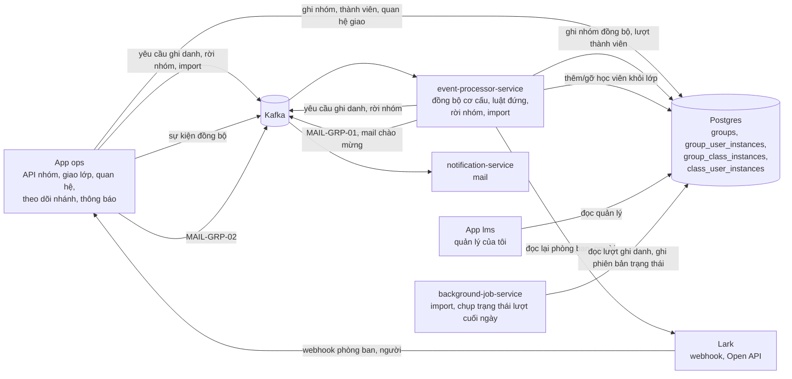
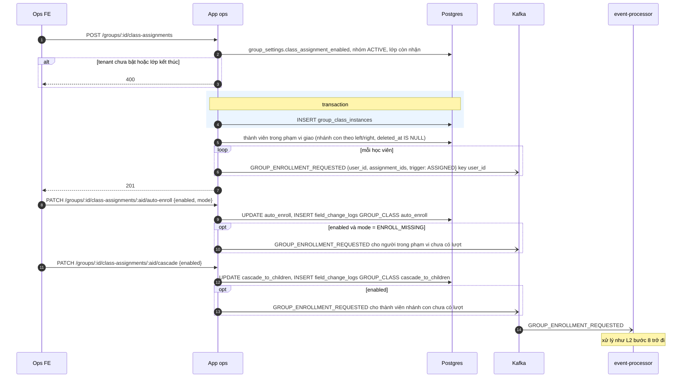
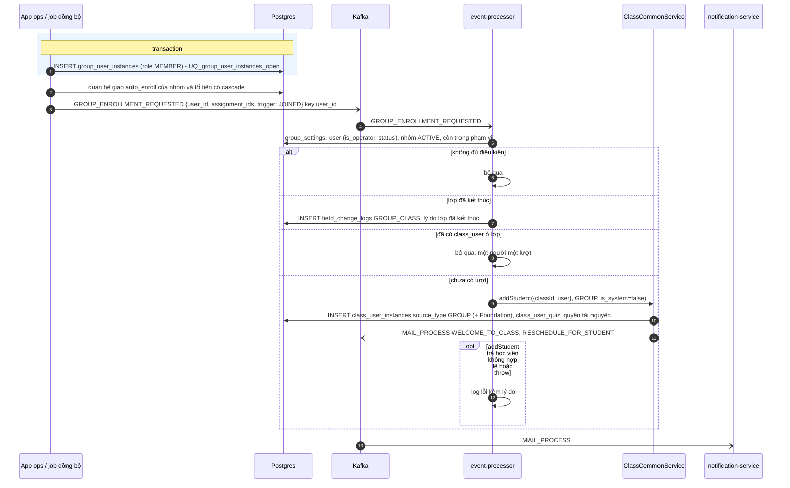
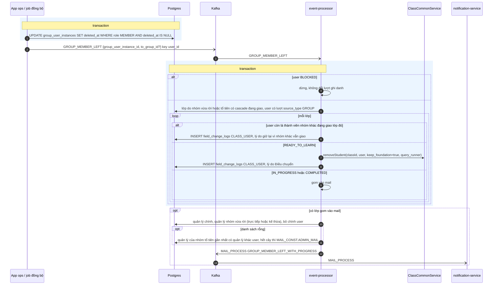
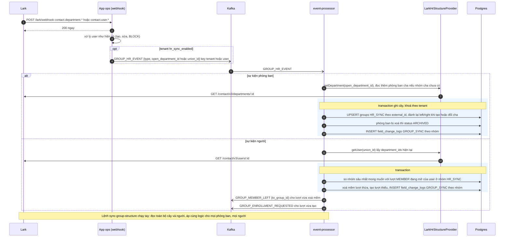
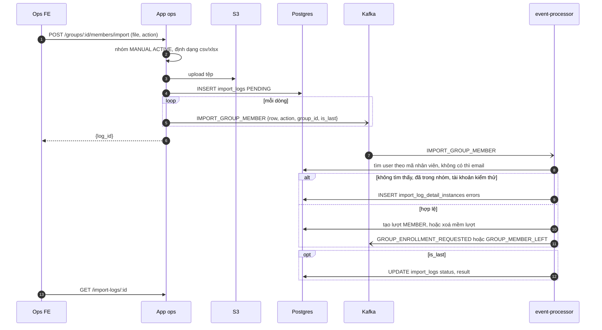
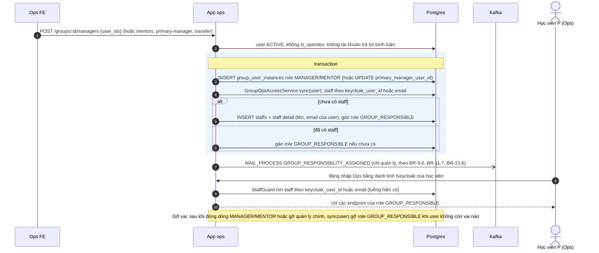
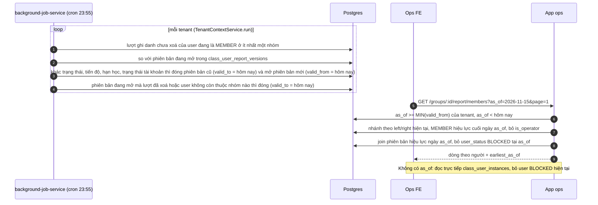

# Technical Design

## Tóm tắt

Thêm chức năng Nhóm học viên: cây nhóm nhiều cấp không giới hạn số cấp ở Ops, nguồn tự tạo hoặc đồng bộ Lark, nhật ký vào ra nhóm, giao lớp cho nhóm bằng luật đứng, quan hệ quản lý và mentor bằng tài khoản học viên, màn theo dõi nhánh, báo cáo theo nhóm ở hiện tại và mốc quá khứ, và thông báo gửi theo nhóm. Học viên làm quản lý, mentor vào Ops qua một staff hạn chế hệ thống tự tạo. Luật đứng và xử lý rời nhóm chạy nền qua Kafka, mỗi message một học viên, và dùng lại luồng thêm/gỡ học viên khỏi lớp hiện có với nguồn mới `GROUP`. Change xoá hẳn nhóm học viên cũ, phòng ban và đơn vị kinh doanh của nhân sự (BREAKING, team đã quyết), rồi tạo bảng `groups` mới cùng tên. Cơ chế ghi danh, mail chào mừng, Foundation khi ghi danh, tiến độ học, luồng đăng nhập Ops, luồng chấm bài, phân quyền Casbin và SIS dashboard giữ nguyên.

## Bối cảnh và mục tiêu

**Hiện trạng:** Học viên vào lớp qua thêm tay, import hoặc các luồng bán hàng; mỗi lượt ghi danh có một `source_type`, không có ràng buộc unique `(user, class)`. Nhóm học viên cũ là danh sách phẳng chỉ dùng cho thông báo; phòng ban và đơn vị kinh doanh của nhân sự gần như không còn dùng. Đồng bộ Lark chỉ đồng bộ người (command chạy tay và webhook), bỏ qua dữ liệu phòng ban. Không có khái niệm quản lý của học viên hay phạm vi dữ liệu theo quan hệ.

**Mục tiêu:**

- Luật đứng ghi danh đúng một lượt cho mỗi người mỗi lớp, kể cả khi nhiều nhóm cùng giao và sự kiện bị gửi lại.
- Đồng bộ cơ cấu tự sửa chênh lệch, không cần ai dọn tay, và cắm được nguồn nhân sự khác.
- Phạm vi theo dõi nhánh chỉ dựa trên quan hệ quản lý, không đụng ma trận Casbin hiện có.
- Học viên làm quản lý, mentor vào Ops mà không đổi `StaffGuard`, `class_mentor_instances` và luồng chấm bài.
- Báo cáo theo mốc quá khứ chạy lại bao nhiêu lần cũng ra cùng số (`SC5`).
- Xoá sạch code và bảng của ba chức năng cũ mà không để lại FK, quyền hay DTO mồ côi.

**Ngoài phạm vi:**

- Báo cáo theo nhóm trên dashboard: `US18` chỉ làm tab Báo cáo trong chi tiết nhóm; SIS dashboard không đổi.
- Cron đồng bộ định kỳ: chỉ có lệnh đồng bộ toàn bộ chạy tay cho lần đầu và khi cần sửa lệch.
- Lịch sử cây nhóm: báo cáo quá khứ cộng dồn theo cây hiện tại.
- Chặn tự chấm bài (`BR-12.8`).
- Chuyển đổi dữ liệu nhóm cũ, phòng ban, đơn vị kinh doanh: drop.
- Sửa lỗ hổng sẵn có của luồng thêm học viên (không chặn lớp `ENDED`, không kiểm tra sức chứa, có thể trùng ở lớp Foundation).

## Khái niệm chính

| Khái niệm | Nghĩa trong thiết kế này |
| --- | --- |
| **Lượt thành viên** | Một dòng `group_user_instances`: một khoảng một user ở trong nhóm với một vai trò (`MEMBER`, `MANAGER`, `MENTOR`), từ `created_at` tới `deleted_at` (xoá mềm; trống là đang hiệu lực, vào lại thì tạo dòng mới). "Thành viên" chỉ tính dòng `MEMBER` |
| **Người phụ trách** | Tài khoản học viên có vai trò `MANAGER` hoặc `MENTOR` trong nhóm, hoặc là quản lý chính của một học viên. Một người được đồng thời là `MEMBER`, `MANAGER`, `MENTOR` của một nhóm |
| **Staff hạn chế** | Staff hệ thống tự tạo cho người phụ trách chưa có staff, cùng email và danh tính Keycloak với học viên, chỉ mang role `GROUP_RESPONSIBLE`. Là cầu để học viên đăng nhập Ops, làm mentor lớp và chấm bài qua các luồng hiện có |
| **Cây nhóm** | `parent_id` trỏ nhóm cha trực tiếp, NULL là gốc; đây là nguồn sự thật. Kèm nested set: mọi cây của một tenant dùng chung một dãy `left`/`right`, nhóm gốc nối tiếp nhau; nhánh con của G là nhóm có `left`/`right` nằm trong `left`/`right` của G, tổ tiên là nhóm bao lấy G |
| **Quan hệ giao** | Một dòng `group_class_instances`: nhóm, lớp, hai công tắc `cascade_to_children`, `auto_enroll` |
| **Phạm vi giao** | Người đang là thành viên của nhóm, hoặc của nhánh con khi `cascade_to_children` bật |
| **Nhóm nguồn** | Nhóm đang giao lớp mà học viên đang là thành viên trong phạm vi giao; tính lúc đọc, không lưu. Lượt ghi danh sinh qua nhóm có `source_type = GROUP` |
| **Yêu cầu ghi danh** | Message Kafka cho một học viên với một hoặc nhiều quan hệ giao, consumer quyết định ghi danh hay bỏ qua |
| **Nghỉ việc** | Tài khoản học viên `BLOCKED`; không lưu đánh dấu riêng |
| **Phạm vi theo dõi** | Thành viên các nhánh mà người phụ trách quản lý (trực tiếp hoặc kế thừa), cộng học viên nhận họ làm quản lý chính |
| **Phiên bản trạng thái lượt** | Một dòng `class_user_report_versions`: trạng thái, tiến độ, hạn học của một lượt ghi danh trong khoảng ngày `[valid_from, valid_to)`. Job cuối ngày chỉ mở phiên bản mới khi có thay đổi |
| **Mốc báo cáo** | Hiện tại (đọc trực tiếp) hoặc ngày T trong quá khứ: thành viên lấy từ lượt thành viên đang hiệu lực cuối ngày T, chỉ số lấy từ phiên bản trạng thái lượt hiệu lực ngày T |

## Bức tranh tổng thể

Thay đổi cơ cấu trên Lark đến qua webhook, consumer đọc lại trạng thái hiện tại từ Lark rồi áp vào. Mọi thay đổi thành viên (Ops, nhập tệp, đồng bộ) mở hoặc đóng một lượt thành viên trong transaction rồi phát message sau commit. Consumer luật đứng là nơi duy nhất sinh lượt ghi danh qua nhóm và gọi lại luồng thêm học viên hiện có, nên Foundation và mail chào mừng chạy như thêm tay. Consumer rời nhóm là nơi duy nhất tự gỡ học viên khỏi lớp và gửi `MAIL-GRP-01`. Theo dõi nhánh, quản lý kế thừa, số thành viên đều tính lúc đọc từ cây nested set và lượt thành viên. Mọi thao tác làm đổi vai người phụ trách gọi một chỗ để cấp hoặc thu role Ops của staff hạn chế trong cùng transaction. Báo cáo hiện tại đọc trực tiếp; báo cáo quá khứ đọc lượt thành viên và phiên bản trạng thái lượt do job cuối ngày ghi.

## Các quyết định cần chốt

| Quyết định | Trạng thái |
| --- | --- |
| Xoá hẳn nhóm học viên cũ, nhóm trong thông báo cũ, phòng ban và đơn vị kinh doanh của nhân sự; drop dữ liệu, không chuyển đổi | Đã chốt · team · 20/10/2026 |
| Dùng lại tên bảng `groups`, `group_user_instances` cho chức năng mới | Đã chốt · team · 20/10/2026 |
| Cây nhóm lưu `parent_id` làm nguồn sự thật, kèm nested set `left`/`right` (một dãy số chung cho cả tenant, không `tree_id`, `depth`) để đọc nhánh; mọi lần ghi cây khoá theo tenant và ghi cả `parent_id` lẫn `left`/`right` trong một transaction | Đã chốt nested set · team · 21/10/2026; thêm `parent_id`: Đã chốt · team · 23/10/2026 |
| Quản lý là user, lưu chung `group_user_instances` với cột `role`; staff đăng nhập Ops đổi sang user qua `keycloak_user_id` | Đã chốt · team · 21/10/2026 |
| Viết command sync-group-structure để đồng bộ tổ chức lần đầu hoặc khi cây phòng ban đồng bộ lỗi. Các thay đổi trên Lark: đồng bộ theo webhook: sự kiện phòng ban thay đổi và sự kiện người đổi phòng ban | Đã chốt · team · 22/10/2026 |
| Không giới hạn số cấp, bỏ `max_depth` và mã lỗi vượt cấp | Đã chốt · PO (PRD CR6) · 21/10/2026 |
| Quản lý, mentor là tài khoản học viên; vào Ops qua staff hạn chế tự tạo mang role `GROUP_RESPONSIBLE`, không sửa `StaffGuard`, `class_mentor_instances`, luồng chấm bài | Đã chốt · team · 23/10/2026 |
| Đưa `US18` vào change; mốc quá khứ tính chỉ số từ phiên bản trạng thái lượt do job cuối ngày ghi, không suy ngược từ tiến độ section | Đã chốt · team · 23/10/2026; PO xác nhận thay câu trả lời cũ của `BR-18.2`: Chờ chốt |

<!-- Phần B: chi tiết thực thi. -->
## Luồng xử lý

### L1. Giao lớp và bật công tắc (đầu việc 9, 10)

### L2. Thành viên vào nhóm và luật đứng (đầu việc 7, 10, 11)

### L3. Rời nhóm (đầu việc 7, 12)

### L4. Đồng bộ cơ cấu từ Lark qua webhook (đầu việc 16)

### L5. Nhập tệp thành viên (đầu việc 8)

### L6. Gán người phụ trách và quyền vào Ops (đầu việc 13, 18)

### L7. Báo cáo nhóm (đầu việc 19)

## Pattern áp dụng

### Design pattern

| Pattern | Áp dụng cho | Interface / class | Đầu việc |
| --- | --- | --- | --- |
| G5 Adapter | Nguồn cơ cấu nhân sự | `HrStructureProvider`: `LarkHrStructureProvider` | 16 |
| G6 Event Handler | Consumer của nhóm | `KafkaEventHandler`: `GroupHrEventHandler`, `GroupEnrollmentRequestedHandler`, `GroupMemberLeftHandler` | 10, 12, 16 |
| G3 Template Method | Nhập tệp thành viên | `BaseImportService`: `ImportGroupMemberService` | 8 |
| G9 Repository | Truy vấn cây, nhánh con, thành viên và người phụ trách | `GroupRepository`, `GroupUserInstanceRepository` | 4, 5 |
| G8 Facade | Điểm vào duy nhất để mở/đóng lượt thành viên cho Ops, import, đồng bộ | `GroupMembershipService` | 7 |
| G8 Facade | Điểm vào duy nhất cấp/thu quyền Ops của người phụ trách | `GroupOpsAccessService` | 13, 18 |

### Pattern kỹ thuật

| Pattern | Đầu việc | Ghi chú |
| --- | --- | --- |
| T1 Transaction tham gia được transaction của caller | 7, 11, 12, 16 | `GroupMembershipService`, `removeStudent` nhận `query_runner` |
| T2 Xử lý bất đồng bộ qua Kafka | 7, 9, 10, 12, 16 | Phát sau commit, key `user_id` |
| T4 Exception nghiệp vụ có mã lỗi | 6–17 | `libs/exceptions/src/lib/group` |
| T7 Phân trang | 6, 7, 14, 17 | |
| **Mới**: Nested set có khoá theo tenant | 4, 6, 16 | `left`/`right` dùng chung cho cả tenant; mọi lần ghi cây lấy `pg_advisory_xact_lock` theo `tenant_id` rồi mới đọc và đánh số |
| **Mới**: Lượt thành viên xoá mềm làm nhật ký | 4, 7, 19 | Vào nhóm tạo dòng, rời nhóm đặt `deleted_at`, vào lại tạo dòng mới; nhật ký và báo cáo quá khứ đọc cả dòng đã xoá mềm |
| **Mới**: Phiên bản theo khoảng ngày hiệu lực | 4, 19 | `valid_from`/`valid_to` kiểu ngày, chỉ mở phiên bản khi giá trị đổi; đọc tại ngày T là `valid_from <= T AND (valid_to IS NULL OR valid_to > T)` |

## Đầu việc

1. **Migration xoá chức năng cũ**: drop theo thứ tự `notification_group_instances` → `group_user_instances` → `groups` → `department_staff_position_instances` → FK/index/cột `staffs.department_id` → `departments` → `staff_business_unit_management` → `business_units` + 2 enum; xoá `casbin_rule` gán role với quyền `gr_get_groups`, `gr_create_group`, `gr_edit_group`, `gr_remove_group` — `libs/database/migrations`
   - `down` chỉ tạo lại schema rỗng, không khôi phục dữ liệu cũ; `down()` của các migration RLS cũ chạm bảng đã drop sẽ lỗi nếu revert qua mốc này
2. **Gỡ code nhóm cũ và nhóm trong thông báo cũ**: xoá `apps/ops/src/groups` cũ, `libs/modules/src/lib/group`, repository/entity `group`, `group-user-instances`, `notification-group-instances`, DTO `group.dto.ts`, exception, mã lỗi `GROUP_NOT_FOUND`, đăng ký ở `app.module`, `share.module`, `entity-list`, `repository.list`, barrel; quan hệ ở `user.entity`, `notification.entity`; tag `gr_create_group` ở `users.controller`
3. **Gỡ phòng ban và đơn vị kinh doanh khỏi nhân sự**: xoá `apps/ops/src/department`, `libs/modules/src/lib/department`, entity/repo/DTO/exception/constant phòng ban và đơn vị kinh doanh; sửa `staffs.service` (bỏ đổi phòng ban, `position_levels` chỉ kiểm tra vị trí và cấp tồn tại), `staff.service` (search, gán cơ sở, tạo nhân sự), `staff-position.service` (bỏ phòng ban ở list/detail/create/update/delete), `import-staff`, `import-staff-position`, `staff-facility` (bỏ `department_ids`), quan hệ ở `staff`, `staff-position`, `course-category`, `subject`, `feature-section`
   - FE đang gọi `/departments` ở form nhân sự và form support group, phải đổi cùng đợt
4. **Migration, entity, repository nhóm mới**: tạo 6 bảng theo [design.dbml](design.dbml) kèm RLS (bảng gốc theo `tenant_id`, bảng con EXISTS qua bảng cha), partial unique index, index `(tenant_id, left, right)`; thêm `class_mentor_instances.source_type` mặc định `MANUAL`, `users.primary_manager_user_id` kèm index; cập nhật comment `source_type`; seed `group_settings` cho tenant hiện có; seed role `GROUP_RESPONSIBLE` cho mọi tenant cùng `casbin_rule` cho các endpoint theo dõi nhánh và chấm bài — `libs/database`
   - `GroupRepository` (tổ tiên, nhánh con, đường dẫn), `GroupUserInstanceRepository` (thành viên và người phụ trách đang hiệu lực, nhật ký UNION vào/ra từ `created_at`/`deleted_at`, kể cả dòng đã xoá mềm)
5. **Nền dùng chung**: enum nguồn/trạng thái/lý do/action, topic `GROUP_HR_EVENT`, `GROUP_ENROLLMENT_REQUESTED`, `GROUP_MEMBER_LEFT`, `IMPORT_GROUP_MEMBER`, `MAIL_LIST` `GROUP_MEMBER_LEFT_WITH_PROGRESS`, `GROUP_RESPONSIBILITY_ASSIGNED` + 2 template mjml, `CLASS_USER_SOURCE_TYPE.GROUP`, exception nhóm, `GroupSettingsService` (đọc/tạo lười, cache theo tenant), `GroupScopeService` (phạm vi giao, nhánh con, loại tài khoản kiểm thử và `BLOCKED`), `GroupAssigneeValidator` (tài khoản học viên hợp lệ để làm người phụ trách) — `libs/constants`, `libs/exceptions`, `libs/interface`, `libs/modules/src/lib/group`
6. **API cây nhóm**: tạo, sửa, đổi cha + xem trước, lưu trữ/khôi phục + xem trước, xoá, cây theo cấp, bảng, tìm kiếm kèm đường dẫn, danh sách chọn, chi tiết kèm thao tác được phép — `apps/ops/src/groups`, `GroupStructureService`
   - `GroupTreeService` là nơi duy nhất ghi `parent_id`, `left`, `right`: thêm nút, di chuyển nhánh, xoá nút, tìm cha, con trực tiếp, tổ tiên, nhánh con, tính cấp; mỗi thao tác ghi lấy khoá theo tenant trong transaction của caller. Chi tiết ở [group-tree.md](group-tree.md)
   - Đổi cha: chặn khi nhóm đích nằm trong khoảng `left`/`right` của nhóm đang chuyển, đánh lại `left`/`right` của nhánh và các nhóm bị dịch số, ghi `field_change_logs` `GROUP` / `parent_id`; không kiểm tra số cấp
   - Lưu trữ lan theo khoảng `left`/`right`; xoá chỉ khi không có `group_user_instances` vai trò `MEMBER`, `group_class_instances` (kể cả đã xoá mềm), nhóm con
   - Chi tiết nhóm đồng bộ: thời điểm lấy từ dòng `field_change_logs` `GROUP_SYNC` mới nhất của nhóm đó, số thành viên là số hiện tại
   - `parent_id` là nguồn sự thật: cây lệch `left`/`right` thì lệnh `repair-group-tree` đánh lại số từ `parent_id`, không cần sửa tay; khoá cây là khoá cả tenant nên giữ transaction ghi cây ngắn
   - Đọc nhóm cha, nhóm con trực tiếp, nhóm gốc theo `parent_id`; đọc nhánh con, tổ tiên, đường dẫn theo `left`/`right`
7. **Thành viên và nhật ký**: danh sách thành viên (trực tiếp/nhánh con, ẩn `BLOCKED`), tìm ứng viên, thêm/gỡ + xem trước gỡ, nhật ký thành viên — `GroupMembershipService` (G8), `GroupMemberController`
   - Mở/đóng lượt `MEMBER` nhận `query_runner`, phát message sau commit, key `user_id`
   - Nhật ký thành viên đọc từ `group_user_instances` vai trò `MEMBER`, kể cả dòng đã xoá mềm: `created_at` là vào, `deleted_at` là ra; không có lý do và người thao tác
8. **Nhập tệp thành viên**: `ImportGroupMemberService` (G3) theo khung import hiện có, consumer `IMPORT_GROUP_MEMBER`, API tải tệp mẫu `.xlsx` và upload — `libs/modules/src/lib/import`, `apps/ops/src/groups`
   - `import_logs` hiện không có `tenant_id`; nhập tệp nhóm dùng chung rủi ro này
9. **API giao nội dung**: danh sách lớp để giao, xem trước, giao, danh sách lớp đã giao, đổi `auto_enroll` + xem trước, đổi `cascade_to_children`, gỡ lớp — `GroupAssignmentService`
   - Chặn khi `class_assignment_enabled` tắt; phát yêu cầu ghi danh theo L1
   - Lớp còn nhận học viên: `status` là `DRAFT` hoặc `PUBLIC`, lớp `FIXED` thì `finished_at` chưa qua (chọn tạm, chờ PO trong proposal)
10. **Consumer luật đứng**: `GroupEnrollmentRequestedHandler` (G6) đăng ký ở `apps/event-processor-service/src/app/app.controller.ts`, `GroupEnrollmentService` kiểm tra điều kiện, gọi `addStudent` với `source_type = GROUP` và ghi nhật ký — `libs/modules/src/lib/group`
    - Kiểm tra lượt tồn tại trước khi gọi `addStudent`; bắt lỗi từ chiến lược Foundation
    - Không thêm unique `(user_id, class_id)` vì dữ liệu cũ có thể đã trùng; còn khe race hiếm với thêm tay đồng thời qua Ops
11. **Sửa luồng Lớp**: `addStudent` gặp lượt cùng lớp có `source_type = GROUP` thì đổi sang `MANUAL` và coi là thành công; `removeStudent` thêm tuỳ chọn không gỡ Foundation; danh sách học viên thêm sức chứa, số hiện có, cờ vượt, nhóm nguồn từng lượt (tính lúc đọc: nhóm học viên đang là thành viên và đang giao lớp); danh sách mentor thêm nhóm phụ trách, `source_type`; `updateClassMentors` thêm tay một mentor đang có nguồn `GROUP` thì đổi sang `MANUAL` — `libs/modules/src/lib/class/class.service.ts`, `apps/ops/src/class`
12. **Consumer rời nhóm và MAIL-GRP-01**: `GroupMemberLeftHandler` (G6), `GroupLeaveService` theo L3, chọn người nhận mail — `libs/modules/src/lib/group`
    - Nhóm khác còn giao tính từ `group_user_instances` vai trò `MEMBER` và `group_class_instances`; gỡ lớp trong cùng transaction; mail sau commit; không chống trùng nên message bị gửi lại có thể gửi `MAIL-GRP-01` lần hai
    - Không lưu lý do rời: đồng bộ điều chuyển gửi kèm `to_group_id` trong message để `MAIL-GRP-01` ghi được nhóm mới; nghỉ việc nhận ra qua tài khoản `BLOCKED`
    - Người nhận theo `BR-20.2`–`BR-20.4`, `BR-20.8`: quản lý chính ở `to`, quản lý nhóm vừa rời ở `cc`; không quản lý chính thì quản lý nhóm vừa rời ở `to`; bỏ chính user rời nhóm khỏi mọi dòng; rỗng thì đi ngược `findAncestors` lấy nhóm gần nhất có quản lý khác user; hết cây thì `MAIL_CONST.ADMIN_MAIL`
13. **Quan hệ người**: gán/gỡ quản lý và mentor nhóm, người phụ trách kèm kế thừa, cờ và bộ lọc nhóm trống quản lý, quản lý chính trên hồ sơ (`/users/:id/primary-manager`), nhóm và quản lý trên hồ sơ học viên, khối đang phụ trách và chuyển phụ trách trên hồ sơ học viên, `MAIL-GRP-02` — `GroupRelationService`, `GroupManagerResolver`
    - Quản lý, mentor là dòng `group_user_instances` vai trò `MANAGER`/`MENTOR`; gán được user `ACTIVE`, không `is_operator`, không phải tài khoản trả lời bình luận (cờ chờ Dev xác minh, ứng viên `is_super_student`); API Ops nhận và trả `user_id`
    - Gán, gỡ vai `MANAGER`/`MENTOR`, gán/gỡ quản lý chính, chuyển phụ trách đều gọi `GroupOpsAccessService.sync` cho các user bị đổi vai trong cùng transaction (L6)
    - Gán vai mới không đụng dòng `MEMBER` của cùng user; gỡ vai `MANAGER`/`MENTOR` không phát `GROUP_MEMBER_LEFT`
    - Mentor nhóm vào lớp khi giao lớp và khi gán mentor vào nhóm đang có quan hệ giao: lấy staff của user qua `GroupOpsAccessService.ensureStaff`, thêm `class_mentor_instances` (`source_type = GROUP`) nếu chưa có; gỡ mentor khỏi nhóm hoặc gỡ lớp khỏi nhóm thì xoá mentor khỏi lớp khi `source_type = GROUP` và không còn nhóm nào khác của mentor đó giao lớp
    - Nhóm phụ trách trong danh sách mentor của lớp tính lúc đọc: các nhóm mentor có vai trò `MENTOR` và đang giao lớp đó
    - Khối đang phụ trách và chuyển phụ trách đọc, ghi theo `user_id` của hồ sơ học viên (`/users/:id/...`)
    - Quản lý chính ghi vào `users.primary_manager_user_id`; gán, thay, gỡ ghi `field_change_logs` `USER` / `primary_manager_user_id`; chuyển phụ trách ghi `USER` / `responsibility` kèm danh sách nhóm ở `metadata`
14. **Theo dõi nhánh**: danh sách người trong phạm vi kèm số khoá quá hạn/đang học/hoàn thành và lần học gần nhất, nhóm để lọc, dữ liệu học của một người trong phạm vi — `GroupTrackingService`, `apps/ops/src/groups`
    - Staff đang đăng nhập đổi sang user qua `keycloak_user_id`, không khớp thì theo email; phạm vi tính theo vai trò `MANAGER` (trực tiếp và kế thừa) và quản lý chính của user đó
    - Endpoint theo dõi nhánh thuộc role `GROUP_RESPONSIBLE` và các role vận hành được cấp `group_tracking`
15. **Quản lý của tôi (lms)**: `GET /users/me/managers` — `apps/lms/src/users`, dùng `GroupManagerResolver`
16. **Đồng bộ cơ cấu qua webhook**: `HrStructureProvider` + `LarkHrStructureProvider` (G5; thêm đọc một phòng ban, một người, toàn bộ cây; giãn cách và retry 429 ở `lark.service`); `LarkWebhookService` route thêm `contact.department.created_v3`/`updated_v3`/`deleted_v3`, và sau khi xử lý user như hiện có thì phát `GROUP_HR_EVENT` nếu tenant bật `hr_sync_enabled`; consumer `GroupHrEventHandler` (G6) và `GroupHrSyncService` theo L4; command `sync-group-structure` ở `apps/event-processor-service/src/commanders` đồng bộ toàn bộ — `apps/ops/src/lark`, `libs/modules/src/lib/group`
    - Sự kiện chỉ là tín hiệu: luôn đọc lại phòng ban hoặc người từ Lark rồi so với DB, nên nhận trùng hay sai thứ tự đều ra đúng trạng thái hiện tại; key Kafka là `tenant_id` cho sự kiện phòng ban (tuần tự với khoá cây) và `user_id` cho sự kiện người
    - Lark app phải bật subscribe sự kiện phòng ban và quyền đọc phòng ban (việc cấu hình phía Lark); sự kiện bị lỡ chỉ sửa được bằng lệnh đồng bộ toàn bộ; lệnh phải bọc tenant context (`TenantContextService.run`), lần đầu khoảng 55 request Lark tuần tự
17. **Thông báo theo nhóm mới**: tạo/sửa thông báo nhận id nhóm mới, tính người nhận bằng `GroupScopeService`, lưu `notification_groups`, sửa `select-groups`, chi tiết, bộ lọc danh sách — `libs/modules/src/lib/notification`, `apps/ops/src/notifications`
18. **Quyền vào Ops cho người phụ trách**: `GroupOpsAccessService` (G8) với `ensureStaff(user)` và `sync(user)` theo L6; role `GROUP_RESPONSIBLE` — `libs/modules/src/lib/group`, `libs/modules/src/lib/staff`
    - `ensureStaff`: tìm staff cùng tenant theo `keycloak_user_id` của user, không có thì theo email; chưa có thì tạo staff `ACTIVE` kèm detail (tên, email của user) và `keycloak_user_id` nếu user đã có, để `OpsAuthService.resolveStaff` khớp được ở lần đăng nhập đầu
    - `sync`: user còn vai `MANAGER`/`MENTOR` đang hiệu lực hoặc là quản lý chính của ai thì bảo đảm staff có role `GROUP_RESPONSIBLE`; không còn thì gỡ role này, không đụng role khác của staff
    - Role chỉ mở endpoint theo dõi nhánh (đầu việc 14) và endpoint chấm bài hiện có; màn chấm bài phải tự lọc theo lớp staff là mentor ở `class_mentor_instances`. Dev kiểm luồng chấm hiện có đã lọc theo mentor chưa (giả định A4 của PRD); chưa thì phải thêm lọc, phạm vi lớn hơn
    - Tự chấm (`BR-12.8`): không thêm điều kiện chặn; bài của chính mentor nằm trong danh sách chấm như bài khác
    - Client Keycloak Ops phải cho danh tính học viên đăng nhập (cùng realm); cấu hình phía Keycloak
19. **Báo cáo nhóm**: job chụp phiên bản trạng thái lượt và ba API báo cáo theo L7 — `GroupReportService`, `apps/ops/src/groups`, `apps/background-job-service`
    - Job `@Cron` lúc 23:55 giờ `Asia/Ho_Chi_Minh` ở `background-job-service`, lặp tenant bằng `TenantContextService.run`; mỗi tenant một transaction theo lô user; chạy lại trong ngày không mở phiên bản trùng (so giá trị trước khi ghi)
    - Phiên bản gồm `status`, `completed_sections`, `total_sections` (từ `learning_progress`), `finished_at`, `user_status`; tiến độ = `completed_sections / total_sections`
    - Ngày sớm nhất chọn được là `MIN(valid_from)` của tenant; mốc phải nhỏ hơn hôm nay vì phiên bản của hôm nay chỉ có sau 23:55
    - Công thức chỉ số theo spec `group/report`; danh sách theo nhóm con tính từ con trực tiếp (`findChildren`) rồi cộng dồn nhánh của từng con
    - Job lỡ một ngày thì phiên bản của ngày trước kéo dài sang ngày đó, số liệu ngày lỡ lệch tối đa một ngày; log và cảnh báo khi job lỗi

## API

### API mới

App ops, prefix `/api/v1`, guard `StaffGuard`, `security.group` là `group_management` trừ khi ghi khác, `tags: []`.

| Method | Path | App | Controller#method | Guard / operationId | Request DTO | Response | Mã lỗi |
| --- | --- | --- | --- | --- | --- | --- | --- |
| POST | `/groups` | ops | `GroupController#create` | `create_group` | `CreateGroupDto` | `GroupDetailDto` | `GROUP_CODE_DUPLICATED`, `GROUP_PARENT_INVALID` |
| PUT | `/groups/:id` | ops | `GroupController#update` | `update_group` | `UpdateGroupDto` (name, description, parent_id) | `GroupDetailDto` | `GROUP_SYNCED_READ_ONLY`, `GROUP_CODE_IMMUTABLE`, `GROUP_MOVE_INTO_DESCENDANT` |
| GET | `/groups/:id/move-preview` | ops | `GroupController#movePreview` | `preview_move_group` | `target_parent_id` | số nhóm con, số người, cha cũ/mới, hợp lệ, lý do | `GROUP_NOT_FOUND` |
| GET | `/groups/:id/archive-preview` | ops | `GroupController#archivePreview` | `preview_archive_group` | — | số thành viên, số lớp đang giao, số nhóm | `GROUP_NOT_FOUND` |
| POST | `/groups/:id/archive` | ops | `GroupController#archive` | `archive_group` | — | — | `GROUP_SYNCED_READ_ONLY`, `GROUP_ALREADY_ARCHIVED` |
| POST | `/groups/:id/restore` | ops | `GroupController#restore` | `restore_group` | — | — | `GROUP_NOT_ARCHIVED` |
| DELETE | `/groups/:id` | ops | `GroupController#remove` | `delete_group` | — | — | `GROUP_HAS_HISTORY`, `GROUP_HAS_CHILDREN`, `GROUP_SYNCED_READ_ONLY` |
| GET | `/groups/tree` | ops | `GroupController#tree` | `get_group_tree` | `parent_id?`, `include_archived?` | nhóm một cấp | — |
| GET | `/groups` | ops | `GroupController#list` | `get_groups` | `GroupListQueryDto` (source, level, status, manager_id, no_manager, sort, page) | `PaginationResponseDto` | validation |
| GET | `/groups/search` | ops | `GroupController#search` | `search_groups` | `q`, `include_archived?` | nhóm + đường dẫn | — |
| GET | `/groups/options` | ops | `GroupController#options` | `get_group_options` | `purpose` (`PARENT` \| `ANY`), `q` | nhóm `ACTIVE` + đường dẫn | — |
| GET | `/groups/:id` | ops | `GroupController#detail` | `get_group` | — | `GroupDetailDto` (nguồn, đồng bộ gần nhất, thao tác được phép) | `GROUP_NOT_FOUND` |
| GET | `/groups/:id/members` | ops | `GroupMemberController#list` | `get_group_members` | `scope` (`DIRECT` \| `SUBTREE`), `account_status`, `include_resigned`, page | `PaginationResponseDto` | — |
| GET | `/groups/:id/member-candidates` | ops | `GroupMemberController#candidates` | `get_group_member_candidates` | `q`, page (20) | học viên + `is_member` | — |
| POST | `/groups/:id/members` | ops | `GroupMemberController#add` | `add_group_members` | `{user_ids[]}` | đã thêm, đã trong nhóm | `GROUP_SYNCED_READ_ONLY`, `GROUP_ARCHIVED`, `GROUP_MEMBER_INVALID` |
| POST | `/groups/:id/members/remove-preview` | ops | `GroupMemberController#removePreview` | `preview_remove_group_members` | `{user_ids[]}` | số sẽ gỡ, số có lượt `IN_PROGRESS`/`COMPLETED` | — |
| DELETE | `/groups/:id/members` | ops | `GroupMemberController#remove` | `remove_group_members` | `{user_ids[]}` | — | `GROUP_SYNCED_READ_ONLY`, `GROUP_MEMBER_NOT_IN_GROUP` |
| GET | `/groups/member-import-template` | ops | `GroupMemberController#template` | `get_group_member_import_template` | — | tệp `.xlsx` | — |
| POST | `/groups/:id/members/import` | ops | `GroupMemberController#import` | `import_group_members` | multipart `file`, `action` (`ADD` \| `REMOVE`) | `{log_id}` | `GROUP_SYNCED_READ_ONLY`, `IMPORT_FILE_INVALID` |
| GET | `/groups/membership-logs` | ops | `GroupMemberController#logs` | `get_group_membership_logs` | `from`, `to`, `group_id`, `user_id`, `reason`, page | dòng nhật ký | validation |
| GET | `/groups/assignable-classes` | ops | `GroupAssignmentController#assignableClasses` | `get_group_assignable_classes` | `q`, page | lớp còn nhận + khoá | — |
| POST | `/groups/:id/class-assignments/preview` | ops | `GroupAssignmentController#preview` | `preview_group_class_assignment` | `{class_ids[], cascade_to_children}` | theo lớp: sẽ vào, đã có, bỏ qua + lý do | — |
| POST | `/groups/:id/class-assignments` | ops | `GroupAssignmentController#assign` | `create_group_class_assignment` | `{class_ids[], cascade_to_children, auto_enroll}` | quan hệ giao | `GROUP_CONTENT_ASSIGNMENT_DISABLED`, `GROUP_ARCHIVED`, `CLASS_NOT_ACCEPTING`, `GROUP_CLASS_ALREADY_ASSIGNED` |
| GET | `/groups/:id/class-assignments` | ops | `GroupAssignmentController#list` | `get_group_class_assignments` | page | lớp, khoá, thời hạn, số người qua nhóm, ngày giao, công tắc, `can_remove` | — |
| GET | `/groups/:id/class-assignments/:aid/auto-enroll-preview` | ops | `GroupAssignmentController#autoEnrollPreview` | `preview_group_auto_enroll` | — | số người chưa vào lớp | — |
| PATCH | `/groups/:id/class-assignments/:aid/auto-enroll` | ops | `GroupAssignmentController#toggleAutoEnroll` | `toggle_group_auto_enroll` | `{enabled, mode?: ENROLL_MISSING \| FUTURE_ONLY}` | — | validation |
| PATCH | `/groups/:id/class-assignments/:aid/cascade` | ops | `GroupAssignmentController#toggleCascade` | `toggle_group_cascade` | `{enabled}` | — | — |
| DELETE | `/groups/:id/class-assignments/:aid` | ops | `GroupAssignmentController#remove` | `delete_group_class_assignment` | — | — | `GROUP_CLASS_HAS_LEARNERS` |
| GET | `/groups/:id/responsibles` | ops | `GroupRelationController#responsibles` | `get_group_responsibles` | — | quản lý (nguồn trực tiếp/kế thừa + nhóm), mentor, `has_no_manager` | — |
| POST, DELETE | `/groups/:id/managers` | ops | `GroupRelationController#addManagers` / `removeManagers` | `add_group_managers` / `remove_group_managers` | `{user_ids[]}` | — | `GROUP_ARCHIVED`, `USER_NOT_ASSIGNABLE` |
| POST, DELETE | `/groups/:id/mentors` | ops | `GroupRelationController#addMentors` / `removeMentors` | `add_group_mentors` / `remove_group_mentors` | `{user_ids[]}` | — | `GROUP_ARCHIVED`, `USER_NOT_ASSIGNABLE` |
| GET | `/users/:id/group-relations` | ops | `GroupRelationController#userRelations` | `get_user_group_relations` | — | nhóm đang thuộc + đường dẫn, quản lý theo thứ tự chính/nhóm/kế thừa | `USER_NOT_FOUND` |
| PUT | `/users/:id/primary-manager` | ops | `GroupRelationController#setPrimaryManager` | `set_user_primary_manager` | `{manager_user_id}` | — | `USER_NOT_ASSIGNABLE` |
| DELETE | `/users/:id/primary-manager` | ops | `GroupRelationController#removePrimaryManager` | `remove_user_primary_manager` | — | — | — |
| GET | `/users/:id/group-responsibilities` | ops | `GroupRelationController#userResponsibilities` | `get_user_group_responsibilities` | — | nhóm quản lý, nhóm mentor | `USER_NOT_FOUND` |
| GET | `/users/:id/transfer-responsibilities/preview` | ops | `GroupRelationController#transferPreview` | `preview_transfer_group_responsibilities` | `to_user_id` | số nhóm, số người, người nhận | `USER_NOT_ASSIGNABLE` |
| POST | `/users/:id/transfer-responsibilities` | ops | `GroupRelationController#transfer` | `transfer_group_responsibilities` | `{to_user_id}` | — | `USER_NOT_ASSIGNABLE`, `TRANSFER_TO_SELF` |
| GET | `/groups/tracking/learners` | ops | `GroupTrackingController#learners` | `get_group_tracking_learners`, `security.group` `group_tracking` | `group_id?`, `has_overdue?`, page | dòng theo người | `GROUP_NOT_IN_SCOPE` |
| GET | `/groups/tracking/groups` | ops | `GroupTrackingController#groups` | `get_group_tracking_groups`, `group_tracking` | — | nhóm trong phạm vi | — |
| GET | `/groups/tracking/learners/:userId/learning` | ops | `GroupTrackingController#learning` | `get_group_tracking_learning`, `group_tracking` | — | lượt ghi danh và tiến độ | 403 ngoài phạm vi |
| GET | `/groups/:id/report/members` | ops | `GroupReportController#members` | `get_group_report_members`, `group_report` | `as_of?` (ngày), page | dòng theo người + `earliest_as_of` | `GROUP_NOT_FOUND`, `GROUP_REPORT_DATE_OUT_OF_RANGE` |
| GET | `/groups/:id/report/children` | ops | `GroupReportController#children` | `get_group_report_children`, `group_report` | `as_of?`, page | dòng theo nhóm con trực tiếp, `has_children` | `GROUP_NOT_FOUND`, `GROUP_REPORT_DATE_OUT_OF_RANGE` |
| GET | `/groups/:id/report/courses` | ops | `GroupReportController#courses` | `get_group_report_courses`, `group_report` | `as_of?`, page | dòng theo lớp kèm khoá | `GROUP_NOT_FOUND`, `GROUP_REPORT_DATE_OUT_OF_RANGE` |
| GET, PUT | `/groups/settings` | ops | `GroupSettingsController#get` / `update` | `get_group_settings` / `update_group_settings`, `group_settings` | `{hr_sync_enabled, class_assignment_enabled}` | cấu hình | validation |
| GET | `/users/me/managers` | lms | `UsersController#myManagers` | `LmsGuard` | — | ảnh, họ tên, email, loại | 401 |

### API thay đổi

| Method | Path | App | Thay đổi request | Thay đổi response | Tương thích ngược |
| --- | --- | --- | --- | --- | --- |
| * | `/groups/*` cũ | ops | Thay bằng API nhóm mới | — | **BREAKING** |
| * | `/departments/*` | ops | Xoá | — | **BREAKING** |
| POST, PUT | `/staffs`, `/staffs/:id` | ops | Bỏ `department_id`; `position_levels` không cần phòng ban | `GET /staffs/:id`, `/me` bỏ `department` | **BREAKING** |
| * | `/staff-positions*` | ops | Bỏ `department_ids`, `department_type` | Bỏ `departments` | **BREAKING** |
| POST | import nhân sự, import vị trí | ops | Tệp bỏ cột phòng ban | — | **BREAKING** |
| GET | `/staff-facility*` | ops | Bỏ `department_ids` | — | **BREAKING** |
| POST, PUT | `/notifications`, `/notifications/:id` | ops | `groups` là id nhóm mới | — | **BREAKING** |
| GET | `/notifications/:id/select-groups` | ops | Bỏ lọc ngày theo nhóm cũ | Nhóm mới + đường dẫn tên từ gốc, `members` tính cả nhánh con, `is_selected` | **BREAKING** |
| GET | `/notifications/:id`, `/notifications` | ops | `filter_groups` là id nhóm mới | Nhóm đã chọn gồm id, tên, trạng thái | **BREAKING** |
| GET | `/class/:id/students` | ops | — | `meta` thêm `capacity`, `current_count`, `is_over_capacity`; mỗi học viên thêm `source_groups` | Có |
| GET | `/class/:id/mentors` | ops | — | Mỗi mentor thêm `source_groups`, `source_type` | Có |
| POST | `/class/students` | ops | — | Học viên đã ở lớp chỉ qua nhóm được coi là thành công, nguồn đổi sang thêm tay | Có (trước đây báo lỗi) |

## Database

Chi tiết cột, index, quan hệ: [design.dbml](design.dbml)

| Bảng | Mới / sửa | Thay đổi chính | tenant_id + RLS |
| --- | --- | --- | --- |
| `notification_group_instances`, `group_user_instances`, `groups` (cũ) | Drop | Xoá cùng dữ liệu | — |
| `department_staff_position_instances`, `departments`, `staff_business_unit_management`, `business_units` | Drop | Xoá cùng dữ liệu và 2 enum | — |
| `staffs` | Sửa | Drop `department_id`, FK, index | Có sẵn |
| `group_settings` | Mới | Cấu hình theo tenant, cờ hai lần bật; không có số cấp | `tenant_id` |
| `groups` | Mới | Cây nhóm: `parent_id` (nguồn sự thật) và nested set `left`, `right` (để đọc nhánh), nguồn, trạng thái, `external_id` của nhóm đồng bộ | `tenant_id` |
| `group_user_instances` | Mới (cùng tên bảng cũ đã drop) | Lượt thành viên, quản lý, mentor; rời nhóm là xoá mềm; cột `role` | Qua `groups` |
| `group_class_instances` | Mới | Quan hệ giao + hai công tắc | Qua `groups` |
| `notification_groups` | Mới | Thông báo ↔ nhóm mới | Qua `notifications` |
| `class_user_report_versions` | Mới | Phiên bản trạng thái lượt ghi danh theo khoảng ngày cho báo cáo quá khứ | `tenant_id` |
| `staffs` và bảng gán role hiện có | Dữ liệu | Staff hạn chế tự tạo và role `GROUP_RESPONSIBLE` | Có sẵn |
| `class_mentor_instances` | Sửa | Thêm `source_type` (`MANUAL` \| `GROUP`); mentor nhóm là staff hạn chế của học viên | Có sẵn |
| `class_user_instances` | Sửa | Chỉ thêm giá trị `GROUP` cho `source_type` | Có sẵn |
| `users` | Sửa | Thêm `primary_manager_user_id` (quản lý chính) + index | Có sẵn |

| Migration | Up | Down |
| --- | --- | --- |
| `1792000000000-drop-legacy-group-department-business-unit.ts` | Drop 8 bảng, cột `staffs.department_id`, 2 enum theo thứ tự FK; xoá `casbin_rule` của quyền nhóm cũ | Tạo lại schema rỗng của các bảng, cột, enum, FK, RLS đã drop |
| `1792000001000-create-group-tables.ts` | Tạo 6 bảng mới, index, FK, RLS; thêm `class_mentor_instances.source_type`, `users.primary_manager_user_id`; comment `source_type` | Drop 6 bảng, cột `class_mentor_instances.source_type`, `primary_manager_user_id`, khôi phục comment |
| `1792000002000-seed-group-settings.ts` | Insert `group_settings` mặc định cho mọi tenant, hai cờ tắt, `ON CONFLICT DO NOTHING` | Xoá các dòng đã seed |
| `1792000003000-seed-group-responsible-role.ts` | Insert role `GROUP_RESPONSIBLE` cho mọi tenant và `casbin_rule` cho endpoint theo dõi nhánh, chấm bài | Xoá role, gán role và `casbin_rule` đã seed |

## Nhật ký thay đổi sau khi chốt

| Ngày | Phạm vi (migration / WP) | Thay đổi | Lý do | Ai quyết | Mục phần A đã cập nhật |
| --- | --- | --- | --- | --- | --- |
| 23/10/2026 | Migration `1792000001000`; đầu việc 4, 6, 16 | Thêm `groups.parent_id` làm nguồn sự thật của cây, `left`/`right` thành dữ liệu suy ra, sửa được bằng `repair-group-tree` | Cây tự tạo lệch số thì không dựng lại được nếu chỉ có `left`/`right` | Team | Khái niệm, quyết định |
| 23/10/2026 | Migration `1792000001000`, `1792000003000`; đầu việc 4, 6, 12, 13, 14, 18, 19 | Theo PRD v0.6 (CR6): bỏ số cấp; quản lý, mentor là tài khoản học viên vào Ops qua staff hạn chế; `MAIL-GRP-01` không gửi chính người rời nhóm; khối đang phụ trách sang hồ sơ học viên; thêm báo cáo nhóm (`US18`) với phiên bản trạng thái lượt | PRD v0.6 duyệt 22/10/2026 | PO (CR6), team | Tóm tắt, mục tiêu, ngoài phạm vi, khái niệm, bức tranh, quyết định, L3, L6, L7 |

