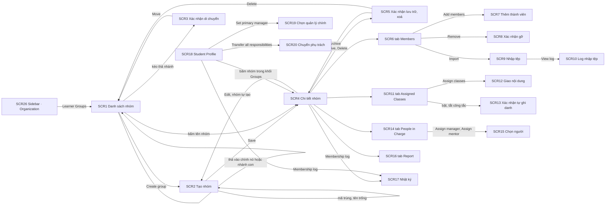
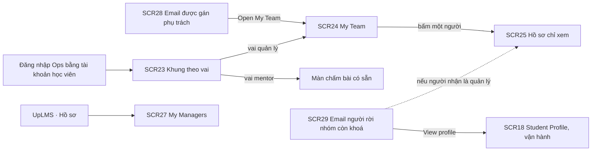

# UX Design: Nhóm học viên (Group)

## 1. Danh sách màn
Portal UpLMS Ops trừ khi ghi khác. Ops thiết kế ở desktop 1920; SCR24 và SCR25 thêm bản 375. UpLMS thiết kế ở 1920 và 375. Chữ giao diện tiếng Anh; bản tiếng Anh của chuỗi trong PRD do Design dịch, giữ nguyên ý.

| SCR | Tên màn | Mới hoặc sửa | US | Figma |
|---|---|---|---|---|
| SCR1 | Danh sách nhóm, dạng Cây và Bảng (page, Organization › Learner Groups) | Mới | US6 xem danh sách nhóm · US2 di chuyển nhánh · US5 nhãn nhóm đồng bộ · US13 nhãn chưa có quản lý · US14 ẩn nhóm lưu trữ |  |
| SCR2 | Tạo nhóm, sửa nhóm (modal) | Mới | US1 tạo và sửa nhóm · US2 đổi nhóm cha |  |
| SCR3 | Xác nhận di chuyển nhánh (hộp xác nhận) | Mới | US2 di chuyển nhánh |  |
| SCR4 | Chi tiết nhóm: đầu trang, khối thông tin, thao tác nhóm (page, Learner Groups › tên nhóm, có bốn tab) | Mới | US1 sửa nhóm · US5 nhóm đồng bộ · US14 lưu trữ, khôi phục, xoá |  |
| SCR5 | Xác nhận lưu trữ nhóm, xác nhận xoá nhóm (hộp xác nhận, hai biến thể) | Mới | US14 lưu trữ nhóm |  |
| SCR6 | Chi tiết nhóm, tab Members (tab của SCR4) | Mới | US3 thêm gỡ thủ công · US4 nhập tệp · US5 nhóm đồng bộ khoá thành viên |  |
| SCR7 | Thêm thành viên (modal lớn, cùng mẫu màn Add Student của lớp) | Mới | US3 thêm thành viên |  |
| SCR8 | Xác nhận gỡ thành viên (hộp xác nhận, hai biến thể) | Mới | US3 gỡ thành viên · US20 báo quản lý |  |
| SCR9 | Nhập tệp thành viên và kết quả (modal và hộp kết quả, cùng mẫu Import Student của lớp) | Mới | US4 thêm gỡ theo lô |  |
| SCR10 | Log nhập tệp (page, cùng mẫu View Log của lớp) | Mới | US4 xem log lỗi |  |
| SCR11 | Chi tiết nhóm, tab Assigned Classes (tab của SCR4) | Mới | US7 giao nội dung · US8 công tắc tự ghi danh |  |
| SCR12 | Giao nội dung cho nhóm (modal rộng, có khối xem trước) | Mới | US7 giao nội dung |  |
| SCR13 | Xác nhận bật, tắt tự ghi danh (hộp xác nhận, hai biến thể) | Mới | US8 bật tắt tự ghi danh |  |
| SCR14 | Chi tiết nhóm, tab People in Charge (tab của SCR4) | Mới | US9 gán quản lý · US10 kế thừa quản lý · US12 gán mentor · US13 cảnh báo trống quản lý |  |
| SCR15 | Gán quản lý, gán mentor (modal chọn nhiều người, hai chế độ) | Mới | US9 gán quản lý · US12 gán mentor |  |
| SCR16 | Chi tiết nhóm, tab Report (tab của SCR4) | Mới | US18 báo cáo theo nhóm |  |
| SCR17 | Nhật ký thay đổi thành viên (page, mở từ SCR4 hoặc SCR18 với bộ lọc chọn sẵn) | Mới | US15 tra nhật ký · US19 dấu vết tự gỡ |  |
| SCR18 | Student Profile, tab Overview (page có sẵn, User Management › Students › Student Profile) | Sửa | US10 ba loại quản lý · US11 quản lý chính · US13 chuyển phụ trách · US15 lối vào nhật ký |  |
| SCR19 | Chỉ định, thay quản lý chính (modal chọn một người) | Mới | US11 quản lý chính |  |
| SCR20 | Chuyển toàn bộ phụ trách (modal rộng: chọn người nhận, xem trước, xác nhận) | Mới | US13 chuyển phụ trách |  |
| SCR21 | Class Detail, tab Students (tab có sẵn của Class Detail) | Sửa | US7 dòng vượt sức chứa |  |
| SCR22 | Class Detail, tab Mentors (tab có sẵn của Class Detail) | Sửa | US12 mentor phụ trách nhóm, người chịu trách nhiệm chính |  |
| SCR23 | Khung UpLMS Ops cho tài khoản học viên (khung app: sidebar và header theo vai) | Sửa | US16 quản lý chỉ thấy màn theo dõi · US12 mentor chỉ thấy màn chấm bài |  |
| SCR24 | My Team, theo dõi nhánh (page, màn duy nhất của quản lý trên Ops; 1920 và 375) | Mới | US16 quản lý theo dõi nhánh |  |
| SCR25 | Hồ sơ học viên mở từ My Team (page, chỉ xem; 1920 và 375) | Mới, bản chỉ xem của SCR18 | US16 xem toàn bộ dữ liệu học của một người |  |
| SCR26 | Sidebar UpLMS Ops, mục Organization (khung app của nhân sự vận hành) | Sửa | US6 lối vào danh sách nhóm |  |
| SCR27 | UpLMS, hồ sơ học viên, khối My Managers (khối trên trang hồ sơ có sẵn của UpLMS; 1920 và 375) | Sửa | US17 học viên xem quản lý |  |
| SCR28 | Email MAIL-GRP-02, được gán phụ trách (email) | Mới | US9 · US11 · US13 email cho người được gán |  |
| SCR29 | Email MAIL-GRP-01, người rời nhóm còn khoá đang học (email) | Mới | US20 báo quản lý |  |

US19 tự gỡ khoá chưa học không có màn riêng; dấu vết hiện ở SCR17 với lý do Transferred. SCR25 dựng theo giả định ở mục 6 câu 1; SCR29 và đường dẫn của nó theo giả định ở mục 6 câu 2.

## 2. Luồng và tương tác
### Nhân sự vận hành

### Quản lý, mentor, học viên và email

### Điều hướng và hành vi theo user story
- US1, US2: tạo nhóm từ SCR1 mở SCR2; lưu xong mở SCR4 của nhóm vừa tạo. Sửa từ SCR4 mở SCR2 với mã nhóm khoá. Đổi nhóm cha trong SCR2 chạy cùng bộ kiểm tra như kéo thả và đi qua SCR3. Nhóm đồng bộ không có nút Edit, không kéo được trên cây.
- US2 kéo thả trên SCR1: chỉ ở dạng Cây. Rê qua một nhóm hợp lệ thì dòng đó có viền màu thành công; rê qua chính nó, nhánh con của nó hoặc nhóm khác nguồn thì viền màu lỗi kèm một dòng lý do cạnh con trỏ. Thả hợp lệ mở SCR3, thả không hợp lệ không làm gì.
- US3, US4: SCR6 có hai nút Add members và Import; chọn dòng thì hiện thanh thao tác Remove. Gỡ luôn đi qua SCR8; có người đang học nội dung giao qua nhóm thì SCR8 ở biến thể cảnh báo, nêu số người và việc quản lý sẽ nhận email.
- US7, US8: SCR11 liệt kê lớp đã giao, mỗi dòng có công tắc Auto-enroll. Đổi công tắc mở SCR13; xác nhận thì lưu ngay, không cần nút Save. Assign classes mở SCR12; khối xem trước cập nhật mỗi khi chọn lớp hoặc đổi công tắc Cascade to sub-groups.
- US9, US10, US12, US13: SCR14 có ba khối: Managers, Mentors, và khối kế thừa khi nhóm chưa gán quản lý. Nhóm trống quản lý có Alert cảnh báo ở đầu tab và nhãn No manager ở SCR1.
- US11, US13: trên SCR18, khối Managers có nút Set primary manager (thành Change primary manager khi đã có) và Remove primary manager; khối Responsibilities chỉ hiện khi người đó đang quản lý hoặc làm mentor của ít nhất một nhóm, có nút Transfer all responsibilities mở SCR20.
- US14: SCR4 hiện Delete khi nhóm chưa từng có thành viên và chưa từng được giao nội dung; còn lại hiện Archive và một dòng giải thích. Nhóm đang lưu trữ hiện Restore, mọi nút sửa khác ẩn.
- US15: SCR17 mở từ SCR4 với bộ lọc Group chọn sẵn, từ SCR18 với bộ lọc Person chọn sẵn; mới nhất lên đầu.
- US16: quản lý đăng nhập Ops thấy khung rút gọn SCR23, vào thẳng SCR24. Bản 375 chuyển bảng thành danh sách thẻ, mỗi thẻ một người, số khoá quá hạn nổi bật.
- US17: SCR27 là khối mới trên trang hồ sơ UpLMS, chỉ đọc.
- US18: SCR16 có ô chọn mốc (Current hoặc On a date, ngày sớm nhất là ngày bật tính năng) và Segmented chọn View by: Members, Sub-groups, Courses.
- US20: email SCR29 có đường dẫn mở hồ sơ người rời nhóm; việc gỡ khỏi lớp do nhân sự vận hành làm ở Class Detail như hiện nay (giả định, mục 6 câu 2).

### State của từng màn
| SCR | Default | Empty | Loading | Success | Error | Disabled | Permission |
|---|---|---|---|---|---|---|---|
| SCR1 | Có, cây gấp ở cấp gốc; bảng 20 dòng | Có ba trường hợp: chưa có nhóm nào (nút Create group); tìm không ra; lọc không ra | Có: tải danh sách; tải nhánh khi mở mũi tên (spinner tại dòng) | Có: thông báo sau khi di chuyển nhánh, sau khi xoá nhóm | Có: lỗi tải danh sách; lỗi tải một nhánh (thử lại tại dòng) | Có: nhóm đồng bộ không kéo được; nhóm lưu trữ chữ xám khi bật hiện | Có: chỉ có quyền xem thì ẩn Create group và tắt kéo thả |
| SCR2 | Có | Không: form luôn có trường | Có: đang lưu | Có: đóng modal, mở SCR4, thông báo đã tạo hoặc đã lưu | Có: tên trống, tên quá 255 ký tự, mô tả quá 1000 ký tự, mã trùng, lỗi lưu | Có: nút Save mờ khi thiếu trường bắt buộc; ô mã khoá khi sửa | Không: chỉ mở được khi có quyền quản lý nhóm |
| SCR3 | Có: tên nhánh, số nhóm con, số người bị ảnh hưởng, cha cũ và mới | Không: luôn có nội dung | Có: đang di chuyển | Có: đóng hộp, cây cập nhật | Có: lỗi khi di chuyển, giữ nguyên vị trí cũ | Không: chỉ mở khi thả hợp lệ | Không: chỉ mở khi có quyền |
| SCR4 | Có: nhóm tự tạo đang dùng | Không: tab bên dưới tự xử lý rỗng | Có | Có: sau lưu trữ, khôi phục | Có: lỗi tải; nhóm không tồn tại hoặc đã xoá | Có: nhóm đồng bộ ẩn Edit, Move, Delete kèm dòng giải thích; nhóm lưu trữ chỉ còn Restore; nhóm có lịch sử không có Delete | Có: chỉ xem thì ẩn mọi nút thao tác |
| SCR5 | Có: Archive nêu số thành viên, số lớp đang giao, số nhóm con bị lưu trữ theo, hệ quả; Delete nêu không khôi phục được | Không | Có | Có | Có: lỗi khi lưu trữ, xoá | Không | Không |
| SCR6 | Có: bảng thành viên, ẩn người đã nghỉ | Có: nhóm chưa có thành viên (nút Add members, Import); lọc không ra | Có | Có: sau thêm, gỡ | Có: lỗi tải; lỗi khi gỡ | Có: nhóm đồng bộ ẩn Add, Import, Remove, thay bằng dòng giải thích; nhóm lưu trữ ẩn thao tác | Có: chỉ xem thì ẩn thao tác |
| SCR7 | Có: bảng người, ô tìm theo tên, mã nhân viên, email | Có: tìm không ra | Có | Có: đóng modal, SCR6 cập nhật, thông báo đã thêm N người | Có: lỗi tải, lỗi khi thêm | Có: người đã trong nhóm hiện mờ, nhãn Already in group, không chọn được; nút Add mờ khi chưa chọn ai | Không: chỉ mở khi có quyền |
| SCR8 | Có, hai biến thể: không ai đang học; có người đang học (cảnh báo, quản lý nhận email) | Không | Có | Có | Có | Không | Không |
| SCR9 | Có: chọn hành động, tải mẫu, vùng kéo thả tệp | Không | Có: đang tải lên, đang xử lý | Có: hộp kết quả Processed N rows | Có: sai định dạng, nhiều tệp, tệp rỗng, lỗi tải lên | Có: vùng tải lên khoá khi chưa chọn hành động | Không |
| SCR10 | Có: bảng dòng lỗi, trường lỗi bôi đỏ, cột Error reason | Có: không có dòng lỗi | Có | Không: chỉ đọc | Có: lỗi tải | Không: chỉ đọc | Không |
| SCR11 | Có: bảng lớp đã giao, công tắc trên dòng | Có: nhóm chưa được giao lớp nào (nút Assign classes) | Có | Có: sau giao lớp, sau gỡ lớp, sau đổi công tắc | Có: lỗi tải; lỗi khi đổi công tắc thì công tắc quay về trạng thái cũ | Có: lớp đã có học viên từ nhóm thì không có Remove, thay bằng dòng giải thích; nhóm lưu trữ khoá công tắc và nút | Có: chỉ xem thì công tắc chỉ đọc |
| SCR12 | Có: chọn lớp, hai công tắc, khối xem trước | Có: không có lớp nào đang nhận học viên; tìm không ra | Có: tải lớp; tính lại khối xem trước | Có: đóng modal, SCR11 cập nhật | Có: lỗi tải, lỗi khi giao | Có: nút Assign mờ khi chưa chọn lớp | Không |
| SCR13 | Có, hai biến thể: bật khi có N người chưa vào lớp; tắt | Không | Có | Có | Có: lỗi lưu, công tắc quay về | Không | Không |
| SCR14 | Có: quản lý gán trực tiếp, mentor | Có ba trường hợp: chưa gán, đang kế thừa (khối kế thừa); trống quản lý (cảnh báo); chưa có mentor | Có | Có | Có | Có: nhóm lưu trữ ẩn nút gán | Có: chỉ xem thì ẩn nút gán, gỡ |
| SCR15 | Có: tìm theo tên, email, chọn nhiều | Có: tìm không ra | Có | Có | Có | Có: người đã là quản lý, mentor của nhóm hiện mờ; nút Assign mờ khi chưa chọn | Không |
| SCR16 | Có: mốc Current, View by Members | Có: nhóm chưa có thành viên hoặc chưa được giao; View by Sub-groups với nhóm không có nhóm con | Có: đang tính báo cáo, không chặn màn | Không: chỉ đọc | Có: lỗi tính báo cáo | Có: ngày trước ngày bật tính năng không chọn được | Có: chỉ xem vẫn xem được |
| SCR17 | Có | Có: lọc không ra | Có | Không: chỉ đọc | Có | Không: chỉ đọc, không sửa xoá dòng | Có: cần quyền xem nhật ký nhóm |
| SCR18 | Có: thêm ba khối Groups, Managers, Responsibilities | Có: Not in any group; chưa có quản lý; khối Responsibilities ẩn khi không phụ trách gì | Có | Có: sau chỉ định, gỡ quản lý chính, sau chuyển phụ trách | Có | Không: dữ liệu đồng bộ vẫn chỉ định được quản lý chính | Có: chỉ xem thì ẩn nút |
| SCR19 | Có | Có: tìm không ra | Có | Có | Có | Có: không chọn được chính học viên đó (giả định, PRD câu hỏi mở #12) | Không |
| SCR20 | Có: chọn người nhận, danh sách sẽ chuyển, số nhóm, số người, người nhận | Không: chỉ mở khi có phụ trách | Có | Có: thông báo đã chuyển | Có | Có: nút Transfer mờ khi chưa chọn người nhận; không chọn được chính người đang chuyển | Không |
| SCR21 | Có: thêm dòng vượt sức chứa ở đầu danh sách | Không: không đổi màn có sẵn | Không: không đổi | Không: không đổi | Không: không đổi | Không: dòng chỉ thông báo, không khoá thao tác nào | Không: không đổi |
| SCR22 | Có: thêm cột Group in charge, nhãn Main responsible | Không: không đổi | Không: không đổi | Có: sau đổi người chịu trách nhiệm chính | Không: không đổi | Không: không đổi | Không: không đổi |
| SCR23 | Có ba biến thể: chỉ quản lý; chỉ mentor; vừa quản lý vừa mentor | Không | Không: theo khung có sẵn | Không | Có: tài khoản học viên không có vai nào trên Ops thì hiện trang không có quyền | Không | Có: đây chính là màn phân quyền theo vai |
| SCR24 | Có, 1920 và 375 | Có: chưa có ai trong nhánh; lọc không ra | Có | Không: chỉ đọc | Có | Không | Có: bị thu hồi quyền quản lý khi đang xem (chờ Dev đề xuất, PRD câu hỏi mở #7) |
| SCR25 | Có, 1920 và 375 | Có: người chưa có khoá nào | Có | Không: chỉ đọc | Có: người không còn trong nhánh | Không | Có: ẩn Edit Profile, tab Setting, Security; chỉ xem dữ liệu học |
| SCR26 | Có | Không | Không | Không | Không | Không | Có: mục chỉ hiện với người có quyền xem nhóm |
| SCR27 | Có, 1920 và 375 | Có: No manager information yet | Có | Không: chỉ đọc | Có | Không | Không: học viên nào cũng xem được khối của mình |
| SCR28 | Có: một nhóm; một hồ sơ; gộp nhiều nhóm khi nhận chuyển phụ trách | Không | Không: email | Không | Không | Không | Không |
| SCR29 | Có: một khoá; nhiều khoá | Không | Không: email | Không | Không | Không | Không |

### Trường hợp biên bắt buộc
| EC | Màn | Tình huống | Cách giao diện xử lý |
|---|---|---|---|
| EC-01 | SCR1 | Kéo một nhóm vào chính nó hoặc nhánh con của nó | Viền màu lỗi, dòng lý do "Can't move a group into its own sub-group", thả không có tác dụng |
| EC-02 | SCR1 | Kéo nhóm tự tạo vào nhóm đồng bộ, hoặc nhóm đồng bộ đi đâu | Nhóm đồng bộ không có tay kéo; thả vào nhóm khác nguồn hiện viền lỗi kèm lý do khác nguồn |
| EC-03 | SCR1 | Kết quả tìm là nhóm con sâu | Kết quả hiện đường dẫn từ gốc, cắt giữa khi quá dài, đầy đủ trong tooltip |
| EC-04 | SCR1 | Cây hàng chục nhóm, tên dài | Tải theo nhánh, tên cắt một dòng kèm tooltip, số thành viên căn phải |
| EC-05 | SCR2 | Chọn nhóm cha là nhóm lưu trữ hoặc nhóm đồng bộ | Không xuất hiện trong ô chọn |
| EC-06 | SCR4 | Mở đường dẫn tới một nhóm đã bị xoá | Trang Not found kèm nút về danh sách nhóm |
| EC-07 | SCR5 | Lưu trữ nhóm cha có nhánh con | Hộp xác nhận nêu số nhóm con bị lưu trữ theo và người đang học vẫn học tiếp |
| EC-08 | SCR5 | Xoá nhóm | Chỉ hiện khi chưa có lịch sử; hộp xác nhận nói rõ không khôi phục được |
| EC-09 | SCR6, SCR8 | Gỡ nhiều người, có người đang học, có người đã nghỉ việc | Một hộp xác nhận nêu tổng số người gỡ và số người đang học; người đã nghỉ gỡ được, không đổi lượt ghi danh |
| EC-10 | SCR6 | Người thuộc nhóm con (vào gián tiếp) | Bộ lọc Direct or sub-group; người thuộc nhóm con không chọn để gỡ ở nhóm cha, vì thành viên chỉ ở nhóm sâu nhất |
| EC-11 | SCR7 | Thêm người đã ở trong nhóm | Hiện mờ, nhãn Already in group, không chọn được |
| EC-12 | SCR9 | Tệp có dòng hợp lệ và dòng lỗi ba loại | Dòng hợp lệ vẫn xử lý; hộp kết quả nêu thành công và lỗi; log ghi ba lý do riêng |
| EC-13 | SCR9 | Gỡ qua tệp người đang học | Như gỡ tay: vẫn gỡ, quản lý nhận email; hộp kết quả nêu số người đang học đã báo quản lý |
| EC-14 | SCR11 | Gỡ lớp đã có người trong nhóm học | Không có nút Remove, dòng "This class already has learners from this group and can't be removed" |
| EC-15 | SCR11 | Lớp đã giao nay đã kết thúc | Dòng lớp có nhãn Ended; công tắc Auto-enroll vẫn hiện nhưng người vào sau không được thêm (luật đứng dừng im lặng); tooltip giải thích |
| EC-16 | SCR12 | Nhóm cha không có thành viên trực tiếp, nhánh con có người, công tắc Cascade tắt | Khối xem trước ghi 0 người sẽ vào lớp và gợi ý bật Cascade to sub-groups |
| EC-17 | SCR12 | Giao cho nhóm lớn, lớp có Foundation | Khối xem trước nêu số người; giao chạy nền, modal đóng ngay, thông báo khi xong |
| EC-18 | SCR13 | Bật công tắc khi có N người chưa vào lớp | Hai lựa chọn Enroll now và Only apply to new members; N bằng 0 thì bật thẳng, không hỏi |
| EC-19 | SCR14 | Nhóm đang kế thừa, vận hành gán riêng một người | Khối kế thừa biến mất, danh sách chỉ còn người gán riêng |
| EC-20 | SCR14 | Gán quản lý cho người đang là thành viên của chính nhóm | Gán được, người đó giữ tư cách thành viên |
| EC-21 | SCR16 | Chọn ngày trước ngày bật tính năng | Không chọn được; dưới ô chọn có dòng giải thích dữ liệu bắt đầu từ ngày bật |
| EC-22 | SCR18 | Học viên có thông tin đồng bộ, không sửa được trên Ops | Nút chỉ định quản lý chính vẫn hiện, vẫn làm được |
| EC-23 | SCR20 | Người nhận đã quản lý sẵn một số nhóm | Danh sách xem trước đánh dấu nhóm người nhận đã quản lý; email chỉ liệt nhóm mới |
| EC-24 | SCR23 | Một tài khoản vừa là quản lý vừa là mentor | Sidebar có hai mục My Team và Grading; vào mặc định My Team |
| EC-25 | SCR24 | Quản lý hàng trăm người, người thuộc hai nhánh | Phân trang; một người một dòng, cột Group liệt kê các nhóm trong phạm vi của quản lý |
| EC-26 | SCR27 | Học viên vừa là thành viên vừa là quản lý nhóm mình | Không hiện chính họ, hiện quản lý cấp gần nhất (theo đề xuất ở PRD câu hỏi mở #12) |
| EC-27 | Mọi màn có danh sách người | Tài khoản kiểm thử | Không xuất hiện ở bảng, ô tìm, con số, báo cáo |

Flow prototype khung xám: `flow-prototype.html` cùng thư mục, mở bằng trình duyệt, ba luồng: Danh sách nhóm và kéo thả, Giao nội dung và công tắc tự ghi danh, Chuyển toàn bộ phụ trách.

## 3. Thành phần giao diện
Tên component theo UpBase Design System, thư viện gốc mà kit UpLMS Ops dựng lên; đối chiếu lại với kit Ops khi dựng UI.

| Vùng | Component của UI kit | Ghi chú |
|---|---|---|
| Khung app Ops | App Shell: sidebar thu gọn, Breadcrumb, Page Header | Như màn Ops hiện có |
| Cây nhóm (SCR1) | Tree, Tree Item có Holder Icon để kéo | Dòng cây cần thêm số thành viên, Tag nguồn, Tag No manager |
| Bảng nhóm, thành viên, lớp đã giao, nhật ký, báo cáo, My Team | Table, Pagination | 20 dòng mỗi trang |
| Đổi dạng xem Cây, Bảng; View by của báo cáo | Segmented | |
| Ô tìm, bộ lọc | Input / Search, Select, DatePicker (khoảng ngày cho nhật ký) | |
| Nhãn nguồn, trạng thái, Already in group, No manager, Archived, Ended, Primary | Tag / Basic, Tag / Status | Tag Success và Warning thiếu tương phản ở UpBase (đã ghi nhận ở kit UpLMS); dùng Default hoặc kèm chữ |
| Tab của chi tiết nhóm, Student Profile | Tabs / Basic | |
| Form tạo, sửa nhóm | Form / Form Item / Vertical, Input, Textarea, Select có tìm | |
| Modal và hộp xác nhận | Modal / Basic, Modal / Confirmation | |
| Công tắc Auto-enroll, Cascade, Show archived, Show former employees | Switch / Basic | |
| Nhập tệp | Upload / Drag and Drop, Radio Group cho hành động | Theo mẫu Import Student |
| Cảnh báo trống quản lý, dòng vượt sức chứa, dòng giải thích nhóm đồng bộ | Alert | |
| Danh sách người trong khối, quản lý, mentor | Avatar, Listy / List Item | |
| Khối xem trước (SCR12, SCR20) | Statistic, Alert, Table | Ghép, chưa có mẫu trong app |
| Trạng thái rỗng | Empty, Result 403 cho trang không có quyền | |
| Thẻ người trên 375 (SCR24) | Card | Mẫu mới trên Ops |

Component kit chưa có:
| Mã | Cần gì | Màn | Xử lý tạm | Đề xuất bổ sung kit |
|---|---|---|---|---|
| K1 | Trạng thái vị trí thả hợp lệ và không hợp lệ của dòng cây, kèm dòng lý do | SCR1 | Viền màu thành công hoặc lỗi trên Tree Item, dòng lý do bằng Tooltip | Thêm state Drop target valid, invalid cho Tree Item |
| K2 | Dòng cây có cột phụ: số thành viên, nhãn | SCR1 | Ghép Tree Item với Tag và chữ số căn phải | Thêm vùng Extra bên phải Tree Item |
| K3 | Khối xem trước số người trước khi xác nhận | SCR12, SCR20 | Ghép Statistic, Alert, Table | Đề xuất component Preview Summary nếu dùng lại ở nơi khác |
| K4 | Thẻ người cho danh sách trên điện thoại ở Ops | SCR24 | Card với Avatar và Statistic nhỏ | Đề xuất khi có bản mobile thứ hai trên Ops |

Bốn đề xuất này gửi người phụ trách kit UpLMS Ops; trong lúc chờ, màn dùng cách xử lý tạm.

## 4. Accessibility
Mức WCAG 2.2 AA (mặc định khi sản phẩm chưa chốt). Điểm cần lưu ý:
- SCR1: kéo thả có cách làm bằng bàn phím thay thế: đổi nhóm cha trong SCR2. Cây điều hướng được bằng phím mũi tên, Enter mở nhánh. Vị trí thả không chỉ dựa vào màu, luôn có dòng lý do.
- Mọi công tắc có nhãn chữ đi cùng; trạng thái bật tắt đọc được bằng trình đọc màn hình.
- Tag trạng thái có chữ, không chỉ màu. Tránh Tag Success, Warning cho chữ nhỏ cho tới khi UpBase sửa tương phản.
- Hộp xác nhận: focus vào nút an toàn (Cancel) khi mở với thao tác xoá, lưu trữ; Esc đóng hộp.
- Bảng: tiêu đề cột sắp xếp được có trạng thái sắp xếp đọc được; ô có nút chỉ icon có nhãn ẩn.
- Bản 375 (SCR24, SCR25, SCR27): vùng chạm tối thiểu 24 x 24 px theo AA, khuyến nghị 44 x 44 px cho nút chính; tên tiếng Việt có dấu đủ chiều cao dòng.
- Thông báo kết quả (đã thêm, đã chuyển) đọc được bằng trình đọc màn hình.

## 5. Ý kiến về PRD
| Mã | Lập trường | Nội dung | Lý do |
|---|---|---|---|
| BR-2.6 · BR-7.5 · BR-8.5 · BR-11.6 · BR-13.5 | Đề xuất sửa | Năm luật ghi "vào nhật ký" (di chuyển nhánh, luật đứng dừng vì lớp kết thúc, đổi công tắc tự ghi danh, gán gỡ quản lý chính, chuyển phụ trách), nhưng nhật ký duy nhất có màn là nhật ký thay đổi thành viên của US15, chỉ có hành động Joined, Left group (BR-15.4). Đề xuất ghi rõ: năm loại này là nhật ký hệ thống, chưa có màn ở đợt này; hoặc thêm một màn Activity log | Không rõ thì Dev và QA hiểu năm loại nhật ký này phải hiện ở US15 |
| US3 bảng giao diện, Thêm thành viên | Đề xuất sửa | Dùng mẫu màn Add Student của lớp: bảng có ô tìm, chọn nhiều, phân trang 20 dòng, thay cho "hiện tối đa 20 kết quả, cuộn để tải thêm" | Đồng nhất với thao tác thêm học viên vào lớp mà vận hành đang dùng |
| US7 bảng giao diện, chuỗi của công tắc tự ghi danh | Đề xuất sửa | Đổi chuỗi `New group members will be automatically enrolled to this group's existing course` thành `New members of this group will be automatically enrolled in this class` | Công tắc đặt cho từng lớp (BR-8.1), không phải khoá; sửa ngữ pháp "enrolled in" |
| US16 | Đề xuất sửa | Thêm bản điện thoại (375) cho màn theo dõi nhánh và hồ sơ mở từ đó | Quản lý không phải nhân sự vận hành, thường xem trên điện thoại; PRD chưa nói thiết bị |
| US6 · câu hỏi mở #7 | Đồng ý | Design đặt tên ở điều hướng: nhóm mục Organization, trang Learner Groups | Tránh nhầm với nhân sự hỗ trợ trả lời bình luận và Recipients List cũ |
| US14 | Đồng ý | Thêm hộp xác nhận khi xoá nhóm, nói rõ không khôi phục được | PRD chỉ định nghĩa xác nhận cho lưu trữ; xoá là thao tác không hoàn tác |
| US17 · câu hỏi mở #12 | Đồng ý | Khối My Managers không hiện chính học viên, hiện quản lý cấp gần nhất | Theo đề xuất trong PRD |
| US18 · BR-18.3 | Đồng ý | Đợt này báo cáo chỉ là bảng, không có biểu đồ, không có công tắc nhánh con | Theo PRD |

## 6. Rủi ro và câu hỏi cần chốt
| # | Nội dung | Cần ai trả lời | Chặn |
|---|---|---|---|
| 1 | Quản lý bấm một người ở My Team thì mở hồ sơ nào. Thiết kế đang theo hướng: Student Profile của Ops ở chế độ chỉ xem, ẩn Edit Profile, tab Setting, Security (SCR25) | PO | Có, chặn chốt SCR25 |
| 2 | Email báo người rời nhóm còn khoá đang học để quản lý "giữ nguyên lớp hoặc gỡ khỏi lớp", nhưng quản lý không có thao tác gỡ. Thiết kế đang theo hướng: nhân sự vận hành gỡ ở Class Detail như hiện nay; đường dẫn trong email mở hồ sơ người đó | PO | Có, chặn chốt SCR29 |
| 3 | Bản điện thoại 375 cho My Team: PO đồng ý đưa vào phạm vi không; UpLMS Ops có chạy được trên điện thoại không | PO · Dev | Không |
| 4 | Quản lý vào Ops bằng cách nào: có đường dẫn từ UpLMS sang Ops không, hay chỉ qua địa chỉ Ops và email | PO | Không |
| 5 | Người chỉ có quyền xem nhóm thấy danh sách và chi tiết nhóm ở chế độ chỉ đọc, ẩn mọi nút thao tác | PO | Không |
| 6 | Bản tiếng Anh của chuỗi hiển thị do Design dịch, PO duyệt cùng file thiết kế UX | PO | Không |
| 7 | Hai email MAIL-GRP-01, MAIL-GRP-02: Design thiết kế giao diện email, hay dùng khung mail hệ thống đang có | PO | Không |
| 8 | Năm loại nhật ký ngoài US15 có cần màn xem không (mục 5 dòng đầu) | PO | Không |
| 9 | Bị thu hồi quyền quản lý khi đang xem My Team thì màn xử lý thế nào | Dev | Không |
| 10 | File Figma và kit của UpLMS Ops chưa có; cần trước khi dựng UI | Design | Không, chặn bước dựng UI |
